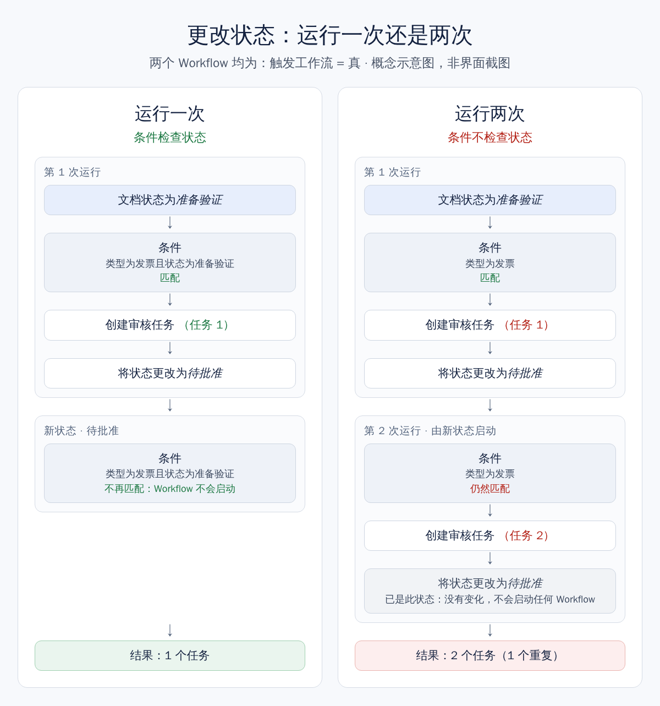

# 更改状态而不重新启动 Workflow

当文档获得新状态时，DocBits 会启动适用于该状态的 Workflow。其中可能包括刚刚更改状态的那个 Workflow。如果它的条件仍然匹配，它会再次运行，并创建第二个任务或第二次导出。

本页介绍如何设置 Workflow，使每个文档只经过它一次。

## 关键设置

[将状态更改为](../cards-overview/then/status/change-status-to.md)卡片用于设置新状态。它的 **触发工作流** 设置决定此次状态更改是否可以启动 Workflow：

* **假：** 不启动任何 Workflow。除非另一个 Workflow 需要继续处理该文档，否则请使用此值。
* **真：** DocBits 会启动条件与文档新状态匹配的 Workflow。其中可能包括执行此更改的 Workflow 本身。

卡片页面介绍了所有状态和卡片版本。

## 状态更改后会启动哪些 Workflow

当 **触发工作流** 设为 **真** 时，DocBits 会检查每个已启用的 Workflow，并核对其中关于文档类型和状态的条件，例如 **文档状态** 卡片。如果文档在新状态下符合条件，该 Workflow 就会启动。

不检查状态的 Workflow 与**所有**状态都匹配。因此，当它自己更改状态时，新状态会再次启动它。

将文档更改为它已有的状态不会产生任何效果：状态保持不变，也不会启动任何 Workflow。

## 示例：运行一次与运行两次

规则：Workflow 完成工作后，它自己的条件必须不再匹配。

<figure><figcaption>
同一个 Workflow，有状态条件和没有状态条件的对比
</figcaption></figure>

在右侧，Workflow 第二次运行，并创建了一个重复任务。它之所以在此停止，只是因为第二次状态更改设置的是文档已有的状态。

**两个 Workflow 可能互相启动。** 如果一个 Workflow 设置 **待批准**，另一个 Workflow 又把文档设回 **准备验证**，并且两者都使用 **真**，它们就会不断互相启动。请为每个 Workflow 添加关于其起始状态的条件，并且只在需要时使用 **真**。

## 逐步设置

1. **使用“将状态更改为”的版本 3。** 旧版本没有 **触发工作流** 设置（请参阅[卡片版本](../cards-overview/then/status/change-status-to.md)）。
2. **检查起始状态。** 添加 **和** 卡片 **文档状态**（位于 **和 → 状态** 下），并将其设为 **是** **准备验证**。请参阅[单个文档状态条件](../cards-overview/and/status/single-document-status-condition.md)。如果仅凭状态无法判断这一步是否已完成，还应检查 Workflow 完成时会填写的某个字段。
3. **添加操作**，例如创建任务或导出文档。
4. **添加“将状态更改为”**，并选择下一个状态，例如 **待批准**。
5. **选择触发工作流的值。** 先使用 **假**。只有当另一个 Workflow 需要在新状态下继续处理时，才选择 **真**。
6. **用真实文档试一试。** 确认只创建了一个任务或一次导出，并且文档已具有新状态。


Workflow 设计器中的测试只模拟状态更改。状态不会被保存，也不会启动其他 Workflow。要查看实际效果，请使用真实文档。


## 内置保护

当 Workflow 一次又一次地互相启动时，DocBits 会限制由此造成的影响：

* **每个文档同一时间只运行一个 Workflow。** 针对同一文档的运行会互相等待，每次运行看到的都是上一次运行结束时的文档状态。
* **运行次数上限。** 默认情况下，同一个 Workflow 在一个文档上最多运行 50 次。之后，DocBits 不再为该文档启动它。

这些限制最终会停止重复，但在此之前可能已经产生了许多任务或导出。真正能防止重复的是状态条件。如果重复会造成实际问题，还应在执行操作前检查是否重复，例如该文档是否已有未完成的任务。

## 相关内容

* [将状态更改为](../cards-overview/then/status/change-status-to.md)：卡片、其状态和版本
* [单个文档状态条件](../cards-overview/and/status/single-document-status-condition.md)：在条件中检查文档状态
* [我的工作流何时运行？](../workflow-execution-model.md)
* [学习路径概览](../workflow-learning-path.md)
