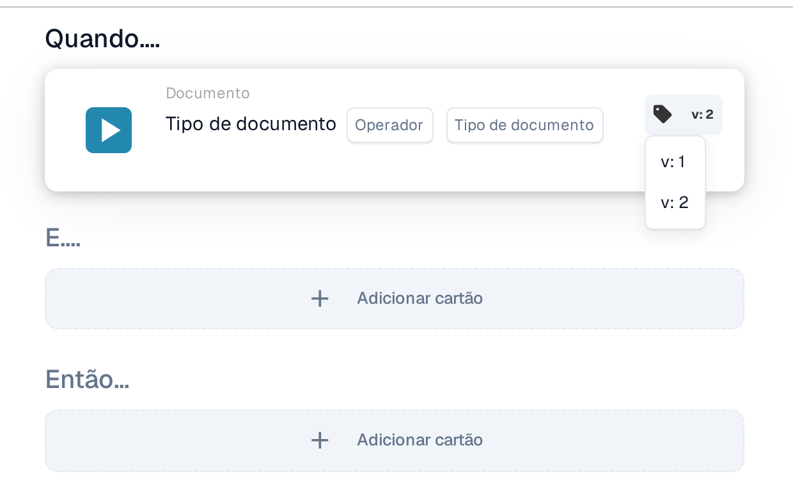

# Versões e histórico dos cartões de fluxo de trabalho

## Princípios de controlo de versões

<figure><figcaption><p>Cartão Tipo de documento com o selo de versão v: 2 e a lista de versões aberta (v: 1, v: 2)</p></figcaption></figure>

No construtor de fluxo de trabalho, cada cartão colocado mostra o número da versão ativa num selo junto ao cartão; na imagem, v: 2. Um clique no selo abre a lista das versões disponíveis desse cartão; na imagem, v: 1 e v: 2. Assim vê qual é a versão ativa antes de alterar uma regra. Como se adiciona um cartão a um fluxo Quando, E e Então e como se guarda o fluxo está descrito em [Fluxo padrão](standard-workflow-builder.md). O que significa a versão de um cartão e quando vale a pena mudá-la está descrito em [Versões e disponibilidade do cartão](cards-overview/card-versions-guide.md).

### Versão 8.5.2024 - Funcionalidades essenciais de versionamento

O Motor de Fluxo de Trabalho DocBits implementa um controlo de versões robusto para todos os cartões de fluxo de trabalho:

1. **Controlo de versões**: Cada cartão pode ter várias versões, representando cada uma um conjunto diferente de condições ou ações. Isto permite-lhe experimentar ou ajustar as regras sem afetar o fluxo de trabalho atualmente ativo.
2. **Atualizações sem interrupções**: Quando precisar de atualizar uma regra ou condição devido a alterações nos seus requisitos de processamento de documentos, pode criar uma nova versão do cartão. Esta abordagem garante que quaisquer modificações são deliberadas e testadas antes de substituírem a versão atual. Minimiza erros e potenciais perturbações no processamento dos seus documentos.
3. **Consistência mantida**: Manter a versão original do cartão inalterada até decidir atualizá-la garante que os processos em curso não são afetados. Pode executar testes e validações na nova versão sem impacto nos dados ou fluxos de trabalho em produção.
4. **Flexibilidade e testes**: As várias versões permitem testar diferentes cenários num ambiente controlado. Pode ver os efeitos de novas regras ou alterações no seu fluxo de trabalho de processamento de documentos sem efetuar alterações permanentes. Assim que estiver satisfeito com os resultados, pode optar por aplicar a nova versão.

---

## Visão geral do versionamento de cartões

### Estatísticas

| Métrica | Valor |
|--------|-------|
| **Cartões com várias versões** | 30+ |
| **Total de registos de versões** | 90+ |
| **Versões ativas atuais** | 81+ |
| **Versões descontinuadas** | 9 |
| **Cartões totalmente desativados** | 2 |
| **Versão mais recente (Máx.)** | 5 (CONDITION_DOC_TO_PO_UNIT_PRICE) |

### Intervalo de versões
- **Mínimo:** v1
- **Máximo:** v5
- **Média de versões por cartão:** 3

---

## Alterações detalhadas das versões dos cartões

### 🔧 ACTION CARDS - Integração e execução externas

#### 1. CALL_API
**Versões:** v1, v2 (Atual: v2)

📖 **Guia:** [Chamar a API DocBits](then/action/call-api-guide.md)

| Versão | Tradução | Estado | Principais alterações |
|---------|-------------|--------|-------------|
| v1 | Não | Ativo | Chamada de API básica sem chaves de tradução |
| v2 | Sim | ✅ Atual | Adicionado `trnsl_%call_api` para suporte multilíngue |

**O que mudou:** Foi adicionado suporte de internacionalização (i18n) com chaves de tradução. A funcionalidade permanece idêntica.

**Antes (v1):**
```
Call Api: [endpoint] with method: [method], params: [params], data: [data]
```

**Depois (v2):**
```
trnsl_%call_api trnsl_be_% Call Api: [endpoint] with method: [method], params: [params], data: [data]
```

**Recomendação:** Utilize v2 para todos os novos fluxos de trabalho (inclui suporte de idiomas)
**Compatibilidade retroativa:** ✅ v1 continua a funcionar

---

#### 2. HTTPS Request (HTTPS_REQUEST)
**Versões:** v1, v2 (Atual: v2)

| Versão | Tradução | Estado | Principais alterações |
|---------|-------------|--------|-------------|
| v1 | Não | Ativo | Pedido HTTP simples |
| v2 | Sim | ✅ Atual | Adicionadas as chaves de tradução `trnsl_%send_https_request` |

**O que mudou:** Foi adicionado suporte de tradução. A funcionalidade essencial de webhook/pedido permanece inalterada.
**Recomendação:** Utilize v2 (suporte multilíngue)

---

#### 3. ACTION_RUN_DOCOPERATOR_SCRIPT ⚠️
**Versões:** v2 (Atual), v3, v4 (Descontinuadas e desativadas)

| Versão | Tradução | Estado | Principais alterações |
|---------|-------------|--------|-------------|
| v2 | Sim | Ativo | Implementação original do DocOperator |
| v3 | Sim | Ativo | Adicionado o parâmetro "Execute the prompt" para controlo adicional |
| v4 | Sim | ❌ OBSOLETA E DESATIVADA | Removido o parâmetro "Execute" (revertido) |

**Trajetória de evolução:** v2 → v3 (parâmetro adicionado) → v4 (revertido - não recomendado)

**O que mudou:**
- v2 → v3: Adicionado o parâmetro opcional de controlo de execução para maior flexibilidade
- v3 → v4: Removido o parâmetro após análise adicional (descontinuado)

**Recomendação:** Utilize v3 para novos fluxos de trabalho (versão ativa mais recente, com todas as funcionalidades)
**Migração:** Se estiver a utilizar v4, mude para v3 ⚠️

---

#### 4. ACTION_TASK_FOR_GROUP
**Versões:** v2, v3 (Descontinuada), v4 (Atual)

📖 **Guia:** [Cartões de atribuição e criação de tarefas](then/task/task-assignment-guide.md)

| Versão | Alterações | Estado | Parâmetro de tipo |
|---------|---------|--------|-----------------|
| v2 | Implementação original | Ativo | "Task" (fixo) |
| v3 | + Suporte de árvore de decisão | ❌ OBSOLETA | "Task" (fixo) |
| v4 | - Árvore de decisão, + Tipo genérico | ✅ Atual | Tipo genérico (flexível) |

**Evolução:** v2 → v3 (experiência com árvore de decisão) → v4 (tipos genéricos, árvore de decisão removida)

**Alteração v2 → v3 (Experiência com árvore de decisão):**
```
Before: "Create a new Task with the title: [param] ... and assign to group [param]"
After:  "Create a new Task with the title: [param] ... and assign to group [param].
         Use decision tree, if available: [param]"
```

**Alteração v3 → v4 (Tipos genéricos + Remoção da árvore de decisão):**
```
Before (v3): "Create a new Task with the title: [param] ... "
After (v4):  "Create a new [param] with the title: [param] ... "
```

**O que mudou:**
- v2 → v3: Adicionado o parâmetro `decision tree, if available: [param]`
- v3 → v4:
  - ❌ Removido o parâmetro de árvore de decisão
  - ✅ Alterado "Task" → `[param]` genérico (suporta Task, Ticket, Issue, etc.)
  - Adicionada a chave de tradução `trnsl_%task_for_group_v4`

**Porquê:** A abordagem de árvore de decisão da v3 era experimental. A v4 proporciona maior flexibilidade com tipos genéricos de item de trabalho.
**Recomendação:** Utilize v4 (atual, mais flexível)

---

#### 5. ACTION_ASSIGN_TASK_TO_PROCUREMENT_GROUP
**Versões:** v2, v3 (Atual)

| Versão | Tipo de tarefa | Estado | Principal diferença |
|---------|-----------|--------|-----------------|
| v2 | "task" (fixo) | Ativo | Versão original |
| v3 | Tipo genérico | ✅ Atual | Alterado para `[param]` flexível |

**O que mudou:** v2 → v3: "Create a new task" → "Create a new [param]" (suporta qualquer tipo de item de trabalho)
**Recomendação:** Utilize v3

---

#### 6. RUN_WORKFLOW
**Versões:** v1, v2 (Atual)

**O que mudou:** v1 → v2: Adicionadas as chaves de tradução `trnsl_%run_workflow`
**Recomendação:** Utilize v2

---

### 📊 CARTÕES DE COMPARAÇÃO E VALIDAÇÃO DE PO

#### 1. CONDITION_DOC_TO_PO_UNIT_PRICE ⭐ (Mais evoluído - 5 versões)
**Versões:** v2, v3, v4, v5 (Atual)

📖 **Guia:** [Cartões correspondentes PO: guia completo](and/compare-with-purchase-order/po-matching-complete-guide.md)

| Versão | Alterações | Estado | Tolerância | Comparação |
|---------|---------|--------|-----------|------------|
| v2 | Comparação de preços básica | Ativo | ❌ Não | Básica |
| v3 | Igual à v2 | Ativo | ❌ Não | Básica |
| v4 | + Parâmetro de modo de comparação | Ativo | ❌ Não | ✅ Sim |
| v5 | + Parâmetros de tolerância | ✅ Atual | ✅ Sim (montante + unidade) | ✅ Sim |

**Trajetória de evolução:** v2 → v3 (sem alteração) → v4 (modos de comparação) → v5 (limiares de tolerância)

**v2 → v3:** Sem alteração funcional (mesma chave de tradução)

**Alteração v3 → v4 (Modo de comparação adicionado):**
```
Before: "[document] unit price is [operator] to purchase order"
After:  "[document] unit price is [operator] to purchase order. Compare as [mode]"
```

**Alteração v4 → v5 (Parâmetros de tolerância adicionados):**
```
Before: "[document] unit price is [operator] to purchase order. Compare as [mode]"
After:  "[document] unit price is [operator] to purchase order, with tolerance of [amount] [unit].
         Compare as [mode]"
```

**O que mudou:**
- **v2 → v3:** Sem alteração funcional
- **v3 → v4:** Adicionado `Compare as [param]` - Suporte para diferentes operadores de comparação
- **v4 → v5:** Adicionados parâmetros de tolerância:
  - `with tolerance of [amount] [unit]`
  - Exemplo: "with tolerance of 2 %" ou "with tolerance of 100 EUR"
  - Suporta: %, EUR, $ e outras moedas

**Casos de utilização:**
- v2/v3: Correspondência estrita (apenas preços exatos)
- v4: Diferentes métodos de comparação
- v5: Aceitação flexível de variações (por exemplo, aceitar diferenças de preço de 2%) ✅ RECOMENDADO

**Recomendação:** Utilize v5 para fluxos de trabalho modernos de correspondência de PO

---

#### 2. CONDITION_OC_TO_PO_ITEMS
**Versões:** v1 (Descontinuada), v2, v3, v4 (Atual)

| Versão | Alterações | Estado | Funcionalidade de comparação |
|---------|---------|--------|-----------------|
| v1 | Sem tradução, sem método | ❌ OBSOLETA | Básica |
| v2 | + Chaves de tradução, + método | Ativo | Método básico |
| v3 | Igual à v2 | Ativo | Método básico |
| v4 | + Parâmetros de modo de comparação | ✅ Atual | ✅ Flexível |

**O que mudou:**
- **v1 → v2:** Adicionado `trnsl_%in_order_confirmations_matches_purchase_order` + parâmetro de método de comparação
- **v2 → v3:** Sem alteração
- **v3 → v4:** Adicionado `Compare as [param1] [param2]` para modos de comparação flexíveis

**Recomendação:** Utilize v4 (evite a v1, que está descontinuada)

---

#### 3. CONDITION_DATES_OPERATOR_OC_LINE_ITEMS
**Versões:** v2, v3 (Atual)

| Versão | Dias de tolerância | Dias de tolerância aceites | Estado |
|---------|-----------------|------------------------|--------|
| v2 | ❌ Não | ❌ Não | Ativo |
| v3 | ✅ Sim | ✅ Sim | ✅ Atual |

**O que mudou:** v2 → v3: Adicionados parâmetros de tolerância:
- `with [param] days as tolerance`
- `and [param] as accepted tolerance days`

**Exemplo:** Aceitar datas de entrega dentro de 5 dias da data prometida
**Recomendação:** Utilize v3

---

#### 4. CONDITION_LESS_THAN_TOLERANCE_AS_VALUE_OF_ORDERED_QUANTITY
**Versões:** v2, v3, v4 (Atual)

| Versão | Modo de comparação | Estado |
|---------|-----------------|--------|
| v2 | Básico | Ativo |
| v3 | Básico (sem alteração) | Ativo |
| v4 | ✅ Seleção de modo flexível | ✅ Atual |

**O que mudou:** v3 → v4: Adicionado `compare [param]` para diferentes abordagens de comparação
**Recomendação:** Utilize v4

---

#### 5. COMBINED_PRICE_OF_QUANTITY_DIFFERENCE_OPERATOR_VALUE
**Versões:** v2, v3, v4 (Atual)

| Versão | Modo de comparação | Estado |
|---------|-----------------|--------|
| v2 | Padrão | Ativo |
| v3 | Padrão (sem alteração) | Ativo |
| v4 | ✅ Flexível | ✅ Atual |

**O que mudou:** v3 → v4: Adicionado o parâmetro `compare [param]`
**Recomendação:** Utilize v4

---

#### 6. CONDITION_CONFIRMED_DELIVERY_ACCEPTED_DATE_IN_CALENDAR_MASTER_DATA
**Versões:** v2, v3 (Atual)

| Versão | Tipo de entrega | Tabela de dados mestre | Estado |
|---------|---------------|-------------------|--------|
| v2 | "Confirmed" (fixo) | Referência fixa | Ativo |
| v3 | [Parâmetro configurável] | [param] dinâmico | ✅ Atual |

**O que mudou:** v2 → v3:
- Alterado "Confirmed delivery" → `[param] delivery` (tipo de entrega flexível)
- Alterada a referência de tabela fixa → `stored in [param]` (seleção dinâmica de tabela)

**Flexibilidade:** A v3 permite diferentes tipos de data de entrega e tabelas de fornecedores
**Recomendação:** Utilize v3

---

#### 7. CONDIITON_UNIT_OF_MEASURE_EQUAL
**Versões:** v2, v3 (Atual)

| Versão | Referência da tabela de fornecedores | Estado |
|---------|--------------------------|--------|
| v2 | "supplier item price table" (fixo) | Ativo |
| v3 | [param dinâmico] | ✅ Atual |

**O que mudou:** v2 → v3: Referência de tabela fixa → `stored in [param]` (permite seleção dinâmica de tabela)
**Recomendação:** Utilize v3

---

### 👥 CARTÕES DE ATRIBUIÇÃO E ENCAMINHAMENTO

#### 1. DOC_USER_ASSIGN
**Versões:** v1, v2, v3 (Descontinuada)

| Versão | Tradução | Árvore de decisão | Estado |
|---------|-------------|---------------|--------|
| v1 | Não | ❌ Não | Ativo |
| v2 | Sim | ❌ Não | ✅ Atual |
| v3 | Sim | ✅ Sim | ❌ Descontinuado |

**Evolução:** v1 (sem i18n) → v2 (com i18n) → v3 (+ experiência de árvore de decisão, agora descontinuada)

**O que mudou:**
- v1 → v2: Adicionadas chaves de tradução
- v2 → v3: Adicionado suporte de árvore de decisão (experimental, descontinuado)

**Recomendação:** Utilize v2 (estável, com suporte de i18n)

---

#### 2. DOC_GROUP_ASSIGN
**Versões:** v2, v3 (Descontinuada)

| Versão | Árvore de decisão | Estado |
|---------|---------------|--------|
| v2 | ❌ Não | ✅ Atual |
| v3 | ✅ Sim | ❌ Descontinuado |

**O que mudou:** v2 → v3: Adicionado `Use decision tree, if available [param]` (mais tarde descontinuado)
**Recomendação:** Utilize v2

---

#### 3. OC_ASSIGN_DOC
**Versões:** v1, v2 (Atual)

**O que mudou:** v1 → v2: Adicionadas as chaves de tradução `trnsl_%oc_assign_doc`
**Recomendação:** Utilize v2

---

### 📋 CARTÕES DE GESTÃO DE TAREFAS

#### 1. tasks_create ⭐ (Cartão de tarefa mais evoluído - 4 versões)
**Versões:** v1 (Descontinuada), v2 (Descontinuada), v3 (Descontinuada), v4 (Atual)

📖 **Guia:** [Cartões de atribuição e criação de tarefas](then/task/task-assignment-guide.md)

| Versão | Tradução | Árvore de decisão | Tipo de item de trabalho | Estado |
|---------|-------------|---------------|-----------------|--------|
| v1 | Não | Não | "Task" (fixo) | ❌ OBSOLETA |
| v2 | Sim | Não | "Task" (fixo) | ❌ OBSOLETA |
| v3 | Sim | Sim | "Task" (fixo) | ❌ Descontinuado |
| v4 | Sim | Não | [param genérico] | ✅ Atual |

**Cronologia de evolução:**
```
v1 (original)
  ↓ (add translation)
v2 (with i18n)
  ↓ (experiment with decision tree)
v3 (+ decision tree, BUT deprecated after this)
  ↓ (remove decision tree, add generic types)
v4 (CURRENT - flexible work items)
```

**Alteração v1 → v2 (Chaves de tradução adicionadas):**
```
Before: "Create a new Task with the title: [param] ... and assign to user [param]"
After:  "trnsl_%tasks_create trnsl_be_% Create a new Task with the title: [param] ... and assign to user [param]"
```

**Alteração v2 → v3 (Experiência com árvore de decisão):**
```
Before: "Create a new Task with the title: [param] ... and assign to user [param]"
After:  "Create a new Task with the title: [param] ... and assign it to the user [param].
         Use decision tree, if available: [param]"
```

**Alteração v3 → v4 (Tipos genéricos + Remoção da árvore de decisão):**
```
Before: "Create a new Task with the title: [param] ... "
After:  "Create a new [param] with the title: [param] ... "
```

**O que mudou:**
- **v1 → v2:** Adicionadas as chaves de tradução `trnsl_%tasks_create`
- **v2 → v3:**
  - Adicionado suporte de árvore de decisão: `Use decision tree, if available: [param]`
  - Alterado "assign to user" → "assign it to the user"
- **v3 → v4:**
  - ❌ Removido o parâmetro de árvore de decisão
  - ✅ Alterado "Task" → `[param]` genérico (suporta Task, Ticket, Issue, etc.)
  - Atualizada a chave de tradução para `trnsl_%tasks_create_v4`

**Nota sobre a árvore de decisão:** A v3 utilizava árvores de decisão para atribuir tarefas dinamicamente. Esta abordagem era experimental e foi descontinuada na v4 a favor da seleção direta do tipo de item de trabalho baseada em parâmetros.

**Recomendação:** Utilize exclusivamente a v4 para novos fluxos de trabalho
**Migração:** Se estiver a utilizar v1, v2 ou v3, atualize para v4 ✅

---

#### 2. OC_TASK
**Versões:** v1, v2 (Atual)

**O que mudou:** v1 → v2: Adicionadas as chaves de tradução `trnsl_%oc_task`
**Recomendação:** Utilize v2

---

#### 3. ACTION_ASSIGN_TASK_TO_USER_FROM_FIELD_WITH_FALLBACK
**Versões:** v1, v3 (Atual - v2 ignorada)

| Versão | Tipo de item de trabalho | Estado |
|---------|-----------------|--------|
| v1 | "Task" (fixo) | Ativo |
| v3 | [param genérico] | ✅ Atual |

**O que mudou:** v1 → v3: Evolução para tipo genérico (a v2 foi ignorada em produção)
**Recomendação:** Utilize v3

---

#### 4. ACTION_DECISION_TREE_CREATE_TASKS
**Versões:** v2, v3 (Atual)

| Versão | Texto de atribuição | Estado |
|---------|-----------------|--------|
| v2 | "Assign task with title" | Ativo |
| v3 | "Assign [generic] with title" | ✅ Atual |

**O que mudou:** v2 → v3:
- Alterado "Assign task" → "Assign [generic param]"
- Alterado "return of decision" → "return of decision table" (terminologia mais clara)

**Recomendação:** Utilize v3

---

### 🔄 CARTÕES DE CONTROLO DE DOCUMENTOS

#### APPROVE
**Versões:** v1, v2 (Atual)
**Alteração:** Adicionadas as chaves de tradução `trnsl_%approve_doc`
**Recomendação:** Utilize v2

---

#### REJECT
**Versões:** v1, v2 (Atual)
**Alteração:** Adicionadas as chaves de tradução `trnsl_%reject_doc`
**Recomendação:** Utilize v2

---

#### STAUS_CHANGE (Alteração de estado)
**Versões:** v1, v2, v3 (Atual)

| Versão | Acionar fluxo de trabalho | Estado |
|---------|-----------------|--------|
| v1 | ❌ Não | Ativo |
| v2 | ❌ Não | Ativo |
| v3 | ✅ Sim | ✅ Atual |

**O que mudou:** v2 → v3: Adicionado `trigger Workflows [param]` - Aciona automaticamente fluxos de trabalho na mudança de estado
**Recomendação:** Utilize v3

---

#### EXPORT
**Versões:** v1, v2, v3 (Atual)

| Versão | Validação | Estado |
|---------|------------|--------|
| v1 | ❌ Não | Ativo |
| v2 | ❌ Não | Ativo |
| v3 | ✅ Sim | ✅ Atual |

**O que mudou:** v2 → v3: Adicionado `Start Export with Validation: [param]`
**Recomendação:** Utilize v3

---

### 🧮 CARTÕES DE MANIPULAÇÃO DE DADOS

#### CALC_COLUMNS, CALC_COLUMNS_REGEX, EDIT_COLUMN, AI_CALC_MTZ_ETZ
**Padrão:** v1 → v2 (chaves de tradução adicionadas)
**Recomendação:** Utilize v2 para todos

---

#### CONDITION_DECISION_TREE_DATA
**Versões:** v2, v3 (Atual)

| Versão | Utilização de dados | Estado |
|---------|------------|--------|
| v2 | "Use return data in later cards" | Ativo |
| v3 | "[Explicit param] returned data for use in subsequent cards" | ✅ Atual |

**O que mudou:** v2 → v3: Controlo mais explícito sobre a extração de dados da árvore de decisão
**Recomendação:** Utilize v3

---

### ❌ CARTÕES DESATIVADOS (Não utilizar)

#### DOC_SUBORG_CHANGE
**Versões:** v1, v2 (ambas desativadas)
**Estado:** Já não é suportado
**Alternativa:** Utilize as funcionalidades de atribuição de documentos

---

#### RUN_SCRIPT
**Versões:** v2, v3 (ambas desativadas)
**Estado:** Substituído por ACTION_RUN_DOCOPERATOR_SCRIPT
**Alternativa:** Utilize ACTION_RUN_DOCOPERATOR_SCRIPT v3

---

## 🎯 Padrões comuns de versões

### Padrão 1: Adoção de chaves de tradução (v1 → v2)
**Afetados:** 15+ cartões

**Alteração:** Adicionadas as chaves de tradução `trnsl_%[card_name]`
```
v1: Plain text (no i18n)
v2: trnsl_%[key] trnsl_be_% Plain text (with i18n)
```

**Cartões:** CALL_API, RUN_WORKFLOW, APPROVE, REJECT, CALC_COLUMNS e outros
**Impacto:** Permite o suporte multilíngue

---

### Padrão 2: Integração de árvore de decisão (v2 → v3) - DESCONTINUADO
**Afetados:** 5 cartões (ACTION_TASK_FOR_GROUP, tasks_create, DOC_USER_ASSIGN, DOC_GROUP_ASSIGN, ACTION_DECISION_TREE_CREATE_TASKS)

**Alteração:** Adicionado o parâmetro opcional de árvore de decisão
```
v2: Standard task/assignment logic
v3: + "Use decision tree, if available: [param]"
```

**Estado:** ❌ Maioritariamente descontinuado (exceto ACTION_DECISION_TREE_CREATE_TASKS)
**Motivo:** Prefere-se a abordagem mais simples baseada em parâmetros diretos

---

### Padrão 3: Evolução para tipo genérico (v3 → v4)
**Afetados:** 4 cartões (tasks_create, ACTION_TASK_FOR_GROUP, ACTION_ASSIGN_TASK_TO_PROCUREMENT_GROUP, ACTION_ASSIGN_TASK_TO_USER_FROM_FIELD_WITH_FALLBACK)

**Alteração:** "Task" → parâmetro de tipo genérico
```
v3: Create a new Task with title: [param]
v4: Create a new [param] with title: [param]
```

**Impacto:** Suporta Task, Ticket, Issue e outros tipos de item de trabalho
**Benefício:** Maior flexibilidade e reutilização

---

### Padrão 4: Parâmetros de tolerância (Cartões de PO)
**Afetados:** 6 cartões (CONDITION_DOC_TO_PO_UNIT_PRICE, CONDITION_DATES_OPERATOR_OC_LINE_ITEMS, CONDITION_LESS_THAN_TOLERANCE_AS_VALUE_OF_ORDERED_QUANTITY, etc.)

**Alteração:** Adicionado suporte de tolerância/variação
```
v2: Value [operator] Reference Value
v3+: Value [operator] Reference with tolerance [amount] [unit]
```

**Exemplos:**
- "with tolerance of 2 %"
- "with tolerance of 100 EUR"
- "with 5 days as tolerance"

**Impacto:** Critérios de correspondência realistas (nem todos os valores têm de coincidir exatamente)

---

### Padrão 5: Parâmetros de modo de comparação
**Afetados:** 3 cartões (COMBINED_PRICE_OF_QUANTITY_DIFFERENCE_OPERATOR_VALUE, CONDITION_OC_TO_PO_ITEMS, CONDITION_LESS_THAN_TOLERANCE_AS_VALUE_OF_ORDERED_QUANTITY)

**Alteração:** Adicionada a seleção flexível do método de comparação
```
v3: Standard comparison
v4: + "Compare as [param1] [param2]"
```

**Impacto:** Suporta diferentes algoritmos de comparação

---

## ✅ Recomendações de versão

### Para novos fluxos de trabalho
**Regra:** Utilize sempre o número de versão ativada mais elevado
- Disponibiliza as funcionalidades mais recentes
- Melhor suporte
- Mais testada
- Abordagem recomendada

### Para fluxos de trabalho existentes
**Abordagem segura:**
- Continue a utilizar a versão atual se funcionar
- Planeie uma migração gradual para versões mais recentes
- Teste primeiro as atualizações em sandbox

### Prioridade de migração

| Prioridade | Cartões | Ação |
|----------|-------|--------|
| **Alta** | tasks_create v1/v2/v3, ACTION_TASK_FOR_GROUP v3, CONDITION_DOC_TO_PO_UNIT_PRICE v2/v3/v4 | Atualizar para a versão atual |
| **Média** | Outras atualizações de tradução v1/v2, cartões de PO v2/v3 | Considerar atualizar |
| **Baixa** | Cartões sem alterações funcionais | Opcional |

---

## ⚠️ Versões descontinuadas - Não utilizar

| Cartão | Versão | Motivo | Utilizar em alternativa |
|------|---------|--------|-------------|
| tasks_create | v1, v2, v3 | Muito antiga, ou árvore de decisão descontinuada | v4 |
| ACTION_TASK_FOR_GROUP | v3 | Abordagem de árvore de decisão descontinuada | v4 |
| DOC_USER_ASSIGN | v3 | Abordagem de árvore de decisão descontinuada | v2 |
| DOC_GROUP_ASSIGN | v3 | Abordagem de árvore de decisão descontinuada | v2 |
| CONDITION_DOC_TYPE_IS_ISNOT | v1 | Muito antiga | v2 |
| CONDITION_OC_TO_PO_ITEMS | v1 | Muito antiga | v4 |
| ACTION_RUN_DOCOPERATOR_SCRIPT | v4 | Funcionalidades revertidas | v3 |

---

## 🔄 Cartões totalmente desativados - Não podem ser utilizados

| Cartão | Versões | Motivo | Alternativa |
|------|----------|--------|-------------|
| DOC_SUBORG_CHANGE | v1, v2 | Já não é suportado | Cartões de atribuição de documentos |
| RUN_SCRIPT | v2, v3 | Substituído pelo DocOperator | ACTION_RUN_DOCOPERATOR_SCRIPT v3 |

---

## Documentação relacionada

- 📖 [Comparações de PO: direção, tolerância e versões de cartão](cards-overview/po-comparison-versions-guide.md) - Direções de comparação, tolerâncias e versões dos cartões
- 📚 [Fluxos de trabalho](README.md) - Utilização dos cartões passo a passo
- 🔄 [Visão geral do versionamento de cartões](#visao-geral-do-versionamento-de-cartoes) - Resumo nesta página
- 📋 [Registos do Fluxo de Trabalho](workflow-logs.md) - Execução e depuração

---

**Última atualização:** 23 de outubro de 2025
**Estado:** Histórico completo de versões
**Fonte da base de dados:** postgres-dev-docflow
