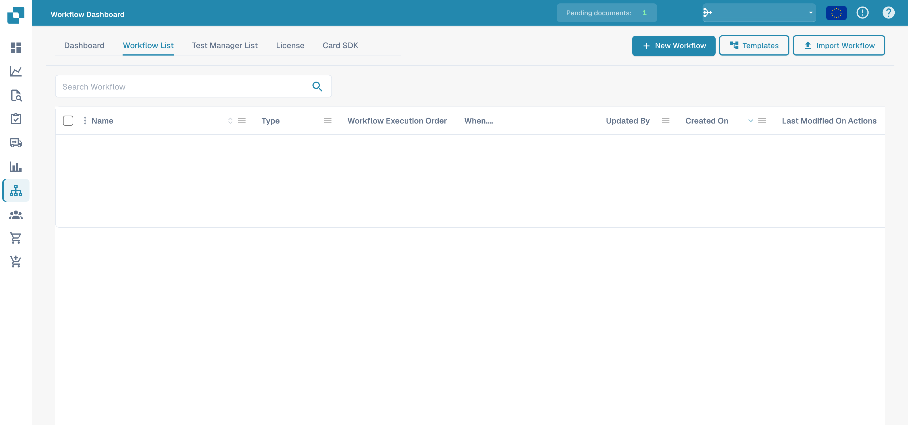
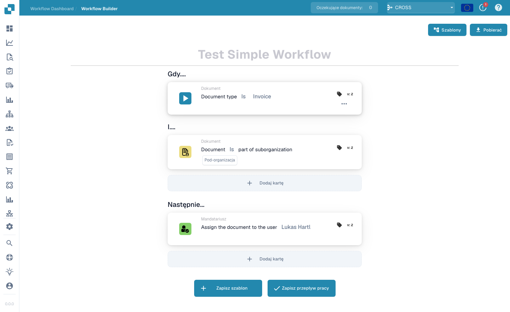
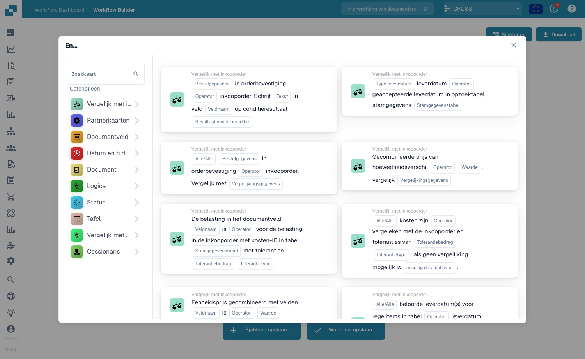
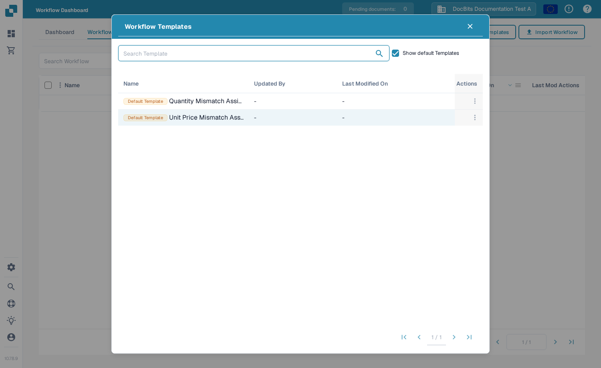

# 标准工作流

**Standard Workflow** 构建器是用于自动化文档处理的线性卡片式编辑器。一个 Workflow 由三组卡片组成——**When**（触发器）、**And**（附加条件）和 **Then**（要执行的操作）。当文档满足 When/And 条件时，Then 操作会自动运行。

## 创建并测试 Standard Workflow 



**视频：** 构建 Standard Workflow · 1:09 · [字幕（WebVTT）](https://docbits-videos.fra1.cdn.digitaloceanspaces.com/settings-assistant/workflow-standard/v1/en.vtt)

文字稿（英文）

**New Workflow, Standard** · [0:00](https://docbits-videos.fra1.cdn.digitaloceanspaces.com/settings-assistant/workflow-standard/v1/en.mp4#t=0.25)

A Standard workflow is the simple way to automate a document. Click New Workflow and choose Standard.

**One When card starts it** · [0:10](https://docbits-videos.fra1.cdn.digitaloceanspaces.com/settings-assistant/workflow-standard/v1/en.mp4#t=10.65)

Give the workflow a name. Every Standard workflow has exactly one When card: it decides when the workflow starts. Here: when the document type is Invoice.

**And cards: all must succeed** · [0:25](https://docbits-videos.fra1.cdn.digitaloceanspaces.com/settings-assistant/workflow-standard/v1/en.mp4#t=25.116)

And cards filter further. Add as many as you need, or none: all of them must succeed, otherwise the workflow stops here.

**Then cards act, in order** · [0:35](https://docbits-videos.fra1.cdn.digitaloceanspaces.com/settings-assistant/workflow-standard/v1/en.mp4#t=35.516)

Then cards do the work, one after the other. Here the invoice is assigned to a user. Save it with Save Workflow, not Save Template. A saved workflow is active right away.

**Limits of Standard workflows** · [0:49](https://docbits-videos.fra1.cdn.digitaloceanspaces.com/settings-assistant/workflow-standard/v1/en.mp4#t=49.816)

Standard workflows are kept simple. They have one When card, the And cards must all succeed, and there are no other paths: if a condition fails, the workflow just stops. Cards are tested one at a time. For branches, error handling, variables or notes, use an Advanced workflow.



**视频：** 在 Standard Workflow 中测试卡片 · 0:51 · [字幕（WebVTT）](https://docbits-videos.fra1.cdn.digitaloceanspaces.com/settings-assistant/workflow-standard-test/v1/en.vtt)

文字稿（英文）

**Test Card: one card at a time** · [0:00](https://docbits-videos.fra1.cdn.digitaloceanspaces.com/settings-assistant/workflow-standard-test/v1/en.mp4#t=0.25)

In a Standard workflow, you test one card at a time. Open the menu of a card, here the And card, and choose Test Card. Search for a document to test it on.

**The result and the card logs** · [0:13](https://docbits-videos.fra1.cdn.digitaloceanspaces.com/settings-assistant/workflow-standard-test/v1/en.mp4#t=13.35)

Click Test on Document. The invoice is ready for validation, not pending approval, so the condition fails. The card logs say why.

**Testing an action changes nothing** · [0:24](https://docbits-videos.fra1.cdn.digitaloceanspaces.com/settings-assistant/workflow-standard-test/v1/en.mp4#t=24.183)

Actions can be tested too. The result shows what the card would do, but the document is not changed.

**One card, current settings, no changes** · [0:35](https://docbits-videos.fra1.cdn.digitaloceanspaces.com/settings-assistant/workflow-standard-test/v1/en.mp4#t=35.516)

Test Card uses the settings on the screen, even before you save. It tests one card, not the whole workflow, so it does not show whether the next card would run. To test a whole flow at once, use an Advanced workflow.

在真实的 DocBits 界面中创建一个完整的 Standard Workflow：匹配发票、检查其编号以及高于 1000 的金额、分配审核人并更改状态。保存该规则，运行三个测试场景，并确认文档的实际结果。



[通过字幕观看](https://docbits-videos.fra1.cdn.digitaloceanspaces.com/settings-assistant/standard-workflow-admin/v2/en.html) · [打开视频](https://docbits-videos.fra1.cdn.digitaloceanspaces.com/settings-assistant/standard-workflow-admin/v2/en.mp4) · [字幕（WebVTT）](https://docbits-videos.fra1.cdn.digitaloceanspaces.com/settings-assistant/standard-workflow-admin/v2/en.vtt) · [转录文本](https://docbits-videos.fra1.cdn.digitaloceanspaces.com/settings-assistant/standard-workflow-admin/v2/en.txt) · 4:24

章节与转录文本

| 章节 | 开始 |
| --- | --- |
| 此 Workflow 的作用 | [0:00](https://docbits-videos.fra1.cdn.digitaloceanspaces.com/settings-assistant/standard-workflow-admin/v2/en.mp4#t=0.000) |
| 命名 Workflow | [0:17](https://docbits-videos.fra1.cdn.digitaloceanspaces.com/settings-assistant/standard-workflow-admin/v2/en.mp4#t=17.000) |
| When：文档类型 | [0:29](https://docbits-videos.fra1.cdn.digitaloceanspaces.com/settings-assistant/standard-workflow-admin/v2/en.mp4#t=29.583) |
| And：发票编号 | [0:44](https://docbits-videos.fra1.cdn.digitaloceanspaces.com/settings-assistant/standard-workflow-admin/v2/en.mp4#t=44.167) |
| And：金额高于 1000 | [0:59](https://docbits-videos.fra1.cdn.digitaloceanspaces.com/settings-assistant/standard-workflow-admin/v2/en.mp4#t=59.875) |
| Then：分配审核人 | [1:17](https://docbits-videos.fra1.cdn.digitaloceanspaces.com/settings-assistant/standard-workflow-admin/v2/en.mp4#t=77.458) |
| Then：更改状态 | [1:33](https://docbits-videos.fra1.cdn.digitaloceanspaces.com/settings-assistant/standard-workflow-admin/v2/en.mp4#t=93.625) |
| 检查并保存 | [1:48](https://docbits-videos.fra1.cdn.digitaloceanspaces.com/settings-assistant/standard-workflow-admin/v2/en.mp4#t=108.167) |
| 检查已保存的规则 | [2:06](https://docbits-videos.fra1.cdn.digitaloceanspaces.com/settings-assistant/standard-workflow-admin/v2/en.mp4#t=126.708) |
| 准备测试场景 | [2:21](https://docbits-videos.fra1.cdn.digitaloceanspaces.com/settings-assistant/standard-workflow-admin/v2/en.mp4#t=141.542) |
| 运行正向测试 | [2:45](https://docbits-videos.fra1.cdn.digitaloceanspaces.com/settings-assistant/standard-workflow-admin/v2/en.mp4#t=165.042) |
| 测试边界值 | [3:07](https://docbits-videos.fra1.cdn.digitaloceanspaces.com/settings-assistant/standard-workflow-admin/v2/en.mp4#t=187.083) |
| 测试另一个发票编号 | [3:26](https://docbits-videos.fra1.cdn.digitaloceanspaces.com/settings-assistant/standard-workflow-admin/v2/en.mp4#t=206.083) |
| 检查文档结果 | [3:46](https://docbits-videos.fra1.cdn.digitaloceanspaces.com/settings-assistant/standard-workflow-admin/v2/en.mp4#t=226.375) |
| 启用已测试的规则 | [4:06](https://docbits-videos.fra1.cdn.digitaloceanspaces.com/settings-assistant/standard-workflow-admin/v2/en.mp4#t=246.833) |

**此 Workflow 的作用**

好的，我要为一张培训用的发票构建一个完整的 Standard Workflow。金额高于一千时，它应交给审核人并等待审批。我使用一个专用的发票编号，这样该示例就不会选中其他文档。

**命名 Workflow**

在 Workflow List 中，我点击 New Workflow。在添加卡片之前，我先给这个 Workflow 起一个清晰的名称。该组织会直接打开 Standard 构建器。

**When：文档类型**

在 When 下，我打开卡片库并选择文档类型卡片。我将运算符设置为 Is，并选择 Invoice。这定义了该规则所检查的文档类型。

**And：发票编号**

在 And 下，我添加一个文档字段条件。我选择 invoice_id，选择 Equals，并输入我们的培训发票编号。这个额外条件使演示只限于预期的那张发票。

**And：金额高于 1000**

我为 total_amount 添加另一个 And 条件。我选择 Greater Than，并输入一千。恰好等于一千不满足此条件。我使用与培训文档相匹配的金额和货币。

**Then：分配审核人**

在 Then 下，我选择 Assign document to User。我选择 Docs User A2，即我们的文档测试审核人。此操作会分配文档，但不会创建电子邮件通知。

**Then：更改状态**

我添加第二个操作，将状态更改为 Pending Approval。我将 Trigger Workflows 设置为 false。当自身操作更改状态时，此示例不需要再运行另一个 Workflow。

**检查并保存**

保存之前，我再次通读整条规则。发票、确切的培训编号以及高于一千的金额必须同时匹配。之后，两个操作会按显示的顺序运行。我点击 Save Workflow 并检查确认信息。

**检查已保存的规则**

回到列表后，我确认已保存的 Workflow 存在，并检查其激活状态。保存操作本身就可能已启用某个 Workflow。在准备测试期间，我停用这条培训规则。

**准备测试场景**

在 Test Manager 中，我添加一个场景并选择我们已保存的 Workflow。我输入一个清晰的场景名称，并上传输入 JSON 文件和预期结果 JSON 文件。输入内容包含我们的发票编号、金额一千七百八十五和 Ready for validation。预期的状态是 Pending Approval。

**运行正向测试**

我发送该场景，然后从其菜单中选择 Run Test。我重新打开列表以加载已保存的结果。Pass 会检查预期的文档状态。此沙箱的卡片详情面板无法可靠地显示各条单独的消息，因此我还会核对实际文档。

**测试边界值**

接下来我测试恰好一千的情况。发票编号和文档类型仍然匹配，但 Greater Than 必须为假。在此测试数据中，预期状态保持为 Ready for validation。我保存并运行这个单独的场景，然后检查其结果。

**测试另一个发票编号**

我再添加一个场景，使用不同的发票编号和高于一千的金额。仅凭金额不应触发这些操作。我保存并运行该场景，并将原始状态作为其预期结果。这些反向用例用于检查规则的边界。

**检查文档结果**

在 Dashboard 上，我找到我们的培训文档。它的实际状态是 Pending Approval，并且已分配给 Docs User A2。这证实了两个操作可见的结果。此更改是由手动测试引起的；它并不能证明自动处理正常。

**启用已测试的规则**

回到 Workflow List，我启用已测试的规则并检查其开关已打开。启用应出现在检查条件、接收人和测试结果之后。在演示该控件之后，我再次关闭这条培训规则。

## 如何访问

打开 **Workflow Dashboard → Workflow List**，然后点击 **New Workflow** 创建新的 Standard Workflow，或点击现有的 Workflow 进行编辑。

<figure><figcaption>
Workflow 列表和导入操作。
</figcaption></figure>

## When / And / Then 模型

<figure><figcaption>
Standard Workflow 画布。此示例对子组织中的发票触发，并将它们分配给某个用户。
</figcaption></figure>

* **When** — 启动 Workflow 的触发器（例如 _Document type is Invoice_）。
* **And** — 还必须为真的附加条件（例如 _Document is part of sub-organization_）。留空则该 Workflow 在 When 卡片每次匹配时运行。
* **Then** — 要执行的操作（例如 _将文档分配给该用户_、创建任务、调用 API、发送电子邮件）。

## 添加卡片

在任意分组中点击 **Add Card** 打开卡片库。卡片按类别组织，便于你找到所需的构建块：

<figure><figcaption>
<strong>Add Card</strong> 库——条件卡片、比较卡片、操作卡片等，按类别分组。
</figcaption></figure>

使用 **Save Workflow** 保存，或使用 **Save Template** 将布局保存为可复用的模板。

## Workflow Templates

Workflow 工具栏中的 **Templates** 按钮会打开 **Workflow Templates** 库，你可以在其中管理组织内已保存的模板：

<figure><figcaption>
<strong>Workflow Templates</strong> 对话框——已保存的模板，以及在启用 <strong>Show default Templates</strong> 时显示的内置默认模板。
</figcaption></figure>

* 列表会显示每个模板的 **Name**、**Updated By** 和 **Last Modified On**。
* 打开 **Show default Templates**，可将内置默认模板包含在列表中。
* 使用该行的 **Actions** 菜单可 **Duplicate** 模板，或 **Delete** 已保存的模板——内置默认模板无法删除。
* 点击某个模板行，可在 **Template Designer** 中打开它；它使用与 Standard Workflow 设计器相同的 When/And/Then 画布。使用 **Save Template** 保存你的更改。
* 要从模板开始新建 Workflow，请在设计器中打开该模板，调整卡片，然后使用 **Save Workflow** 将其保存为 Workflow。

## 后续步骤

* 在 **Cards** 章节中查看每张卡片的作用。
* 使用 **Workflow Pattern Guides** 将卡片组合成经过验证的解决方案。
* 对于包含并行路径（Wait ALL / Wait ANY / OR）的分支流程，请使用 **Advanced Workflow** 构建器。
