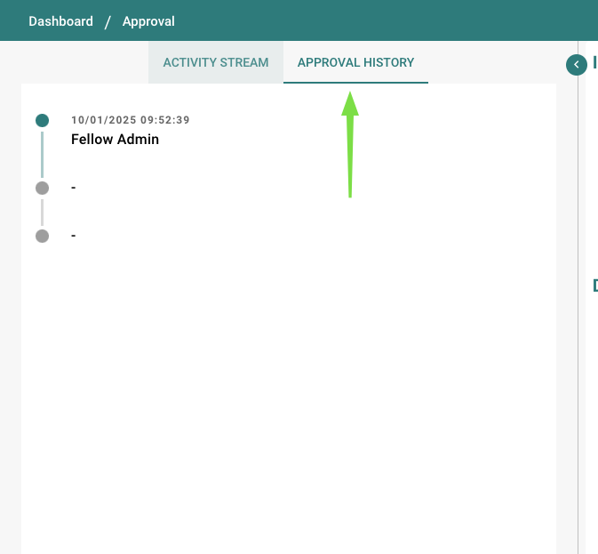
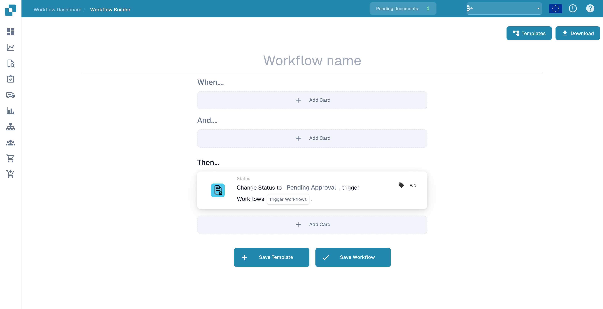
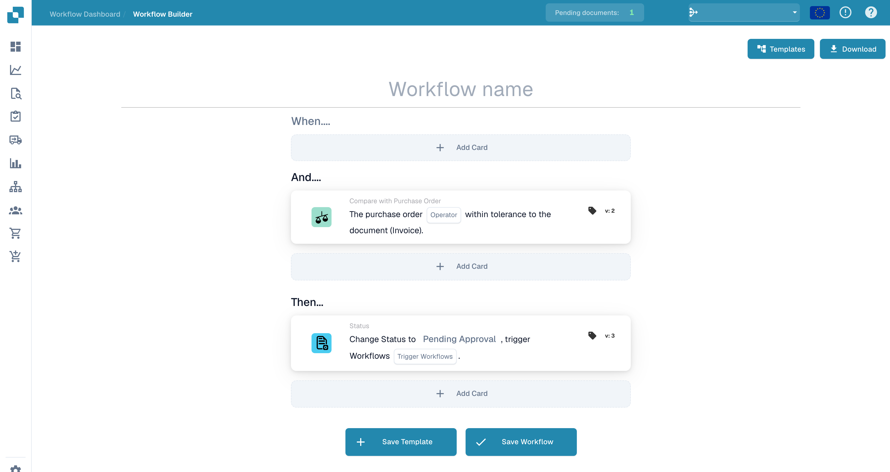
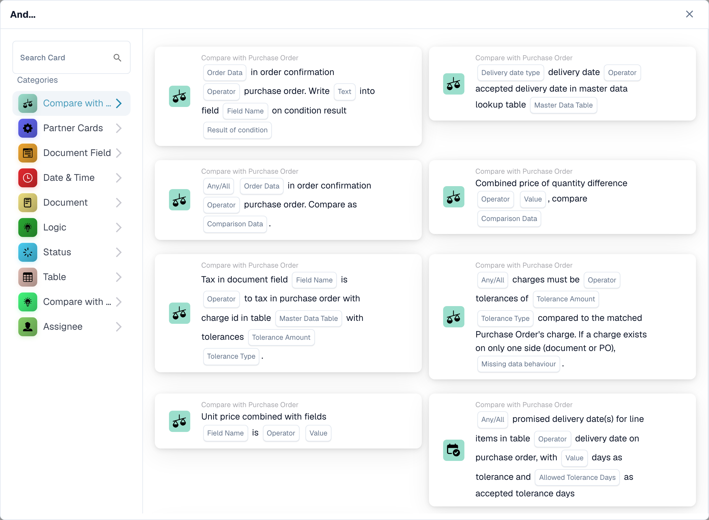
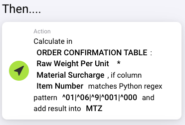
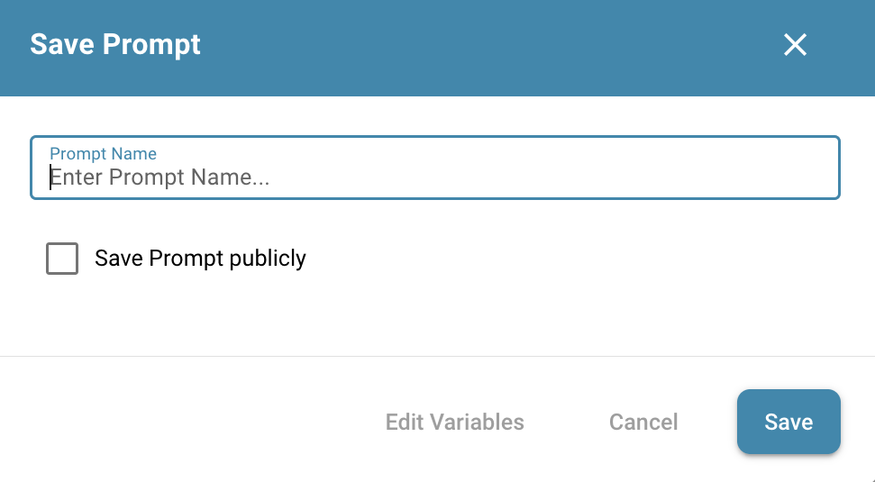

# 分配与状态 — 示例

为了便于总览，您可以为各个 Workflow 设置不同的标题，这样就能立即看出该 Workflow 涉及哪项任务。

创建新的 Workflow：点击 + ADD WORKFLOW

.png>)

您可以使用这些 Workflow（Test 1,2,3）将各类文档自动分配给公司中对应的员工。

.png>)

如果某张发票或其他文档的总额超过需要事先审核与批准的特定金额，这些文档可以立即分配给正确的人员。

<figure><figcaption></figcaption></figure>

**Test 1: Logic Card**

When: **Assignee is:** Intake reviewer

And: **Document type is:** Invoice

Then: **Assign document to:** Invoice reviewer

.png>)

**Test 2: Logic Card**

When: **Assignee is:** Intake reviewer

And: **Document type is:** Delivery Note

Then: **Assign document to:** Delivery-note reviewer

.png>)

**Test 3: Logic Card**

**When:** **Assignee is:** Intake reviewer

**And:** **Document type is:** Order Confirmation

**Then:** **Assign document to:** Order reviewer

.png>)

如果文档不是分配给单个人员，也可以从一开始就将其分配给特定的员工。

<figure><figcaption></figcaption></figure>

为了更清晰地了解文档应如何处理，您可以在此 Workflow 中为传入的文档设置状态。通过该 Workflow，可以立即看出是否存在例如待处理的审批。

**Test 4: Logic Card**

**When:** **Document type is:** Delivery Note

**And:** **Assignee is:** Intake reviewer

**Then:** **Change Status to:** Pending Approval

<figure><figcaption>
未保存的 Workflow 草稿，用于更改文档状态。
</figcaption></figure>

.png>)

**Test 5: Logic Card**

When: **Document type is:** Invoice

And: **Assignee is:** Invoice reviewer

Then: **Change Status to:** Pending Second Approval

<figure><figcaption></figcaption></figure>

.png>)

如果某张发票或其他文档的总额超过需要事先审核与批准的特定金额，这些文档可以立即分配给正确的人员。

.png>)

**Test 6: Logic Card**

When: **Assignee is:** Intake reviewer

And: Docfield **total\_amount** is **Greater than 500**

Then: **Assign document to:** Approval owner

<figure><figcaption></figcaption></figure>

.png>)

也可以将状态写入 Workflow，这样被分配的人员就能立即看到该文档处于什么状态，以及接下来应如何处理。

**Test 7: Logic Card**

**When:** **Assignee is:** Intake reviewer

**And:** Docfield **total\_amount** is **Greater then 500**

**Then:** **Assign document to:** Approval owner

**Change Status to:** Pending Approval

<figure><figcaption>
未保存的 Workflow 草稿中的状态更改操作。
</figcaption></figure>

<figure><figcaption></figcaption></figure>

例如，如果文档缺少某些信息或重要信息，而这些信息对后续处理很重要且必须包含，您可以设置 Workflow，使这些文档立即转发给采购员和一名替补人员（替代者）。

<figure><figcaption></figcaption></figure>

**Test 9:**

由这些逻辑卡片构成的 Workflow 用于自动检查订单确认中注明的数量、单价或折扣是否与采购订单中的相应数值一致。该检查确保订购内容与供应商确认交付的内容之间保持一致与准确。

您可以为这些文档设置特定状态，或将它们分配给特定的员工。

<figure><figcaption>
未保存的 Workflow 草稿，包含采购订单比较条件。
</figcaption></figure>

<figure><figcaption>
英文 Workflow 选择器中的采购订单比较卡片。
</figcaption></figure>

**Logic Card: Quantity or Unit Price or Discount Match**

该逻辑卡片用于自动检查订单确认中注明的数量、单价或折扣是否与采购订单中的相应数值一致。该检查确保订购内容与供应商确认交付的内容之间保持一致与准确。

**Trigger Condition**

当订单确认中相对于原始采购订单满足以下任一条件时，该逻辑会被激活：

* **Quantity**：订购的物料数量与供应商确认的数量一致。
* **Unit Price**：约定的每件物料价格与供应商的确认一致。
* **Discount**：所适用的折扣在采购订单与订单确认之间保持一致。
* **Define Comparison Parameters**：设置逻辑卡片要检查是否匹配的具体字段（数量、单价、折扣）。
* **Automate Verification**：将系统配置为在收到订单确认时自动比较这些细节。
* **Customize Alerts**：确定处理差异的 Workflow，包括为人工审核自定义提醒。

该逻辑卡片对于确保订单确认的细节与原始采购订单一致、保障采购流程的完整性至关重要。

**Test 10:**

如果您对附加费采用不同的计算方式，或只有部分物料带有附加费，可以使用通用的表格计算卡片，其中一些还支持使用正则表达式进行筛选。

<figure><figcaption></figcaption></figure>

上方是一个 MTZ 的计算示例，其中筛选物料编号以 01、06、9、001 或 000 开头。

采用手动设置时，建议将会依赖新列的计算拆分到单独的 Workflow 中。要继续进行计算，可以使用 Run Workflow 卡片。

**Run Workflow**

<figure><figcaption></figcaption></figure>

使用此卡片，您可以指定一个 Workflow 的名称，当条件满足时，该 Workflow 会在当前 Workflow 之后、且在当前 Workflow 前面的 then 卡片之后运行。它优先运行可运行且已激活的 Workflow，同时也允许您在文档满足条件时运行已停用的 Workflow。

### **将计算出的附加费添加到现有列中** 

如果您想将所有附加费作为负折扣添加到折扣列中，可以使用计算卡片。该列中可能已有条目：您可以将其设置为卡片上的变量之一，从中减去 MTZ，再将结果写回该列。如果存在空字段（仅部分物料有附加费），计算时会将其视为 0。

**Notify user to authorize the order confirmation in DocBits**

在计算出附加费之后，您可能想通知特定用户来批准订单确认。为此可以使用通知卡片。

<figure><figcaption></figcaption></figure>

根据设置，该用户会在 DocBits 中获得一个新任务，并可选地收到一封邮件，通知其有新任务。
