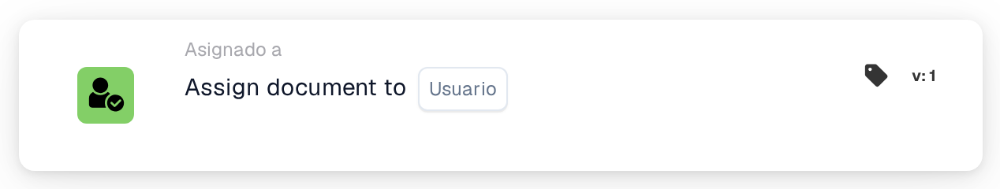
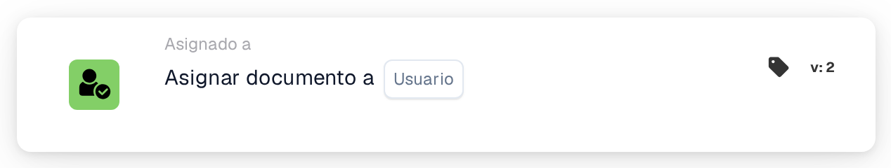
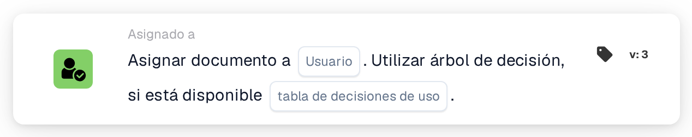

# Asignar documento al usuario

<figure><figcaption>
Versión 1
</figcaption></figure>

<figure><figcaption>
Versión 2
</figcaption></figure>

<figure><figcaption>
Versión 3
</figcaption></figure>



**Vídeo:** Tarjeta: Asignar documento a un usuario · 0:47 · [Subtítulos (WebVTT)](https://docbits-videos.fra1.cdn.digitaloceanspaces.com/settings-assistant/card-assign-user/v1/es.vtt)

Transcripción

**Asignar documento a un usuario** · [0:00](https://docbits-videos.fra1.cdn.digitaloceanspaces.com/settings-assistant/card-assign-user/v1/es.mp4#t=0.25)

La tarjeta Asignar documento a un usuario entrega el documento a un usuario: elíjalo. La versión tres, elegida con la etiqueta de versión, añade un segundo ajuste: si una tabla de decisión puede elegir el usuario en su lugar.

**Árbol de decisión: primero el usuario de la tabla** · [0:21](https://docbits-videos.fra1.cdn.digitaloceanspaces.com/settings-assistant/card-assign-user/v1/es.mp4#t=21.75)

Con el árbol de decisión activado, la tarjeta toma el primer usuario que devolvió una tarjeta de tabla de decisión anterior en el Workflow. Si la tabla no devolvió ningún usuario, el usuario de la tarjeta recibe el documento. La versión dos siempre asigna el usuario de la tarjeta.

**Ejemplo: aprobador de la tabla, respaldo en la tarjeta** · [0:36](https://docbits-videos.fra1.cdn.digitaloceanspaces.com/settings-assistant/card-assign-user/v1/es.mp4#t=36.816)

Por ejemplo, una tabla de decisión devuelve el aprobador del importe, y la tarjeta de asignación lo usa. Si la tabla no encuentra a nadie, Alex Example recibe la factura.

## **Propósito:**

La tarjeta de flujo de trabajo **"Assign Document to User"** permite a los usuarios asignar un documento a un usuario específico, garantizando una gestión fluida del flujo de trabajo al enrutar los documentos a la persona adecuada. La versión 3 añade la capacidad de usar un árbol de decisión para determinar dinámicamente la asignación de usuario según las condiciones disponibles.

## **Componentes de la tarjeta:**

1. **Usuario**
   * **Descripción:** Especifica el usuario al que se asignará el documento.
   * **Detalle:** Se proporciona una lista desplegable de todos los usuarios disponibles para su selección. Al usuario seleccionado se le asignará el documento para una acción adicional.

## **Componentes adicionales en la versión 3:**

1. **Usar árbol de decisión**
   * **Descripción:** Si está habilitado, la tarjeta usa un árbol de decisión para determinar dinámicamente la asignación de usuario.
   * **Opciones:**
     * **True:** Usa el árbol de decisión para la asignación dinámica de usuario.
     * **False:** Asigna el documento al usuario seleccionado sin usar el árbol de decisión.

## **Funcionalidad:**

* **Evaluación de la condición:**\
  La tarjeta solo ejecuta su acción si las secciones **"Cuando"** y **"Y"** se evalúan como verdaderas.
* **Asignación del documento:**\
  La tarjeta asigna el documento al usuario seleccionado, garantizando que la tarea se enrute a la persona adecuada para su acción. Esto ayuda con la responsabilidad y la gestión eficaz de documentos.
* **Árbol de decisión (versión 3):**\
  Si el árbol de decisión está habilitado, la tarjeta evalúa las condiciones definidas dentro del árbol para seleccionar dinámicamente el usuario para la asignación del documento.

## **Configuración:**

* **Seleccionar el User:**\
  Elija el **usuario** de la lista desplegable al que se asignará el documento.
* **Use Decision Tree (versión 3):**\
  Habilite o deshabilite el uso del árbol de decisión para seleccionar dinámicamente el usuario.

## **Conclusión:**

La tarjeta de flujo de trabajo **"Assign Document to User"** facilita un enrutamiento eficiente de los documentos al asignarlos al usuario seleccionado, con la flexibilidad añadida en la versión 3 de determinar dinámicamente el usuario mediante un árbol de decisión. Esto garantiza un proceso de flujo de trabajo más adaptable y eficiente.

<!-- workflow-card-practical-example-20261021 -->

## Ejemplo práctico

**Cuándo utilizar:** Enviar facturas que necesiten revisión manual a una persona responsable.

**Configuración:** Seleccione el usuario configurado `Demo Reviewer A`.

**Resultado esperado y contraejemplo:** El documento está asignado a ese usuario. Confirmar la asignación del documento resultante; Esta tarjeta por sí sola no crea una tarea de revisión separada.

Esta es una configuración ilustrativa y un resultado esperado. Utilice campos, usuarios y grupos configurados en su organización de prueba; no es una afirmación de que este ejemplo haya sido ejecutado.
