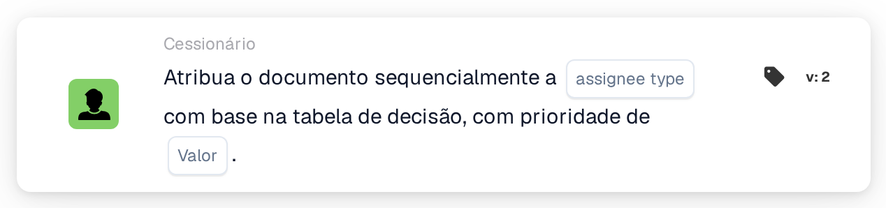
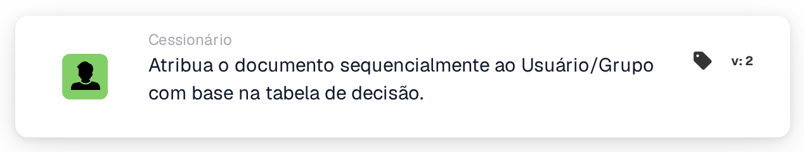

# Atribuir sequencialmente ao usuário/grupo

<figure><figcaption>
Versão 2
</figcaption></figure>

<figure><figcaption>
Atribua o documento sequencialmente ao Usuário/Grupo com base na tabela de decisão. — Versão 2
</figcaption></figure>



**Vídeo:** Cartão: Atribuir em sequência com base numa tabela de decisão · 0:42 · [Legendas (WebVTT)](https://docbits-videos.fra1.cdn.digitaloceanspaces.com/settings-assistant/card-assign-sequential-dt/v1/pt.vtt)

Transcrição

**Atribuir em sequência com base numa tabela de decisão** · [0:00](https://docbits-videos.fra1.cdn.digitaloceanspaces.com/settings-assistant/card-assign-sequential-dt/v1/pt.mp4#t=0.25)

O cartão Atribuir em sequência com base numa tabela de decisão entrega o documento, um após o outro, aos utilizadores e grupos devolvidos por uma tabela de decisão. O cartão não tem definições: tudo vem da tabela.

**O que o cartão precisa** · [0:13](https://docbits-videos.fra1.cdn.digitaloceanspaces.com/settings-assistant/card-assign-sequential-dt/v1/pt.mp4#t=13.883)

Precisa antes de um cartão de tabela de decisão que guarde os dados devolvidos. Usa todos os utilizadores e grupos que a tabela devolveu, e a prioridade mais baixa recebe o documento primeiro. Linhas sem prioridade contam como prioridade um. Se a tabela não devolveu ninguém, o cartão segue a sua saída de erro.

**Exemplo: dois aprovadores à vez** · [0:31](https://docbits-videos.fra1.cdn.digitaloceanspaces.com/settings-assistant/card-assign-sequential-dt/v1/pt.mp4#t=31.116)

Por exemplo, a tabela Example approvers devolve dois aprovadores com prioridade um e dois. A fatura vai para o primeiro e, depois da aprovação, para o segundo.

## **Propósito**

O cartão de fluxo de trabalho "**Atribuir o documento sequencialmente ao usuário/grupo com base na tabela de decisão**" atribui dinamicamente documentos a um utilizador ou a um grupo, consoante a avaliação da decision table. Isto assegura que os documentos são encaminhados de forma adequada com base em regras predefinidas.

## **Componentes do cartão**

1. **Prioridade (Valor)**
   * **Descrição**: Especifica o nível de prioridade das atribuições, sendo que números mais baixos representam uma prioridade mais elevada.
   * **Detalhe**: Um campo de introdução numérica onde se pode definir o valor de prioridade para controlar a sequência de atribuição.

## **Funcionalidade**

* **Avaliação da decision table**:\
  A decision table avalia condições predefinidas para decidir se o documento é atribuído a um utilizador ou a um grupo.
* **Atribuição de documentos**:
  * Se a decision table devolver um utilizador, o documento é atribuído diretamente a esse utilizador.
  * Se a decision table devolver um grupo, o documento é atribuído ao grupo de forma sequencial, respeitando o valor de prioridade especificado.

## **Configuração**

1. Adicione o cartão **Atribuir o documento sequencialmente** ao seu fluxo de trabalho.
2. Configure o campo **Prioridade (Valor)**:
   * Introduza um valor numérico para definir a prioridade de atribuição.
3. Guarde e ative o fluxo de trabalho para aplicar a configuração.

## **Conclusão**

O cartão de fluxo de trabalho "**Atribuir o documento sequencialmente ao usuário/grupo com base na tabela de decisão**" assegura um encaminhamento de documentos eficiente e dinâmico. Ao recorrer à lógica da decision table e aos valores de prioridade, o cartão facilita uma atribuição precisa a um utilizador ou a um grupo, simplificando os fluxos de trabalho de documentos.

<!-- workflow-card-practical-example-20261021 -->

## Exemplo prático

**Quando usar:** Use uma tabela de decisão para selecionar um destinatário de documento priorizado.

**Configuração:** Configure uma regra de tabela de decisão de demonstração correspondente que retorne o usuário ou grupo pretendido e selecione essa tabela no cartão.

**Resultado esperado e contra-exemplo:** O responsável retornado é usado para atribuição sequencial de documentos. Sem retorno correspondente, não assuma um responsável padrão; inspecione o resultado e configure o comportamento de fallback desta versão.

Esta é uma configuração ilustrativa e resultado esperado. Utilize campos, usuários e grupos configurados em sua organização de teste; não é uma afirmação de que este exemplo foi executado.
