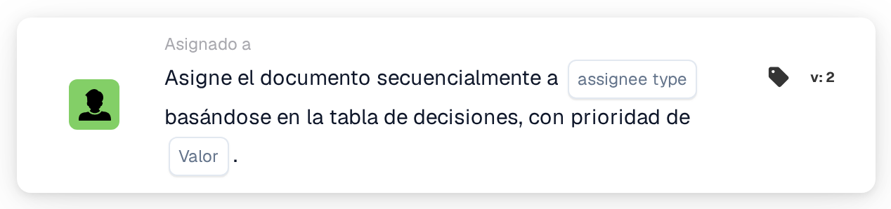
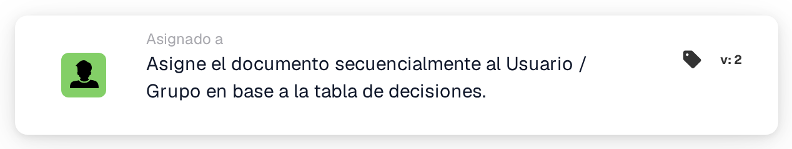

# Asignar secuencialmente a usuario/grupo

<figure><figcaption>
Versión 2
</figcaption></figure>

<figure><figcaption>
Asigne el documento secuencialmente al Usuario / Grupo en base a la tabla de decisiones. — Versión 2
</figcaption></figure>



**Vídeo:** Tarjeta: Asignar sucesivamente según una tabla de decisión · 0:42 · [Subtítulos (WebVTT)](https://docbits-videos.fra1.cdn.digitaloceanspaces.com/settings-assistant/card-assign-sequential-dt/v1/es.vtt)

Transcripción

**Asignar sucesivamente según una tabla de decisión** · [0:00](https://docbits-videos.fra1.cdn.digitaloceanspaces.com/settings-assistant/card-assign-sequential-dt/v1/es.mp4#t=0.25)

La tarjeta Asignar sucesivamente según una tabla de decisión da el documento, uno tras otro, a los usuarios y grupos que devolvió una tabla de decisión. La tarjeta no tiene ajustes: todo viene de la tabla.

**Lo que necesita la tarjeta** · [0:12](https://docbits-videos.fra1.cdn.digitaloceanspaces.com/settings-assistant/card-assign-sequential-dt/v1/es.mp4#t=12.783)

Necesita antes una tarjeta de tabla de decisión que guarde los datos devueltos. Toma todos los usuarios y grupos que devolvió la tabla, y la prioridad más baja recibe el documento primero. Las filas sin prioridad cuentan como prioridad uno. Si la tabla no devolvió a nadie, la tarjeta toma su salida de error.

**Ejemplo: dos aprobadores por turno** · [0:31](https://docbits-videos.fra1.cdn.digitaloceanspaces.com/settings-assistant/card-assign-sequential-dt/v1/es.mp4#t=31.15)

Por ejemplo, la tabla Example approvers devuelve dos aprobadores con prioridad uno y dos. La factura va al primero y, tras su aprobación, al segundo.

## **Propósito**

La tarjeta de flujo de trabajo "**Asignar el documento secuencialmente al usuario/grupo según la tabla de decisiones**" asigna dinámicamente documentos a un usuario o a un grupo, según la evaluación de la tabla de decisión. Esto garantiza que los documentos se enruten de forma adecuada según reglas predefinidas.

## **Componentes de la tarjeta**

1. **Prioridad (Valor)**
   * **Descripción**: Especifica el nivel de prioridad de las asignaciones, donde los números más bajos representan una mayor prioridad.
   * **Detalle**: Un campo de entrada numérico donde se puede establecer el valor de prioridad para controlar la secuencia de asignación.

## **Funcionalidad**

* **Evaluación de la tabla de decisión**:\
  La tabla de decisión evalúa condiciones predefinidas para decidir si el documento se asigna a un usuario o a un grupo.
* **Asignación del documento**:
  * Si la tabla de decisión devuelve un usuario, el documento se asigna directamente a ese usuario.
  * Si la tabla de decisión devuelve un grupo, el documento se asigna al grupo de forma secuencial, respetando el valor de prioridad especificado.

## **Configuración**

1. Añada la tarjeta **Asignar el documento secuencialmente** a su flujo de trabajo.
2. Configure el campo **Prioridad (Valor)**:
   * Introduzca un valor numérico para establecer la prioridad de asignación.
3. Guarde y active el flujo de trabajo para aplicar la configuración.

## **Conclusión**

La tarjeta de flujo de trabajo "**Asignar el documento secuencialmente al usuario/grupo según la tabla de decisiones**" garantiza un enrutamiento de documentos eficiente y dinámico. Al aprovechar la lógica de la tabla de decisión y los valores de prioridad, la tarjeta facilita una asignación precisa a un usuario o a un grupo, agilizando los flujos de trabajo de documentos.

<!-- workflow-card-practical-example-20261021 -->

## Ejemplo práctico

**Cuándo utilizar:** Utilice una tabla de decisiones para seleccionar un responsable de documento priorizado.

**Configuración:** Configure una regla de tabla de decisiones de demostración coincidente que devuelva al usuario o grupo deseado, luego seleccione esa tabla en la tarjeta.

**Resultado esperado y contraejemplo:** El asignatario devuelto se utiliza para la asignación secuencial de documentos. Sin una devolución equivalente, no asuma un responsable predeterminado; Inspeccione el resultado y el comportamiento de reserva configurado de esta versión.

Esta es una configuración ilustrativa y un resultado esperado. Utilice campos, usuarios y grupos configurados en su organización de prueba; no es una afirmación de que este ejemplo haya sido ejecutado.
