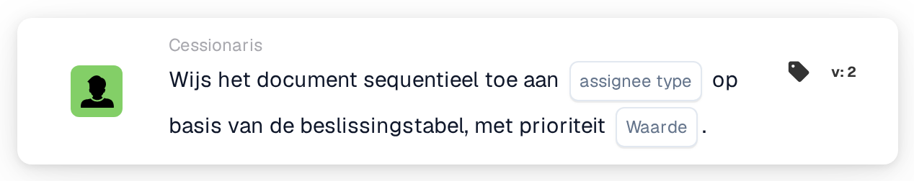
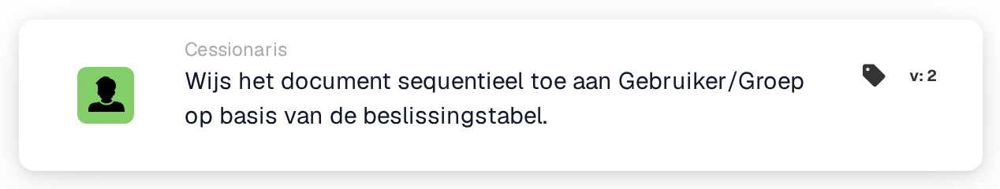

# Opeenvolgend toewijzen aan gebruiker/groep

<figure><figcaption>
Versie 2
</figcaption></figure>

<figure><figcaption>
Wijs het document sequentieel toe aan Gebruiker/Groep op basis van de beslissingstabel. — Versie 2
</figcaption></figure>



**Video:** Kaart: Opeenvolgend toewijzen via beslissingstabel · 0:48 · [Ondertitels (WebVTT)](https://docbits-videos.fra1.cdn.digitaloceanspaces.com/settings-assistant/card-assign-sequential-dt/v1/nl.vtt)

Transcriptie

**Opeenvolgend toewijzen via beslissingstabel** · [0:00](https://docbits-videos.fra1.cdn.digitaloceanspaces.com/settings-assistant/card-assign-sequential-dt/v1/nl.mp4#t=0.25)

De kaart Opeenvolgend toewijzen op basis van een beslissingstabel geeft het document na elkaar aan de gebruikers en groepen die een beslissingstabel heeft teruggegeven. De kaart heeft geen instellingen: alles komt uit de tabel.

**Wat de kaart nodig heeft** · [0:15](https://docbits-videos.fra1.cdn.digitaloceanspaces.com/settings-assistant/card-assign-sequential-dt/v1/nl.mp4#t=15.416)

Ze heeft ervoor een beslissingstabelkaart nodig die haar teruggegeven gegevens opslaat. Ze neemt alle gebruikers en groepen die de tabel teruggaf, en de laagste prioriteit krijgt het document eerst. Rijen zonder prioriteit tellen als prioriteit één. Gaf de tabel niemand terug, dan neemt de kaart haar foutuitgang.

**Voorbeeld: twee goedkeurders na elkaar** · [0:36](https://docbits-videos.fra1.cdn.digitaloceanspaces.com/settings-assistant/card-assign-sequential-dt/v1/nl.mp4#t=36.916)

De tabel Example approvers geeft bijvoorbeeld twee goedkeurders terug met prioriteit één en twee. De factuur gaat naar de eerste en na de goedkeuring naar de tweede.

## **Doel**

De workflow-kaart "**Wijs het document opeenvolgend toe aan de gebruiker/groep op basis van de beslissingstabel**" wijst documenten dynamisch toe aan een gebruiker of een groep, afhankelijk van de evaluatie van de decision table. Dit zorgt ervoor dat documenten op de juiste manier worden gerouteerd op basis van vooraf gedefinieerde regels.

## **Onderdelen van de kaart**

1. **Prioriteit (waarde)**
   * **Beschrijving**: Geeft het prioriteitsniveau voor toewijzingen op, waarbij lagere getallen een hogere prioriteit vertegenwoordigen.
   * **Details**: Een numeriek invoerveld waarin de prioriteitswaarde kan worden ingesteld om de toewijzingsvolgorde te bepalen.

## **Functionaliteit**

* **Besluittabel-evaluatie**:\
  De decision table evalueert vooraf gedefinieerde voorwaarden om te beslissen of het document aan een gebruiker of een groep wordt toegewezen.
* **Documenttoewijzing**:
  * Als de decision table een gebruiker retourneert, wordt het document rechtstreeks aan die gebruiker toegewezen.
  * Als de decision table een groep retourneert, wordt het document sequentieel aan de groep toegewezen, met inachtneming van de opgegeven prioriteitswaarde.

## **Opzet en configuratie**

1. Voeg de kaart **Wijs het document opeenvolgend toe** toe aan uw workflow.
2. Configureer het veld **Prioriteit (waarde)**:
   * Voer een numerieke waarde in om de toewijzingsprioriteit in te stellen.
3. Sla op en activeer de workflow om de configuratie toe te passen.

## **Conclusie**

De workflow-kaart "**Wijs het document opeenvolgend toe aan de gebruiker/groep op basis van de beslissingstabel**" zorgt voor efficiënte en dynamische documentroutering. Door beslislogica en prioriteitswaarden te benutten, faciliteert de kaart een nauwkeurige toewijzing aan een gebruiker of een groep, wat documentworkflows stroomlijnt.

<!-- workflow-card-practical-example-20261021 -->

## Praktisch voorbeeld

**Wanneer gebruiken:** Gebruik een beslissingstabel om een documentontvanger met prioriteit te selecteren.

**Configuratie:** Configureer een overeenkomende demo-beslissingstabelregel die de beoogde gebruiker of groep retourneert en selecteer vervolgens die tabel op de kaart.

**Verwacht resultaat en tegenvoorbeeld:** De geretourneerde verantwoordelijke wordt gebruikt voor opeenvolgende documenttoewijzing. Als er geen passende retourwaarde is, mag u niet uitgaan van een standaard verantwoordelijke; inspecteer het resultaat en het geconfigureerde fallback-gedrag van deze versie.

Dit is een illustratieve configuratie en een verwacht resultaat. Gebruik velden, gebruikers en groepen die in uw testorganisatie zijn geconfigureerd; het is geen bewering dat dit voorbeeld is uitgevoerd.
