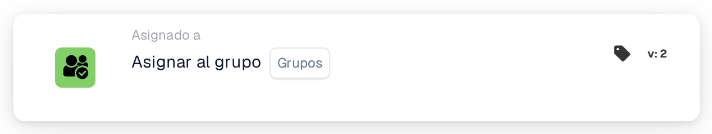
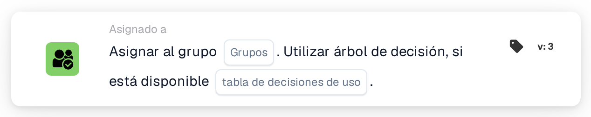

# Asignar al grupo

<figure><figcaption>
Versión 2
</figcaption></figure>

<figure><figcaption>
Versión 3
</figcaption></figure>



**Vídeo:** Tarjeta: Asignar documento a un grupo · 0:48 · [Subtítulos (WebVTT)](https://docbits-videos.fra1.cdn.digitaloceanspaces.com/settings-assistant/card-assign-group/v1/es.vtt)

Transcripción

**Asignar documento a un grupo** · [0:00](https://docbits-videos.fra1.cdn.digitaloceanspaces.com/settings-assistant/card-assign-group/v1/es.mp4#t=0.25)

La tarjeta Asignar al grupo entrega el documento a un grupo, por ejemplo Accounts payable. La versión tres, elegida con la etiqueta de versión, añade un segundo ajuste: si una tabla de decisión puede elegir el grupo en su lugar.

**Árbol de decisión: primero el grupo de la tabla** · [0:21](https://docbits-videos.fra1.cdn.digitaloceanspaces.com/settings-assistant/card-assign-group/v1/es.mp4#t=21.683)

Con el árbol de decisión activado, la tarjeta toma el grupo que devolvió una tarjeta de tabla de decisión anterior en el Workflow. Si la tabla no devolvió ningún grupo, el grupo de la tarjeta recibe el documento. La versión dos siempre asigna el grupo de la tarjeta.

**Ejemplo: grupo de la tabla, respaldo en la tarjeta** · [0:37](https://docbits-videos.fra1.cdn.digitaloceanspaces.com/settings-assistant/card-assign-group/v1/es.mp4#t=37.083)

Por ejemplo, una tabla de decisión devuelve el grupo del proveedor, y la tarjeta de asignación lo usa. Si la tabla no encuentra grupo, Accounts payable recibe la factura.

## Propósito:

La tarjeta de flujo de trabajo **"Assign to Group"** facilita la asignación de documentos a un **grupo** específico dentro del sistema. Esto garantiza que el documento sea procesado por el equipo adecuado, agilizando el flujo de trabajo. Mejorada en versiones posteriores, introduce la funcionalidad de árbol de decisión para la asignación dinámica de grupos.

## Componentes de la tarjeta:

1. **Grupos**
   * **Descripción:** Especifica el **grupo** al que se asignará el documento.
   * **Detalle:** Se selecciona de una lista desplegable de **grupos** disponibles.

## **Componentes adicionales en la versión 3**

1. **Decision Tree (solo en la versión 3)**
   * **Descripción:** Permite usar un árbol de decisión para determinar dinámicamente el **grupo** al que debe asignarse el documento.
   * **Opciones:**
     * **True:** Habilita el procesamiento del árbol de decisión.
     * **False:** Deshabilita el procesamiento del árbol de decisión.

## Funcionalidad:

* **Evaluación de la condición:** La tarjeta solo ejecuta su acción si las secciones **"Cuando"** y **"Y"** se evalúan como verdaderas.
* **Asignación del documento:** Asigna el documento al **grupo** seleccionado. En la **versión 3**, el **árbol de decisión** determina el grupo de destino dinámicamente si está habilitado.

## Configuración:

* **Seleccionar el Group:** Elija el **grupo** de la lista desplegable para asignar el documento.
* **Use Decision Tree (solo en la versión 3):** Habilite esta opción si debe usarse el **árbol de decisión** para la asignación dinámica.

## Conclusión:

La tarjeta de flujo de trabajo **"Assign to Group"** automatiza la asignación de documentos a **grupos** predefinidos, mejorando la coordinación de los equipos. La **versión 3** introduce la capacidad de asignar grupos dinámicamente según la lógica del árbol de decisión.

<!-- workflow-card-practical-example-20261021 -->

## Ejemplo práctico

**Cuándo usarlo:** Coloque un documento en una cola de revisión compartida.

**Configuración:** Seleccione el grupo configurado `Demo Finance`.

**Resultado esperado y contraejemplo:** El documento se asigna al grupo seleccionado. Se trata de una asignación de documentos, no de una promesa de que se creará una tarea o un correo electrónico adicional.

Esta es una configuración ilustrativa y un resultado esperado. Utilice campos, usuarios y grupos configurados en su organización de prueba; no es una afirmación de que este ejemplo haya sido ejecutado.
