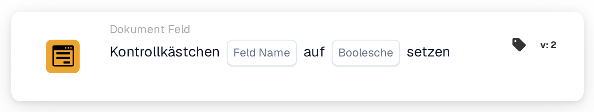

# Setzen Sie das Kontrollkästchen auf

<figure><figcaption>
Version 2
</figcaption></figure>



**Video:** Karte: Kontrollkästchen setzen · 0:44 · [Untertitel (WebVTT)](https://docbits-videos.fra1.cdn.digitaloceanspaces.com/settings-assistant/card-set-checkbox/v1/de.vtt)

Transkript

**Kontrollkästchen setzen** · [0:00](https://docbits-videos.fra1.cdn.digitaloceanspaces.com/settings-assistant/card-set-checkbox/v1/de.mp4#t=0.25)

Die Karte Kontrollkästchen setzen aktiviert oder deaktiviert ein Kontrollkästchen-Feld des Dokuments. Wählen Sie das Feld, zum Beispiel Special handling, und ob es aktiviert sein soll.

**Aktiviert oder nicht, dann gespeichert** · [0:17](https://docbits-videos.fra1.cdn.digitaloceanspaces.com/settings-assistant/card-set-checkbox/v1/de.mp4#t=17.083)

Die Karte schreibt den Wert und speichert das Dokument, auch wenn das Kontrollkästchen vorher leer war. Ist das Feld kein Kontrollkästchen, zum Beispiel ein Betrag, nimmt die Karte ihren Fehlerpfad. Um ein Kontrollkästchen auf den umgekehrten Wert zu stellen, nutzen Sie die Karte Kontrollkästchen umkehren.

**Beispiel: Special handling aktivieren** · [0:34](https://docbits-videos.fra1.cdn.digitaloceanspaces.com/settings-assistant/card-set-checkbox/v1/de.mp4#t=34.65)

Braucht der Lieferant zum Beispiel eine Sonderbehandlung, aktiviert der Workflow Special handling, und der Validierer sieht es am Dokument.

## **Zweck:**

Diese Workflow-Karte ist darauf ausgelegt, ein Kontrollkästchenfeld auf einen angegebenen Wert (true oder false) zu setzen, basierend auf den in den Abschnitten **„Wenn“** und **„Und“** definierten Bedingungen. Sie bietet eine einfache, aber effektive Möglichkeit, Kontrollkästchenaktualisierungen zu automatisieren, wenn bestimmte Kriterien erfüllt sind, und sorgt so für eine optimierte Dokumentverarbeitung.

## **Bestandteile der Karte:**

1. **Feldname:**
   * **Beschreibung**: Gibt das Feld an, in dem das Kontrollkästchen gesetzt wird.
   * **Detailliert**: Das zu aktualisierende Kontrollkästchenfeld wird durch den Feldnamen identifiziert.
2. **Boolescher Wert**
   * **Beschreibung**: Legt den Wert fest, auf den das Kontrollkästchenfeld gesetzt wird, wenn die Bedingungen in den Abschnitten **Wo** und **Und** beide erfüllt sind.
   * **Optionen**:
     * **True**: Das Kontrollkästchen wird auf **true** gesetzt, wenn die Bedingungen erfüllt sind.
     * **False**: Das Kontrollkästchen wird auf **false** gesetzt, wenn die Bedingungen erfüllt sind.

## **Funktionalität:**

* **Bedingungsauswertung**: Das System wertet die Bedingungen sowohl im Abschnitt **„Wenn“** als auch im Abschnitt **„Und“** aus.
* **Ausführung der Aktion**: Werden sowohl der **„Wenn“**- als auch der **„Und“**-Abschnitt als erfüllt ausgewertet, wird das Kontrollkästchenfeld auf den angegebenen Wert (true oder false) aktualisiert. Ist eine der Bedingungen nicht erfüllt, wird keine Aktion ausgeführt, und das Kontrollkästchen bleibt unverändert.

## **Einrichtung und Konfiguration:**

Um diese Karte zu konfigurieren, müssen Benutzer:

1. **Das Ziel-Kontrollkästchenfeld angeben**, das bei Erfüllung der Bedingungen auf true oder false gesetzt wird.
2. **Den Wert (true oder false) auswählen**, auf den das Kontrollkästchen bei der Bedingungsauswertung gesetzt wird.
3. Die Karte führt ihre Aktion nur aus, wenn beide Bedingungen in den Abschnitten **„Wenn“** und **„Und“** als erfüllt ausgewertet werden.

## **Fazit:**

Die Workflow-Karte **"Set Checkbox"** ist ein einfaches und effektives Automatisierungswerkzeug, um Kontrollkästchenfelder auf Basis bestimmter Bedingungen zu aktualisieren. Indem sie sicherstellt, dass sowohl der **„Wenn“**- als auch der **„Und“**-Abschnitt erfüllt sind, ermöglicht sie es Benutzern, Prozesse zu automatisieren und manuelle Eingriffe zu reduzieren, und sorgt so für eine reibungslosere und effizientere Dokumentverarbeitung.

<!-- workflow-card-practical-example-20261021 -->

## Praxisbeispiel

**Wann zu verwenden ist:** Markieren Sie eine erfolgreiche Validierung mit einem expliziten Flag.

**Konfiguration:** Aktivieren Sie das Kontrollkästchenfeld `review_complete` und stellen Sie es auf `true` ein.

**Erwartetes Ergebnis und Gegenbeispiel:** Das Feld wird überprüft. Führen Sie die Aktion mit `false` in einem separaten Test aus, wenn Sie die Flagge löschen müssen.

Dies ist eine beispielhafte Konfiguration und ein erwartetes Ergebnis. Verwenden Sie in Ihrer Testorganisation konfigurierte Felder, Benutzer und Gruppen. Es wird nicht behauptet, dass dieses Beispiel ausgeführt wurde.
