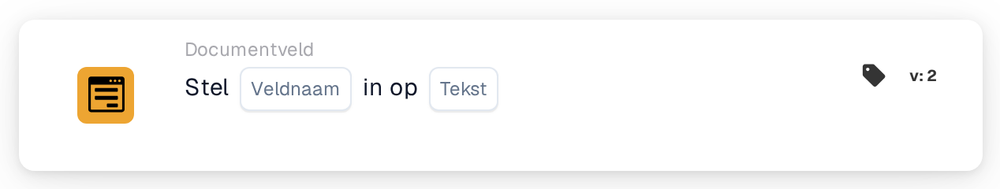

# Instellen op

<figure><figcaption>
Versie 2
</figcaption></figure>



**Video:** Kaart: Veld instellen op tekst · 0:39 · [Ondertitels (WebVTT)](https://docbits-videos.fra1.cdn.digitaloceanspaces.com/settings-assistant/card-set-field-text/v1/nl.vtt)

Transcriptie

**Veld instellen op tekst** · [0:00](https://docbits-videos.fra1.cdn.digitaloceanspaces.com/settings-assistant/card-set-field-text/v1/nl.mp4#t=0.25)

De kaart Veld instellen op tekst schrijft een tekst in een veld van het document. Kies het veld, bijvoorbeeld Notities, en typ de tekst.

**De tekst vervangt de oude waarde** · [0:16](https://docbits-videos.fra1.cdn.digitaloceanspaces.com/settings-assistant/card-set-field-text/v1/nl.mp4#t=16.216)

De tekst vervangt wat het veld eerst bevatte, en het document wordt ermee opgeslagen. Kan het document niet worden opgeslagen, dan neemt de kaart het foutpad.

**Voorbeeld: de reden in Notities** · [0:27](https://docbits-videos.fra1.cdn.digitaloceanspaces.com/settings-assistant/card-set-field-text/v1/nl.mp4#t=27.316)

Bijvoorbeeld: als de controle van de eenheidsprijs mislukt, schrijft de kaart Eenheidsprijs controleren in Notities. De validator ziet meteen waarom het document stopte.

## **Doel:**

Deze workflow-kaart is ontworpen om een opgegeven veld in het document automatisch op een vooraf gedefinieerde tekstwaarde in te stellen op basis van de voorwaarden die zijn gedefinieerd in de **"Wanneer"**- en **"En"**-secties. Hiermee kunnen gebruikers de gegevensinvoer stroomlijnen door ervoor te zorgen dat velden met consistente waarden worden gevuld wanneer aan bepaalde criteria wordt voldaan.

## **Onderdelen van de kaart:**

1. **Veldnaam**
   * **Beschrijving**: Geeft het veld op dat met de tekstwaarde wordt bijgewerkt.
   * **Details**: Het geselecteerde veld wordt bijgewerkt met de opgegeven tekstwaarde als aan de voorwaarden in de **"Wanneer"**- en **"En"**-secties wordt voldaan.
2. **Tekst**
   * **Beschrijving**: Definieert de tekstwaarde die in het doelveld wordt ingesteld wanneer de voorwaarden als true worden geëvalueerd.
   * **Details**: Dit kan een aangepast bericht, een status of een vooraf gedefinieerde waarde zijn die de gebruiker in het veld wil schrijven. De tekst moet overeenkomen met het verwachte invoerformaat van het veld (bijv. alfanumeriek, datum of andere soorten tekstuele informatie).

## **Functionaliteit:**

* **Voorwaarde-evaluatie**: Het systeem evalueert de voorwaarden in de **"Wanneer"**- en **"En"**-secties:
  * Als **beide voorwaarden true zijn**, worden de in de **"Then"**-sectie gedefinieerde acties uitgevoerd. Specifiek wordt het doelveld (Field Name) gevuld met de opgegeven tekst.
  * Als **de "Where"- of de "And"-sectie false is**, wordt er geen actie ondernomen en blijft het veld ongewijzigd. De acties van de **Dan**-sectie worden volledig overgeslagen als een van beide voorwaarden false is.
* **Actie-uitvoering**: Als aan beide voorwaarden in de **"Wanneer"**- en **"En"**-secties wordt voldaan, vult het systeem automatisch het opgegeven veld met de gekozen tekstwaarde. Als niet aan de voorwaarden wordt voldaan, worden er geen wijzigingen aan het veld aangebracht.

## **Opzet en configuratie:**

Om deze kaart op te zetten:

1. **Selecteer het veld** (Field Name) dat met de tekstwaarde wordt bijgewerkt. De beschikbare velden in het document worden weergegeven om uit te selecteren.
2. **Geef de tekstwaarde op** die in het doelveld wordt geschreven wanneer de voorwaarden true zijn.
3. De actie wordt alleen uitgevoerd als zowel de **"Wanneer"**- als de **"En"**-voorwaarden als true worden geëvalueerd.

## **Conclusie:**

De workflow-kaart **"Stel veld in op tekst"** biedt een eenvoudige manier om het vullen van tekstwaarden in specifieke documentvelden te automatiseren op basis van vooraf gedefinieerde voorwaarden. Dit vermindert handmatige gegevensinvoer en zorgt voor consistentie in de documentverwerking, waardoor het een nuttig hulpmiddel is voor het automatiseren van workflows en het verbeteren van de efficiëntie.

<!-- workflow-card-practical-example-20261021 -->

## Praktisch voorbeeld

**Wanneer gebruiken:** Schrijf een routeringsresultaat in een documentveld.

**Configuratie:** Selecteer tekstveld `routing_result` en stel de tekst in op `manual review`.

**Verwacht resultaat en tegenvoorbeeld:** Het veld bevat exact `manual review`. Een volgende gelijkheidsvoorwaarde kan die waarde gebruiken; het is een documentveld en geen organisatievariabele.

Dit is een illustratieve configuratie en een verwacht resultaat. Gebruik velden, gebruikers en groepen die in uw testorganisatie zijn geconfigureerd; het is geen bewering dat dit voorbeeld is uitgevoerd.
