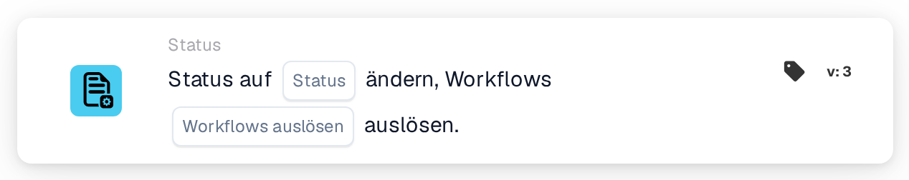

# Status auf … ändern

<figure><figcaption>
Version 1
</figcaption></figure>

<figure><figcaption>
Version 2
</figcaption></figure>

<figure><figcaption>
Version 3
</figcaption></figure>

## Zweck

Die Karte **Status auf … ändern** setzt das Dokument auf einen neuen Status, zum Beispiel um es zur Genehmigung weiterzugeben oder als abgelehnt zu markieren. Sie finden sie im Workflow-Designer unter **Dann → Status**.

## Einstellungen

### Status

Der Status, den das Dokument erhält. Sie können wählen:

| Status | Bedeutung |
| --- | --- |
| **Fehler** | Das Dokument wird als fehlerhaft markiert. |
| **Abgelehnt** | Das Dokument wird abgelehnt. |
| **Bereit zur Validierung** | Das Dokument wartet darauf, dass ein Benutzer es in der Validierung prüft. |
| **Genehmigung ausstehend** | Das Dokument wartet auf die Genehmigung. |
| **Zweite Genehmigung ausstehend** | Das Dokument wartet auf die zweite Genehmigung. |
| **Archiviert** | Das Dokument wird ins Archiv verschoben. Wird es wiederhergestellt, erhält es seinen vorherigen Status zurück. |
| **Abgeschlossen** | Die Verarbeitung des Dokuments ist abgeschlossen. |
| **Exportiert** | Das Dokument wurde exportiert, bleibt aber offen, zum Beispiel damit es noch zur Genehmigung zurückgegeben werden kann. |

Das Setzen eines Status führt den Schritt dahinter nicht aus. **Zweite Genehmigung ausstehend** bedeutet zum Beispiel nicht, dass jemand die erste Genehmigung erteilt hat.

### Workflows auslösen (nur Version 3)

Legt fest, ob der Statuswechsel Workflows starten darf.

* **Falsch:** Dieser Statuswechsel startet keinen Workflow. Verwenden Sie diesen Wert, außer ein anderer Workflow soll mit dem Dokument in seinem neuen Status weiterarbeiten.
* **Wahr:** DocBits startet die Workflows, deren Bedingungen auf das Dokument mit seinem neuen Status passen. Sie starten, nachdem der aktuelle Workflow beendet ist. Die Karte wartet nicht auf sie und zeigt nicht an, ob sie erfolgreich waren; siehe dazu die Workflow-Logs.

Wählen Sie immer einen Wert. Achten Sie bei **Wahr** darauf, dass der Workflow, der diese Karte enthält, nicht selbst auf den neuen Status passt, sonst läuft er ein zweites Mal. Siehe [Status ändern, ohne den Workflow neu zu starten](../../masterclass/status-and-reentry.md).

## Kartenversionen

| Version | Einstellungen | Startet Workflows nach dem Wechsel |
| --- | --- | --- |
| **1** | Status | Ja, immer |
| **2** | Status | Ja, immer |
| **3** | Status, Workflows auslösen | Nur mit **Workflows auslösen** = **Wahr** |

Die Versionen 1 und 2 funktionieren gleich. Version 3 ergänzt **Workflows auslösen**, damit Sie entscheiden können, ob der neue Status andere Workflows startet. Verwenden Sie Version 3 für neue Workflows. Wenn Sie eine bestehende Karte von Version 3 auf eine ältere Version zurückstellen, gilt **Workflows auslösen** nicht mehr, und jeder Statuswechsel kann wieder Workflows starten.

## Gut zu wissen

* **Gleicher Status, keine Wirkung.** Hat das Dokument bereits den gewählten Status, ändert sich nichts, und kein Workflow startet.
* **Archiviert startet nie Workflows**, in keiner Version.
* **Webhooks sind nicht betroffen.** Webhooks für Statuswechsel werden unabhängig davon gesendet, was Sie bei **Workflows auslösen** wählen.
* **Ein Wechsel kann verweigert werden.** Wenn Ihre Organisation abgeschlossene Dokumente sperrt, kann ein **Abgeschlossen**-Dokument nur auf **Archiviert** oder **Fehler** gesetzt werden. Jeder andere Wechsel wird verweigert, der Status bleibt unverändert, und das Workflow-Log zeigt einen Fehler.
* **Tests simulieren nur.** In einem Kartentest oder Advanced Test im Workflow-Designer sehen die folgenden Karten den neuen Status, aber der Status wird nicht gespeichert, und kein Workflow wird gestartet.

## Beispiel

**Ziel:** Nach den Prüfungen eine Rechnung zur Genehmigung weitergeben.

1. Bedingungen: **Dokumenttyp** ist _Rechnung_ und **Dokumentstatus** **Ist** **Bereit zur Validierung**.
2. **Status auf … ändern** (Version 3): **Status** = **Genehmigung ausstehend**, **Workflows auslösen** = **Falsch**.

**Ergebnis:** Die Rechnung wechselt auf **Genehmigung ausstehend** und wartet auf die Genehmigung. Der Wechsel startet keinen anderen Workflow, und dieser Workflow läuft nicht erneut, weil das Dokument nicht mehr **Bereit zur Validierung** ist.
