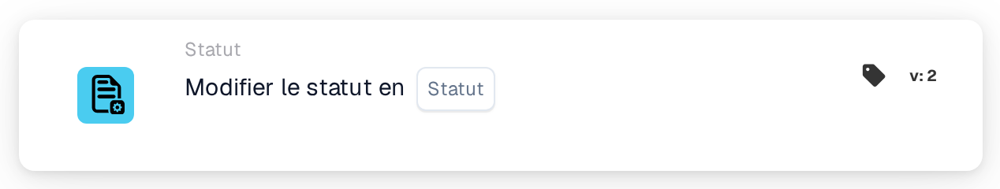
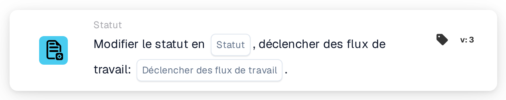

# Modifier le statut en

<figure><figcaption>
Version 1
</figcaption></figure>

<figure><figcaption>
Version 2
</figcaption></figure>

<figure><figcaption>
Version 3
</figcaption></figure>

## Objectif

La carte **Modifier le statut en** donne au document un nouveau statut, par exemple pour l'envoyer en approbation ou pour le marquer comme rejeté. Vous la trouverez dans le concepteur de Workflows sous **Dans ce cas → Statut**.

## Réglages

### Statut

Le statut que reçoit le document. Vous pouvez choisir :

| Statut | Signification |
| --- | --- |
| **Erreur** | Le document est marqué comme contenant une erreur. |
| **Rejeté** | Le document est rejeté. |
| **Prêt pour la validation** | Le document attend qu'un utilisateur le vérifie dans la validation. |
| **Validé en attente d'approbation** | Le document attend l'approbation. |
| **Approuvé en attente de deuxième approbation** | Le document attend la deuxième approbation. |
| **Archivé** | Le document est déplacé dans l'archive. S'il est restauré, il retrouve son statut précédent. |
| **Terminé** | Le traitement du document est terminé. |
| **Exporté** | Le document a été exporté mais reste ouvert, par exemple pour pouvoir encore être renvoyé en approbation. |

Définir un statut n'exécute pas l'étape correspondante. Par exemple, **Approuvé en attente de deuxième approbation** ne signifie pas que quelqu'un a donné la première approbation.

### Déclencher des flux de travail (version 3 uniquement)

Décide si le changement de statut peut lancer des Workflows.

* **Faux :** ce changement de statut ne lance aucun Workflow. Utilisez cette valeur, sauf si un autre Workflow doit poursuivre le traitement du document avec son nouveau statut.
* **Vrai :** DocBits lance les Workflows dont les conditions correspondent au document avec son nouveau statut. Ils démarrent une fois le Workflow en cours terminé. La carte ne les attend pas et n'indique pas s'ils ont réussi ; consultez les **Journaux de flux de travail**.

Choisissez toujours une valeur. Avec **Vrai**, assurez-vous que le Workflow qui contient cette carte ne correspond pas lui-même au nouveau statut, sinon il s'exécute une deuxième fois. Voir [Changer le statut sans relancer votre Workflow](../../masterclass/status-and-reentry.md).

## Versions de la carte

| Version | Réglages | Lance des Workflows après le changement |
| --- | --- | --- |
| **1** | Statut | Oui, toujours |
| **2** | Statut | Oui, toujours |
| **3** | Statut, Déclencher des flux de travail | Uniquement si **Déclencher des flux de travail** = **Vrai** |

Les versions 1 et 2 fonctionnent de la même façon. La version 3 ajoute **Déclencher des flux de travail**, ce qui vous permet de décider si le nouveau statut lance d'autres Workflows. Utilisez la version 3 pour les nouveaux Workflows. Si vous repassez une carte existante de la version 3 à une version antérieure, **Déclencher des flux de travail** ne s'applique plus et chaque changement de statut peut de nouveau lancer des Workflows.

## Bon à savoir

* **Même statut, aucun effet.** Si le document a déjà le statut choisi, rien ne change et aucun Workflow ne démarre.
* **Archivé ne lance jamais de Workflow**, quelle que soit la version.
* **Les webhooks ne sont pas concernés.** Les webhooks de changement de statut sont envoyés quelle que soit la valeur de **Déclencher des flux de travail**.
* **Un changement peut être refusé.** Si votre organisation verrouille les documents terminés, un document **Terminé** ne peut passer qu'à **Archivé** ou **Erreur**. Tout autre changement est refusé, le statut reste inchangé et le journal du Workflow affiche une erreur.
* **Les tests ne font que simuler.** Dans un test de carte ou un Advanced Test du concepteur de Workflows, les cartes suivantes voient le nouveau statut, mais le statut n'est pas enregistré et aucun Workflow n'est lancé.

## Exemple

**Objectif :** après les contrôles, envoyer une facture en approbation.

1. Conditions : **Le type de document est** _Facture_ et **Le statut du document** **Est** **Prêt pour la validation**.
2. **Modifier le statut en** (version 3) : **Statut** = **Validé en attente d'approbation**, **Déclencher des flux de travail** = **Faux**.

**Résultat :** la facture passe à **Validé en attente d'approbation** et attend l'approbation. Le changement ne lance aucun autre Workflow, et ce Workflow ne s'exécute pas à nouveau, car le document n'est plus **Prêt pour la validation**.
