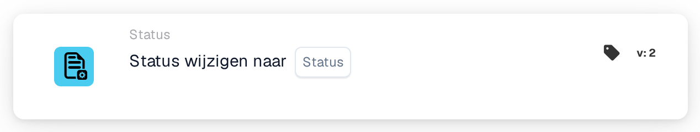
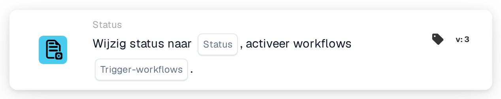

# Wijzig status naar

<figure><figcaption>
Versie 1
</figcaption></figure>

<figure><figcaption>
Versie 2
</figcaption></figure>

<figure><figcaption>
Versie 3
</figcaption></figure>

## Doel

De kaart **Wijzig status naar** zet het document op een nieuwe status, bijvoorbeeld om het door te sturen voor goedkeuring of om het als afgewezen te markeren. U vindt de kaart in de Workflow-ontwerper onder **Dan → Status**.

## Instellingen

### Status

De status die het document krijgt. U kunt kiezen uit:

| Status | Betekenis |
| --- | --- |
| **Fout** | Het document wordt gemarkeerd als document met een fout. |
| **Afgewezen** | Het document is afgewezen. |
| **Klaar voor validatie** | Het document wacht tot een gebruiker het controleert in de validatie. |
| **In afwachting van goedkeuring** | Het document wacht op goedkeuring. |
| **In afwachting van tweede goedkeuring** | Het document wacht op de tweede goedkeuring. |
| **Gearchiveerd** | Het document wordt naar het archief verplaatst. Wanneer het wordt hersteld, krijgt het zijn vorige status terug. |
| **Afgerond** | De verwerking van het document is voltooid. |
| **Geëxporteerd** | Het document is geëxporteerd maar blijft open, bijvoorbeeld zodat het nog teruggestuurd kan worden voor goedkeuring. |

Een status zetten voert de stap erachter niet uit. **In afwachting van tweede goedkeuring** betekent bijvoorbeeld niet dat iemand de eerste goedkeuring heeft gegeven.

### Trigger-workflows (alleen versie 3)

Bepaalt of de statuswijziging Workflows mag starten.

* **Onwaar:** deze statuswijziging start geen Workflow. Kies deze waarde, tenzij een andere Workflow verder moet gaan met het document in zijn nieuwe status.
* **WAAR:** DocBits start de Workflows waarvan de voorwaarden kloppen voor het document met zijn nieuwe status. Ze starten nadat de huidige Workflow klaar is. De kaart wacht niet op ze en laat niet zien of ze geslaagd zijn; kijk daarvoor in de Workflow-logboeken.

Kies altijd een waarde. Zorg er bij **WAAR** voor dat de Workflow met deze kaart zelf niet klopt voor de nieuwe status, anders wordt hij een tweede keer uitgevoerd. Zie [Status wijzigen zonder uw Workflow opnieuw te starten](../../masterclass/status-and-reentry.md).

## Kaartversies

| Versie | Instellingen | Start Workflows na de wijziging |
| --- | --- | --- |
| **1** | Status | Ja, altijd |
| **2** | Status | Ja, altijd |
| **3** | Status, Trigger-workflows | Alleen met **Trigger-workflows** = **WAAR** |

Versie 1 en 2 werken hetzelfde. Versie 3 voegt **Trigger-workflows** toe, zodat u kunt bepalen of de nieuwe status andere Workflows start. Gebruik versie 3 voor nieuwe Workflows. Zet u een bestaande kaart van versie 3 terug naar een oudere versie, dan geldt **Trigger-workflows** niet meer en kan elke statuswijziging weer Workflows starten.

## Goed om te weten

* **Zelfde status, geen effect.** Als het document de gekozen status al heeft, verandert er niets en start er geen Workflow.
* **Gearchiveerd start nooit Workflows**, in geen enkele versie.
* **Webhooks worden niet beïnvloed.** Webhooks voor statuswijzigingen worden verstuurd, wat u ook kiest bij **Trigger-workflows**.
* **Een wijziging kan worden geweigerd.** Als uw organisatie afgeronde documenten vergrendelt, kan een document met status **Afgerond** alleen naar **Gearchiveerd** of **Fout**. Elke andere wijziging wordt geweigerd, de status blijft zoals hij was en het Workflow-logboek toont een fout.
* **Tests simuleren alleen.** Bij een kaarttest of Advanced Test in de Workflow-ontwerper zien de volgende kaarten de nieuwe status, maar de status wordt niet opgeslagen en er wordt geen Workflow gestart.

## Voorbeeld

**Doel:** een factuur na de controles doorsturen voor goedkeuring.

1. Voorwaarden: **Documenttype** is _Factuur_ en **Documentstatus** **Is** **Klaar voor validatie**.
2. **Wijzig status naar** (versie 3): **Status** = **In afwachting van goedkeuring**, **Trigger-workflows** = **Onwaar**.

**Resultaat:** de factuur gaat naar **In afwachting van goedkeuring** en wacht op goedkeuring. De wijziging start geen andere Workflow, en deze Workflow wordt niet opnieuw uitgevoerd omdat het document niet meer **Klaar voor validatie** is.
