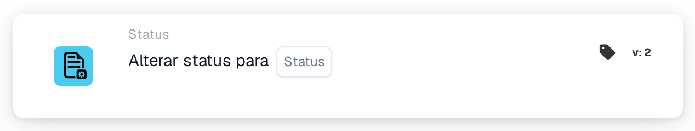
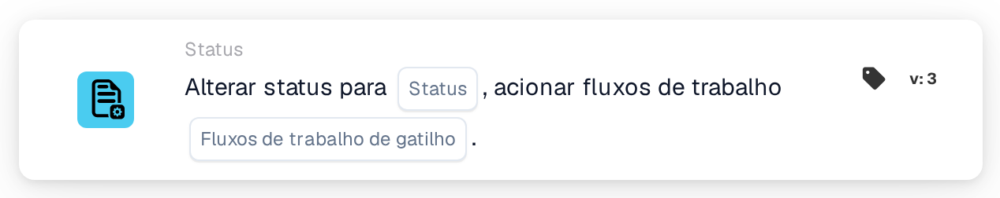

# Alterar status para

<figure><figcaption>
Versão 1
</figcaption></figure>

<figure><figcaption>
Versão 2
</figcaption></figure>

<figure><figcaption>
Versão 3
</figcaption></figure>

## Finalidade

O cartão **Alterar status para** coloca o documento num novo status, por exemplo para o enviar para aprovação ou para o marcar como rejeitado. Encontra-o no designer de Workflows em **Então → Status**.

## Definições

### Status

O status que o documento recebe. Pode escolher:

| Status | Significado |
| --- | --- |
| **Erro** | O documento é marcado como tendo um erro. |
| **Rejeitado** | O documento é rejeitado. |
| **Pronto para validação** | O documento aguarda que um utilizador o verifique na validação. |
| **Aprovação pendente** | O documento aguarda aprovação. |
| **Pendente segunda aprovação** | O documento aguarda a segunda aprovação. |
| **Arquivado** | O documento é movido para o arquivo. Quando é restaurado, recupera o status anterior. |
| **Concluído** | O processamento do documento está concluído. |
| **Exportado** | O documento foi exportado, mas continua aberto, por exemplo para que ainda possa ser enviado de volta para aprovação. |

Definir um status não executa o passo que lhe está associado. Por exemplo, **Pendente segunda aprovação** não significa que alguém deu a primeira aprovação.

### Fluxos de trabalho de gatilho (apenas na versão 3)

Decide se a alteração de status pode iniciar Workflows.

* **Falso:** esta alteração de status não inicia nenhum Workflow. Use este valor, a menos que outro Workflow deva continuar com o documento no novo status.
* **Verdadeiro:** o DocBits inicia os Workflows cujas condições correspondem ao documento no novo status. São iniciados depois de o Workflow atual terminar. O cartão não espera por eles nem mostra se foram bem-sucedidos; consulte os **Registros de fluxo de trabalho**.

Escolha sempre um valor. Com **Verdadeiro**, certifique-se de que o Workflow que contém este cartão não corresponde ele próprio ao novo status; caso contrário, é executado uma segunda vez. Consulte [Alterar o status sem reiniciar o seu Workflow](../../masterclass/status-and-reentry.md).

## Versões do cartão

| Versão | Definições | Inicia Workflows após a alteração |
| --- | --- | --- |
| **1** | Status | Sim, sempre |
| **2** | Status | Sim, sempre |
| **3** | Status, Fluxos de trabalho de gatilho | Apenas com **Fluxos de trabalho de gatilho** = **Verdadeiro** |

As versões 1 e 2 funcionam da mesma forma. A versão 3 acrescenta **Fluxos de trabalho de gatilho**, para que possa decidir se o novo status inicia outros Workflows. Use a versão 3 em novos Workflows. Se mudar um cartão existente da versão 3 para uma versão anterior, **Fluxos de trabalho de gatilho** deixa de se aplicar e qualquer alteração de status pode voltar a iniciar Workflows.

## Bom saber

* **Mesmo status, sem efeito.** Se o documento já tiver o status escolhido, nada muda e nenhum Workflow é iniciado.
* **Arquivado nunca inicia Workflows**, em nenhuma versão.
* **Os webhooks não são afetados.** Os webhooks de alterações de status são enviados independentemente do que escolher em **Fluxos de trabalho de gatilho**.
* **Uma alteração pode ser recusada.** Se a sua organização bloquear documentos concluídos, um documento **Concluído** só pode passar para **Arquivado** ou **Erro**. Qualquer outra alteração é recusada, o status mantém-se e o registo do Workflow mostra um erro.
* **Os testes apenas simulam.** Num teste de cartão ou num Advanced Test no designer de Workflows, os cartões seguintes veem o novo status, mas o status não é guardado e nenhum Workflow é iniciado.

## Exemplo

**Objetivo:** depois das verificações, enviar uma fatura para aprovação.

1. Condições: **O tipo de documento é** _Fatura_ e **Status do documento** **É** **Pronto para validação**.
2. **Alterar status para** (versão 3): **Status** = **Aprovação pendente**, **Fluxos de trabalho de gatilho** = **Falso**.

**Resultado:** a fatura passa para **Aprovação pendente** e aguarda aprovação. A alteração não inicia nenhum outro Workflow, e este Workflow não volta a ser executado porque o documento já não está em **Pronto para validação**.
