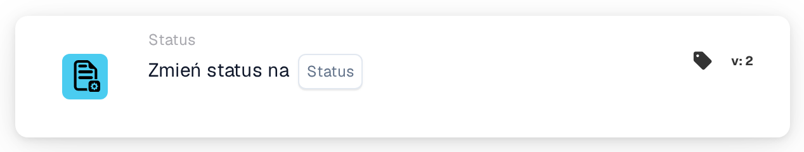
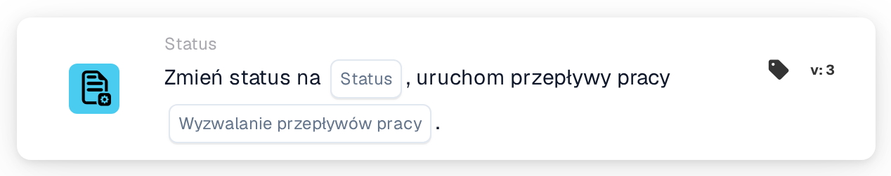

# Zmień status na

<figure><figcaption>
Wersja 1
</figcaption></figure>

<figure><figcaption>
Wersja 2
</figcaption></figure>

<figure><figcaption>
Wersja 3
</figcaption></figure>

## Cel

Karta **Zmień status na** ustawia nowy status dokumentu, na przykład aby przekazać go do zatwierdzenia lub oznaczyć jako odrzucony. Znajdziesz ją w projektancie Workflow w **Następnie → Status**.

## Ustawienia

### Status

Status, który otrzyma dokument. Możesz wybrać:

| Status | Znaczenie |
| --- | --- |
| **Błąd** | Dokument zostaje oznaczony jako zawierający błąd. |
| **Odrzucony** | Dokument zostaje odrzucony. |
| **Gotowy do walidacji** | Dokument czeka, aż użytkownik sprawdzi go w walidacji. |
| **Oczekujące na zatwierdzenie** | Dokument czeka na zatwierdzenie. |
| **Oczekiwanie na drugą akceptację** | Dokument czeka na drugie zatwierdzenie. |
| **Zarchiwizowano** | Dokument zostaje przeniesiony do archiwum. Po przywróceniu otrzymuje z powrotem swój poprzedni status. |
| **Zakończony** | Przetwarzanie dokumentu jest zakończone. |
| **Eksportowano** | Dokument został wyeksportowany, ale pozostaje otwarty, na przykład aby nadal można go było odesłać do zatwierdzenia. |

Ustawienie statusu nie wykonuje kroku, który się za nim kryje. Na przykład **Oczekiwanie na drugą akceptację** nie oznacza, że ktoś udzielił pierwszego zatwierdzenia.

### Wyzwalanie przepływów pracy (tylko wersja 3)

Decyduje, czy zmiana statusu może uruchamiać Workflow.

* **FAŁSZ:** ta zmiana statusu nie uruchamia żadnego Workflow. Używaj tej wartości, chyba że inny Workflow ma dalej przetwarzać dokument w nowym statusie.
* **PRAWDA:** DocBits uruchamia Workflow, których warunki pasują do dokumentu w nowym statusie. Uruchamiają się one po zakończeniu bieżącego Workflow. Karta nie czeka na nie i nie pokazuje, czy zakończyły się powodzeniem; sprawdź to w dziennikach Workflow.

Zawsze wybierz wartość. Przy **PRAWDA** upewnij się, że Workflow zawierający tę kartę sam nie pasuje do nowego statusu, w przeciwnym razie uruchomi się drugi raz. Zobacz [Zmiana statusu bez ponownego uruchamiania Workflow](../../masterclass/status-and-reentry.md).

## Wersje karty

| Wersja | Ustawienia | Uruchamia Workflow po zmianie |
| --- | --- | --- |
| **1** | Status | Tak, zawsze |
| **2** | Status | Tak, zawsze |
| **3** | Status, Wyzwalanie przepływów pracy | Tylko przy **Wyzwalanie przepływów pracy** = **PRAWDA** |

Wersje 1 i 2 działają tak samo. Wersja 3 dodaje **Wyzwalanie przepływów pracy**, dzięki czemu możesz zdecydować, czy nowy status uruchamia inne Workflow. W nowych Workflow używaj wersji 3. Jeśli przełączysz istniejącą kartę z wersji 3 na starszą wersję, **Wyzwalanie przepływów pracy** przestaje obowiązywać i każda zmiana statusu może znowu uruchamiać Workflow.

## Warto wiedzieć

* **Ten sam status, brak efektu.** Jeśli dokument ma już wybrany status, nic się nie zmienia i żaden Workflow się nie uruchamia.
* **Zarchiwizowano nigdy nie uruchamia Workflow**, w żadnej wersji.
* **Webhooki nie są objęte tym ustawieniem.** Webhooki dotyczące zmian statusu są wysyłane niezależnie od wartości **Wyzwalanie przepływów pracy**.
* **Zmiana może zostać odrzucona.** Jeśli Twoja organizacja blokuje zakończone dokumenty, dokument **Zakończony** można przenieść tylko do statusu **Zarchiwizowano** lub **Błąd**. Każda inna zmiana zostaje odrzucona, status pozostaje bez zmian, a dziennik Workflow pokazuje błąd.
* **Testy tylko symulują.** W teście karty lub w Advanced Test w projektancie Workflow kolejne karty widzą nowy status, ale status nie jest zapisywany i żaden Workflow nie zostaje uruchomiony.

## Przykład

**Cel:** po kontrolach przekazać fakturę do zatwierdzenia.

1. Warunki: **Typ dokumentu** to _Faktura_ oraz **Status dokumentu** **Jest** **Gotowy do walidacji**.
2. **Zmień status na** (wersja 3): **Status** = **Oczekujące na zatwierdzenie**, **Wyzwalanie przepływów pracy** = **FAŁSZ**.

**Wynik:** faktura przechodzi do statusu **Oczekujące na zatwierdzenie** i czeka na zatwierdzenie. Zmiana nie uruchamia żadnego innego Workflow, a ten Workflow nie uruchamia się ponownie, ponieważ dokument nie ma już statusu **Gotowy do walidacji**.
