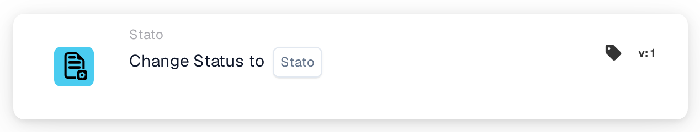
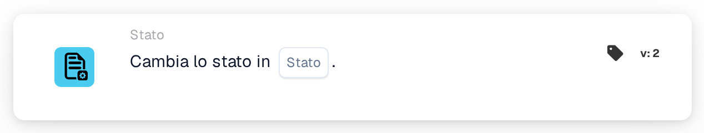
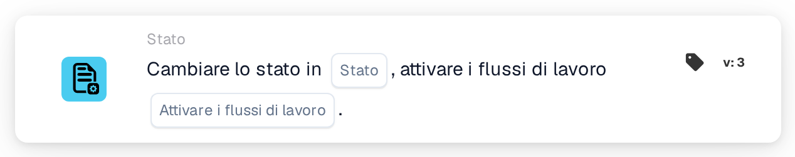

# Cambiare lo stato in

<figure><figcaption>
Versione 1
</figcaption></figure>

<figure><figcaption>
Versione 2
</figcaption></figure>

<figure><figcaption>
Versione 3
</figcaption></figure>

## Scopo

La scheda **Cambiare lo stato in** imposta un nuovo stato per il documento, per esempio per inviarlo all'approvazione o per contrassegnarlo come rifiutato. Si trova nel designer dei Workflow in **Allora → Stato**.

## Impostazioni

### Stato

Lo stato che il documento riceve. È possibile scegliere:

| Stato | Significato |
| --- | --- |
| **Errore** | Il documento viene contrassegnato come errato. |
| **Rifiutato** | Il documento viene rifiutato. |
| **Pronto per la convalida** | Il documento attende che un utente lo controlli nella convalida. |
| **In attesa di approvazione** | Il documento attende l'approvazione. |
| **In attesa della seconda approvazione** | Il documento attende la seconda approvazione. |
| **Archiviato** | Il documento viene spostato nell'archivio. Quando viene ripristinato, riprende lo stato precedente. |
| **Completato** | L'elaborazione del documento è conclusa. |
| **Esportato** | Il documento è stato esportato ma resta aperto, per esempio per poterlo ancora rimandare all'approvazione. |

Impostare uno stato non esegue il passaggio corrispondente. Per esempio, **In attesa della seconda approvazione** non significa che qualcuno abbia dato la prima approvazione.

### Attivare i flussi di lavoro (solo versione 3)

Decide se il cambio di stato può avviare Workflow.

* **Falso:** questo cambio di stato non avvia nessun Workflow. Usare questo valore, a meno che un altro Workflow debba proseguire con il documento nel suo nuovo stato.
* **Vero:** DocBits avvia i Workflow le cui condizioni corrispondono al documento nel suo nuovo stato. Si avviano al termine del Workflow corrente. La scheda non li attende e non mostra se sono riusciti; consultare i **Registri del flusso di lavoro**.

Scegliere sempre un valore. Con **Vero**, assicurarsi che il Workflow che contiene questa scheda non corrisponda a sua volta al nuovo stato, altrimenti viene eseguito una seconda volta. Vedere [Cambiare lo stato senza riavviare il Workflow](../../masterclass/status-and-reentry.md).

## Versioni della scheda

| Versione | Impostazioni | Avvia Workflow dopo il cambio |
| --- | --- | --- |
| **1** | Stato | Sì, sempre |
| **2** | Stato | Sì, sempre |
| **3** | Stato, Attivare i flussi di lavoro | Solo con **Attivare i flussi di lavoro** = **Vero** |

Le versioni 1 e 2 funzionano allo stesso modo. La versione 3 aggiunge **Attivare i flussi di lavoro**, così è possibile decidere se il nuovo stato avvia altri Workflow. Per i nuovi Workflow usare la versione 3. Se una scheda esistente viene riportata dalla versione 3 a una versione precedente, **Attivare i flussi di lavoro** non vale più e ogni cambio di stato può di nuovo avviare Workflow.

## Da sapere

* **Stesso stato, nessun effetto.** Se il documento ha già lo stato scelto, non cambia nulla e non si avvia nessun Workflow.
* **Archiviato non avvia mai Workflow**, in nessuna versione.
* **I webhook non sono interessati.** I webhook per i cambi di stato vengono inviati indipendentemente dal valore scelto per **Attivare i flussi di lavoro**.
* **Un cambio può essere rifiutato.** Se l'organizzazione blocca i documenti completati, un documento **Completato** può essere spostato solo in **Archiviato** o **Errore**. Qualsiasi altro cambio viene rifiutato, lo stato resta invariato e il registro del Workflow mostra un errore.
* **I test simulano soltanto.** In un test della scheda o in un Advanced Test nel designer dei Workflow, le schede successive vedono il nuovo stato, ma lo stato non viene salvato e non si avvia nessun Workflow.

## Esempio

**Obiettivo:** dopo i controlli, inviare una fattura all'approvazione.

1. Condizioni: **Il tipo di documento è** _Fattura_ e **Document status** **È** **Pronto per la convalida**.
2. **Cambiare lo stato in** (versione 3): **Stato** = **In attesa di approvazione**, **Attivare i flussi di lavoro** = **Falso**.

**Risultato:** la fattura passa a **In attesa di approvazione** e attende l'approvazione. Il cambio non avvia nessun altro Workflow, e questo Workflow non viene rieseguito perché il documento non è più **Pronto per la convalida**.
