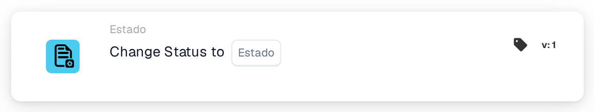
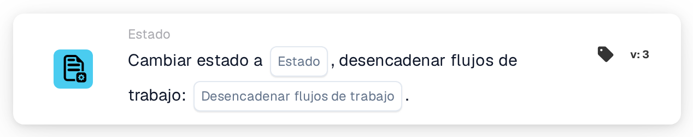

# Cambiar estado a

<figure><figcaption>
Versión 1
</figcaption></figure>

<figure><figcaption>
Versión 2
</figcaption></figure>

<figure><figcaption>
Versión 3
</figcaption></figure>

## Propósito

La tarjeta **Cambiar estado a** asigna un nuevo estado al documento, por ejemplo para enviarlo a aprobación o para marcarlo como rechazado. La encontrará en el diseñador de Workflows, en **Entonces → Estado**.

## Ajustes

### Estado

El estado que recibe el documento. Puede elegir:

| Estado | Significado |
| --- | --- |
| **Error** | El documento se marca como erróneo. |
| **Rechazado** | El documento se rechaza. |
| **Listo para la validación** | El documento espera a que un usuario lo revise en la validación. |
| **Aprobación pendiente** | El documento espera la aprobación. |
| **Pendiente de la segunda aprobación** | El documento espera la segunda aprobación. |
| **Archivado** | El documento se mueve al archivo. Si se restaura, recupera su estado anterior. |
| **Finalizado** | El procesamiento del documento ha terminado. |
| **Exportado** | El documento se ha exportado, pero sigue abierto; por ejemplo, para que todavía pueda devolverse a aprobación. |

Asignar un estado no ejecuta el paso que hay detrás. Por ejemplo, **Pendiente de la segunda aprobación** no significa que alguien haya dado la primera aprobación.

### Desencadenar flujos de trabajo (solo versión 3)

Decide si el cambio de estado puede iniciar Workflows.

* **Falso:** este cambio de estado no inicia ningún Workflow. Use este valor, salvo que otro Workflow deba continuar con el documento en su nuevo estado.
* **Verdadero:** DocBits inicia los Workflows cuyas condiciones coinciden con el documento en su nuevo estado. Se inician cuando el Workflow actual ha terminado. La tarjeta no los espera ni muestra si han funcionado; consulte los **Registros de flujo de trabajo**.

Elija siempre un valor. Con **Verdadero**, asegúrese de que el Workflow que contiene esta tarjeta no coincida él mismo con el nuevo estado; de lo contrario, se ejecuta una segunda vez. Consulte [Cambiar el estado sin volver a iniciar su Workflow](../../masterclass/status-and-reentry.md).

## Versiones de la tarjeta

| Versión | Ajustes | Inicia Workflows después del cambio |
| --- | --- | --- |
| **1** | Estado | Sí, siempre |
| **2** | Estado | Sí, siempre |
| **3** | Estado, Desencadenar flujos de trabajo | Solo con **Desencadenar flujos de trabajo** = **Verdadero** |

Las versiones 1 y 2 funcionan igual. La versión 3 añade **Desencadenar flujos de trabajo**, de modo que puede decidir si el nuevo estado inicia otros Workflows. Use la versión 3 para los Workflows nuevos. Si cambia una tarjeta existente de la versión 3 a una versión anterior, **Desencadenar flujos de trabajo** deja de aplicarse y cada cambio de estado puede volver a iniciar Workflows.

## Conviene saber

* **Mismo estado, ningún efecto.** Si el documento ya tiene el estado elegido, no cambia nada y no se inicia ningún Workflow.
* **Archivado nunca inicia Workflows**, en ninguna versión.
* **Los webhooks no se ven afectados.** Los webhooks de cambios de estado se envían independientemente de lo que elija en **Desencadenar flujos de trabajo**.
* **Un cambio puede rechazarse.** Si su organización bloquea los documentos finalizados, un documento **Finalizado** solo puede pasar a **Archivado** o a **Error**. Cualquier otro cambio se rechaza, el estado se mantiene y el registro del Workflow muestra un error.
* **Las pruebas solo simulan.** En una prueba de tarjeta o en Advanced Test del diseñador de Workflows, las tarjetas siguientes ven el nuevo estado, pero el estado no se guarda y no se inicia ningún Workflow.

## Ejemplo

**Objetivo:** después de las comprobaciones, enviar una factura a aprobación.

1. Condiciones: **El tipo de documento es** _Factura_ y **El estado del documento** **Es** **Listo para la validación**.
2. **Cambiar estado a** (versión 3): **Estado** = **Aprobación pendiente**, **Desencadenar flujos de trabajo** = **Falso**.

**Resultado:** la factura pasa a **Aprobación pendiente** y espera la aprobación. El cambio no inicia ningún otro Workflow, y este Workflow no vuelve a ejecutarse porque el documento ya no está en **Listo para la validación**.
