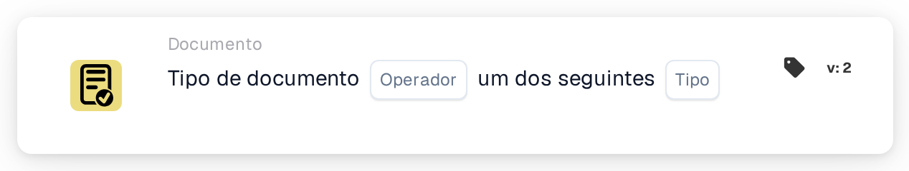

# Tipo de Documento Um de

<figure><figcaption>
Versão 2
</figcaption></figure>



**Vídeo:** Cartão: Tipo de documento: um de uma lista · 0:30 · [Legendas (WebVTT)](https://docbits-videos.fra1.cdn.digitaloceanspaces.com/settings-assistant/card-doc-type-list/v1/pt.vtt)

Transcrição

**Tipo de documento: um de uma lista** · [0:00](https://docbits-videos.fra1.cdn.digitaloceanspaces.com/settings-assistant/card-doc-type-list/v1/pt.mp4#t=0.25)

O cartão Tipo de documento um dos seguintes compara o tipo de um documento com uma lista. Escolha É ou Não é e depois um ou mais tipos de documento. É passa quando o tipo está na lista, Não é quando não está.

**Exemplo: faturas e notas de crédito** · [0:17](https://docbits-videos.fra1.cdn.digitaloceanspaces.com/settings-assistant/card-doc-type-list/v1/pt.mp4#t=17.516)

Por exemplo, um Workflow para faturas e notas de crédito: Tipo de documento é um de Fatura e Nota de Crédito como cartão Quando, depois o cartão de atribuição. Outros documentos não iniciam este Workflow.

## **Propósito:**

Este cartão DocBits garante a classificação correta de um documento verificando se ele corresponde a qualquer um dos tipos de documento especificados. Isso é útil em situações em que um documento pode pertencer a mais de uma categoria, permitindo uma validação mais ampla e manipulação automatizada.

## **Funcionalidade:**

* **Validação de Múltiplos Tipos de Documento:** Este cartão permite aos usuários verificar se um documento corresponde a qualquer um de um conjunto de tipos de documento especificados, garantindo uma categorização flexível para fluxos de trabalho de documentos mais complexos.
* **Operador:** Os usuários podem definir condições para validar o documento em relação a vários tipos. Os operadores disponíveis incluem:
  * **É:** Confirma que o documento corresponde a um dos tipos de documento especificados.
  * **Não É:** Garante que o documento não corresponda a nenhum dos tipos de documento selecionados.
* **Tipos de Documento:** Os usuários podem selecionar entre vários tipos de documento suportados, incluindo:
  * **Fatura:** Registros financeiros enviados para pagamento.
  * **Nota de Débito:** Documentos que indicam um ajuste que aumenta o valor devido.
  * **Nota de Crédito:** Documentos que indicam uma redução no valor devido.
  * **Ordem de Compra:** Documentos detalhando um pedido do comprador.
  * **Confirmação de Pedido:** Documentos que confirmam que um pedido foi aceito.
  * **Aviso de Remessa Antecipada:** Documentos que notificam sobre uma remessa iminente.

## **Uso:**

Este cartão é ideal para gerentes de documentos e administradores que precisam garantir que os documentos sejam categorizados em um dos vários tipos. É especialmente útil para fluxos de trabalho de documentos nos quais um documento pode ser classificado em várias categorias, melhorando a automação e a precisão da classificação.

## **Cenário de Exemplo:**

* Um usuário faz upload de um documento que pode ser uma "Fatura" ou "Nota de Débito". Usando o operador "É", o cartão confirma que o documento corresponde a um dos tipos selecionados, permitindo que o sistema aplique as regras e categorizações apropriadas.

Ao usar o cartão "Validação de Múltiplos Tipos de Documento", as organizações podem aprimorar a flexibilidade do fluxo de trabalho, automatizar a categorização e garantir que os documentos sejam tratados adequadamente mesmo quando vários tipos são aplicáveis.
