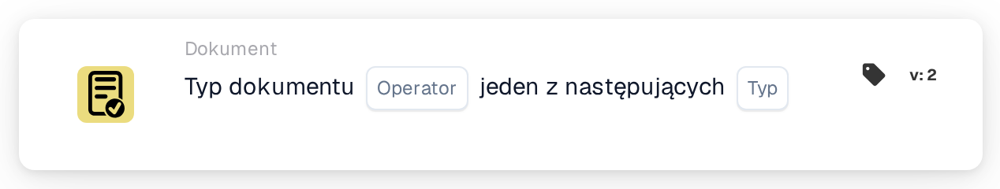

# Typ dokumentu Jeden z

<figure><figcaption>
Wersja 2
</figcaption></figure>



**Film:** Karta: Typ dokumentu: jeden z listy · 0:38 · [Napisy (WebVTT)](https://docbits-videos.fra1.cdn.digitaloceanspaces.com/settings-assistant/card-doc-type-list/v1/pl.vtt)

Transkrypcja

**Typ dokumentu: jeden z listy** · [0:00](https://docbits-videos.fra1.cdn.digitaloceanspaces.com/settings-assistant/card-doc-type-list/v1/pl.mp4#t=0.25)

Karta Typ dokumentu jednym z następujących porównuje typ dokumentu z listą. Wybierz Jest albo Nie jest, a potem jeden lub więcej typów dokumentów. Jest pasuje, gdy typ jest na liście, Nie jest, gdy go tam nie ma.

**Przykład: faktury i noty kredytowe** · [0:19](https://docbits-videos.fra1.cdn.digitaloceanspaces.com/settings-assistant/card-doc-type-list/v1/pl.mp4#t=19.883)

Na przykład jeden Workflow dla faktur i not kredytowych: Typ dokumentu jest jednym z Faktura i Nota kredytowa jako karta Kiedy, potem karta przypisania. Inne dokumenty nie uruchamiają tego Workflow.

## **Cel:**

Ta karta DocBits zapewnia prawidłową klasyfikację dokumentu, weryfikując, czy odpowiada on któremukolwiek z określonych typów dokumentów. Jest to przydatne w sytuacjach, gdy dokument może należeć do więcej niż jednej kategorii, umożliwiając szerszą walidację i zautomatyzowaną obsługę.

## **Funkcjonalność:**

* **Walidacja wielu typów dokumentów:** Ta karta umożliwia użytkownikom sprawdzenie, czy dokument odpowiada któremukolwiek z zestawu określonych typów dokumentów, zapewniając elastyczną kategoryzację dla bardziej złożonych przepływów pracy dokumentów.
* **Operator:** Użytkownicy mogą definiować warunki walidacji dokumentu względem wielu typów. Dostępne operatory obejmują:
  * **Is:** Potwierdza, że dokument odpowiada jednemu z określonych typów dokumentów.
  * **Nie jest:** Zapewnia, że dokument nie odpowiada żadnemu z wybranych typów dokumentów.
* **Typy dokumentów:** Użytkownicy mogą wybierać spośród wielu obsługiwanych typów dokumentów, w tym:
  * **Faktura:** Dokumenty finansowe przedłożone do zapłaty.
  * **Uwaga debetowa:** Dokumenty wskazujące korektę zwiększającą należną kwotę.
  * **Nota kredytowa:** Dokumenty wskazujące zmniejszenie należnej kwoty.
  * **Zamówienie zakupu:** Dokumenty szczegółowo opisujące zamówienie kupującego.
  * **Potwierdzenie zamówienia:** Dokumenty potwierdzające przyjęcie zamówienia.
  * **Powiadomienie o wysyłce z wyprzedzeniem:** Dokumenty powiadamiające o nadchodzącej dostawie.

## **Zastosowanie:**

Ta karta jest idealna dla menedżerów dokumentów i administratorów, którzy muszą zapewnić, że dokumenty są kategoryzowane do jednego z kilku typów. Jest szczególnie przydatna dla przepływów pracy dokumentów, w których dokument może być sklasyfikowany w wielu kategoriach, poprawiając automatyzację i dokładność klasyfikacji.

## **Przykładowy scenariusz:**

* Użytkownik przesyła dokument, który może być "Invoice" lub "Debit Note". Przy użyciu operatora "Is" karta potwierdza, że dokument odpowiada jednemu z wybranych typów, umożliwiając systemowi zastosowanie odpowiednich reguł i kategoryzacji.

Korzystając z karty "Multiple Document Type Validation", organizacje mogą zwiększyć elastyczność przepływu pracy, zautomatyzować kategoryzację i zapewnić właściwą obsługę dokumentów nawet wtedy, gdy zastosowanie ma wiele typów.
