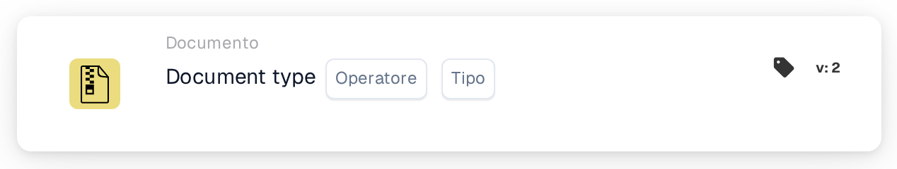

# Operazione di Tipo di Documento

<figure><figcaption>
Versione 1
</figcaption></figure>

<figure><figcaption>
Versione 2
</figcaption></figure>



**Video:** Scheda: Tipo di documento è / non è · 0:31 · [Sottotitoli (WebVTT)](https://docbits-videos.fra1.cdn.digitaloceanspaces.com/settings-assistant/card-doc-type/v1/it.vtt)

Trascrizione

**Tipo di documento è / non è** · [0:00](https://docbits-videos.fra1.cdn.digitaloceanspaces.com/settings-assistant/card-doc-type/v1/it.mp4#t=0.25)

La scheda Tipo di documento controlla il tipo di un documento. Scegli È o Non è e poi il tipo, per esempio Fattura. Non è corrisponde a ogni tipo tranne quello scelto.

**Esempio: solo fatture** · [0:17](https://docbits-videos.fra1.cdn.digitaloceanspaces.com/settings-assistant/card-doc-type/v1/it.mp4#t=17.183)

Per esempio, un Workflow solo per le fatture: Tipo di documento è Fattura come scheda Quando, poi una scheda di assegnazione. Per note di credito, offerte o ordini questo Workflow non parte.

## **Scopo:**

Questa scheda di flusso di lavoro è specificamente progettata per eseguire operazioni predefinite su documenti categorizzati per tipo. Ottimizza la gestione di varie forme di documenti all'interno di un sistema ERP, garantendo che ciascun tipo venga elaborato secondo i suoi requisiti unici e le politiche organizzative.

## **Funzionalità:**

* **Validazione del Tipo di Documento**: Questa scheda verifica se un documento corrisponde a un particolare tipo, consentendo agli utenti di confermare la sua categorizzazione.
* **Operatore**: Gli utenti possono impostare condizioni per determinare il tipo di documento. Gli operatori disponibili includono:
  * **Is**: Conferma che il documento corrisponde al tipo di documento specificato.
  * **Non lo è**: Garantisce che il documento non corrisponda al tipo di documento specificato.
* **Tipi di Documenti**: I tipi di documenti supportati includono:
  * **Fattura**
  * **Nota di Debito**
  * **Nota di Credito**
  * **Ordine di Acquisto**
  * **Conferma d'Ordine**
  * **Avviso di Spedizione Anticipata**

## **Utilizzo**:

Questa scheda è utile per i gestori e gli amministratori dei documenti che devono garantire che i documenti siano correttamente classificati per una elaborazione ottimizzata. La convalida dei tipi di documento migliora l'automazione dei flussi di lavoro, consente azioni specifiche sui documenti e mantiene organizzati i registri.

## **Scenario Esempio**:

* Un utente carica un documento etichettato come "Nota di Debito". Utilizzando l'operatore "Is", la scheda conferma che il tipo di documento è effettivamente "Nota di Debito", consentendo al sistema di applicare regole di elaborazione pertinenti e categorizzarlo in modo appropriato.

Implementando la scheda "Tipo di Documento", le organizzazioni possono automatizzare la classificazione dei documenti, garantire coerenza nella gestione dei documenti e migliorare l'efficienza dei flussi di lavoro della gestione dei documenti.
