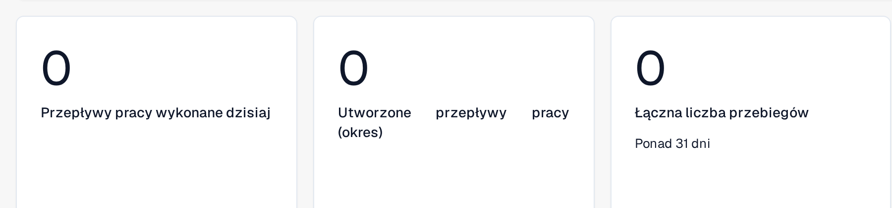
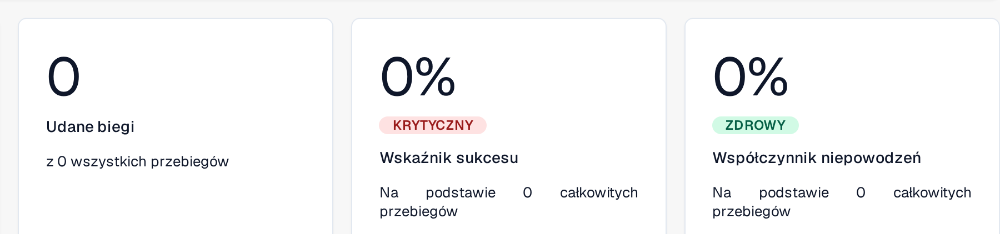
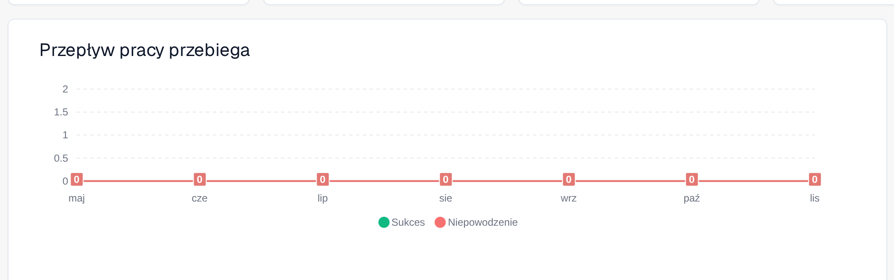
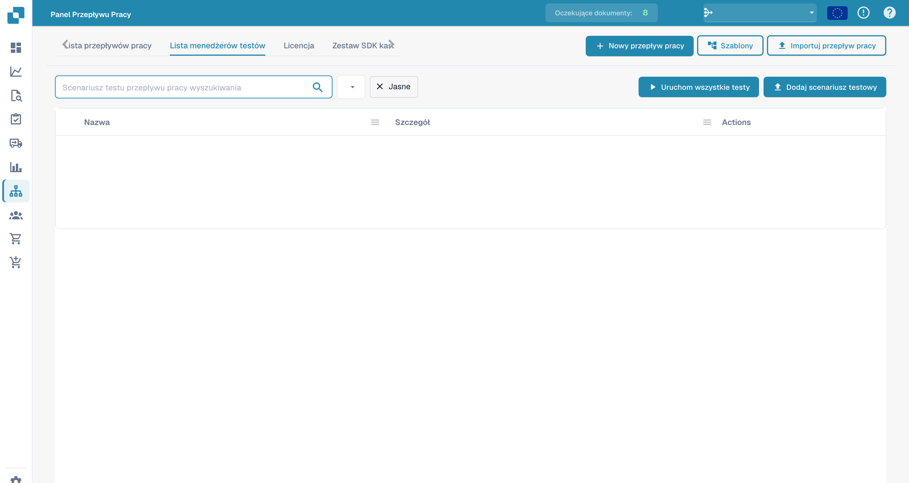

# Panel

**Panel przepływu pracy** to strona główna obszaru przepływów pracy. Pokazuje, jak działają Twoje przepływy pracy — łączne liczby uruchomień, wskaźniki sukcesu i niepowodzeń, wykres uruchomień w czasie oraz ostatnią aktywność — i daje dostęp do listy przepływów pracy, menedżera testów oraz Card SDK.

Poniższe fragmenty pokazują metryki wolumenu, wyniki uruchomień i wykres uruchomień. Ostatnia aktywność i elementy nawigacji znajdują się poza tymi wycinkami.

<figure><figcaption>
Metryki wolumenu: przepływy pracy wykonane dzisiaj, przepływy pracy utworzone w wybranym okresie oraz łączna liczba przebiegów (w tym przykładzie ponad 31 dni).
</figcaption></figure>

<figure><figcaption>
Wyniki uruchomień: udane biegi, wskaźnik sukcesu i współczynnik niepowodzeń, wraz z liczbą przebiegów, na której są liczone.
</figcaption></figure>

<figure><figcaption>
Przebiegi przepływu pracy w siedmiu widocznych miesiącach; serie Sukces i Niepowodzenie są pokazane osobno.
</figcaption></figure>

## Zakładki



**Film:** Wyszukiwanie i filtrowanie na panelu Workflows · 1:04 · [Napisy (WebVTT)](https://docbits-videos.fra1.cdn.digitaloceanspaces.com/settings-assistant/workflow-filtering/v1/pl.vtt)



**Film:** Pobieranie i przesyłanie Workflow jako JSON · 1:11 · [Napisy (WebVTT)](https://docbits-videos.fra1.cdn.digitaloceanspaces.com/settings-assistant/workflow-json/v1/pl.vtt)

- **Panel** — metryki uruchomień i ostatnia aktywność (pokazane powyżej).
- **Lista przepływów pracy** — każdy przepływ pracy wraz z typem, kolejnością wykonania i wyzwalaczem. Przycisk **Nowy przepływ pracy** w pasku narzędzi tworzy nowy przepływ pracy.
- **Lista menedżerów testów** — scenariusze testowe, które walidują Twoje przepływy pracy; uruchom je przyciskiem **Uruchom wszystkie testy**.
- **Licencja** — informacje o licencjonowaniu przepływów pracy.
- **Card SDK** — tworzenie i przesyłanie własnych kart przepływów pracy (zobacz [Card SDK](card-sdk.md)).

Pasek narzędzi oferuje także **Szablony**, który otwiera bibliotekę [szablonów przepływu pracy](standard-workflow-builder.md#workflow-templates), oraz **Importuj przepływ pracy**, który importuje przepływ pracy z pliku JSON.

**Zarządzanie testami** pozwala zapisywać scenariusze testowe dla każdego przepływu pracy i uruchamiać je razem, dzięki czemu możesz sprawdzić, czy Twoje przepływy pracy nadal działają poprawnie po wprowadzeniu zmian:

<figure><figcaption>
Lista scenariuszy testowych przepływów.
</figcaption></figure>

## Następne kroki

- Zbuduj liniową automatyzację za pomocą buildera **Standardowy przepływ**.
- Zbuduj rozgałęziony przepływ za pomocą buildera **Zaawansowany przepływ pracy**.
