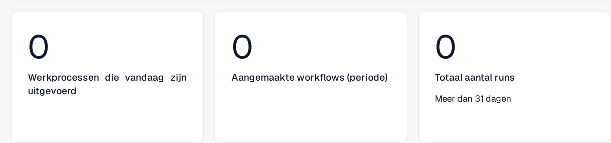
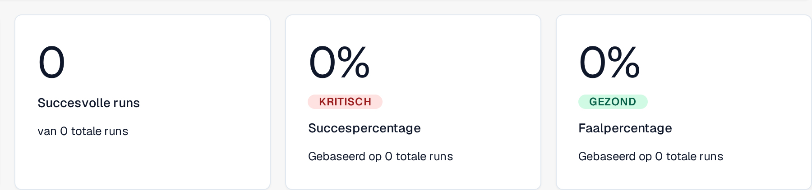
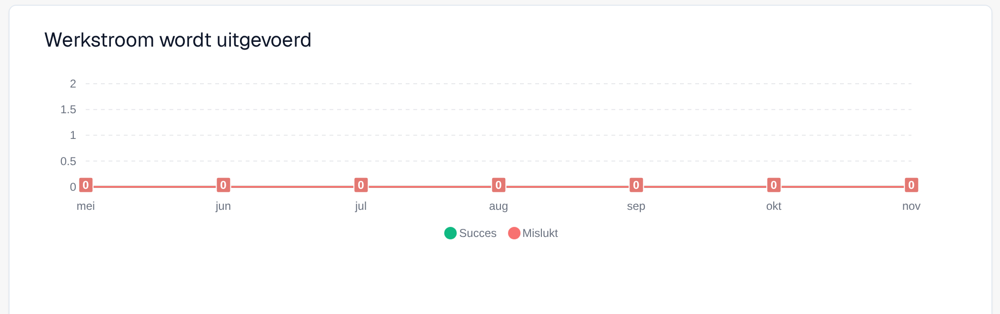
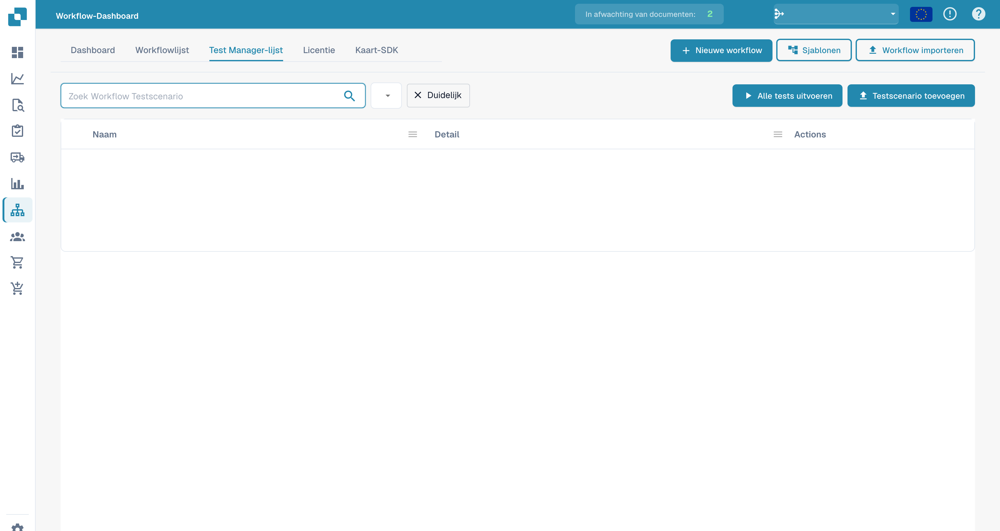

# Dashboard

Het **Workflow-dashboard** is het startpunt van het workflowgedeelte. Het laat zien hoe uw workflows presteren (uitvoeringstotalen, slaag- en faalpercentages, een grafiek van uitvoeringen in de tijd en recente activiteit) en geeft toegang tot de workflowlijst, de testmanager en de Kaart-SDK.

De deelweergaven hieronder tonen de volumemetrieken, het resultaat van de uitvoeringen en de grafiek van de uitvoeringen. Recente activiteit en de navigatieknoppen vallen buiten deze uitsneden.

<figure><figcaption>
Volumemetrieken: vandaag uitgevoerde werkprocessen, in de gekozen periode aangemaakte workflows en het totale aantal runs over meer dan 31 dagen.
</figcaption></figure>

<figure><figcaption>
Resultaat van de uitvoeringen: succesvolle runs van het totale aantal, succespercentage en faalpercentage, elk met een statuslabel en gebaseerd op het getoonde totale aantal runs.
</figcaption></figure>

<figure><figcaption>
Werkstroomuitvoeringen over de zeven getoonde maanden, met de reeksen Succes en Mislukt apart weergegeven.
</figcaption></figure>

## Tabbladen



**Video:** Zoeken en filteren op het Workflow-dashboard · 0:53 · [Ondertitels (WebVTT)](https://docbits-videos.fra1.cdn.digitaloceanspaces.com/settings-assistant/workflow-filtering/v1/nl.vtt)



**Video:** Een Workflow als JSON downloaden en uploaden · 0:55 · [Ondertitels (WebVTT)](https://docbits-videos.fra1.cdn.digitaloceanspaces.com/settings-assistant/workflow-json/v1/nl.vtt)

- **Dashboard** — uitvoeringsstatistieken en recente activiteit (hierboven afgebeeld).
- **Workflowlijst** — elke workflow met zijn type, uitvoeringsvolgorde en trigger. Maak een nieuwe aan met **Nieuwe workflow**.
- **Test Manager-lijst** — testscenario's die uw workflows valideren; voer ze uit met **Alle tests uitvoeren**.
- **Licentie** — informatie over workflowlicenties.
- **Kaart-SDK** — bouw en upload aangepaste workflowkaarten (zie [Kaart-SDK](card-sdk.md)).

De werkbalk biedt ook **Sjablonen**, waarmee de bibliotheek [Workflowsjablonen](standard-workflow-builder.md#workflowsjablonen) wordt geopend, en **Workflow importeren**, waarmee u een workflow uit een JSON-bestand importeert.

Met het tabblad **Test Manager-lijst** kunt u per workflow testscenario's opslaan en gezamenlijk uitvoeren, zodat u kunt bevestigen dat uw workflows na wijzigingen nog steeds correct werken:

<figure><figcaption>
Lijst met workflowtestscenario&#x27;s.
</figcaption></figure>

## Volgende stappen

- Bouw een lineaire automatisering met de **Standaardworkflow**-builder — zie [Toegang krijgen](standard-workflow-builder.md#toegang-krijgen).
- Bouw een vertakkende flow met de **Geavanceerde workflow**-builder.
