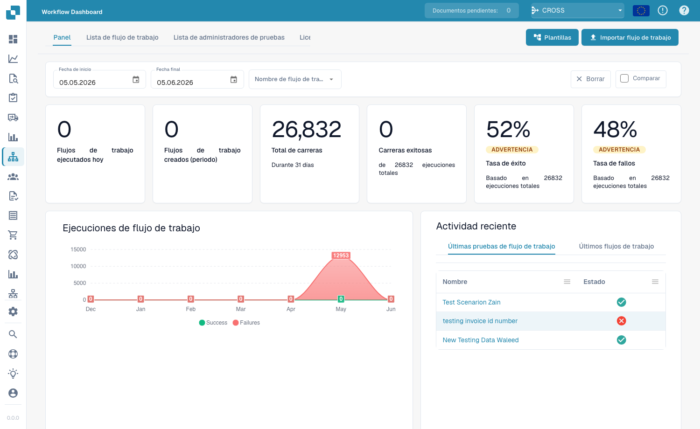
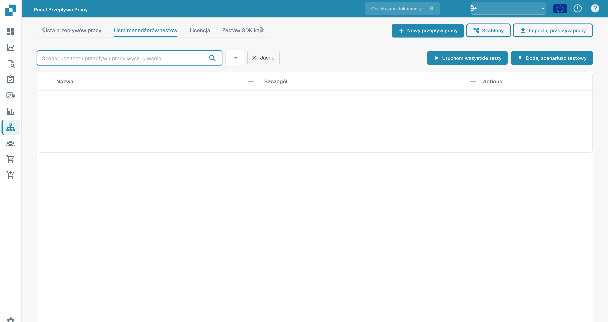

# Panel

**Panel przepływu pracy** to strona główna obszaru przepływów pracy. Pokazuje, jak działają Twoje przepływy pracy — łączne liczby uruchomień, wskaźniki sukcesu i niepowodzeń, wykres uruchomień w czasie oraz ostatnią aktywność — i daje dostęp do listy przepływów pracy, menedżera testów oraz Card SDK.

<figure><figcaption>
Workflow Dashboard — łączne liczby uruchomień, wskaźniki sukcesu/niepowodzeń i ostatnia aktywność dla każdego przepływu pracy.
</figcaption></figure>



**Film:** Lista Workflows · 2:33 · [Napisy (WebVTT)](https://docbits-videos.fra1.cdn.digitaloceanspaces.com/settings-assistant/workflow-list/v1/pl.vtt)

Transkrypcja

**Włącz Standard Workflow** · [0:00](https://docbits-videos.fra1.cdn.digitaloceanspaces.com/settings-assistant/workflow-list/v1/pl.mp4#t=0.25)

Najpierw trzeba włączyć Workflow dla twojej organizacji. Ustawienie Konstruktor przepływu pracy w sekcji Moduł daje dostęp do Standard Workflow. Advanced Workflow mają własne ustawienie i subskrypcję.

**Licencja: Przepływ pracy i Zaawansowany przepływ pracy** · [0:19](https://docbits-videos.fra1.cdn.digitaloceanspaces.com/settings-assistant/workflow-list/v1/pl.mp4#t=19.083)

Ten sam przełącznik jest na zakładce Licencja w Panelu przepływu pracy, obok przełącznika dla Advanced Workflow. Każdy kafelek pokazuje, czy jest aktywny.

**Wybierz swój plan** · [0:34](https://docbits-videos.fra1.cdn.digitaloceanspaces.com/settings-assistant/workflow-list/v1/pl.mp4#t=34.483)

Włączenie otwiera Wybierz swój plan. Wybierz plan i potwierdź, a subskrypcja się zacznie. Tutaj anulujemy.

**Subskrypcje i ich stan** · [0:45](https://docbits-videos.fra1.cdn.digitaloceanspaces.com/settings-assistant/workflow-list/v1/pl.mp4#t=45.983)

Wszystkie subskrypcje i ich stan są w ustawieniach, w sekcji Plan subskrypcji.

**Nowy przepływ pracy: Standard lub Zaawansowany przepływ pracy** · [0:54](https://docbits-videos.fra1.cdn.digitaloceanspaces.com/settings-assistant/workflow-list/v1/pl.mp4#t=54.516)

Na Liście przepływów pracy Nowy przepływ pracy pozwala wybrać Standard lub Zaawansowany przepływ pracy. Każdy ma własny film.

**Zacznij od szablonu** · [1:08](https://docbits-videos.fra1.cdn.digitaloceanspaces.com/settings-assistant/workflow-list/v1/pl.mp4#t=68.416)

Szablony to gotowe Workflow. Otwórz jeden, dostosuj go i zapisz: tak powstaje twój własny nowy Workflow.

**Import pobranych Workflow** · [1:21](https://docbits-videos.fra1.cdn.digitaloceanspaces.com/settings-assistant/workflow-list/v1/pl.mp4#t=81.35)

Przez Importuj przepływ pracy wgrywasz wcześniej pobrane Workflow, na przykład ze środowiska testowego lub kopii zapasowej: pliki JSON, do dziesięciu naraz.

**Duplikuj Workflow** · [1:36](https://docbits-videos.fra1.cdn.digitaloceanspaces.com/settings-assistant/workflow-list/v1/pl.mp4#t=96.916)

Aby wypróbować zmianę bez ruszania działającego Workflow, zduplikuj go. Kopia nazywa się „copy” plus oryginalna nazwa i zachowuje stan włączenia.

**Włączanie i wyłączanie** · [1:56](https://docbits-videos.fra1.cdn.digitaloceanspaces.com/settings-assistant/workflow-list/v1/pl.mp4#t=116.116)

Ikona obok nazwy pokazuje, czy Workflow jest włączony. Aby go włączyć lub wyłączyć, użyj Aktywuj lub Dezaktywuj w menu wiersza.

**Kilka naraz** · [2:15](https://docbits-videos.fra1.cdn.digitaloceanspaces.com/settings-assistant/workflow-list/v1/pl.mp4#t=135.116)

Aby obsłużyć kilka Workflow naraz, zaznacz je i otwórz menu w nagłówku: aktywuj, dezaktywuj lub usuń je razem. Usuwanie wymaga jeszcze jednego potwierdzenia, zanim Workflow znikną.

## Zakładki



**Film:** Wyszukiwanie i filtrowanie na panelu Workflows · 1:04 · [Napisy (WebVTT)](https://docbits-videos.fra1.cdn.digitaloceanspaces.com/settings-assistant/workflow-filtering/v1/pl.vtt)

Transkrypcja

**Szukanie po nazwie** · [0:00](https://docbits-videos.fra1.cdn.digitaloceanspaces.com/settings-assistant/workflow-filtering/v1/pl.mp4#t=0.25)

Na karcie Lista przepływów pracy pole wyszukiwania znajduje Workflows po nazwie. Wpisz część nazwy, a na liście zostaną tylko pasujące Workflows.

**Wyczyść wyszukiwanie** · [0:12](https://docbits-videos.fra1.cdn.digitaloceanspaces.com/settings-assistant/workflow-filtering/v1/pl.mp4#t=12.683)

Wyczyść wyszukiwanie, aby znów zobaczyć wszystkie Workflows. Wyszukiwanie jest też w adresie strony, więc po powrocie do listy zostaje.

**Daty i Workflow** · [0:26](https://docbits-videos.fra1.cdn.digitaloceanspaces.com/settings-assistant/workflow-filtering/v1/pl.mp4#t=26.25)

Na zakładce Panel filtry u góry decydują, co zliczają liczby i wykres: data rozpoczęcia i zakończenia, domyślnie ostatni miesiąc, oraz wszystkie Workflows albo jeden.

**Porównanie dwóch okresów** · [0:43](https://docbits-videos.fra1.cdn.digitaloceanspaces.com/settings-assistant/workflow-filtering/v1/pl.mp4#t=43.016)

Opcja Porównaj dodaje drugi okres: wpisz jego datę rozpoczęcia i zakończenia. Każda liczba pokazuje wtedy też wartość tego okresu i różnicę. Ta przeglądarka zapamięta filtry na następną wizytę.



**Film:** Pobieranie i przesyłanie Workflow jako JSON · 1:11 · [Napisy (WebVTT)](https://docbits-videos.fra1.cdn.digitaloceanspaces.com/settings-assistant/workflow-json/v1/pl.vtt)

Transkrypcja

**Pobierz jako JSON** · [0:00](https://docbits-videos.fra1.cdn.digitaloceanspaces.com/settings-assistant/workflow-json/v1/pl.mp4#t=0.25)

Aby zachować kopię Workflow, otwórz jego akcje na liście i wybierz Pobierz. Otrzymasz jeden plik JSON z nazwą, typem oraz wszystkimi kartami i połączeniami.

**Kopia lub przeniesienie** · [0:14](https://docbits-videos.fra1.cdn.digitaloceanspaces.com/settings-assistant/workflow-json/v1/pl.mp4#t=14.95)

Użyj go jako kopii zapasowej albo do przeniesienia Workflow zbudowanego i przetestowanego w środowisku testowym.

**Importuj przepływ pracy** · [0:27](https://docbits-videos.fra1.cdn.digitaloceanspaces.com/settings-assistant/workflow-json/v1/pl.mp4#t=27.25)

Aby go przywrócić, kliknij Importuj przepływ pracy i wybierz pliki JSON, do dziesięciu naraz.

**Trafia wyłączony** · [0:37](https://docbits-videos.fra1.cdn.digitaloceanspaces.com/settings-assistant/workflow-json/v1/pl.mp4#t=37.383)

Przesłany Workflow trafia wyłączony, więc nic nie działa, zanim go nie sprawdzisz.

**Sprawdź użytkowników, grupy i tabele** · [0:47](https://docbits-videos.fra1.cdn.digitaloceanspaces.com/settings-assistant/workflow-json/v1/pl.mp4#t=47.016)

Karty wskazujące użytkowników, grupy, podorganizacje lub tabele decyzyjne odwołują się do nich przez wewnętrzny identyfikator. Po przesłaniu z innego środowiska otwórz karty i sprawdź, czy nadal są ustawione tak, jak chcesz. Potem przetestuj go i włącz.

- **Panel** — metryki uruchomień i ostatnia aktywność (pokazane powyżej).
- **Lista przepływów pracy** — każdy przepływ pracy wraz z typem, kolejnością wykonania i wyzwalaczem. Nowy przepływ pracy utworzysz przyciskiem **Nowy przepływ pracy**.
- **Lista menedżerów testów** — scenariusze testowe, które walidują Twoje przepływy pracy; uruchom je przyciskiem **Uruchom wszystkie testy**.
- **Licencja** — informacje o licencjonowaniu przepływów pracy.
- **Card SDK** — tworzenie i przesyłanie własnych kart przepływów pracy (zobacz [Card SDK](card-sdk.md)).

Pasek narzędzi oferuje także **Szablony**, który otwiera bibliotekę [Workflow Templates](standard-workflow-builder.md#workflow-templates), oraz **Importuj przepływ pracy**, który importuje przepływ pracy z pliku JSON.

**Zarządzanie testami** pozwala zapisywać scenariusze testowe dla każdego przepływu pracy i uruchamiać je razem, dzięki czemu możesz sprawdzić, czy Twoje przepływy pracy nadal działają poprawnie po wprowadzeniu zmian:

<figure><figcaption>
Lista scenariuszy testowych przepływów.
</figcaption></figure>

## Następne kroki

- Zbuduj liniową automatyzację za pomocą buildera **Standardowy przepływ**.
- Zbuduj rozgałęziony przepływ za pomocą buildera **Zaawansowany przepływ pracy**.
