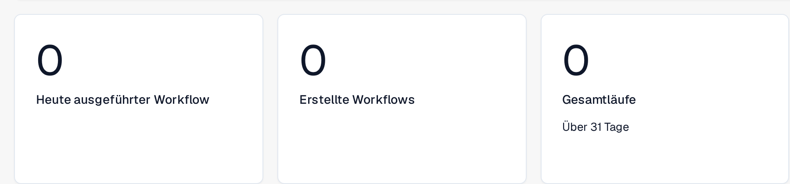
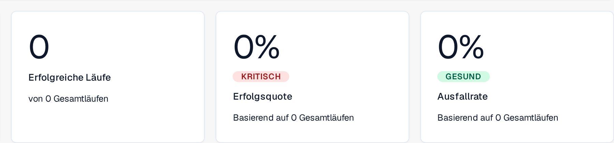
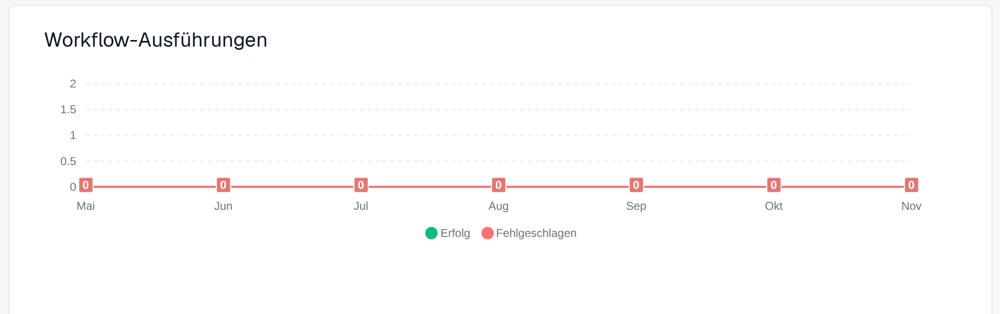
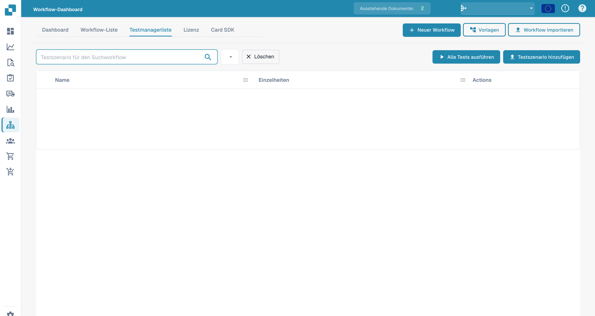

# Dashboard

Das **Workflow-Dashboard** ist die Startseite des Workflow-Bereichs. Es zeigt, wie Ihre Workflows laufen – Ausführungssummen, Erfolgs- und Ausfallrate, ein Diagramm der Ausführungen im Zeitverlauf und die letzte Aktivität – und bietet Zugriff auf die Workflow-Liste, den Testmanager und das Card SDK.

Die folgenden Teilansichten zeigen die Mengenkennzahlen, die Laufergebnisse und das Diagramm der Ausführungen. Letzte Aktivität und Bedienelemente liegen außerhalb dieser Ausschnitte.

<figure><figcaption>
Mengenkennzahlen: <strong>Heute ausgeführter Workflow</strong>, <strong>Erstellte Workflows</strong> und <strong>Gesamtläufe</strong>, hier für die letzten 31 Tage.
</figcaption></figure>

<figure><figcaption>
Laufergebnisse: <strong>Erfolgreiche Läufe</strong>, <strong>Erfolgsquote</strong> und <strong>Ausfallrate</strong>, jeweils mit Bezug auf die Gesamtläufe. Über der Quote steht eine farbige Marke, im Beispiel <strong>KRITISCH</strong> beziehungsweise <strong>GESUND</strong>.
</figcaption></figure>

<figure><figcaption>
<strong>Workflow-Ausführungen</strong> über die angezeigten Monate Mai bis November, mit den Reihen <strong>Erfolg</strong> und <strong>Fehlgeschlagen</strong>.
</figcaption></figure>



**Video:** Die Workflow-Liste · 1:54 · [Untertitel (WebVTT)](https://docbits-videos.fra1.cdn.digitaloceanspaces.com/settings-assistant/workflow-list/v1/de.vtt)

Transkript

**Standard-Workflows einschalten** · [0:00](https://docbits-videos.fra1.cdn.digitaloceanspaces.com/settings-assistant/workflow-list/v1/de.mp4#t=0.25)

Workflows müssen zuerst für Ihre Organisation eingeschaltet werden. Die Einstellung Workflow Builder unter Module gibt Zugriff auf Standard-Workflows. Advanced Workflows haben eine eigene Einstellung und ein eigenes Abonnement.

**Lizenz: Workflow und Advanced Workflow** · [0:14](https://docbits-videos.fra1.cdn.digitaloceanspaces.com/settings-assistant/workflow-list/v1/de.mp4#t=14.383)

Derselbe Schalter ist auf dem Tab Lizenz im Workflow-Dashboard, neben dem für Advanced Workflows. Jede Karte zeigt, ob sie aktiv ist.

**Wählen Sie Ihren Tarif** · [0:24](https://docbits-videos.fra1.cdn.digitaloceanspaces.com/settings-assistant/workflow-list/v1/de.mp4#t=24.75)

Einschalten öffnet Wählen Sie Ihren Tarif. Nach Wahl und Bestätigen beginnt das Abonnement. Hier brechen wir ab.

**Abonnements und ihr Status** · [0:32](https://docbits-videos.fra1.cdn.digitaloceanspaces.com/settings-assistant/workflow-list/v1/de.mp4#t=32.916)

Alle Abonnements und ihr Status stehen in den Einstellungen unter Abonnement-Plan.

**Neuer Workflow: Standard oder Advanced Workflow** · [0:38](https://docbits-videos.fra1.cdn.digitaloceanspaces.com/settings-assistant/workflow-list/v1/de.mp4#t=38.55)

In der Workflow-Liste wählen Sie über Neuer Workflow zwischen Standard und Advanced Workflow. Zu jedem gibt es ein eigenes Video.

**Mit einer Vorlage beginnen** · [0:47](https://docbits-videos.fra1.cdn.digitaloceanspaces.com/settings-assistant/workflow-list/v1/de.mp4#t=47.95)

Vorlagen sind fertige Workflows. Öffnen Sie eine, passen Sie sie an und speichern Sie: So entsteht ein eigener neuer Workflow.

**Heruntergeladene Workflows importieren** · [0:57](https://docbits-videos.fra1.cdn.digitaloceanspaces.com/settings-assistant/workflow-list/v1/de.mp4#t=57.983)

Mit Workflow importieren laden Sie zuvor heruntergeladene Workflows hoch, etwa aus einer Testumgebung oder einem Backup: JSON-Dateien, bis zu zehn auf einmal.

**Einen Workflow duplizieren** · [1:09](https://docbits-videos.fra1.cdn.digitaloceanspaces.com/settings-assistant/workflow-list/v1/de.mp4#t=69.05)

Um eine Änderung auszuprobieren, ohne einen laufenden Workflow anzufassen, duplizieren Sie ihn. Die Kopie heißt „copy“ plus der ursprüngliche Name und behält bei, ob sie eingeschaltet ist.

**Ein- und ausschalten** · [1:27](https://docbits-videos.fra1.cdn.digitaloceanspaces.com/settings-assistant/workflow-list/v1/de.mp4#t=87.616)

Das Symbol neben dem Namen zeigt, ob ein Workflow eingeschaltet ist. Zum Ein- oder Ausschalten nutzen Sie Aktivieren oder Deaktivieren im Zeilenmenü.

**Mehrere auf einmal** · [1:40](https://docbits-videos.fra1.cdn.digitaloceanspaces.com/settings-assistant/workflow-list/v1/de.mp4#t=100.05)

Für mehrere Workflows auf einmal haken Sie sie an und öffnen das Menü in der Kopfzeile: gemeinsam aktivieren, deaktivieren oder löschen. Löschen fragt noch einmal nach, bevor die Workflows weg sind.

## Reiter



**Video:** Suchen und Filtern im Workflow-Dashboard · 0:52 · [Untertitel (WebVTT)](https://docbits-videos.fra1.cdn.digitaloceanspaces.com/settings-assistant/workflow-filtering/v1/de.vtt)

Transkript

**Nach Namen suchen** · [0:00](https://docbits-videos.fra1.cdn.digitaloceanspaces.com/settings-assistant/workflow-filtering/v1/de.mp4#t=0.25)

In der Workflow-Liste findet das Suchfeld Workflows nach ihrem Namen. Tippen Sie einen Teil des Namens ein, und nur die passenden Workflows bleiben in der Liste.

**Suche leeren** · [0:10](https://docbits-videos.fra1.cdn.digitaloceanspaces.com/settings-assistant/workflow-filtering/v1/de.mp4#t=10.383)

Leeren Sie die Suche, um wieder alle Workflows zu sehen. Die Suche steht auch in der Seitenadresse, sodass sie beim Zurückgehen zur Liste erhalten bleibt.

**Zeitraum und Workflow** · [0:20](https://docbits-videos.fra1.cdn.digitaloceanspaces.com/settings-assistant/workflow-filtering/v1/de.mp4#t=20.75)

Auf dem Tab Dashboard bestimmen die Filter oben, was die Zahlen und das Diagramm zählen: ein Start- und ein Enddatum, standardmäßig der letzte Monat, und alle Workflows oder ein einzelner.

**Zwei Zeiträume vergleichen** · [0:33](https://docbits-videos.fra1.cdn.digitaloceanspaces.com/settings-assistant/workflow-filtering/v1/de.mp4#t=33.516)

Vergleichen fügt einen zweiten Zeitraum hinzu: Geben Sie dessen Start- und Enddatum ein. Jede Zahl zeigt dann auch den Wert dieses Zeitraums und die Differenz. Die Filter merkt sich dieser Browser für Ihren nächsten Besuch.



**Video:** Einen Workflow als JSON herunterladen und hochladen · 0:55 · [Untertitel (WebVTT)](https://docbits-videos.fra1.cdn.digitaloceanspaces.com/settings-assistant/workflow-json/v1/de.vtt)

Transkript

**Als JSON herunterladen** · [0:00](https://docbits-videos.fra1.cdn.digitaloceanspaces.com/settings-assistant/workflow-json/v1/de.mp4#t=0.25)

Um eine Kopie eines Workflows zu behalten, öffnen Sie seine Aktionen in der Liste und wählen Herunterladen. Sie erhalten eine JSON-Datei mit seinem Namen, seinem Typ und allen Karten und Verbindungen.

**Sichern oder übertragen** · [0:13](https://docbits-videos.fra1.cdn.digitaloceanspaces.com/settings-assistant/workflow-json/v1/de.mp4#t=13.416)

Nutzen Sie sie als Sicherung, oder um einen Workflow zu übertragen, den Sie in einer Testumgebung gebaut und getestet haben.

**Workflow importieren** · [0:22](https://docbits-videos.fra1.cdn.digitaloceanspaces.com/settings-assistant/workflow-json/v1/de.mp4#t=22.35)

Um ihn zurückzuholen, klicken Sie auf Workflow importieren und wählen die JSON-Dateien, bis zu zehn auf einmal.

**Kommt ausgeschaltet an** · [0:31](https://docbits-videos.fra1.cdn.digitaloceanspaces.com/settings-assistant/workflow-json/v1/de.mp4#t=31.35)

Ein hochgeladener Workflow kommt ausgeschaltet an, damit nichts läuft, bevor Sie ihn angesehen haben.

**Benutzer, Gruppen und Tabellen prüfen** · [0:38](https://docbits-videos.fra1.cdn.digitaloceanspaces.com/settings-assistant/workflow-json/v1/de.mp4#t=38.35)

Karten mit Benutzern, Gruppen, Unterorganisationen oder Entscheidungstabellen verweisen über eine interne ID darauf. Öffnen Sie nach einem Upload aus einer anderen Umgebung die Karten und prüfen Sie, ob sie noch so eingestellt sind, wie Sie es möchten. Testen Sie ihn dann und schalten Sie ihn ein.

- **Dashboard** — Kennzahlen zu den Ausführungen und letzte Aktivität (oben dargestellt).
- **Workflow-Liste** — jeder Workflow mit Typ, Workflow-Ausführungsreihenfolge und Auslöser. Einen neuen Workflow legen Sie mit **Neuer Workflow** an.
- **Testmanagerliste** — Testszenarien, die Ihre Workflows validieren; führen Sie sie mit **Alle Tests ausführen** aus.
- **Lizenz** — Informationen zur Workflow-Lizenzierung.
- **Card SDK** — eigene Workflow-Karten erstellen und hochladen (siehe [Card SDK](card-sdk.md)).

Die Symbolleiste bietet außerdem **Vorlagen**, das die Bibliothek [Workflow-Vorlagen](standard-workflow-builder.md#workflow-vorlagen) öffnet, und **Workflow importieren**, das einen Workflow aus einer JSON-Datei importiert.

Mit dem **Testmanager** können Sie Testszenarien pro Workflow speichern und gemeinsam ausführen, um zu bestätigen, dass Ihre Workflows sich nach Änderungen weiterhin korrekt verhalten:

<figure><figcaption>
Deutsche Testmanagerliste mit Alle Tests ausführen und Testszenario hinzufügen. Szenariodaten sind ausgeblendet; Actions bleibt ein Produktbegriff.
</figcaption></figure>

## Nächste Schritte

- Erstellen Sie mit dem Builder **Standard-Workflow** eine lineare Automatisierung.
- Erstellen Sie mit dem Builder **Erweiterter Workflow** einen verzweigten Ablauf.
