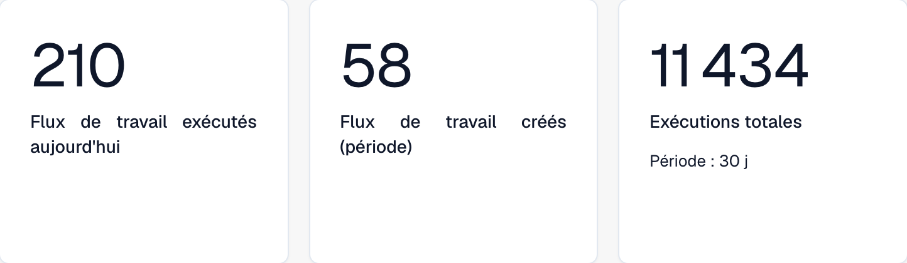
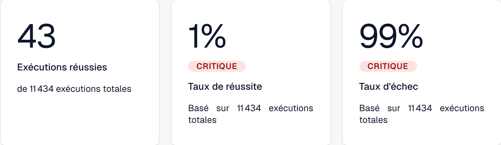
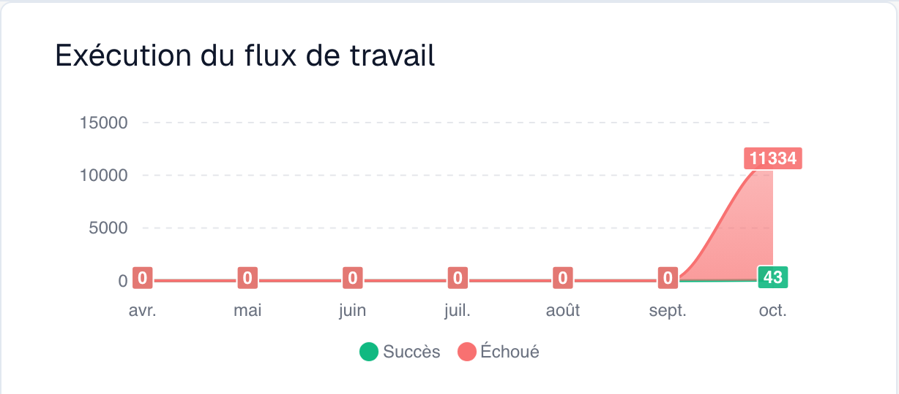
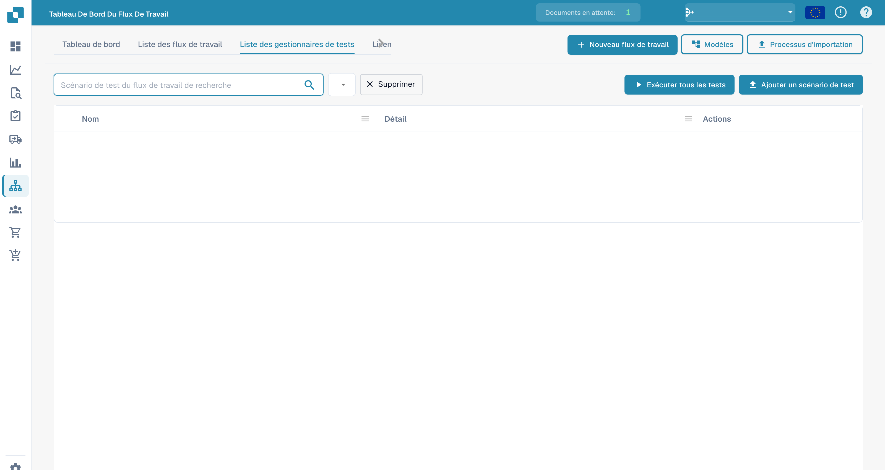

# Tableau de bord

Le **Tableau de bord du flux de travail** est la page d'accueil de la zone des workflows. Il montre les performances de vos workflows — totaux d'exécutions, taux de réussite et d'échec, graphique des exécutions dans le temps et activité récente — et vous donne accès à la liste des workflows, au Test Manager et au Card SDK.

## Indicateurs de volume

Les trois premières cartes présentent les workflows exécutés aujourd’hui, les workflows créés pendant la période et le nombre total d’exécutions. Le sous-titre de la carte **Exécutions totales** indique la durée de la période sélectionnée.

<figure><figcaption>
Indicateurs de volume : workflows exécutés aujourd’hui, workflows créés et exécutions totales sur la période sélectionnée.
</figcaption></figure>

## Résultats d’exécution

Les trois cartes suivantes présentent les **Exécutions réussies**, le **Taux de réussite** et le **Taux d’échec**. Les sous-titres indiquent le nombre total d’exécutions servant de contexte aux indicateurs.

<figure><figcaption>
Résultats d’exécution : exécutions réussies, taux de réussite et taux d’échec.
</figcaption></figure>

## Graphique des exécutions

Le graphique présente les séries de réussite et d’échec avec les mois affichés en français.

<figure><figcaption>
Graphique des exécutions : séries de réussite et d’échec sur les sept mois affichés en français.
</figcaption></figure>

## Onglets



**Vidéo:** Rechercher et filtrer dans le tableau de bord des Workflows · 0:52 · [Sous-titres (WebVTT)](https://docbits-videos.fra1.cdn.digitaloceanspaces.com/settings-assistant/workflow-filtering/v1/fr.vtt)

Transcription

**Rechercher par nom** · [0:00](https://docbits-videos.fra1.cdn.digitaloceanspaces.com/settings-assistant/workflow-filtering/v1/fr.mp4#t=0.25)

Dans la Liste des flux de travail, le champ de recherche trouve les Workflows par leur nom. Tapez une partie du nom : seuls les Workflows correspondants restent dans la liste.

**Effacer la recherche** · [0:11](https://docbits-videos.fra1.cdn.digitaloceanspaces.com/settings-assistant/workflow-filtering/v1/fr.mp4#t=11.816)

Effacez la recherche pour revoir tous les Workflows. La recherche est aussi gardée dans l'adresse de la page : en revenant à la liste, elle est conservée.

**Dates et Workflow** · [0:21](https://docbits-videos.fra1.cdn.digitaloceanspaces.com/settings-assistant/workflow-filtering/v1/fr.mp4#t=21.45)

Dans l'onglet Tableau de bord, les filtres du haut décident de ce que comptent les chiffres et le graphique : une date de début et de fin, par défaut le dernier mois, et tous les Workflows ou un seul.

**Comparer deux périodes** · [0:33](https://docbits-videos.fra1.cdn.digitaloceanspaces.com/settings-assistant/workflow-filtering/v1/fr.mp4#t=33.016)

Comparer ajoute une deuxième période : saisissez sa date de début et de fin. Chaque chiffre montre alors aussi la valeur de cette période et l'écart. Ce navigateur retient les filtres pour votre prochaine visite.



**Vidéo:** Télécharger et importer un Workflow en JSON · 0:56 · [Sous-titres (WebVTT)](https://docbits-videos.fra1.cdn.digitaloceanspaces.com/settings-assistant/workflow-json/v1/fr.vtt)

Transcription

**Télécharger en JSON** · [0:00](https://docbits-videos.fra1.cdn.digitaloceanspaces.com/settings-assistant/workflow-json/v1/fr.mp4#t=0.25)

Pour garder une copie d'un Workflow, ouvrez ses actions dans la liste et choisissez Télécharger. Vous obtenez un fichier JSON avec son nom, son type, toutes ses cartes et ses connexions.

**Sauvegarder ou déplacer** · [0:13](https://docbits-videos.fra1.cdn.digitaloceanspaces.com/settings-assistant/workflow-json/v1/fr.mp4#t=13.816)

Utilisez-le comme sauvegarde, ou pour déplacer un Workflow construit et testé dans un environnement de test.

**Importer le flux de travail** · [0:22](https://docbits-videos.fra1.cdn.digitaloceanspaces.com/settings-assistant/workflow-json/v1/fr.mp4#t=22.016)

Pour le récupérer, cliquez sur Importer le flux de travail et choisissez les fichiers JSON, jusqu'à dix à la fois.

**Arrive désactivé** · [0:30](https://docbits-videos.fra1.cdn.digitaloceanspaces.com/settings-assistant/workflow-json/v1/fr.mp4#t=30.383)

Un Workflow importé arrive désactivé : rien ne s'exécute avant que vous l'ayez vérifié.

**Vérifier utilisateurs, groupes et tables** · [0:37](https://docbits-videos.fra1.cdn.digitaloceanspaces.com/settings-assistant/workflow-json/v1/fr.mp4#t=37.55)

Les cartes qui désignent des utilisateurs, des groupes, des sous-organisations ou des tables de décision les référencent par un identifiant interne. Après un import depuis un autre environnement, ouvrez les cartes et vérifiez qu'elles sont toujours réglées comme vous le souhaitez. Testez-le ensuite, puis activez-le.

- **Tableau de bord** — indicateurs d'exécution et activité récente.
- **Liste des flux de travail** — chaque workflow avec son type, son ordre d'exécution et son déclencheur. Créez-en un nouveau avec **Nouveau flux de travail**.
- **Liste des gestionnaires de tests** — scénarios de test qui valident vos workflows ; exécutez-les avec **Exécuter tous les tests**.
- **Licence** — informations sur la licence des workflows.
- **Kit de développement logiciel pour cartes** — créez et téléversez des cartes de workflow personnalisées (voir [Card SDK](card-sdk.md)).

La barre d'outils propose également **Modèles**, qui ouvre la bibliothèque de modèles réutilisables, et **Processus d'importation**, qui importe un workflow à partir d'un fichier JSON. Pour enregistrer un workflow comme modèle, consultez le [constructeur Flux standard](standard-workflow-builder.md#ajouter-des-cartes).

La **gestion des tests** vous permet d'enregistrer des scénarios de test par workflow et de les exécuter ensemble, afin de confirmer que vos workflows se comportent toujours correctement après des modifications :

<figure><figcaption>
Liste des scénarios de test de workflows.
</figcaption></figure>

## Étapes suivantes

- Créez une automatisation linéaire avec le builder **Flux standard**.
- Créez un flux avec branches grâce au builder **Flux de travail avancé**.
