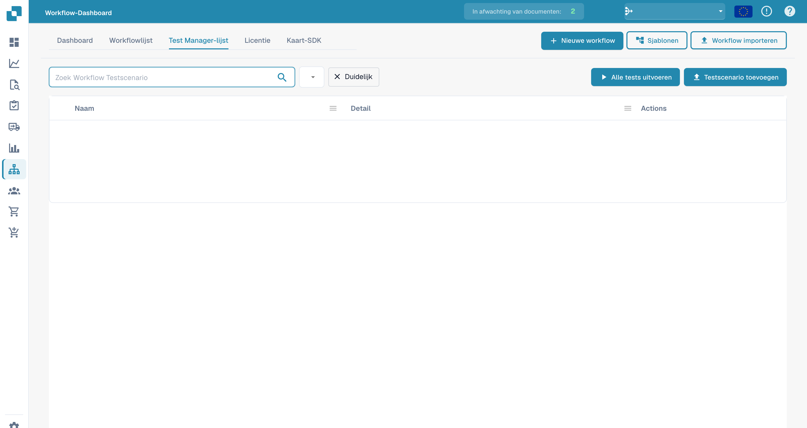

# Dashboard

Het **Workflow-dashboard** is het startpunt van het workflowgedeelte. Het laat zien hoe uw workflows presteren (uitvoeringstotalen, slaag- en faalpercentages, een grafiek van uitvoeringen in de tijd en recente activiteit) en geeft toegang tot de workflowlijst, de testmanager en de Card SDK.

<figure><figcaption>
Het Workflow Dashboard: uitvoeringstotalen, slaag-/faalpercentages en recente activiteit voor elke workflow.
</figcaption></figure>



**Video:** De Workflowlijst · 1:56 · [Ondertitels (WebVTT)](https://docbits-videos.fra1.cdn.digitaloceanspaces.com/settings-assistant/workflow-list/v1/nl.vtt)

Transcriptie

**Standard Workflows inschakelen** · [0:00](https://docbits-videos.fra1.cdn.digitaloceanspaces.com/settings-assistant/workflow-list/v1/nl.mp4#t=0.25)

Workflows moeten eerst voor je organisatie worden ingeschakeld. De instelling Workflow Builder onder Module geeft toegang tot Standard Workflows. Advanced Workflows hebben een eigen instelling en abonnement.

**Licentie: Workflow en Geavanceerde workflow** · [0:13](https://docbits-videos.fra1.cdn.digitaloceanspaces.com/settings-assistant/workflow-list/v1/nl.mp4#t=13.75)

Dezelfde schakelaar staat op het tabblad Licentie van het Workflow-dashboard, naast die voor Advanced Workflows. Elke kaart toont of hij actief is.

**Kies uw plan** · [0:24](https://docbits-videos.fra1.cdn.digitaloceanspaces.com/settings-assistant/workflow-list/v1/nl.mp4#t=24.383)

Inschakelen opent Kies uw plan. Kies een plan en bevestig, en het abonnement start. Hier annuleren we.

**Abonnementen en hun status** · [0:33](https://docbits-videos.fra1.cdn.digitaloceanspaces.com/settings-assistant/workflow-list/v1/nl.mp4#t=33.216)

Alle abonnementen en hun status staan in de instellingen onder Abonnementsplan.

**Nieuwe workflow: Standaard of Geavanceerde workflow** · [0:39](https://docbits-videos.fra1.cdn.digitaloceanspaces.com/settings-assistant/workflow-list/v1/nl.mp4#t=39.416)

In de Workflowlijst kies je met Nieuwe workflow tussen Standaard en Geavanceerde workflow. Elk heeft een eigen video.

**Begin met een sjabloon** · [0:49](https://docbits-videos.fra1.cdn.digitaloceanspaces.com/settings-assistant/workflow-list/v1/nl.mp4#t=49.316)

Sjablonen zijn kant-en-klare Workflows. Open er een, pas hem aan en sla hem op: zo maak je een eigen Workflow.

**Gedownloade Workflows importeren** · [0:58](https://docbits-videos.fra1.cdn.digitaloceanspaces.com/settings-assistant/workflow-list/v1/nl.mp4#t=58.416)

Met Workflow importeren upload je Workflows die je eerder hebt gedownload, bijvoorbeeld uit een testomgeving of een back-up: JSON-bestanden, tot tien tegelijk.

**Een Workflow dupliceren** · [1:10](https://docbits-videos.fra1.cdn.digitaloceanspaces.com/settings-assistant/workflow-list/v1/nl.mp4#t=70.316)

Om een wijziging uit te proberen zonder een draaiende Workflow aan te raken, dupliceer je hem. De kopie heet 'copy' gevolgd door de oorspronkelijke naam en behoudt of hij aan staat.

**Aan- en uitzetten** · [1:28](https://docbits-videos.fra1.cdn.digitaloceanspaces.com/settings-assistant/workflow-list/v1/nl.mp4#t=88.716)

Het icoon naast de naam toont of een Workflow aan staat. Gebruik Activeren of Deactiveren in het rijmenu om hem aan of uit te zetten.

**Meerdere tegelijk** · [1:41](https://docbits-videos.fra1.cdn.digitaloceanspaces.com/settings-assistant/workflow-list/v1/nl.mp4#t=101.816)

Voor meerdere Workflows tegelijk vink je ze aan en open je het menu in de kop: samen activeren, deactiveren of verwijderen. Verwijderen vraagt nog één keer om bevestiging.

## Tabbladen



**Video:** Zoeken en filteren op het Workflow-dashboard · 0:53 · [Ondertitels (WebVTT)](https://docbits-videos.fra1.cdn.digitaloceanspaces.com/settings-assistant/workflow-filtering/v1/nl.vtt)

Transcriptie

**Zoeken op naam** · [0:00](https://docbits-videos.fra1.cdn.digitaloceanspaces.com/settings-assistant/workflow-filtering/v1/nl.mp4#t=0.25)

In de Workflowlijst vindt het zoekveld Workflows op naam. Typ een deel van een naam, en alleen de passende Workflows blijven in de lijst.

**Zoekopdracht wissen** · [0:10](https://docbits-videos.fra1.cdn.digitaloceanspaces.com/settings-assistant/workflow-filtering/v1/nl.mp4#t=10.616)

Wis de zoekopdracht om weer alle Workflows te zien. De zoekopdracht staat ook in het paginaadres, dus terug in de lijst blijft hij behouden.

**Datums en Workflow** · [0:20](https://docbits-videos.fra1.cdn.digitaloceanspaces.com/settings-assistant/workflow-filtering/v1/nl.mp4#t=20.983)

Op het tabblad Dashboard bepalen de filters bovenaan wat de cijfers en de grafiek tellen: een start- en een einddatum, standaard de laatste maand, en alle Workflows of één enkele.

**Twee periodes vergelijken** · [0:33](https://docbits-videos.fra1.cdn.digitaloceanspaces.com/settings-assistant/workflow-filtering/v1/nl.mp4#t=33.983)

Vergelijken voegt een tweede periode toe: vul de start- en einddatum in. Elk cijfer toont dan ook de waarde van die periode en het verschil. Deze browser onthoudt de filters voor uw volgende bezoek.



**Video:** Een Workflow als JSON downloaden en uploaden · 0:55 · [Ondertitels (WebVTT)](https://docbits-videos.fra1.cdn.digitaloceanspaces.com/settings-assistant/workflow-json/v1/nl.vtt)

Transcriptie

**Downloaden als JSON** · [0:00](https://docbits-videos.fra1.cdn.digitaloceanspaces.com/settings-assistant/workflow-json/v1/nl.mp4#t=0.25)

Om een kopie van een Workflow te bewaren, opent u de acties in de lijst en kiest u Download. U krijgt één JSON-bestand met de naam, het type en alle kaarten en verbindingen.

**Back-up of verplaatsen** · [0:13](https://docbits-videos.fra1.cdn.digitaloceanspaces.com/settings-assistant/workflow-json/v1/nl.mp4#t=13.183)

Gebruik het als back-up, of om een Workflow te verplaatsen die u in een testomgeving hebt gebouwd en getest.

**Workflow importeren** · [0:21](https://docbits-videos.fra1.cdn.digitaloceanspaces.com/settings-assistant/workflow-json/v1/nl.mp4#t=21.15)

Om hem terug te halen, klikt u op Workflow importeren en kiest u de JSON-bestanden, tot tien tegelijk.

**Komt uitgeschakeld binnen** · [0:30](https://docbits-videos.fra1.cdn.digitaloceanspaces.com/settings-assistant/workflow-json/v1/nl.mp4#t=30.483)

Een geüploade Workflow komt uitgeschakeld binnen, zodat er niets draait voordat u hem hebt bekeken.

**Gebruikers, groepen en tabellen controleren** · [0:38](https://docbits-videos.fra1.cdn.digitaloceanspaces.com/settings-assistant/workflow-json/v1/nl.mp4#t=38.616)

Kaarten die gebruikers, groepen, suborganisaties of beslistabellen noemen, verwijzen ernaar met een interne id. Open na een upload uit een andere omgeving de kaarten en controleer of ze nog zo zijn ingesteld als u wilt. Test hem daarna en schakel hem in.

- **Dashboard** — uitvoeringsstatistieken en recente activiteit (hierboven weergegeven).
- **Workflowlijst** — elke workflow met zijn type, uitvoeringsvolgorde en trigger. Maak een nieuwe aan met **Nieuwe workflow**.
- **Test Manager-lijst** — testscenario's die uw workflows valideren; voer ze uit met **Alle tests uitvoeren**.
- **Licentie** — informatie over workflowlicenties.
- **Card SDK** — bouw en upload aangepaste workflowkaarten (zie [Card SDK](card-sdk.md)).

De werkbalk biedt ook **Sjablonen**, waarmee de bibliotheek [Workflow Templates](standard-workflow-builder.md#workflow-templates) wordt geopend, en **Workflow importeren**, waarmee u een workflow uit een JSON-bestand importeert.

Met de **Testbeheer** kunt u per workflow testscenario's opslaan en gezamenlijk uitvoeren, zodat u kunt bevestigen dat uw workflows na wijzigingen nog steeds correct werken:

<figure><figcaption>
Lijst met workflowtestscenario&#x27;s.
</figcaption></figure>

## Volgende stappen

- Bouw een lineaire automatisering met de **Standaardworkflow**-builder.
- Bouw een vertakkende flow met de **Geavanceerde workflow**-builder.
