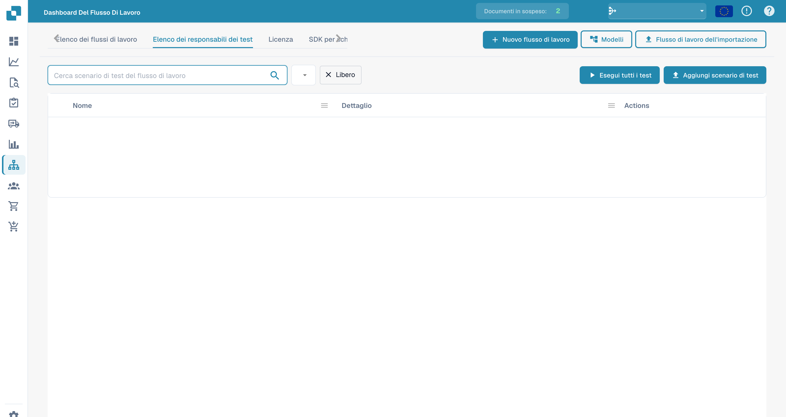

# Pannello di controllo

La **Dashboard del flusso di lavoro** è la home dell'area workflow. Mostra come stanno andando i tuoi workflow — totali delle esecuzioni, tassi di successo e di fallimento, un grafico delle esecuzioni nel tempo e l'attività recente — e ti dà accesso all'elenco dei workflow, al test manager e al Card SDK.

<figure><figcaption>
La Workflow Dashboard — totali delle esecuzioni, tassi di successo/fallimento e attività recente per ogni workflow.
</figcaption></figure>

## Schede



**Video:** Cercare e filtrare nella dashboard dei Workflow · 0:53 · [Sottotitoli (WebVTT)](https://docbits-videos.fra1.cdn.digitaloceanspaces.com/settings-assistant/workflow-filtering/v1/it.vtt)

Trascrizione

**Cercare per nome** · [0:00](https://docbits-videos.fra1.cdn.digitaloceanspaces.com/settings-assistant/workflow-filtering/v1/it.mp4#t=0.25)

Nell'Elenco dei flussi di lavoro, il campo di ricerca trova i Workflow per nome. Digita parte di un nome: nell'elenco restano solo i Workflow corrispondenti.

**Cancellare la ricerca** · [0:11](https://docbits-videos.fra1.cdn.digitaloceanspaces.com/settings-assistant/workflow-filtering/v1/it.mp4#t=11.35)

Cancella la ricerca per rivedere tutti i Workflow. La ricerca resta anche nell'indirizzo della pagina, quindi tornando all'elenco viene mantenuta.

**Date e Workflow** · [0:21](https://docbits-videos.fra1.cdn.digitaloceanspaces.com/settings-assistant/workflow-filtering/v1/it.mp4#t=21.383)

Nella scheda Cruscotto, i filtri in alto decidono cosa contano i numeri e il grafico: una data di inizio e una di fine, di default l'ultimo mese, e tutti i Workflow o uno solo.

**Confrontare due periodi** · [0:34](https://docbits-videos.fra1.cdn.digitaloceanspaces.com/settings-assistant/workflow-filtering/v1/it.mp4#t=34.483)

Confronta aggiunge un secondo periodo: inserisci la sua data di inizio e di fine. Ogni numero mostra poi anche il valore di quel periodo e la differenza. Questo browser ricorda i filtri per la prossima visita.



**Video:** Scaricare e caricare un Workflow come JSON · 0:49 · [Sottotitoli (WebVTT)](https://docbits-videos.fra1.cdn.digitaloceanspaces.com/settings-assistant/workflow-json/v1/it.vtt)

Trascrizione

**Scarica come JSON** · [0:00](https://docbits-videos.fra1.cdn.digitaloceanspaces.com/settings-assistant/workflow-json/v1/it.mp4#t=0.25)

Per tenere una copia di un Workflow, apri le sue azioni nell'elenco e scegli Scarica. Ottieni un file JSON con il nome, il tipo e tutte le schede e i collegamenti.

**Backup o spostamento** · [0:11](https://docbits-videos.fra1.cdn.digitaloceanspaces.com/settings-assistant/workflow-json/v1/it.mp4#t=11.65)

Usalo come backup, o per spostare un Workflow creato e testato in un ambiente di test.

**Importa flusso di lavoro** · [0:18](https://docbits-videos.fra1.cdn.digitaloceanspaces.com/settings-assistant/workflow-json/v1/it.mp4#t=18.35)

Per ripristinarlo, fai clic su Importa flusso di lavoro e scegli i file JSON, fino a dieci alla volta.

**Arriva disattivato** · [0:26](https://docbits-videos.fra1.cdn.digitaloceanspaces.com/settings-assistant/workflow-json/v1/it.mp4#t=26.783)

Un Workflow caricato arriva disattivato, quindi non parte nulla prima che tu l'abbia controllato.

**Controlla utenti, gruppi e tabelle** · [0:33](https://docbits-videos.fra1.cdn.digitaloceanspaces.com/settings-assistant/workflow-json/v1/it.mp4#t=33.616)

Le schede che indicano utenti, gruppi, sotto-organizzazioni o tabelle decisionali li richiamano con un id interno. Dopo un caricamento da un altro ambiente, apri le schede e controlla che siano ancora impostate come vuoi. Poi testalo e attivalo.

- **Cruscotto** — metriche delle esecuzioni e attività recente (mostrate sopra).
- **Elenco dei flussi di lavoro** — ogni workflow con il suo tipo, l'ordine di esecuzione e il trigger. Creane uno nuovo con **Nuovo flusso di lavoro**.
- **Elenco degli scenari di test** — scenari di test che validano i tuoi workflow; eseguili con **Esegui tutti i test**.
- **Licenza** — informazioni sulla licenza dei workflow.
- **Card SDK** — crea e carica schede workflow personalizzate (vedi [Card SDK](card-sdk.md)).

La barra degli strumenti offre anche **Modelli**, che apre la libreria dei modelli di workflow, e **Flusso di lavoro dell'importazione**, che importa un workflow da un file JSON.

Il **Gestione dei test** ti permette di salvare scenari di test per ogni workflow e di eseguirli insieme, così puoi verificare che i tuoi workflow si comportino ancora correttamente dopo le modifiche:

<figure><figcaption>
Elenco degli scenari di test dei workflow.
</figcaption></figure>

## Prossimi passi

- Crea un'automazione lineare con il builder **Flusso standard**.
- Crea un flusso con diramazioni con il builder **Flusso di lavoro avanzato**.

Per modificare un workflow lineare, consulta l’[apertura del builder Flusso standard](standard-workflow-builder.md#come-accedere).
