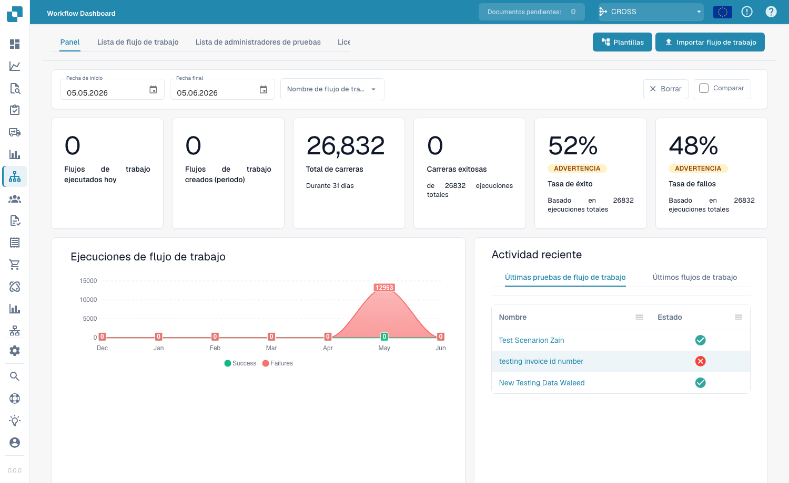
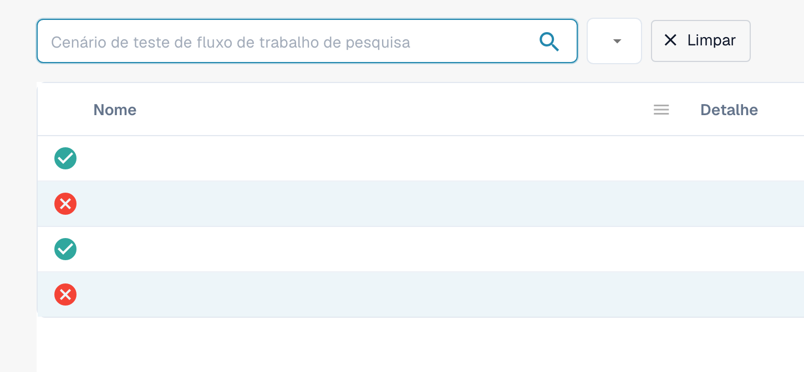
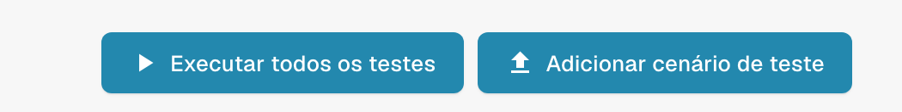

# Painel

O **Painel de fluxo de trabalho** é a página inicial da área de workflows. Ele mostra o desempenho dos seus workflows — totais de execuções, taxas de sucesso e falha, um gráfico de execuções ao longo do tempo e a atividade recente — e dá acesso à lista de workflows, ao gerenciador de testes e ao Card SDK.

<figure><figcaption>
O Workflow Dashboard — totais de execuções, taxas de sucesso/falha e atividade recente de cada workflow.
</figcaption></figure>

## Abas



**Vídeo:** Pesquisar e filtrar no painel de Workflows · 0:47 · [Legendas (WebVTT)](https://docbits-videos.fra1.cdn.digitaloceanspaces.com/settings-assistant/workflow-filtering/v1/pt.vtt)

Transcrição

**Pesquisar por nome** · [0:00](https://docbits-videos.fra1.cdn.digitaloceanspaces.com/settings-assistant/workflow-filtering/v1/pt.mp4#t=0.25)

Na Lista de fluxo de trabalho, o campo de pesquisa encontra Workflows pelo nome. Digite parte de um nome e só os Workflows correspondentes ficam na lista.

**Limpar a pesquisa** · [0:10](https://docbits-videos.fra1.cdn.digitaloceanspaces.com/settings-assistant/workflow-filtering/v1/pt.mp4#t=10.15)

Limpe a pesquisa para ver todos os Workflows de novo. A pesquisa também fica no endereço da página, então ela é mantida ao voltar para a lista.

**Datas e Workflow** · [0:18](https://docbits-videos.fra1.cdn.digitaloceanspaces.com/settings-assistant/workflow-filtering/v1/pt.mp4#t=18.683)

Na aba Painel, os filtros no topo definem o que os números e o gráfico contam: uma data de início e de fim, por padrão o último mês, e todos os Workflows ou um só.

**Comparar dois períodos** · [0:29](https://docbits-videos.fra1.cdn.digitaloceanspaces.com/settings-assistant/workflow-filtering/v1/pt.mp4#t=29.05)

Comparar adiciona um segundo período: informe a data de início e de fim. Cada número mostra então também o valor desse período e a diferença. Este navegador lembra os filtros para a sua próxima visita.



**Vídeo:** Baixar e enviar um Workflow como JSON · 0:50 · [Legendas (WebVTT)](https://docbits-videos.fra1.cdn.digitaloceanspaces.com/settings-assistant/workflow-json/v1/pt.vtt)

Transcrição

**Download como JSON** · [0:00](https://docbits-videos.fra1.cdn.digitaloceanspaces.com/settings-assistant/workflow-json/v1/pt.mp4#t=0.25)

Para guardar uma cópia de um Workflow, abra as ações dele na lista e escolha Download. Você recebe um arquivo JSON com o nome, o tipo e todos os cartões e conexões.

**Backup ou mudança** · [0:12](https://docbits-videos.fra1.cdn.digitaloceanspaces.com/settings-assistant/workflow-json/v1/pt.mp4#t=12.283)

Use-o como backup, ou para mover um Workflow que você criou e testou em um ambiente de teste.

**Importar fluxo de trabalho** · [0:18](https://docbits-videos.fra1.cdn.digitaloceanspaces.com/settings-assistant/workflow-json/v1/pt.mp4#t=18.883)

Para trazê-lo de volta, clique em Importar fluxo de trabalho e escolha os arquivos JSON, até dez de cada vez.

**Chega desativado** · [0:26](https://docbits-videos.fra1.cdn.digitaloceanspaces.com/settings-assistant/workflow-json/v1/pt.mp4#t=26.916)

Um Workflow carregado chega desativado, então nada é executado antes de você revisá-lo.

**Conferir usuários, grupos e tabelas** · [0:33](https://docbits-videos.fra1.cdn.digitaloceanspaces.com/settings-assistant/workflow-json/v1/pt.mp4#t=33.616)

Cartões que indicam usuários, grupos, suborganizações ou tabelas de decisão apontam para eles por um id interno. Depois de carregar de outro ambiente, abra os cartões e confira se continuam configurados como você quer. Depois teste-o e ative-o.

- **Painel** — métricas de execução e atividade recente (mostrados acima).
- **Lista de fluxo de trabalho** — todos os workflows com tipo, ordem de execução e gatilho. Crie um novo com **Novo fluxo de trabalho**.
- **Lista de Gerenciadores de Teste** — cenários de teste que validam seus workflows; execute-os com **Executar todos os testes**.
- **Licença** — informações de licenciamento dos workflows.
- **Card SDK** — crie e envie cartões de workflow personalizados (consulte [Card SDK](card-sdk.md)).

A barra de ferramentas também oferece **Modelos**, que abre a biblioteca de [Modelos de workflow](standard-workflow-builder.md#workflow-templates), e **Fluxo de trabalho de importação**, que importa um workflow a partir de um arquivo JSON.

A **gestão de testes** permite salvar cenários de teste por workflow e executá-los em conjunto, para confirmar que seus workflows continuam se comportando corretamente após alterações:

<figure><figcaption>
Vista parcial da lista de cenários de teste, com os valores privados ocultos. O botão Limpar limpa o filtro.
</figcaption></figure>

<figure><figcaption>
Pormenor das ações de teste: Executar todos os testes e Adicionar cenário de teste.
</figcaption></figure>

## Próximos passos

- Crie uma automação linear com o construtor **Fluxo padrão**.
- Crie um fluxo com ramificações com o construtor **Fluxo de trabalho avançado**.
