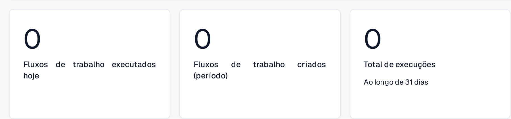
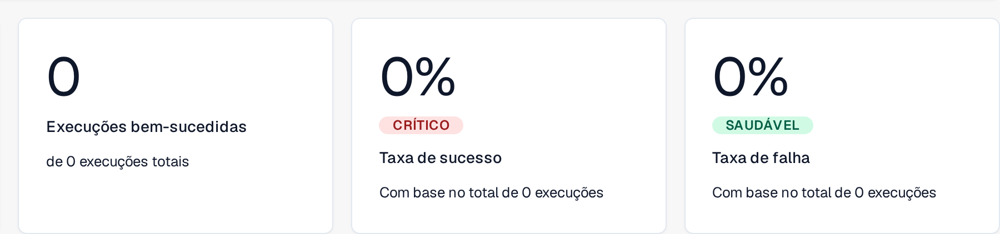
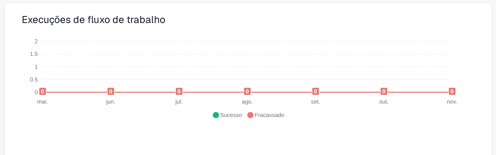

# Painel

O **Painel de fluxo de trabalho** é a página inicial da área de fluxos de trabalho. Mostra o desempenho dos seus fluxos de trabalho — totais de execuções, taxas de sucesso e de falha, um gráfico de execuções ao longo do tempo e a atividade recente — e dá acesso à lista de fluxos de trabalho, ao gerenciador de testes e ao SDK de cartão.

As vistas parciais abaixo mostram as métricas de volume, o resultado das execuções e o gráfico de execuções. A atividade recente e os controlos de navegação ficam fora destes recortes.

<figure><figcaption>
Métricas de volume: fluxos de trabalho executados hoje, fluxos de trabalho criados no período selecionado e total de execuções.
</figcaption></figure>

<figure><figcaption>
Resultado das execuções: execuções bem-sucedidas, taxa de sucesso e taxa de falha, com o total de execuções em que se baseiam.
</figcaption></figure>

<figure><figcaption>
Execuções de fluxos de trabalho nos sete meses apresentados, com as séries Sucesso e Fracassado apresentadas em separado.
</figcaption></figure>

## Abas



**Vídeo:** Pesquisar e filtrar no painel de Workflows · 0:47 · [Legendas (WebVTT)](https://docbits-videos.fra1.cdn.digitaloceanspaces.com/settings-assistant/workflow-filtering/v1/pt.vtt)



**Vídeo:** Baixar e enviar um Workflow como JSON · 0:50 · [Legendas (WebVTT)](https://docbits-videos.fra1.cdn.digitaloceanspaces.com/settings-assistant/workflow-json/v1/pt.vtt)

- **Painel** — métricas de execução e atividade recente (mostradas acima).
- **Lista de fluxo de trabalho** — todos os fluxos de trabalho com o tipo, a ordem de execução e o gatilho. Crie um novo com **Novo fluxo de trabalho**.
- **Lista de Gerenciadores de Teste** — cenários de teste que validam os seus fluxos de trabalho; execute-os com **Executar todos os testes**.
- **Licença** — informações de licenciamento dos fluxos de trabalho.
- **SDK de cartão** — crie e carregue cartões de fluxo de trabalho personalizados (consulte [Card SDK](card-sdk.md)).

A barra de ferramentas também oferece **Modelos**, que abre a biblioteca de [Modelos de fluxo de trabalho](standard-workflow-builder.md#modelos-de-fluxo-de-trabalho), e **Fluxo de trabalho de importação**, que importa um fluxo de trabalho a partir de um ficheiro JSON.

A aba **Lista de Gerenciadores de Teste** permite guardar cenários de teste por fluxo de trabalho e executá-los em conjunto, para confirmar que os seus fluxos de trabalho continuam a comportar-se corretamente depois de alterações:

<figure><figcaption>
Vista parcial da lista de cenários de teste, com os valores privados ocultos. O botão Limpar limpa o filtro.
</figcaption></figure>

<figure><figcaption>
Pormenor das ações de teste: Executar todos os testes e Adicionar cenário de teste.
</figcaption></figure>

## Próximos passos

- Crie uma automação linear com o construtor **Fluxo padrão** — consulte [Como aceder](standard-workflow-builder.md#como-aceder).
- Crie um fluxo com ramificações com o construtor **Fluxo de trabalho avançado**.
