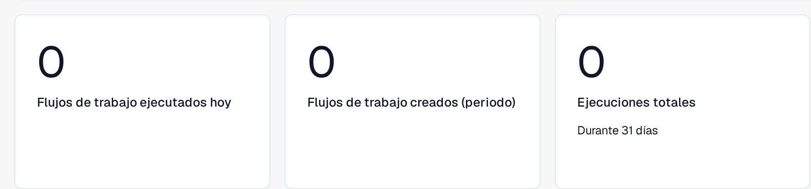
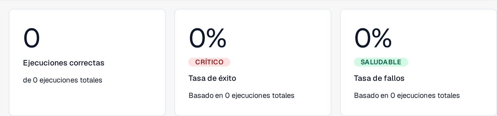
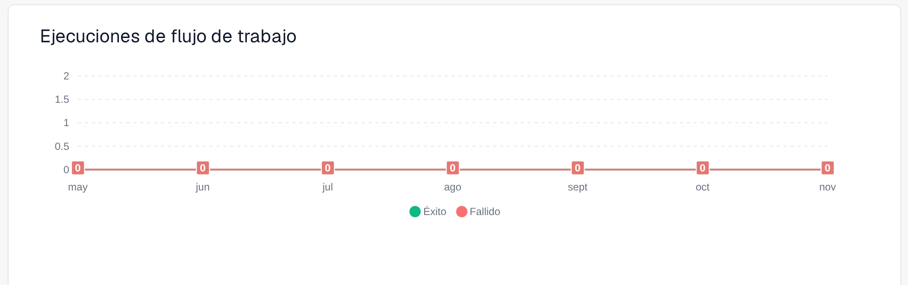
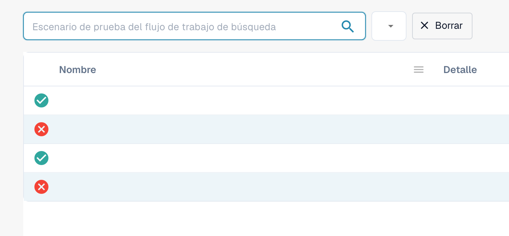
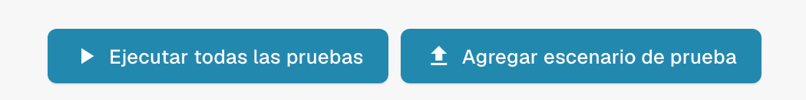

# Panel

El **Panel de flujo de trabajo** es la página de inicio del área de flujos de trabajo. Muestra cómo se comportan sus flujos de trabajo (totales de ejecuciones, tasas de éxito y de fallo, un gráfico de ejecuciones a lo largo del tiempo y la actividad reciente) y le da acceso a la lista de flujos de trabajo, al gestor de pruebas y al Card SDK.

Las siguientes vistas parciales muestran las métricas de volumen, los resultados de las ejecuciones y el gráfico de ejecuciones. La actividad reciente y los controles de navegación quedan fuera de estos recortes.

<figure><figcaption>
Métricas de volumen: <strong>Flujos de trabajo ejecutados hoy</strong>, <strong>Flujos de trabajo creados (periodo)</strong> y <strong>Ejecuciones totales</strong>, en este caso de los últimos 31 días.
</figcaption></figure>

<figure><figcaption>
Resultados de las ejecuciones: <strong>Ejecuciones correctas</strong>, <strong>Tasa de éxito</strong> y <strong>Tasa de fallos</strong>, cada uno con referencia a las ejecuciones totales. Sobre la tasa aparece una etiqueta de color, en el ejemplo <strong>CRÍTICO</strong> o <strong>SALUDABLE</strong>.
</figcaption></figure>

<figure><figcaption>
<strong>Ejecuciones de flujo de trabajo</strong> en los meses mostrados, de mayo a noviembre, con las series <strong>Éxito</strong> y <strong>Fallido</strong>.
</figcaption></figure>

## Pestañas



**Vídeo:** Buscar y filtrar en el panel de Workflows · 0:49 · [Subtítulos (WebVTT)](https://docbits-videos.fra1.cdn.digitaloceanspaces.com/settings-assistant/workflow-filtering/v1/es.vtt)

Transcripción

**Buscar por nombre** · [0:00](https://docbits-videos.fra1.cdn.digitaloceanspaces.com/settings-assistant/workflow-filtering/v1/es.mp4#t=0.25)

En la Lista de flujo de trabajo, el campo de búsqueda encuentra Workflows por su nombre. Escriba parte de un nombre y solo quedan en la lista los Workflows que coinciden.

**Borrar la búsqueda** · [0:10](https://docbits-videos.fra1.cdn.digitaloceanspaces.com/settings-assistant/workflow-filtering/v1/es.mp4#t=10.783)

Borre la búsqueda para volver a ver todos los Workflows. La búsqueda también queda en la dirección de la página, así que se mantiene al volver a la lista.

**Fechas y Workflow** · [0:19](https://docbits-videos.fra1.cdn.digitaloceanspaces.com/settings-assistant/workflow-filtering/v1/es.mp4#t=19.083)

En la pestaña Panel, los filtros de arriba deciden qué cuentan las cifras y el gráfico: una fecha de inicio y de fin, por defecto el último mes, y todos los Workflows o uno solo.

**Comparar dos periodos** · [0:30](https://docbits-videos.fra1.cdn.digitaloceanspaces.com/settings-assistant/workflow-filtering/v1/es.mp4#t=30.583)

Comparar añade un segundo periodo: introduzca su fecha de inicio y de fin. Cada cifra muestra entonces también el valor de ese periodo y la diferencia. Este navegador recuerda los filtros para su próxima visita.



**Vídeo:** Descargar y subir un Workflow como JSON · 0:46 · [Subtítulos (WebVTT)](https://docbits-videos.fra1.cdn.digitaloceanspaces.com/settings-assistant/workflow-json/v1/es.vtt)

Transcripción

**Descargar como JSON** · [0:00](https://docbits-videos.fra1.cdn.digitaloceanspaces.com/settings-assistant/workflow-json/v1/es.mp4#t=0.25)

Para guardar una copia de un Workflow, abra sus acciones en la lista y elija Descargar. Obtiene un archivo JSON con su nombre, su tipo y todas sus tarjetas y conexiones.

**Copia de seguridad o traslado** · [0:11](https://docbits-videos.fra1.cdn.digitaloceanspaces.com/settings-assistant/workflow-json/v1/es.mp4#t=11.25)

Úselo como copia de seguridad, o para trasladar un Workflow que creó y probó en un entorno de pruebas.

**Importar flujo de trabajo** · [0:17](https://docbits-videos.fra1.cdn.digitaloceanspaces.com/settings-assistant/workflow-json/v1/es.mp4#t=17.85)

Para recuperarlo, haga clic en Importar flujo de trabajo y elija los archivos JSON, hasta diez a la vez.

**Llega desactivado** · [0:25](https://docbits-videos.fra1.cdn.digitaloceanspaces.com/settings-assistant/workflow-json/v1/es.mp4#t=25.016)

Un Workflow cargado llega desactivado, así que nada se ejecuta antes de que lo haya revisado.

**Revisar usuarios, grupos y tablas** · [0:31](https://docbits-videos.fra1.cdn.digitaloceanspaces.com/settings-assistant/workflow-json/v1/es.mp4#t=31.05)

Las tarjetas que nombran usuarios, grupos, suborganizaciones o tablas de decisión los referencian con un id interno. Tras cargarlo desde otro entorno, abra las tarjetas y compruebe que siguen configuradas como desea. Después pruébelo y actívelo.

- **Panel**: métricas de ejecución y actividad reciente (se muestra arriba).
- **Lista de flujo de trabajo**: todos los flujos de trabajo con su tipo, orden de ejecución y disparador. Cree uno nuevo con **Nuevo flujo de trabajo**.
- **Lista de administradores de pruebas**: escenarios de prueba que validan sus flujos de trabajo; ejecútelos con **Ejecutar todas las pruebas**.
- **Licencia**: información de licencia de los flujos de trabajo.
- **SDK de tarjeta**: cree y suba tarjetas de flujo de trabajo personalizadas (consulte [Card SDK](card-sdk.md)).

La barra de herramientas también ofrece **Plantillas**, que abre la biblioteca de [Plantillas de flujo de trabajo](standard-workflow-builder.md#workflow-templates), e **Importar flujo de trabajo**, que importa un flujo de trabajo desde un archivo JSON.

La **gestión de pruebas** le permite guardar escenarios de prueba por flujo de trabajo y ejecutarlos juntos, de modo que pueda confirmar que sus flujos de trabajo siguen comportándose correctamente después de los cambios:

<figure><figcaption>
Vista parcial del gestor de pruebas: búsqueda, columnas Nombre y Detalle y estados de los escenarios. Los valores privados están ocultos.
</figcaption></figure>

<figure><figcaption>
Detalle de los botones Ejecutar todas las pruebas y Agregar escenario de prueba.
</figcaption></figure>

## Próximos pasos

- Cree una automatización lineal con el constructor **Flujo estándar**.
- Cree un flujo con ramificaciones con el constructor **Flujo de trabajo avanzado**.
