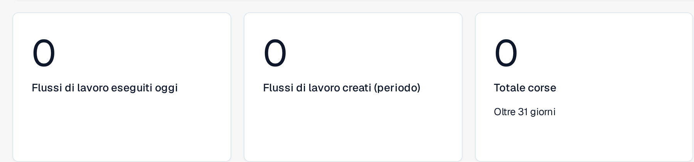
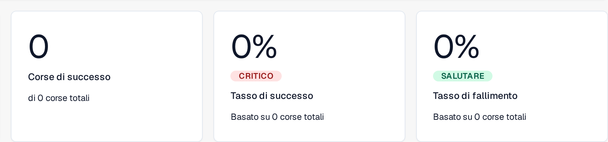
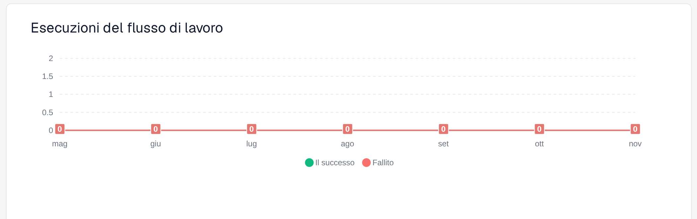

# Pannello di controllo

La **Dashboard del flusso di lavoro** è la home dell'area workflow. La scheda **Cruscotto** mostra come stanno andando i tuoi flussi di lavoro — totali delle esecuzioni, tassi di successo e di fallimento, un grafico delle esecuzioni nel tempo e l'attività recente — e ti dà accesso all'**Elenco dei flussi di lavoro**, alla gestione dei test e all'**SDK per schede**.

Le viste parziali qui sotto mostrano le metriche di volume, l'esito delle esecuzioni e il grafico delle esecuzioni. L'attività recente e i comandi di navigazione restano fuori da questi ritagli.

<figure><figcaption>
Metriche di volume: flussi di lavoro eseguiti oggi, flussi di lavoro creati nel periodo selezionato e totale delle esecuzioni.
</figcaption></figure>

<figure><figcaption>
Esito delle esecuzioni: esecuzioni riuscite, tasso di successo e tasso di fallimento, con il numero di esecuzioni mostrato.
</figcaption></figure>

<figure><figcaption>
Esecuzioni dei flussi di lavoro nei sette mesi mostrati, con i successi e i fallimenti in due serie separate.
</figcaption></figure>

## Schede



**Video:** Cercare e filtrare nella dashboard dei Workflow · 0:53 · [Sottotitoli (WebVTT)](https://docbits-videos.fra1.cdn.digitaloceanspaces.com/settings-assistant/workflow-filtering/v1/it.vtt)



**Video:** Scaricare e caricare un Workflow come JSON · 0:49 · [Sottotitoli (WebVTT)](https://docbits-videos.fra1.cdn.digitaloceanspaces.com/settings-assistant/workflow-json/v1/it.vtt)

- **Cruscotto** — metriche delle esecuzioni (illustrate sopra) e attività recente.
- **Elenco dei flussi di lavoro** — ogni flusso di lavoro con il suo tipo, l'ordine di esecuzione e il trigger. Creane uno nuovo con **Nuovo flusso di lavoro**.
- **Elenco dei responsabili dei test** — scenari di test che validano i tuoi flussi di lavoro; eseguili con **Esegui tutti i test**.
- **Licenza** — informazioni sulla licenza dei flussi di lavoro.
- **SDK per schede** — crea e carica schede di flusso di lavoro personalizzate (vedi [Card SDK](card-sdk.md)).

La barra degli strumenti offre anche **Modelli**, che apre la libreria dei [Modelli di flusso di lavoro](standard-workflow-builder.md#modelli-di-flusso-di-lavoro), e **Flusso di lavoro dell'importazione**, che importa un flusso di lavoro da un file JSON.

La scheda **Elenco dei responsabili dei test** (Test Manager) ti permette di salvare scenari di test per ogni flusso di lavoro ed eseguirli insieme, così puoi verificare che i tuoi flussi di lavoro si comportino ancora correttamente dopo le modifiche:

<figure><figcaption>
Elenco degli scenari di test dei flussi di lavoro.
</figcaption></figure>

## Prossimi passi

- Crea un'automazione lineare con il builder **Flusso standard**.
- Crea un flusso con diramazioni con il builder **Flusso di lavoro avanzato**.

Per modificare un flusso lineare, consulta la sezione [Come accedere al builder Flusso standard](standard-workflow-builder.md#come-accedere).
