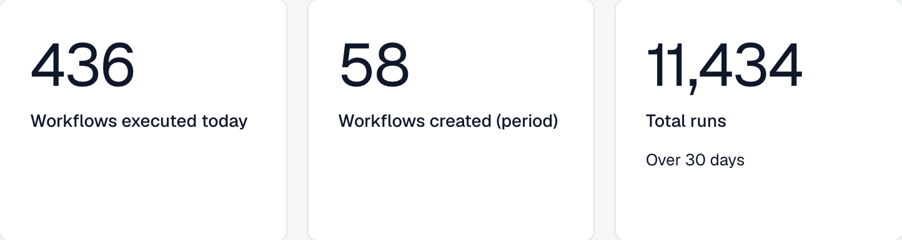
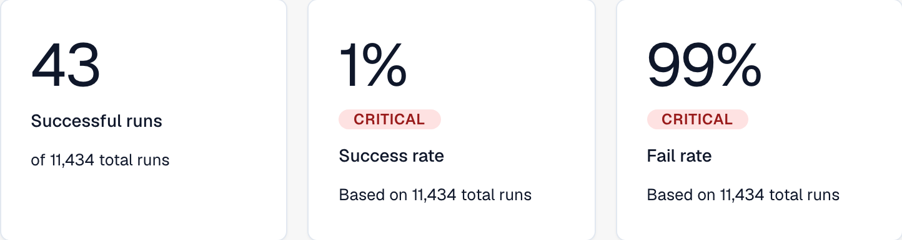
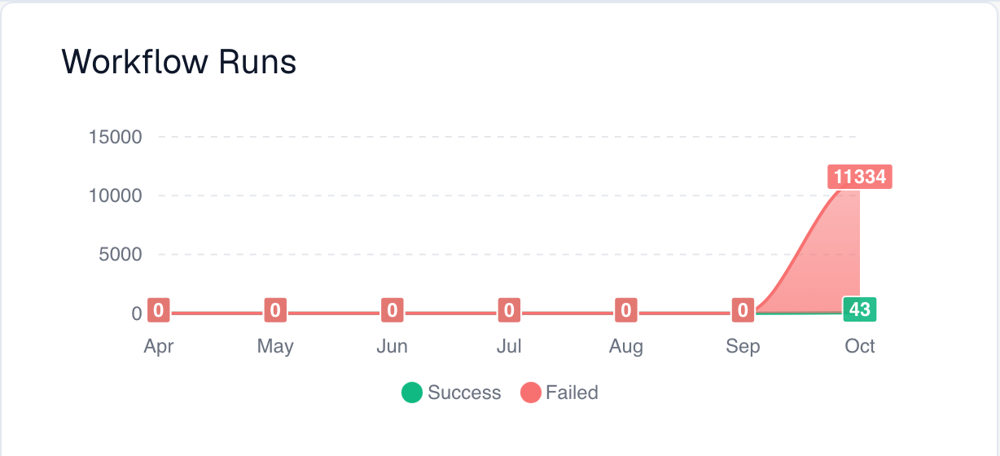
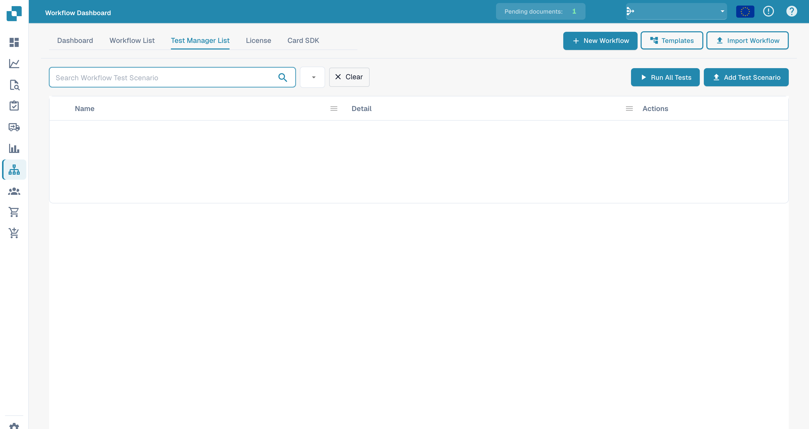

# Dashboard

The **Workflow Dashboard** is the home of the workflow area. It shows how your workflows are performing — run totals, success and fail rates, a runs-over-time chart and recent activity — and gives you access to the workflow list, the test manager and the Card SDK.

The partial views below show volume metrics, run outcomes and the runs chart. Recent activity and navigation controls are outside these crops.

<figure><figcaption>
Volume metrics: workflows executed today, workflows created during the selected period, and total runs.
</figcaption></figure>

<figure><figcaption>
Run outcomes: successful runs, success rate and fail rate, including the displayed run-count context.
</figcaption></figure>

<figure><figcaption>
Workflow runs over the seven displayed months, with Success and Failed series shown separately.
</figcaption></figure>

## Tabs



**Video:** Searching and filtering on the workflow dashboard · 0:54 · [Captions (WebVTT)](https://docbits-videos.fra1.cdn.digitaloceanspaces.com/settings-assistant/workflow-filtering/v1/en.vtt)

Transcript

**Search by name** · [0:00](https://docbits-videos.fra1.cdn.digitaloceanspaces.com/settings-assistant/workflow-filtering/v1/en.mp4#t=0.25)

In the Workflow List, the search field finds workflows by their name. Type part of a name, and only the matching workflows stay in the list.

**Clear the search** · [0:11](https://docbits-videos.fra1.cdn.digitaloceanspaces.com/settings-assistant/workflow-filtering/v1/en.mp4#t=11.65)

Clear the search to see all workflows again. The search is also kept in the page address, so going back to the list keeps it.

**Dates and workflow** · [0:21](https://docbits-videos.fra1.cdn.digitaloceanspaces.com/settings-assistant/workflow-filtering/v1/en.mp4#t=21.85)

On the Dashboard tab, the filters at the top decide what the numbers and the chart count: a start and an end date, by default the last month, and all workflows or a single one.

**Compare two periods** · [0:34](https://docbits-videos.fra1.cdn.digitaloceanspaces.com/settings-assistant/workflow-filtering/v1/en.mp4#t=34.95)

Compare adds a second period: enter its start and end date. Each number then also shows the value of that period and the difference. The filters are remembered in this browser for your next visit.



**Video:** Download and upload a workflow as JSON · 0:51 · [Captions (WebVTT)](https://docbits-videos.fra1.cdn.digitaloceanspaces.com/settings-assistant/workflow-json/v1/en.vtt)

Transcript

**Download as JSON** · [0:00](https://docbits-videos.fra1.cdn.digitaloceanspaces.com/settings-assistant/workflow-json/v1/en.mp4#t=0.25)

To keep a copy of a workflow, open its actions in the list and choose Download. You get one JSON file with its name, its type and all cards and connections.

**Backup or move** · [0:12](https://docbits-videos.fra1.cdn.digitaloceanspaces.com/settings-assistant/workflow-json/v1/en.mp4#t=12.85)

Use it as a backup, or to move a workflow you built and tested in a testing environment.

**Import Workflow** · [0:19](https://docbits-videos.fra1.cdn.digitaloceanspaces.com/settings-assistant/workflow-json/v1/en.mp4#t=19.85)

To bring it back, click Import Workflow and choose the JSON files, up to ten at a time.

**Arrives switched off** · [0:27](https://docbits-videos.fra1.cdn.digitaloceanspaces.com/settings-assistant/workflow-json/v1/en.mp4#t=27.183)

An uploaded workflow arrives switched off, so nothing runs before you have looked at it.

**Check users, groups and tables** · [0:34](https://docbits-videos.fra1.cdn.digitaloceanspaces.com/settings-assistant/workflow-json/v1/en.mp4#t=34.816)

Cards that name users, groups, sub-organisations or decision tables point to them by an internal id. After an upload from another environment, open the cards and check that they are still set up as you want. Then test it and switch it on.

* **Dashboard** — run metrics (illustrated above) and recent activity.
* **Workflow List** — every workflow with its type, execution order and trigger. Create a new one with **New Workflow**.
* **Test Manager List** — test scenarios that validate your workflows; run them with **Run All Tests**.
* **License** — workflow licensing information.
* **Card SDK** — build and upload custom workflow cards (see [Card SDK](card-sdk.md)).

The toolbar also offers **Templates**, which opens the [Workflow Templates](standard-workflow-builder/#workflow-templates) library, and **Import Workflow**, which imports a workflow from a JSON file.

The **Test Manager** lets you save test scenarios per workflow and run them together, so you can confirm your workflows still behave correctly after changes:

<figure><figcaption>
Workflow test-scenario list.
</figcaption></figure>

## Next steps

* Build a linear automation with the **Standard Workflow** builder.
* Build a branching flow with the **Advanced Workflow** builder.
