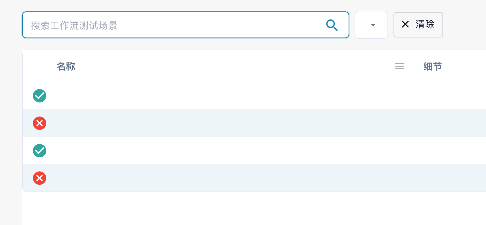

# 仪表板

**工作流仪表板**是工作流区域的主页。它展示工作流的运行情况，包括运行总数、成功率和失败率、随时间变化的运行次数图表以及近期活动，并提供访问工作流列表、测试管理器和 Card SDK 的入口。

<figure><figcaption>
工作流仪表板 — 每个工作流的运行总数、成功率和失败率以及近期活动。
</figcaption></figure>

## 选项卡



**视频:** 在 Workflow 仪表板中搜索和筛选 · 0:51 · [字幕 (WebVTT)](https://docbits-videos.fra1.cdn.digitaloceanspaces.com/settings-assistant/workflow-filtering/v1/zh.vtt)

文字稿

**按名称搜索** · [0:00](https://docbits-videos.fra1.cdn.digitaloceanspaces.com/settings-assistant/workflow-filtering/v1/zh.mp4#t=0.25)

在工作流列表中，搜索框按名称查找 Workflow。输入名称的一部分，列表中只保留匹配的 Workflow。

**清除搜索** · [0:10](https://docbits-videos.fra1.cdn.digitaloceanspaces.com/settings-assistant/workflow-filtering/v1/zh.mp4#t=10.383)

清除搜索即可再次看到所有 Workflow。搜索也保存在页面地址中，所以返回列表时仍然保留。

**日期和 Workflow** · [0:20](https://docbits-videos.fra1.cdn.digitaloceanspaces.com/settings-assistant/workflow-filtering/v1/zh.mp4#t=20.35)

在仪表板选项卡上，顶部的筛选条件决定数字和图表统计什么：开始日期和结束日期（默认是上个月），以及全部 Workflow 或单个 Workflow。

**比较两个时间段** · [0:32](https://docbits-videos.fra1.cdn.digitaloceanspaces.com/settings-assistant/workflow-filtering/v1/zh.mp4#t=32.783)

比较会添加第二个时间段：输入它的开始和结束日期。每个数字随后还会显示该时间段的值和差值。此浏览器会为您下次访问记住这些筛选条件。



**视频:** 以 JSON 格式下载和上传 Workflow · 0:46 · [字幕 (WebVTT)](https://docbits-videos.fra1.cdn.digitaloceanspaces.com/settings-assistant/workflow-json/v1/zh.vtt)

文字稿

**下载为 JSON** · [0:00](https://docbits-videos.fra1.cdn.digitaloceanspaces.com/settings-assistant/workflow-json/v1/zh.mp4#t=0.25)

要保留一个 Workflow 的副本，请在列表中打开它的操作并选择下载。您会得到一个 JSON 文件，包含它的名称、类型以及所有卡片和连接。

**备份或迁移** · [0:13](https://docbits-videos.fra1.cdn.digitaloceanspaces.com/settings-assistant/workflow-json/v1/zh.mp4#t=13.183)

可以用作备份，也可以用来迁移在测试环境中构建并测试过的 Workflow。

**导入工作流程** · [0:19](https://docbits-videos.fra1.cdn.digitaloceanspaces.com/settings-assistant/workflow-json/v1/zh.mp4#t=19.55)

要恢复它，请点击导入工作流程并选择 JSON 文件，一次最多十个。

**上传后处于关闭状态** · [0:26](https://docbits-videos.fra1.cdn.digitaloceanspaces.com/settings-assistant/workflow-json/v1/zh.mp4#t=26.483)

上传的 Workflow 处于关闭状态，在您检查之前不会运行任何内容。

**检查用户、组和决策表** · [0:32](https://docbits-videos.fra1.cdn.digitaloceanspaces.com/settings-assistant/workflow-json/v1/zh.mp4#t=32.783)

指定用户、组、子组织或决策表的卡片通过内部 ID 引用它们。从其他环境上传后，请打开这些卡片，检查设置是否仍符合您的要求。然后测试并开启它。

* **仪表板** — 运行指标和近期活动（如上所示）。
* **工作流列表** — 列出每个工作流及其类型、执行顺序和触发器。使用 **新工作流程** 创建新工作流。
* **测试管理器列表** — 用于验证工作流的测试场景；使用 **运行所有测试** 运行这些场景。
* **执照** — 工作流许可信息。
* **Card SDK** — 构建并上传自定义工作流卡片（参见 [Card SDK](card-sdk.md)）。

工具栏还提供 **模板**，用于打开 [Workflow Templates](standard-workflow-builder/#workflow-templates) 库；以及 **导入工作流程**，用于从 JSON 文件导入工作流。

**测试管理器** 允许你为每个工作流保存测试场景并批量运行，从而确认更改后工作流仍能正常运行：

<figure><figcaption>
测试管理器列表局部视图：搜索栏、名称与细节列。场景名称等私有值已隐藏；状态图标来自已有记录。
</figcaption></figure>

<figure><figcaption>
测试管理器操作：运行所有测试与添加测试场景。
</figcaption></figure>

## 后续步骤

* 使用 **标准工作流** 构建器构建线性自动化流程。
* 使用 **高级工作流程** 构建器构建分支流程。
