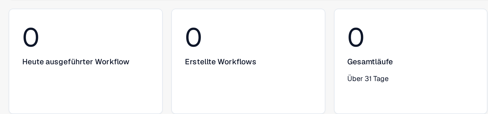
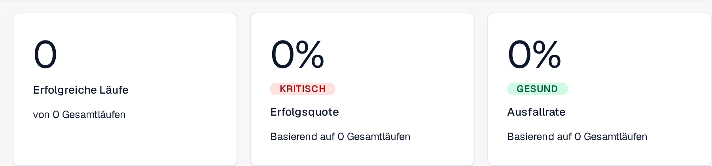
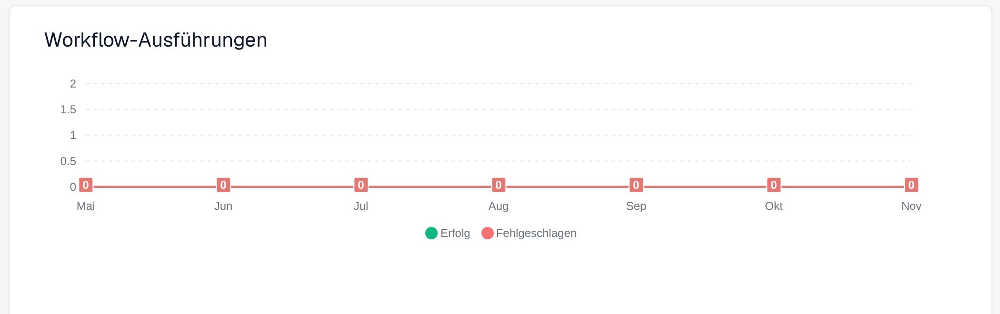
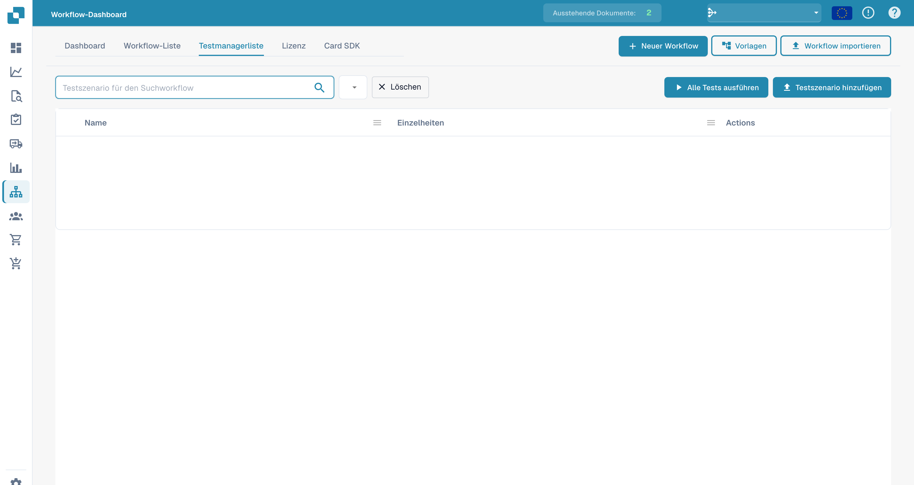

# Dashboard

Das **Workflow-Dashboard** ist die Startseite des Workflow-Bereichs. Es zeigt, wie Ihre Workflows laufen – Ausführungssummen, Erfolgs- und Ausfallrate, ein Diagramm der Ausführungen im Zeitverlauf und die letzte Aktivität – und bietet Zugriff auf die Workflow-Liste, den Testmanager und das Card SDK.

Die folgenden Teilansichten zeigen die Mengenkennzahlen, die Laufergebnisse und das Diagramm der Ausführungen. Letzte Aktivität und Bedienelemente liegen außerhalb dieser Ausschnitte.

<figure><figcaption>
Mengenkennzahlen: <strong>Heute ausgeführter Workflow</strong>, <strong>Erstellte Workflows</strong> und <strong>Gesamtläufe</strong>, hier für die letzten 31 Tage.
</figcaption></figure>

<figure><figcaption>
Laufergebnisse: <strong>Erfolgreiche Läufe</strong>, <strong>Erfolgsquote</strong> und <strong>Ausfallrate</strong>, jeweils mit Bezug auf die Gesamtläufe. Über der Quote steht eine farbige Marke, im Beispiel <strong>KRITISCH</strong> beziehungsweise <strong>GESUND</strong>.
</figcaption></figure>

<figure><figcaption>
<strong>Workflow-Ausführungen</strong> über die angezeigten Monate Mai bis November, mit den Reihen <strong>Erfolg</strong> und <strong>Fehlgeschlagen</strong>.
</figcaption></figure>

## Reiter



**Video:** Suchen und Filtern im Workflow-Dashboard · 0:52 · [Untertitel (WebVTT)](https://docbits-videos.fra1.cdn.digitaloceanspaces.com/settings-assistant/workflow-filtering/v1/de.vtt)



**Video:** Einen Workflow als JSON herunterladen und hochladen · 0:55 · [Untertitel (WebVTT)](https://docbits-videos.fra1.cdn.digitaloceanspaces.com/settings-assistant/workflow-json/v1/de.vtt)

- **Dashboard** — Kennzahlen zu den Ausführungen und letzte Aktivität (oben dargestellt).
- **Workflow-Liste** — jeder Workflow mit Typ, Workflow-Ausführungsreihenfolge und Auslöser. Einen neuen Workflow legen Sie mit **Neuer Workflow** an.
- **Testmanagerliste** — Testszenarien, die Ihre Workflows validieren; führen Sie sie mit **Alle Tests ausführen** aus.
- **Lizenz** — Informationen zur Workflow-Lizenzierung.
- **Card SDK** — eigene Workflow-Karten erstellen und hochladen (siehe [Card SDK](card-sdk.md)).

Die Symbolleiste bietet außerdem **Vorlagen**, das die Bibliothek [Workflow-Vorlagen](standard-workflow-builder.md#workflow-vorlagen) öffnet, und **Workflow importieren**, das einen Workflow aus einer JSON-Datei importiert.

Mit dem **Testmanager** können Sie Testszenarien pro Workflow speichern und gemeinsam ausführen, um zu bestätigen, dass Ihre Workflows sich nach Änderungen weiterhin korrekt verhalten:

<figure><figcaption>
Deutsche Testmanagerliste mit Alle Tests ausführen und Testszenario hinzufügen. Szenariodaten sind ausgeblendet; Actions bleibt ein Produktbegriff.
</figcaption></figure>

## Nächste Schritte

- Erstellen Sie mit dem Builder **Standard-Workflow** eine lineare Automatisierung.
- Erstellen Sie mit dem Builder **Erweiterter Workflow** einen verzweigten Ablauf.
