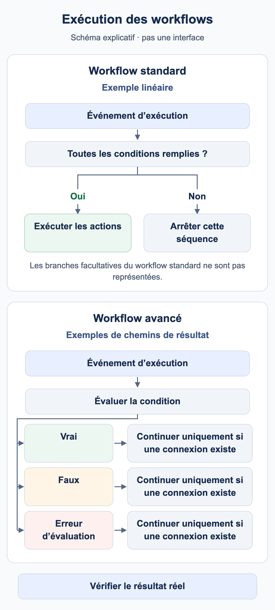

# Quand mon workflow s’exécute-t-il ?

Un workflow nécessite un événement d’exécution et des conditions correspondantes. **Le type de document est Facture** sélectionne des documents ; cela ne signifie pas que toute modification d’une facture déclenche automatiquement une nouvelle exécution.

<figure><figcaption>Exemples schématiques : une séquence standard linéaire exécute les actions uniquement si ses conditions sont remplies ; sinon, cette séquence s’arrête. Un nœud de condition avancé peut utiliser des chemins de résultat configurés séparément. Un chemin ne continue que si une connexion existe. Les branches standard facultatives sont omises ; il ne s’agit pas d’une capture de l’interface DocBits.</figcaption></figure>

## De l’événement à l’action

1. Vérifiez l’organisation, les autorisations et le module Workflow, ainsi que l’habilitation Advanced si nécessaire.
2. Identifiez l’événement : traitement documentaire, appel manuel explicite ou déclencheur pris en charge. Utilisez uniquement les déclencheurs réellement disponibles dans le catalogue de votre version.
3. Dans Standard Workflow, When et toutes les conditions And doivent être satisfaits. Une condition fausse arrête cette séquence linéaire.
4. Dans Advanced Workflow, l’entrée et les sorties de résultat connectées déterminent le chemin. Une condition And fausse peut continuer par orange ; rouge traite une erreur d’évaluation.
5. Vérifiez le résultat au bon endroit : réponse de test, exécution persistée, document ou système destinataire.

**Start** est une entrée manuelle. Le kit utilise une entrée When pour Facture et le numéro exact de formation afin de respecter les exigences de l’interface actuelle. Importez-le désactivé et testez-le manuellement. Un test manuel réussi ne prouve pas le déclenchement automatique par un événement documentaire.

## Enregistrer, tester et activer

| État | Signification |
| --- | --- |
| Brouillon local | La copie du navigateur ne remplace pas l’enregistrement sur le serveur. |
| Enregistré | La configuration existe. Vérifiez séparément l’activation : enregistrer une nouvelle règle peut déjà l’activer. |
| Test Advanced | Évalue le graphique actuel, y compris les modifications non enregistrées. Les actions documentaires sont simulées. |
| Activé | La règle peut être prise en compte pour l’événement correspondant. Testez cet événement séparément. |

Test Manager et le dialogue de test Advanced sont des surfaces d’exécution différentes. Comparer uniquement le statut ne confirme ni affectation, ni notification, ni réception d’un export. Vérifiez les effets de la surface choisie avant de tester des documents réels.

## Plusieurs workflows et répétitions



**Vidéo:** Ordre d'exécution des Workflows · 1:16 · [Sous-titres (WebVTT)](https://docbits-videos.fra1.cdn.digitaloceanspaces.com/settings-assistant/workflow-order/v1/fr.vtt)

Transcription

**Les petits nombres d'abord** · [0:00](https://docbits-videos.fra1.cdn.digitaloceanspaces.com/settings-assistant/workflow-order/v1/fr.mp4#t=0.25)

Quand un document atteint un statut, chaque Workflow actif qui correspond s'exécute, l'un après l'autre. La colonne Ordre d'exécution du flux de travail fixe la séquence : les petits nombres passent en premier.

**Modifier l'ordre d'exécution** · [0:15](https://docbits-videos.fra1.cdn.digitaloceanspaces.com/settings-assistant/workflow-order/v1/fr.mp4#t=15.883)

Pour la modifier, ouvrez les actions d'un Workflow et choisissez Modifier l'ordre d'exécution du flux de travail. Saisissez un nombre de zéro à mille. Les nouveaux Workflows commencent à cinq cents, et ceux qui ont le même nombre passent par ordre alphabétique.

**Chacun voit ce qu'ont fait les précédents** · [0:32](https://docbits-videos.fra1.cdn.digitaloceanspaces.com/settings-assistant/workflow-order/v1/fr.mp4#t=32.983)

L'ordre compte, car chaque Workflow travaille avec ce que les précédents ont laissé. Un Workflow suivant voit les champs qu'un Workflow antérieur a remplis. Les cartes agissent tout de suite, même pour attribuer ou exporter le document. Seules les cartes d'attribution séquentielle, la carte d'export en file d'attente et les prompts DocOperator attendent la fin du dernier Workflow. Et si un Workflow finit par une condition échouée ou une erreur, les suivants tournent quand même.

**Préparer d'abord, décider ensuite** · [0:59](https://docbits-videos.fra1.cdn.digitaloceanspaces.com/settings-assistant/workflow-order/v1/fr.mp4#t=59.583)

Un schéma simple : donnez des petits nombres aux Workflows qui préparent les données, par exemple en remplissant des champs, et des nombres plus grands à ceux qui vérifient, orientent ou approuvent le document. Laissez des écarts pour insérer de nouveaux Workflows.



**Vidéo:** Limites d'exécution des Workflows · 0:48 · [Sous-titres (WebVTT)](https://docbits-videos.fra1.cdn.digitaloceanspaces.com/settings-assistant/workflow-limits/v1/fr.vtt)

Transcription

**Limite d'exécution atteinte** · [0:00](https://docbits-videos.fra1.cdn.digitaloceanspaces.com/settings-assistant/workflow-limits/v1/fr.mp4#t=0.25)

Un flux ne peut s'exécuter qu'un nombre limité de fois sur le même document. Quand un flux a atteint cette limite, les journaux de flux du document l'indiquent en haut.

**L'icône rouge signale le flux** · [0:13](https://docbits-videos.fra1.cdn.digitaloceanspaces.com/settings-assistant/workflow-limits/v1/fr.mp4#t=13.25)

Chaque exécution d'un flux qui a atteint la limite porte cette icône rouge à côté de son nom. Survolez-la pour voir pourquoi.

**Par flux et par document** · [0:22](https://docbits-videos.fra1.cdn.digitaloceanspaces.com/settings-assistant/workflow-limits/v1/fr.mp4#t=22.683)

La limite compte les exécutions d'un flux sur un document. Une fois atteinte, ce flux est ignoré pour ce document, et tous les autres flux continuent de s'exécuter.

**Comprendre pourquoi il a tant tourné** · [0:34](https://docbits-videos.fra1.cdn.digitaloceanspaces.com/settings-assistant/workflow-limits/v1/fr.mp4#t=34.083)

Si un flux atteint la limite, regardez dans ses journaux pourquoi il a tourné si souvent. Vérifiez par exemple s'il change quelque chose qui le relance, et restreignez ses conditions pour qu'il ne tourne que quand il le doit.

Les plus petites valeurs d’**ordre d’exécution** passent en premier. Par exemple, le workflow 100 prépare un champ et le 200 le contrôle. Utilisez des valeurs distinctes et confirmez les données effectivement lues lors d’une nouvelle exécution. La position d’une carte Advanced sur le canevas ne détermine pas l’ordre.

**Change Status to → Trigger Workflows** peut provoquer une autre exécution. **Run Workflow** appelle un workflow sélectionné. Les deux nécessitent des conditions réfléchies ; aucun ne garantit une exécution unique. Limitez les tâches et exports par l’état métier et testez explicitement un deuxième passage. Un indicateur de fin ne protège pas, à lui seul, contre tous les doublons simultanés.

Poursuivez avec le [cas Advanced](advanced-workflow-case-study.md), le [kit de formation](workflow-training-kit.md) et le [diagnostic](workflow-troubleshooting.md).

## WF-01: Exercice et recette

Notez événement, filtre, activation et version. Vérifiez deux exécutions puis l’ordre 100/200 avec un champ effectivement lu ensuite. Distinguez demande attendue et exécution observée.

[Parcours](workflow-learning-path.md)
