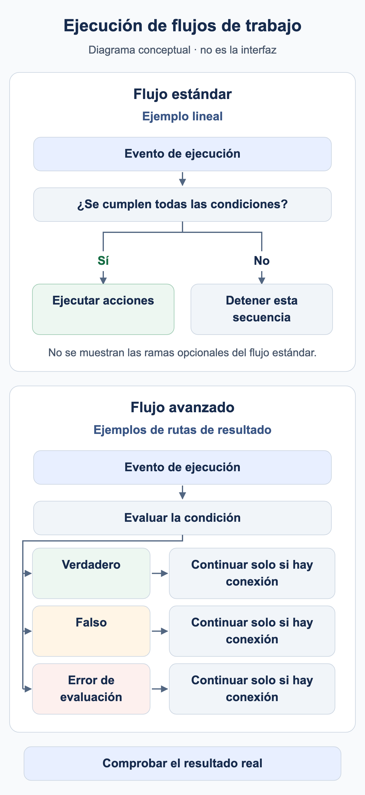

# ¿Cuándo se ejecuta mi workflow?

Un workflow necesita un motivo de ejecución y condiciones coincidentes. **El tipo de documento es Factura** selecciona documentos; no significa que cualquier cambio de una factura inicie otra ejecución automáticamente.

<figure><figcaption>Ejemplos conceptuales: una secuencia estándar lineal ejecuta acciones solo cuando se cumplen sus condiciones; de lo contrario, esa secuencia se detiene. Un nodo de condición avanzado puede utilizar rutas de resultado configuradas por separado. Una ruta continúa solo si está conectada. Se omiten las ramas estándar opcionales; no es una captura de la interfaz de DocBits.</figcaption></figure>

## Del evento a la acción

1. Compruebe la organización, los permisos y el módulo Workflow, además de la habilitación Advanced cuando corresponda.
2. Identifique el motivo: procesamiento documental, ejecución manual explícita o un disparador de evento compatible. Utilice únicamente disparadores disponibles en el catálogo de su versión.
3. En Standard Workflow deben cumplirse When y todas las condiciones And. Una condición falsa detiene esa secuencia lineal.
4. En Advanced Workflow, la entrada y las salidas de resultado conectadas determinan la ruta. Una condición And falsa puede continuar por naranja; rojo trata un error de evaluación.
5. Compruebe el resultado donde corresponda: respuesta de prueba, ejecución persistida, documento o sistema receptor.

**Start** es una entrada manual. El paquete utiliza una entrada When para Factura y una limitación al número exacto de formación para cumplir los requisitos de la interfaz actual. Impórtelo desactivado y pruébelo manualmente. Una prueba manual correcta no demuestra la activación automática por eventos del documento.

## Guardar, probar y activar

| Estado | Significado |
| --- | --- |
| Borrador local | La copia del navegador no sustituye el guardado en el servidor. |
| Guardado | La configuración existe. Compruebe la activación por separado: guardar una regla nueva puede activarla. |
| Prueba Advanced | Evalúa el gráfico actual, incluidos cambios sin guardar. Las acciones documentales se simulan. |
| Activado | La regla puede participar en el evento correspondiente. Compruebe ese evento por separado. |

Test Manager y el diálogo de prueba Advanced son superficies de ejecución diferentes. Comparar solo el estado no confirma una asignación, notificación o entrega de exportación. Compruebe los posibles efectos de la superficie elegida antes de usar documentos reales.

## Varios workflows y ejecuciones repetidas



**Vídeo:** Orden de ejecución de los Workflows · 1:07 · [Subtítulos (WebVTT)](https://docbits-videos.fra1.cdn.digitaloceanspaces.com/settings-assistant/workflow-order/v1/es.vtt)

Transcripción

**Los números bajos van primero** · [0:00](https://docbits-videos.fra1.cdn.digitaloceanspaces.com/settings-assistant/workflow-order/v1/es.mp4#t=0.25)

Cuando un documento llega a un estado, se ejecuta cada flujo activo que coincide, uno tras otro. La columna Orden de ejecución del flujo de trabajo fija la secuencia: los números bajos van primero.

**Editar el orden de ejecución** · [0:14](https://docbits-videos.fra1.cdn.digitaloceanspaces.com/settings-assistant/workflow-order/v1/es.mp4#t=14.583)

Para cambiarlo, abra las acciones de un flujo y elija Editar orden de ejecución del flujo de trabajo. Introduzca un número de cero a mil. Los flujos nuevos empiezan en quinientos, y los que tienen el mismo número van en orden alfabético.

**Cada uno ve lo que hicieron los anteriores** · [0:28](https://docbits-videos.fra1.cdn.digitaloceanspaces.com/settings-assistant/workflow-order/v1/es.mp4#t=28.083)

El orden importa porque cada flujo trabaja con lo que dejaron los anteriores. Un flujo posterior ve los campos que uno anterior rellenó. Las tarjetas actúan enseguida, también al asignar o exportar el documento. Solo las tarjetas de asignación secuencial, la tarjeta de exportación en cola y los prompts de DocOperator esperan a que termine el último flujo. Y si un flujo termina con una condición fallida o un error, los siguientes se ejecutan igualmente.

**Primero preparar, luego decidir** · [0:52](https://docbits-videos.fra1.cdn.digitaloceanspaces.com/settings-assistant/workflow-order/v1/es.mp4#t=52.85)

Un esquema sencillo: dé números bajos a los flujos que preparan datos, por ejemplo rellenando campos, y números más altos a los que comprueban, dirigen o aprueban el documento. Deje huecos para que quepan flujos nuevos.



**Vídeo:** Límites de ejecución de los Workflows · 0:43 · [Subtítulos (WebVTT)](https://docbits-videos.fra1.cdn.digitaloceanspaces.com/settings-assistant/workflow-limits/v1/es.vtt)

Transcripción

**Límite de ejecución alcanzado** · [0:00](https://docbits-videos.fra1.cdn.digitaloceanspaces.com/settings-assistant/workflow-limits/v1/es.mp4#t=0.25)

Un flujo solo puede ejecutarse un número limitado de veces sobre el mismo documento. Cuando un flujo alcanza ese límite, los registros de flujo del documento lo indican arriba.

**El icono rojo marca el flujo** · [0:12](https://docbits-videos.fra1.cdn.digitaloceanspaces.com/settings-assistant/workflow-limits/v1/es.mp4#t=12.683)

Cada ejecución de un flujo que alcanzó el límite lleva este icono rojo junto a su nombre. Pase el ratón por encima para ver por qué.

**Por flujo y por documento** · [0:21](https://docbits-videos.fra1.cdn.digitaloceanspaces.com/settings-assistant/workflow-limits/v1/es.mp4#t=21.516)

El límite cuenta las ejecuciones de un flujo sobre un documento. Una vez alcanzado, ese flujo se omite para este documento, mientras todos los demás siguen ejecutándose.

**Averiguar por qué se ejecutó tanto** · [0:31](https://docbits-videos.fra1.cdn.digitaloceanspaces.com/settings-assistant/workflow-limits/v1/es.mp4#t=31.55)

Si un flujo alcanza el límite, mire en sus registros por qué se ejecutó tantas veces. Compruebe, por ejemplo, si cambia algo que lo vuelve a iniciar, y acote sus condiciones para que solo se ejecute cuando debe.

Los valores menores del **orden de ejecución** se procesan primero. Por ejemplo, el workflow 100 prepara un campo y el 200 lo comprueba. Utilice valores distintos y confirme los datos realmente leídos en una ejecución nueva. La posición de una tarjeta Advanced en el lienzo no determina el orden.

**Change Status to → Trigger Workflows** puede iniciar otra ejecución. **Run Workflow** invoca un workflow seleccionado. Ambos necesitan condiciones deliberadas; ninguno garantiza una única ejecución. Limite tareas y exportaciones mediante el estado del proceso y pruebe expresamente una segunda ejecución. Una marca de finalización por sí sola no evita en general duplicados simultáneos.

Continúe con el [caso Advanced](advanced-workflow-case-study.md), el [paquete de formación](workflow-training-kit.md) y la [guía de diagnóstico](workflow-troubleshooting.md).

## WF-01: Ejercicio y aceptación

Registre evento, filtro, activación y versión de tarjeta. Compruebe dos ejecuciones y el orden 100/200 con un campo posterior realmente leído. Distinga solicitud esperada y ejecución observada.

[Ruta de aprendizaje](workflow-learning-path.md)
