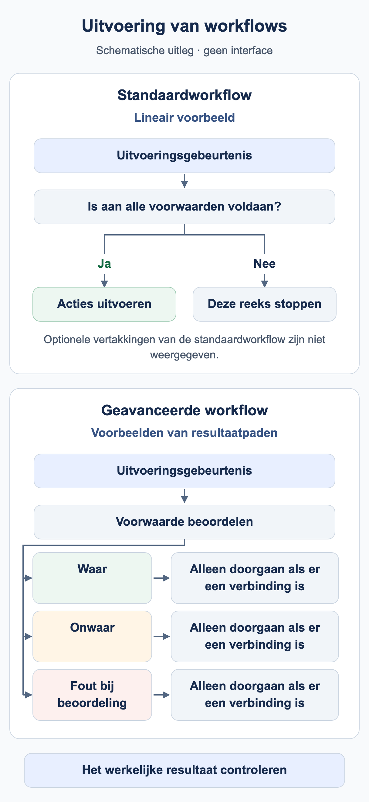

# Wanneer wordt mijn workflow uitgevoerd?

Een workflow heeft een aanleiding en passende voorwaarden nodig. **Documenttype is Factuur** selecteert documenten; dit betekent niet dat elke wijziging van een factuur automatisch een nieuwe uitvoering start.

<figure><figcaption>Schematische voorbeelden: een lineaire standaardreeks voert alleen acties uit als aan de voorwaarden is voldaan; anders stopt die reeks. Een geavanceerd voorwaardeknooppunt kan afzonderlijk geconfigureerde resultaatpaden gebruiken. Een pad gaat alleen verder als er een verbinding is. Optionele standaardvertakkingen zijn weggelaten; dit is geen schermafbeelding van de DocBits-interface.</figcaption></figure>

## Van gebeurtenis naar actie

1. Controleer de organisatie, rechten en Workflow-module, plus de Advanced-toegang waar nodig.
2. Bepaal de aanleiding: documentverwerking, een expliciete handmatige aanroep of een ondersteunde gebeurtenistrigger. Gebruik alleen triggers die de kaartcatalogus van uw versie daadwerkelijk aanbiedt.
3. In Standard Workflow moeten When en alle And-voorwaarden overeenkomen. Een onware voorwaarde stopt die lineaire kaartvolgorde.
4. In Advanced Workflow bepalen de ingang en verbonden resultaatuitgangen de route. Een onware And-voorwaarde kan via oranje doorgaan; rood behandelt een evaluatiefout.
5. Controleer het resultaat op de juiste plek: testantwoord, opgeslagen uitvoering, document of ontvangend systeem.

**Start** is een handmatige ingang. Het oefenpakket gebruikt When voor Factuur en het exacte oefenfactuurnummer om aan de huidige interfacevereisten te voldoen. Importeer het uitgeschakeld en test handmatig. Een geslaagde handmatige test bewijst geen automatische uitvoering door een documentgebeurtenis.

## Opslaan, testen en activeren

| Toestand | Betekenis |
| --- | --- |
| Lokaal concept | Een browserkopie vervangt opslaan op de server niet. |
| Opgeslagen | De configuratie bestaat. Controleer activering afzonderlijk: opslaan kan een nieuwe regel al activeren. |
| Advanced-test | Beoordeelt de huidige graaf, inclusief niet-opgeslagen wijzigingen. Documentacties worden gesimuleerd. |
| Geactiveerd | De regel kan bij de passende gebeurtenis worden meegenomen. Test die gebeurtenis afzonderlijk. |

Test Manager en het Advanced-testvenster zijn verschillende uitvoeringsmogelijkheden. Alleen een statusvergelijking bevestigt geen toewijzing, melding of exportontvangst. Controleer de gevolgen van de gekozen testmogelijkheid voordat u echte documenten gebruikt.

## Meerdere workflows en herhaling



**Video:** Uitvoeringsvolgorde van Workflows · 1:15 · [Ondertitels (WebVTT)](https://docbits-videos.fra1.cdn.digitaloceanspaces.com/settings-assistant/workflow-order/v1/nl.vtt)

Transcriptie

**Lagere nummers lopen eerst** · [0:00](https://docbits-videos.fra1.cdn.digitaloceanspaces.com/settings-assistant/workflow-order/v1/nl.mp4#t=0.25)

Bereikt een document een status, dan loopt elke actieve Workflow die erbij past, de een na de ander. De kolom Volgorde van workflow-uitvoering bepaalt de volgorde: lagere nummers lopen eerst.

**Uitvoeringsvolgorde bewerken** · [0:16](https://docbits-videos.fra1.cdn.digitaloceanspaces.com/settings-assistant/workflow-order/v1/nl.mp4#t=16.083)

Open daarvoor de acties van een Workflow en kies Volgorde van workflow-uitvoering bewerken. Vul een getal van nul tot duizend in. Nieuwe Workflows starten op vijfhonderd, en Workflows met hetzelfde getal lopen alfabetisch.

**Elke Workflow ziet wat de vorige deden** · [0:32](https://docbits-videos.fra1.cdn.digitaloceanspaces.com/settings-assistant/workflow-order/v1/nl.mp4#t=32.516)

De volgorde telt, omdat elke Workflow werkt met wat de vorige achterlieten. Een latere Workflow ziet de velden die een eerdere heeft ingesteld. Kaarten handelen meteen, ook als ze het document toewijzen of exporteren. Alleen de kaarten voor sequentiële toewijzing, de exportkaart met wachtrij en DocOperator-prompts wachten tot de laatste Workflow klaar is. En eindigt een Workflow met een mislukte conditie of een fout, dan lopen de volgende toch.

**Eerst voorbereiden, dan beslissen** · [0:58](https://docbits-videos.fra1.cdn.digitaloceanspaces.com/settings-assistant/workflow-order/v1/nl.mp4#t=58.416)

Een eenvoudig schema: geef Workflows die gegevens voorbereiden, zoals velden instellen, lage nummers, en Workflows die het document controleren, doorsturen of goedkeuren hogere. Laat ruimte, zodat nieuwe Workflows ertussen passen.



**Video:** Uitvoeringslimieten van Workflows · 0:50 · [Ondertitels (WebVTT)](https://docbits-videos.fra1.cdn.digitaloceanspaces.com/settings-assistant/workflow-limits/v1/nl.vtt)

Transcriptie

**Uitvoeringslimiet bereikt** · [0:00](https://docbits-videos.fra1.cdn.digitaloceanspaces.com/settings-assistant/workflow-limits/v1/nl.mp4#t=0.25)

Een Workflow kan maar een beperkt aantal keren op hetzelfde document lopen. Heeft een Workflow die limiet bereikt, dan staat dat bovenaan in de Workflowlogboeken van het document.

**Het rode pictogram markeert de Workflow** · [0:13](https://docbits-videos.fra1.cdn.digitaloceanspaces.com/settings-assistant/workflow-limits/v1/nl.mp4#t=13.783)

Elke uitvoering van een Workflow die de limiet bereikte, draagt dit rode pictogram bij de naam. Beweeg erover voor de reden.

**Per Workflow en document** · [0:23](https://docbits-videos.fra1.cdn.digitaloceanspaces.com/settings-assistant/workflow-limits/v1/nl.mp4#t=23.35)

De limiet telt de uitvoeringen van één Workflow op één document. Is die bereikt, dan wordt die Workflow voor dit document overgeslagen, terwijl alle andere Workflows nog lopen.

**Zoek uit waarom hij zo vaak liep** · [0:35](https://docbits-videos.fra1.cdn.digitaloceanspaces.com/settings-assistant/workflow-limits/v1/nl.mp4#t=35.25)

Bereikt een Workflow de limiet, kijk dan in de logboeken waarom hij zo vaak liep. Controleer bijvoorbeeld of hij iets wijzigt dat hem opnieuw start, en verscherp de condities zodat hij alleen loopt wanneer dat moet.

Lagere waarden van de **uitvoeringsvolgorde** komen eerst. Workflow 100 kan bijvoorbeeld een veld voorbereiden dat workflow 200 controleert. Gebruik verschillende waarden en bevestig de werkelijk gelezen gegevens in een nieuwe uitvoering. De positie van een Advanced-kaart op het canvas bepaalt de volgorde niet.

**Change Status to → Trigger Workflows** kan een nieuwe uitvoering starten. **Run Workflow** roept een geselecteerde workflow aan. Beide vereisen bewuste voorwaarden; geen van beide garandeert eenmalige uitvoering. Beperk taken en exports via de zakelijke verwerkingsstatus en test expliciet een tweede uitvoering. Een voltooiingsmarkering alleen beschermt niet algemeen tegen gelijktijdige dubbele verwerking.

Ga verder met het [Advanced-praktijkvoorbeeld](advanced-workflow-case-study.md), het [oefenpakket](workflow-training-kit.md) en de [diagnosehandleiding](workflow-troubleshooting.md).

## WF-01: Oefening en acceptatie

Noteer gebeurtenis, filter, activatie en kaartversie. Controleer twee uitvoeringen en volgorde 100/200 met een werkelijk gelezen vervolgveld. Onderscheid verwachte aanvraag en waargenomen uitvoering.

[Leerpad](workflow-learning-path.md)
