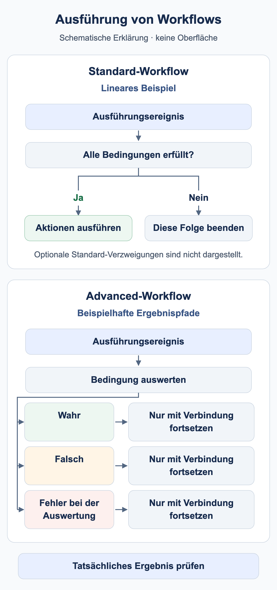
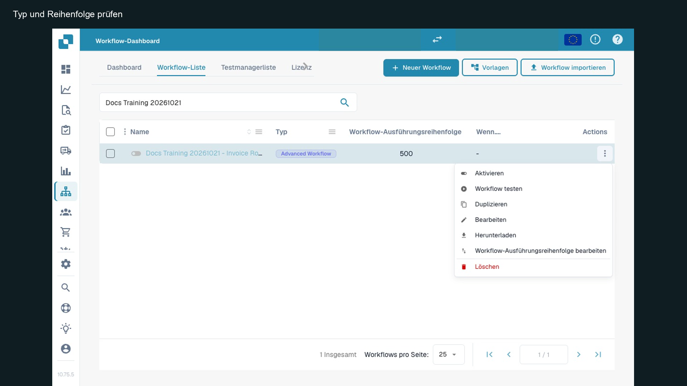

# Wann läuft mein Workflow?

Ein Workflow benötigt einen Ausführungsanlass und passende Bedingungen. **Dokumenttyp ist Rechnung** beschreibt eine Auswahl. Daraus folgt nicht, dass jede beliebige Änderung an einer Rechnung automatisch einen neuen Lauf startet.

<figure><figcaption>Schematische Beispiele: Eine lineare Standard-Folge führt Aktionen nur aus, wenn ihre Bedingungen erfüllt sind; andernfalls endet diese Folge. Ein Advanced-Bedingungsknoten kann getrennte konfigurierte Ergebnispfade verwenden. Ein Pfad wird nur mit Verbindung fortgesetzt. Optionale Standard-Verzweigungen sind nicht dargestellt; dies ist kein Screenshot der DocBits-Oberfläche.</figcaption></figure>

## Vom Ereignis zur Aktion

1. Prüfen Sie Organisation, Berechtigungen, Workflow-Modul und bei Advanced zusätzlich die Advanced-Freigabe.
2. Bestimmen Sie den Anlass: dokumentbezogene Verarbeitung, expliziter manueller Aufruf oder ein unterstützter Ereignis-Trigger. Verwenden Sie nur Trigger, die der Kartenkatalog Ihrer Version tatsächlich anbietet.
3. Im Standard Workflow müssen When und alle And-Bedingungen zutreffen. Eine falsche Bedingung beendet diese Kartenfolge.
4. Im Advanced Workflow bestimmen Einstieg und verbundene Ergebnisausgänge den Weg. Eine falsche And-Bedingung kann über Orange weiterlaufen; Rot behandelt einen Auswertungsfehler.
5. Prüfen Sie das Ergebnis am richtigen Ort: Testantwort, gespeicherter Lauf, Dokument oder angeschlossenes Zielsystem.

**Start** dient als manueller Einstieg. Das Übungspaket verwendet einen When-Einstieg für Rechnung und eine zusätzliche Begrenzung auf die Trainingsnummer, damit es auch die Anforderungen der aktuellen Oberfläche erfüllt. Es wird inaktiv importiert und manuell getestet; ein erfolgreicher manueller Test belegt keinen automatischen Dokumentereignis-Trigger.

## Speichern, Testen und Aktivieren

| Zustand | Bedeutung |
| --- | --- |
| Lokaler Entwurf | Eine Browserkopie ersetzt kein Speichern auf dem Server. |
| Gespeichert | Die Konfiguration ist vorhanden. Prüfen Sie den Aktivzustand separat; Speichern kann eine neue Regel bereits aktivieren. |
| Advanced-Test | Prüft den aktuellen Graphen, auch mit ungespeicherten Änderungen. Dokumentaktionen werden im Testmodus simuliert. |
| Aktiviert | Die Regel kann bei ihrem passenden Ausführungsanlass berücksichtigt werden. Das ersetzt keinen Test dieses Anlasses. |

Der Test Manager und der Advanced-Testdialog sind verschiedene Ausführungsoberflächen. Ein Statusvergleich allein bestätigt keine Zuweisung, Nachricht oder Exportzustellung. Prüfen Sie mögliche Nebenwirkungen der verwendeten Testoberfläche vor einem Lauf an echten Dokumenten.

## Mehrere Workflows und erneute Ausführung



**Video:** Ausführungsreihenfolge von Workflows · 1:14 · [Untertitel (WebVTT)](https://docbits-videos.fra1.cdn.digitaloceanspaces.com/settings-assistant/workflow-order/v1/de.vtt)

Transkript

**Niedrige Zahlen laufen zuerst** · [0:00](https://docbits-videos.fra1.cdn.digitaloceanspaces.com/settings-assistant/workflow-order/v1/de.mp4#t=0.25)

Erreicht ein Dokument einen Status, läuft jeder aktive Workflow, der passt, einer nach dem anderen. Die Spalte Workflow-Ausführungsreihenfolge legt die Folge fest: niedrigere Zahlen laufen zuerst.

**Reihenfolge bearbeiten** · [0:14](https://docbits-videos.fra1.cdn.digitaloceanspaces.com/settings-assistant/workflow-order/v1/de.mp4#t=14.716)

Zum Ändern öffnen Sie die Aktionen eines Workflows und wählen Workflow-Ausführungsreihenfolge bearbeiten. Geben Sie eine Zahl von null bis tausend ein. Neue Workflows starten bei fünfhundert, und Workflows mit derselben Zahl laufen alphabetisch.

**Jeder sieht, was die vorherigen taten** · [0:30](https://docbits-videos.fra1.cdn.digitaloceanspaces.com/settings-assistant/workflow-order/v1/de.mp4#t=30.05)

Die Reihenfolge zählt, weil jeder Workflow mit dem arbeitet, was die vorherigen hinterlassen haben. Ein späterer Workflow sieht die Felder, die ein früherer gesetzt hat. Karten handeln sofort, auch wenn sie das Dokument zuweisen oder exportieren. Nur die sequenziellen Zuweisungskarten, die Export-Karte mit Warteschlange und DocOperator-Prompts warten, bis der letzte Workflow gelaufen ist. Und endet ein Workflow mit einer gescheiterten Bedingung oder einem Fehler, laufen die nächsten trotzdem.

**Erst vorbereiten, dann entscheiden** · [0:58](https://docbits-videos.fra1.cdn.digitaloceanspaces.com/settings-assistant/workflow-order/v1/de.mp4#t=58.25)

Ein einfaches Schema: Workflows, die Daten vorbereiten, etwa Felder setzen, bekommen niedrige Zahlen, und Workflows, die das Dokument prüfen, weiterleiten oder genehmigen, höhere. Lassen Sie Lücken, damit neue Workflows dazwischen passen.



**Video:** Ausführungslimits von Workflows · 0:48 · [Untertitel (WebVTT)](https://docbits-videos.fra1.cdn.digitaloceanspaces.com/settings-assistant/workflow-limits/v1/de.vtt)

Transkript

**Ausführungslimit erreicht** · [0:00](https://docbits-videos.fra1.cdn.digitaloceanspaces.com/settings-assistant/workflow-limits/v1/de.mp4#t=0.25)

Ein Workflow kann auf demselben Dokument nur begrenzt oft laufen. Hat ein Workflow dieses Limit erreicht, steht das oben in den Workflow-Logs des Dokuments.

**Das rote Symbol markiert den Workflow** · [0:13](https://docbits-videos.fra1.cdn.digitaloceanspaces.com/settings-assistant/workflow-limits/v1/de.mp4#t=13.183)

Jeder Lauf eines Workflows, der das Limit erreicht hat, trägt dieses rote Symbol neben seinem Namen. Fahren Sie darüber, um den Grund zu sehen.

**Pro Workflow und Dokument** · [0:23](https://docbits-videos.fra1.cdn.digitaloceanspaces.com/settings-assistant/workflow-limits/v1/de.mp4#t=23.183)

Das Limit zählt die Läufe eines Workflows auf einem Dokument. Ist es erreicht, wird dieser Workflow für dieses Dokument übersprungen, alle anderen Workflows laufen weiter.

**Herausfinden, warum er so oft lief** · [0:34](https://docbits-videos.fra1.cdn.digitaloceanspaces.com/settings-assistant/workflow-limits/v1/de.mp4#t=34.35)

Erreicht ein Workflow das Limit, sehen Sie in seinen Logs nach, warum er so oft lief. Prüfen Sie zum Beispiel, ob er etwas ändert, das ihn erneut startet, und grenzen Sie seine Bedingungen so ein, dass er nur läuft, wenn er soll.

Kleinere Werte der **Ausführungsreihenfolge** laufen zuerst. Beispiel: Workflow 100 bereitet ein Feld vor; Workflow 200 prüft dessen Wert. Verwenden Sie unterschiedliche Werte und bestätigen Sie die tatsächlich gelesenen Daten in einem neuen Lauf. Die Position einer Advanced-Karte auf der Arbeitsfläche bestimmt keine Reihenfolge.

**Change Status to → Trigger Workflows** kann eine weitere Workflow-Ausführung anstoßen. **Run Workflow** ruft einen ausgewählten Workflow auf. Beide Mechanismen benötigen bewusst gesetzte Bedingungen; sie sind keine Zusicherung einer einmaligen Ausführung. Begrenzen Sie Aufgaben und Exporte über einen fachlichen Bearbeitungszustand und prüfen Sie den zweiten Lauf ausdrücklich. Ein Erledigt-Merkmal allein ist bei gleichzeitigen Aufrufen kein allgemeiner Schutz vor Doppelverarbeitung.

Weiter mit dem [Advanced-Geschäftsfall](advanced-workflow-case-study.md), dem [Übungspaket](workflow-training-kit.md) und der [Fehlerdiagnose](workflow-troubleshooting.md).

## Zustand und Ausführung getrennt am Bildschirm prüfen

<figure><figcaption>
Zustandskontrolle an der vorhandenen Trainingsregel: Schalter aus, Menüeintrag „Aktivieren“, eigener Testzugang. Aufnahme aus dem bereits veröffentlichten deutschen Lernvideo, Stufe 1. Das Bild zeigt den kontrollierten Zustand; es ist kein neuer Importnachweis.
</figcaption></figure>

Der Schalter bestätigt den inaktiven Zustand. **Workflow testen** öffnet einen Testweg; es ist keine Aktivierung für alle passenden Dokumentereignisse. Prüfen Sie anschließend am konkreten Test beziehungsweise gespeicherten Lauf, welcher Einstieg und welche Aktion tatsächlich erreicht wurden. Die angezeigte Ausführungsreihenfolge 500 ordnet diese Regel ein; sie legt nicht die Position ihrer Karten auf der Zeichenfläche fest.

Im [bestehenden Lernvideo Stufe 1](https://docbits-videos.fra1.cdn.digitaloceanspaces.com/settings-assistant/workflow-learning-step-01-admin/v1/de.html) zeigt Thomas die Liste und diesen Zustand ab etwa 0:21. Die Unterscheidung zwischen Test und tatsächlicher Dokumentwirkung folgt im selben Film. Es ist kein zusätzliches Einführungsvideo nötig.

## WF-01: Übung und Abnahme

Notieren Sie für Ihre Regel Anlass, Filter, Aktivzustand und Kartenversion. Prüfen Sie zwei aufeinanderfolgende Ausführungen und die Reihenfolge 100/200 mit einem tatsächlich gelesenen Folgefeld. Trennen Sie erwartete Folgeausführung und beobachteten Lauf.

[Lernweg](workflow-learning-path.md)
