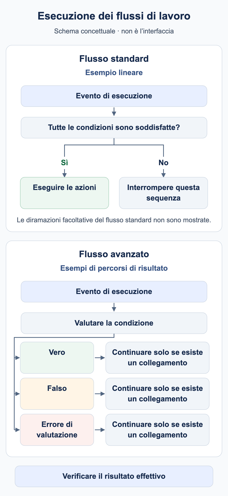

# Quando viene eseguito il mio workflow?

Un workflow richiede un motivo di esecuzione e condizioni corrispondenti. **Il tipo di documento è Fattura** seleziona i documenti; non significa che ogni modifica a una fattura avvii automaticamente una nuova esecuzione.

<figure><figcaption>Esempi concettuali: una sequenza standard lineare esegue le azioni solo quando le sue condizioni sono soddisfatte; altrimenti la sequenza si interrompe. Un nodo di condizione avanzato può utilizzare percorsi di risultato configurati separatamente. Un percorso prosegue solo se esiste un collegamento. Le diramazioni standard facoltative sono omesse; non è una schermata dell’interfaccia DocBits.</figcaption></figure>

## Dall’evento all’azione

1. Controllare organizzazione, autorizzazioni e modulo Workflow, oltre all’abilitazione Advanced quando necessaria.
2. Individuare il motivo: elaborazione del documento, chiamata manuale esplicita o trigger di evento supportato. Usare solo i trigger realmente disponibili nel catalogo della propria versione.
3. In Standard Workflow devono risultare vere When e tutte le condizioni And. Una condizione falsa interrompe quella sequenza lineare.
4. In Advanced Workflow, ingresso e uscite dei risultati collegate determinano il percorso. Una condizione And falsa può proseguire tramite arancione; rosso gestisce un errore di valutazione.
5. Verificare il risultato nel punto appropriato: risposta del test, esecuzione persistita, documento o sistema destinatario.

**Start** è un ingresso manuale. Il pacchetto utilizza When per Fattura e il numero esatto di formazione per soddisfare i requisiti dell’interfaccia corrente. Importarlo disattivato ed eseguire test manuali. Un test manuale riuscito non dimostra l’attivazione automatica tramite eventi documentali.

## Salvare, provare e attivare

| Stato | Significato |
| --- | --- |
| Bozza locale | La copia nel browser non sostituisce il salvataggio sul server. |
| Salvato | La configurazione esiste. Controllare separatamente l’attivazione: salvare una nuova regola può già attivarla. |
| Test Advanced | Valuta il grafico corrente, comprese modifiche non salvate. Le azioni documentali vengono simulate. |
| Attivato | La regola può essere considerata per il relativo evento. Provare tale evento separatamente. |

Test Manager e la finestra di test Advanced sono superfici di esecuzione diverse. Il solo confronto dello stato non conferma assegnazione, notifica o consegna di un’esportazione. Verificare gli effetti della modalità scelta prima di usare documenti reali.

## Più workflow ed esecuzioni ripetute



**Video:** Ordine di esecuzione dei Workflow · 1:19 · [Sottotitoli (WebVTT)](https://docbits-videos.fra1.cdn.digitaloceanspaces.com/settings-assistant/workflow-order/v1/it.vtt)

Trascrizione

**I numeri bassi vanno prima** · [0:00](https://docbits-videos.fra1.cdn.digitaloceanspaces.com/settings-assistant/workflow-order/v1/it.mp4#t=0.25)

Quando un documento raggiunge uno stato, ogni Workflow attivo che corrisponde viene eseguito, uno dopo l'altro. La colonna Ordine di esecuzione del flusso di lavoro fissa la sequenza: i numeri bassi vanno prima.

**Modificare l'ordine di esecuzione** · [0:15](https://docbits-videos.fra1.cdn.digitaloceanspaces.com/settings-assistant/workflow-order/v1/it.mp4#t=15.75)

Per cambiarlo, apri le azioni di un Workflow e scegli Modifica l'ordine di esecuzione del flusso di lavoro. Inserisci un numero da zero a mille. I nuovi Workflow partono da cinquecento, e quelli con lo stesso numero vanno in ordine alfabetico.

**Ognuno vede cosa hanno fatto i precedenti** · [0:32](https://docbits-videos.fra1.cdn.digitaloceanspaces.com/settings-assistant/workflow-order/v1/it.mp4#t=32.283)

L'ordine conta perché ogni Workflow lavora con ciò che hanno lasciato i precedenti. Un Workflow successivo vede i campi impostati da uno precedente. Le schede agiscono subito, anche quando assegnano o esportano il documento. Solo le schede di assegnazione sequenziale, la scheda di esportazione in coda e i prompt di DocOperator aspettano che l'ultimo Workflow sia finito. E se un Workflow finisce con una condizione non riuscita o un errore, i successivi vengono eseguiti comunque.

**Prima preparare, poi decidere** · [1:02](https://docbits-videos.fra1.cdn.digitaloceanspaces.com/settings-assistant/workflow-order/v1/it.mp4#t=62.65)

Uno schema semplice: dai numeri bassi ai Workflow che preparano i dati, per esempio impostando campi, e numeri più alti a quelli che controllano, instradano o approvano il documento. Lascia degli spazi, così i nuovi Workflow ci stanno in mezzo.



**Video:** Limiti di esecuzione dei Workflow · 0:51 · [Sottotitoli (WebVTT)](https://docbits-videos.fra1.cdn.digitaloceanspaces.com/settings-assistant/workflow-limits/v1/it.vtt)

Trascrizione

**Limite di esecuzione raggiunto** · [0:00](https://docbits-videos.fra1.cdn.digitaloceanspaces.com/settings-assistant/workflow-limits/v1/it.mp4#t=0.25)

Un Workflow può essere eseguito sullo stesso documento solo un numero limitato di volte. Quando un Workflow ha raggiunto quel limite, i Registri del flusso di lavoro del documento lo indicano in alto.

**L'icona rossa segnala il Workflow** · [0:14](https://docbits-videos.fra1.cdn.digitaloceanspaces.com/settings-assistant/workflow-limits/v1/it.mp4#t=14.616)

Ogni esecuzione di un Workflow che ha raggiunto il limite porta questa icona rossa accanto al nome. Passaci sopra per vedere il motivo.

**Per Workflow e per documento** · [0:24](https://docbits-videos.fra1.cdn.digitaloceanspaces.com/settings-assistant/workflow-limits/v1/it.mp4#t=24.183)

Il limite conta le esecuzioni di un Workflow su un documento. Una volta raggiunto, quel Workflow viene saltato per questo documento, mentre tutti gli altri continuano a essere eseguiti.

**Capire perché è partito così spesso** · [0:36](https://docbits-videos.fra1.cdn.digitaloceanspaces.com/settings-assistant/workflow-limits/v1/it.mp4#t=36.883)

Se un Workflow raggiunge il limite, guarda nei suoi registri perché è stato eseguito così spesso. Controlla per esempio se cambia qualcosa che lo riavvia, e restringi le sue condizioni così che venga eseguito solo quando deve.

I valori inferiori dell’**ordine di esecuzione** vengono elaborati prima. Per esempio, il workflow 100 prepara un campo e il 200 lo controlla. Usare valori distinti e confermare i dati effettivamente letti in una nuova esecuzione. La posizione di una scheda Advanced sul canvas non determina l’ordine.

**Change Status to → Trigger Workflows** può avviare un’altra esecuzione. **Run Workflow** richiama un workflow selezionato. Entrambi richiedono condizioni deliberate; nessuno garantisce una sola esecuzione. Limitare attività ed esportazioni mediante lo stato del processo e provare esplicitamente un secondo passaggio. Una semplice marca di completamento non protegge in generale dai duplicati simultanei.

Proseguire con il [caso Advanced](advanced-workflow-case-study.md), il [pacchetto di formazione](workflow-training-kit.md) e la [diagnosi](workflow-troubleshooting.md).

## WF-01: Esercizio e collaudo

Registrare evento, filtro, attivazione e versione. Verificare due esecuzioni e ordine 100/200 con un campo successivo realmente letto. Distinguere richiesta attesa ed esecuzione osservata.

[Percorso](workflow-learning-path.md)
