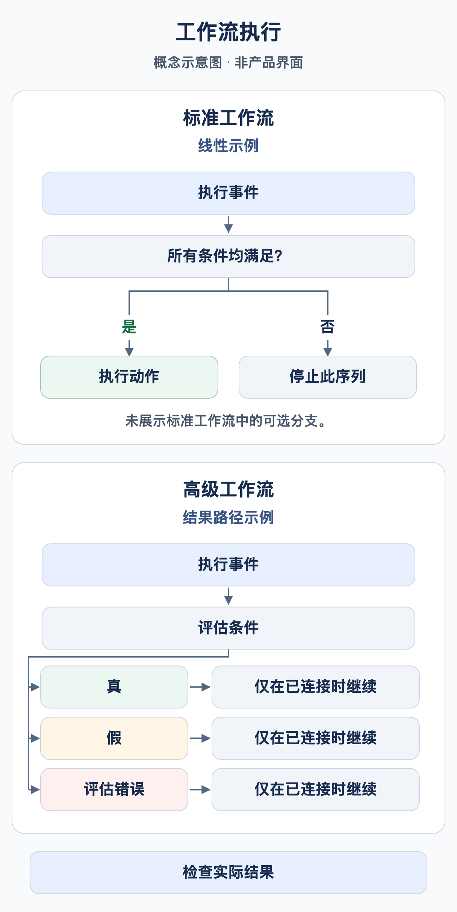

# 我的工作流何时运行？

工作流需要执行契机和匹配的条件。**文档类型为发票**用于筛选文档，并不意味着对发票进行任何修改都会自动启动新一次执行。

<figure><figcaption>概念示例：线性的标准工作流序列仅在条件均满足时执行动作，否则该序列停止。高级工作流中的条件节点可使用分别配置的结果路径。只有已连接的路径才会继续。图中省略了标准工作流的可选分支；这不是 DocBits 产品界面的截图。</figcaption></figure>

## 从事件到操作

1. 检查组织、权限和 Workflow 模块；使用高级工作流时，还需检查 Advanced 授权。
2. 明确执行契机：文档处理、显式手动调用，或受支持的事件触发器。仅使用当前版本卡片目录中实际提供的触发器。
3. Standard Workflow 要求 When 和所有 And 条件均匹配。条件为假会停止当前线性卡片序列。
4. Advanced Workflow 由入口和已连接的结果出口决定路径。And 条件为假时可以沿橙色出口继续；红色出口处理求值错误。
5. 在正确的位置核实结果：测试响应、持久化的执行记录、文档或连接的接收系统。

**Start** 是手动入口。练习包使用发票 When 入口和精确的培训发票编号，以满足当前界面的要求。请在停用状态下导入并手动测试。手动测试成功并不能证明文档事件会自动触发工作流。

## 保存、测试与启用

| 状态 | 含义 |
| --- | --- |
| 本地草稿 | 浏览器副本不能代替服务器上的保存。 |
| 已保存 | 配置已存在。请单独检查启用状态；保存新规则可能同时将其启用。 |
| Advanced 测试 | 评估当前图，包括未保存的更改。测试模式会模拟文档操作。 |
| 已启用 | 发生匹配事件时，系统可以考虑执行该规则。必须另行测试该事件。 |

Test Manager 与 Advanced 测试对话框是不同的执行入口。仅比较状态无法证明已完成分配、通知或导出交付。在真实文档上测试前，应确认所选测试入口可能产生的影响。

## 多个工作流与重复执行



**视频:** Workflow 的执行顺序 · 1:04 · [字幕 (WebVTT)](https://docbits-videos.fra1.cdn.digitaloceanspaces.com/settings-assistant/workflow-order/v1/zh.vtt)

文字稿

**数字小的先运行** · [0:00](https://docbits-videos.fra1.cdn.digitaloceanspaces.com/settings-assistant/workflow-order/v1/zh.mp4#t=0.25)

当文档达到某个状态时，每个匹配的已启用 Workflow 会依次运行。工作流执行顺序列决定先后：数字小的先运行。

**编辑执行顺序** · [0:12](https://docbits-videos.fra1.cdn.digitaloceanspaces.com/settings-assistant/workflow-order/v1/zh.mp4#t=12.383)

要修改，请打开 Workflow 的操作并选择编辑工作流执行顺序。输入零到一千之间的数字。新 Workflow 从五百开始，数字相同的 Workflow 按字母顺序运行。

**每个都能看到前面的结果** · [0:26](https://docbits-videos.fra1.cdn.digitaloceanspaces.com/settings-assistant/workflow-order/v1/zh.mp4#t=26.116)

顺序很重要，因为每个 Workflow 都基于前面 Workflow 留下的结果工作。后面的 Workflow 能看到前面设置的字段。卡片会立即执行，分配或导出文档时也是如此。只有顺序分配卡、排队导出卡和 DocOperator 提示会等到最后一个 Workflow 运行完。如果某个 Workflow 以失败条件或错误结束，后面的 Workflow 仍会运行。

**先准备，后决定** · [0:50](https://docbits-videos.fra1.cdn.digitaloceanspaces.com/settings-assistant/workflow-order/v1/zh.mp4#t=50.416)

一个简单的方案：准备数据的 Workflow（例如设置字段）用小数字，检查、分派或批准文档的 Workflow 用大数字。留出间隔，以便插入新的 Workflow。



**视频:** Workflow 的执行次数限制 · 0:47 · [字幕 (WebVTT)](https://docbits-videos.fra1.cdn.digitaloceanspaces.com/settings-assistant/workflow-limits/v1/zh.vtt)

文字稿

**已达到执行限制** · [0:00](https://docbits-videos.fra1.cdn.digitaloceanspaces.com/settings-assistant/workflow-limits/v1/zh.mp4#t=0.25)

同一个文档上，Workflow 只能运行有限的次数。Workflow 达到该限制时，文档的工作流日志会在顶部注明。

**红色图标标记该 Workflow** · [0:12](https://docbits-videos.fra1.cdn.digitaloceanspaces.com/settings-assistant/workflow-limits/v1/zh.mp4#t=12.216)

达到限制的 Workflow 的每次运行，名称旁都会显示这个红色图标。把鼠标悬停在上面可查看原因。

**按 Workflow 和文档计算** · [0:21](https://docbits-videos.fra1.cdn.digitaloceanspaces.com/settings-assistant/workflow-limits/v1/zh.mp4#t=21.55)

该限制统计一个 Workflow 在一个文档上的运行次数。达到后，此 Workflow 对该文档会被跳过，其他 Workflow 仍照常运行。

**找出运行频繁的原因** · [0:32](https://docbits-videos.fra1.cdn.digitaloceanspaces.com/settings-assistant/workflow-limits/v1/zh.mp4#t=32.55)

如果 Workflow 达到限制，请查看它的日志，了解它为什么运行这么频繁。例如检查它是否修改了会再次触发它的内容，并收紧条件，让它只在应该运行时运行。

**执行顺序**数值越小，越先运行。例如，工作流 100 准备字段，工作流 200 检查该字段。使用不同数值，并在新一次执行中核实实际读取的数据。Advanced 卡片在画布上的位置不决定执行顺序。

**Change Status to → Trigger Workflows** 可以启动后续执行；**Run Workflow** 调用选定的工作流。两者都需要明确设置条件，均不保证仅执行一次。通过业务处理状态限制任务和导出，并明确测试第二次运行。仅设置完成标记，并不能普遍防止并发重复处理。

接下来阅读[高级案例](advanced-workflow-case-study.md)、[练习包](workflow-training-kit.md)和[诊断指南](workflow-troubleshooting.md)。

## WF-01: 练习与验收

记录事件、过滤条件、启用状态和卡片版本。检查连续两次运行，并通过实际读取的后续字段验证 100/200 顺序。区分预期的后续请求与已经观察到的运行。

[学习路径](workflow-learning-path.md)
