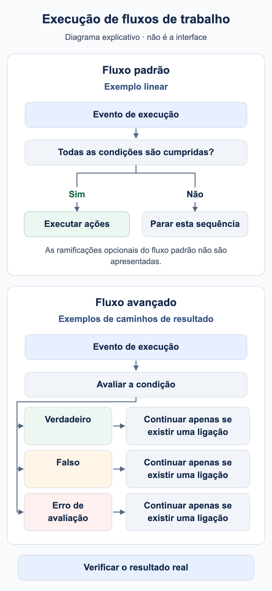

# Quando é executado o meu workflow?

Um workflow precisa de um motivo de execução e de condições correspondentes. **O tipo de documento é Fatura** seleciona documentos; não significa que qualquer alteração de uma fatura inicie automaticamente outra execução.

<figure><figcaption>Exemplos conceptuais: uma sequência padrão linear executa ações apenas quando as condições são cumpridas; caso contrário, essa sequência para. Um nó de condição avançado pode utilizar caminhos de resultado configurados separadamente. Um caminho só continua se existir uma ligação. As ramificações padrão opcionais foram omitidas; não é uma captura da interface do DocBits.</figcaption></figure>

## Do evento à ação

1. Verifique a organização, as permissões e o módulo Workflow, além da habilitação Advanced quando necessária.
2. Identifique o motivo: processamento documental, chamada manual explícita ou acionador de evento suportado. Utilize apenas acionadores realmente disponíveis no catálogo da sua versão.
3. No Standard Workflow, When e todas as condições And têm de corresponder. Uma condição falsa interrompe essa sequência linear.
4. No Advanced Workflow, a entrada e as saídas de resultado ligadas determinam o percurso. Uma condição And falsa pode continuar por laranja; vermelho trata um erro de avaliação.
5. Verifique o resultado no local adequado: resposta do teste, execução persistida, documento ou sistema destinatário.

**Start** é uma entrada manual. O pacote utiliza When para Fatura e o número exato de formação para cumprir os requisitos da interface atual. Importe-o desativado e teste manualmente. Um teste manual bem-sucedido não comprova o acionamento automático por eventos do documento.

## Guardar, testar e ativar

| Estado | Significado |
| --- | --- |
| Rascunho local | A cópia no navegador não substitui guardar no servidor. |
| Guardado | A configuração existe. Verifique a ativação separadamente: guardar uma regra nova pode já ativá-la. |
| Teste Advanced | Avalia o grafo atual, incluindo alterações não guardadas. As ações documentais são simuladas. |
| Ativado | A regra pode ser considerada no evento correspondente. Teste esse evento separadamente. |

O Test Manager e a janela de teste Advanced são superfícies de execução diferentes. Comparar apenas o estado não confirma atribuição, notificação ou receção de uma exportação. Verifique os efeitos da superfície escolhida antes de usar documentos reais.

## Vários workflows e repetições



**Vídeo:** Ordem de execução dos Workflows · 1:10 · [Legendas (WebVTT)](https://docbits-videos.fra1.cdn.digitaloceanspaces.com/settings-assistant/workflow-order/v1/pt.vtt)

Transcrição

**Números menores vão primeiro** · [0:00](https://docbits-videos.fra1.cdn.digitaloceanspaces.com/settings-assistant/workflow-order/v1/pt.mp4#t=0.25)

Quando um documento chega a um status, cada Workflow ativo que corresponde é executado, um após o outro. A coluna Ordem de Execução do Fluxo de Trabalho define a sequência: números menores vão primeiro.

**Editar a ordem de execução** · [0:13](https://docbits-videos.fra1.cdn.digitaloceanspaces.com/settings-assistant/workflow-order/v1/pt.mp4#t=13.516)

Para mudar, abra as ações de um Workflow e escolha Editar ordem de execução do fluxo de trabalho. Digite um número de zero a mil. Workflows novos começam em quinhentos, e Workflows com o mesmo número rodam em ordem alfabética.

**Cada um vê o que os anteriores fizeram** · [0:28](https://docbits-videos.fra1.cdn.digitaloceanspaces.com/settings-assistant/workflow-order/v1/pt.mp4#t=28.616)

A ordem importa porque cada Workflow trabalha com o que os anteriores deixaram. Um Workflow posterior vê os campos que um anterior preencheu. Os cartões agem na hora, também ao atribuir ou exportar o documento. Só os cartões de atribuição sequencial, o cartão de exportação em fila e os prompts do DocOperator esperam o último Workflow terminar. E se um Workflow terminar com condição não atendida ou erro, os seguintes rodam mesmo assim.

**Primeiro preparar, depois decidir** · [0:55](https://docbits-videos.fra1.cdn.digitaloceanspaces.com/settings-assistant/workflow-order/v1/pt.mp4#t=55.783)

Um esquema simples: dê números baixos aos Workflows que preparam dados, como preencher campos, e números mais altos aos que verificam, encaminham ou aprovam o documento. Deixe intervalos para que novos Workflows caibam no meio.



**Vídeo:** Limites de execução dos Workflows · 0:45 · [Legendas (WebVTT)](https://docbits-videos.fra1.cdn.digitaloceanspaces.com/settings-assistant/workflow-limits/v1/pt.vtt)

Transcrição

**Limite de execução atingido** · [0:00](https://docbits-videos.fra1.cdn.digitaloceanspaces.com/settings-assistant/workflow-limits/v1/pt.mp4#t=0.25)

Um Workflow só pode ser executado um número limitado de vezes no mesmo documento. Quando um Workflow atinge esse limite, os Registros de fluxo de trabalho do documento mostram isso no topo.

**O ícone vermelho marca o Workflow** · [0:12](https://docbits-videos.fra1.cdn.digitaloceanspaces.com/settings-assistant/workflow-limits/v1/pt.mp4#t=12.683)

Cada execução de um Workflow que atingiu o limite tem este ícone vermelho ao lado do nome. Passe o mouse sobre ele para ver o motivo.

**Por Workflow e por documento** · [0:21](https://docbits-videos.fra1.cdn.digitaloceanspaces.com/settings-assistant/workflow-limits/v1/pt.mp4#t=21.35)

O limite conta as execuções de um Workflow em um documento. Depois de atingido, esse Workflow é ignorado para este documento, enquanto todos os outros continuam rodando.

**Descobrir por que rodou tanto** · [0:32](https://docbits-videos.fra1.cdn.digitaloceanspaces.com/settings-assistant/workflow-limits/v1/pt.mp4#t=32.05)

Se um Workflow atingir o limite, veja nos registros dele por que rodou tantas vezes. Verifique, por exemplo, se ele muda algo que o inicia de novo, e restrinja as condições para que rode só quando deve.

Os valores mais baixos da **ordem de execução** são processados primeiro. Por exemplo, o workflow 100 prepara um campo e o 200 verifica-o. Utilize valores distintos e confirme os dados efetivamente lidos numa nova execução. A posição de um cartão Advanced no canvas não determina a ordem.

**Change Status to → Trigger Workflows** pode iniciar outra execução. **Run Workflow** chama um workflow selecionado. Ambos exigem condições deliberadas; nenhum garante uma execução única. Limite tarefas e exportações pelo estado do processo e teste explicitamente uma segunda execução. Um indicador de conclusão, por si só, não protege em geral contra duplicados simultâneos.

Continue com o [caso Advanced](advanced-workflow-case-study.md), o [pacote de formação](workflow-training-kit.md) e o [diagnóstico](workflow-troubleshooting.md).

## WF-01: Exercício e aceitação

Registe evento, filtro, ativação e versão. Verifique duas execuções e ordem 100/200 com um campo seguinte realmente lido. Distinga pedido esperado e execução observada.

[Percurso](workflow-learning-path.md)
