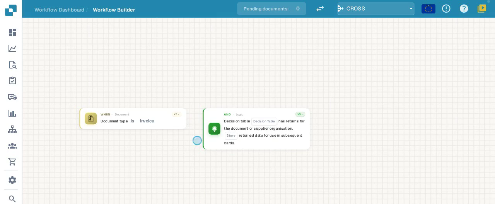
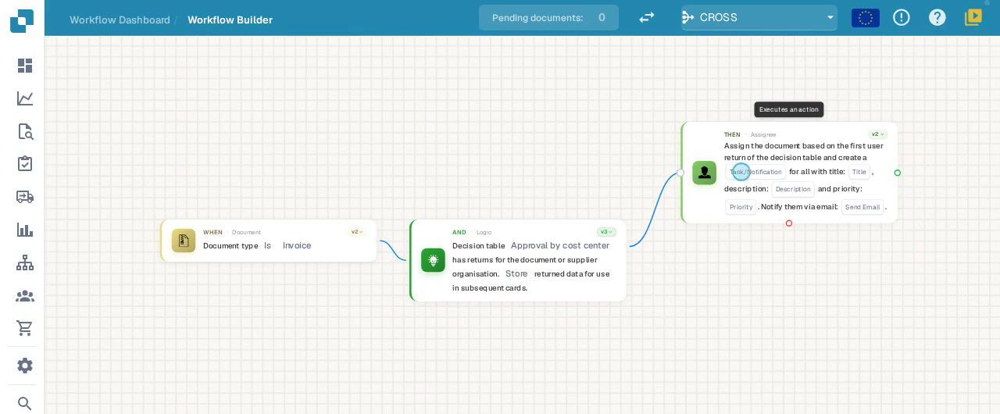
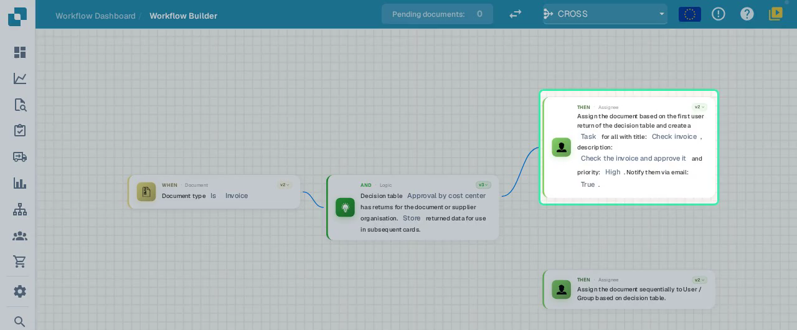
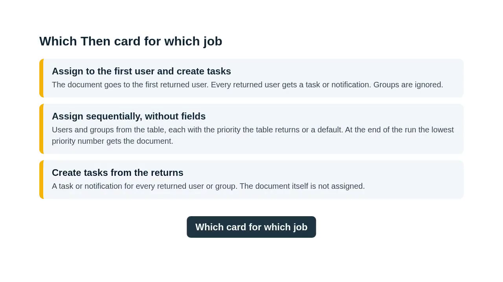

# P1: Trace a decision table through to assignment

A decision table decides **who handles a document** in a workflow. It checks the document's fields against your rules and returns users, groups, or both. Workflow cards then use those returns to assign the document or create tasks.

It works in **two steps**:

1. An **AND card** runs the decision table and stores its returns.
2. **THEN cards** read the stored returns and assign the document or create tasks.



**Video:** Decision tables in assignment cards · 1:59 · [Captions (WebVTT)](https://docbits-videos.fra1.cdn.digitaloceanspaces.com/settings-assistant/decision-tables/v1/en.vtt)

Transcript

**Decision tables in two steps** · [0:00](https://docbits-videos.fra1.cdn.digitaloceanspaces.com/settings-assistant/decision-tables/v1/en.mp4#t=0.25)

Decision tables decide who handles a document. In a workflow they work in two steps. An And card runs the decision table and keeps what it returns. Then cards use those returns to assign the document or to create tasks.

**Success, failed condition or error** · [0:16](https://docbits-videos.fra1.cdn.digitaloceanspaces.com/settings-assistant/decision-tables/v1/en.mp4#t=16.15)

The And card succeeds when the table returns at least one match for the document. Without a match it ends as failed condition and follows the orange failed condition path. Without a selected table, or when the table cannot run, it ends as error.

**Run the table and store its returns** · [0:31](https://docbits-videos.fra1.cdn.digitaloceanspaces.com/settings-assistant/decision-tables/v1/en.mp4#t=31.25)

Add the And card Decision table has returns and choose the decision table. Then set it to store the returned data. Without that, the cards after it have nothing to work with.

**First user gets the document, everyone a task** · [0:46](https://docbits-videos.fra1.cdn.digitaloceanspaces.com/settings-assistant/decision-tables/v1/en.mp4#t=46.283)

On the success path, the Then card Assign the document based on the first user return gives the document to the first user the table returns. Every returned user, the first one included, gets a task or a notification. Give the task a title, a description and a priority, and choose whether to also send an email. Groups in the returns are ignored.

**No fields: everything from the table** · [1:16](https://docbits-videos.fra1.cdn.digitaloceanspaces.com/settings-assistant/decision-tables/v1/en.mp4#t=76.483)

Instead, the card Assign the document sequentially to User or Group based on decision table has no fields at all. It takes users and groups from the table, each with the priority the table returns, or a default. At the end of the run, the entry with the lowest priority number gets the document, unless another card has already assigned it directly.

**Which card for which job** · [1:38](https://docbits-videos.fra1.cdn.digitaloceanspaces.com/settings-assistant/decision-tables/v1/en.mp4#t=98.916)

In short: to give the document to one person and inform everyone else, use the first user card. To let the table decide everything, including priorities, use the sequential card without fields. To only create tasks, use the task card for decision table returns.

---

## Example used on this page

Invoices are routed by cost center and amount:

| Rule | Cost center | Total amount | Returns           |
| ---- | ----------- | ------------ | ----------------- |
| 1    | 4711        | up to 1,000.00 | Reviewer A (user) |
| 2    | 4711        | above 1,000.00 | Reviewer B (user) |

Make sure the rules **don't overlap**, so that each document matches exactly one rule. Use users that exist in your organization.

---

## Step 1: Run the decision table (AND card)

Add the AND card **"Decision table … has returns for the document or supplier organisation. Store returned data for use in subsequent cards."**

| Setting        | What to choose                                           |
| -------------- | -------------------------------------------------------- |
| Decision table | The table you want to run, e.g. *Approval by cost center* |
| Returned data  | **Store**                                                |

> ⚠️ **Important:** if you choose *Do not store*, the THEN cards after it have nothing to work with and won't assign anyone.

<figure><figcaption>
The AND card runs the table and stores its returns
</figcaption></figure>

### The three outcome paths

| Path                          | When it happens                                      | What to connect                           |
| ----------------------------- | ---------------------------------------------------- | ----------------------------------------- |
| **Success**                   | The table returns at least one match for the document | Your assignment or task card (Step 2)     |
| **Failed condition** (orange) | No rule matches the document                         | A fallback, e.g. assign to a default group |
| **Error** (red)               | No decision table is selected, or the table can't run | A fallback and a notification to an admin  |

> ℹ️ Always connect the **Failed condition** and **Error** paths. Otherwise the document stays unassigned and nobody is notified.

---

## Step 2: Choose what happens with the returns (THEN card)

Connect one of these cards to the **Success** path:

| Your goal                                                   | Card                                                                                                | What it does                                                                                                                                                                                                                                              |
| ----------------------------------------------------------- | --------------------------------------------------------------------------------------------------- | --------------------------------------------------------------------------------------------------------------------------------------------------------------------------------------------------------------------------------------------------------- |
| **One person owns the document, everyone else is informed** | *Assign the document based on the first user return of the decision table and create a task for all* | Assigns the document to the **first** returned user. **Every** returned user gets a task or notification, the first one included. Groups in the returns are ignored.                                                                                        |
| **The table decides everything, including priority**        | *Assign the document sequentially to User / Group based on decision table*                          | Has no fields. Takes users and groups from the table, each with the priority the table returns or a default. At the end of the run, the entry with the **lowest priority number** gets the document, unless another card has already assigned it directly. |
| **Only create tasks, no assignment**                        | *Assign task with title … to user/group return of decision table*                                   | Creates a task or notification for each returned user or group. The document itself is not assigned.                                                                                                                                                        |
| **Assign to one user or group**                             | *Assign document to user/group based on decision table*                                             | Assigns the document to the returned user or group. If several rules match, the **last** match wins.                                                                                                                                                        |

<figure><figcaption>
The first-user card on the Success path
</figcaption></figure>

### Task settings

| Setting             | Meaning                                          |
| ------------------- | ------------------------------------------------ |
| Task / Notification | A task needs action; a notification only informs |
| Title / Description | Shown to the user in their task list             |
| Priority            | Low / Medium / High                              |
| Notify via email    | Also notify the user by email                    |

<figure><figcaption>
The first-user card filled in, plus the sequential card without fields
</figcaption></figure>

### Other decision-table cards

| Card                                                                                                  | Use                                                                          |
| ----------------------------------------------------------------------------------------------------- | ---------------------------------------------------------------------------- |
| *Assign the document sequentially to user/group based on decision table, with priority of …*          | Like the sequential card above, but you set the priority on the card yourself |
| *Assign the document to and create a task … return of decision table. Set an assignment priority of …* | Sequential assignment plus a task in one card                                |
| *Assign the first returned user of the decision table to the supplier*                                 | Supplier workflows: sets the supplier's responsible user                      |

---

## When several rules match

Which person gets the document depends on the card:

| Card                           | Who gets the document                        |
| ------------------------------ | -------------------------------------------- |
| First user return + tasks      | The **first** returned user                  |
| Assign based on decision table | The **last** returned user or group          |
| Sequential (user and/or group) | The entry with the **lowest priority number** |

> ⚠️ Several matches do **not** mean that all of those users must approve. Don't rely on the row order in the table. If the order matters, set priorities in the table and use the sequential card.

<figure><figcaption>
Which then card for which job
</figcaption></figure>

---

## Test your setup

Test with test users and test documents only. The AND card really runs the decision table, even in test mode.

| #   | Test                                   | Expected result                                     |
| --- | -------------------------------------- | --------------------------------------------------- |
| 1   | Cost center 4711, amount 1,000.00       | Reviewer A                                          |
| 2   | Cost center 4711, amount 1,000.01       | Reviewer B                                          |
| 3   | Cost center 9999 (no rule matches)      | Orange path → fallback                              |
| 4   | Both rules match (overlapping amounts)  | Depends on the card (see "When several rules match") |
| 5   | Returned data set to *Do not store*     | Nothing is assigned                                 |
| 6   | The returned user was deleted           | Error → fallback                                    |

Check the result on the document itself (assignee and tasks) and in the workflow log.

[Continue learning](./) · [Training kit](workflow-training-kit.md)
