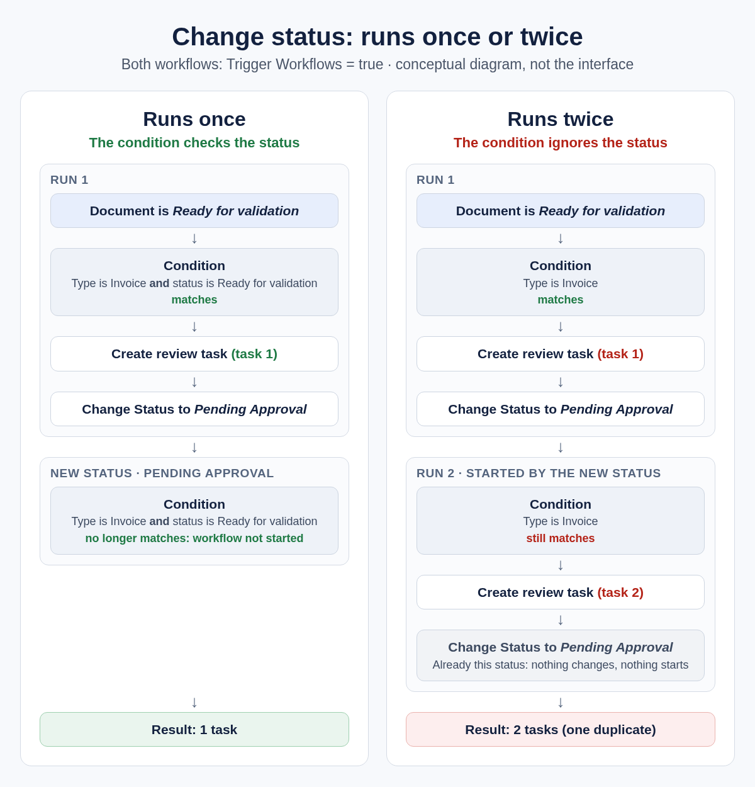

# Change status without restarting your workflow

When a document gets a new status, DocBits starts the workflows that are meant for that status. This can include the workflow that just changed the status. If its conditions still match, it runs again and creates a second task or export.

This page shows how to set up your workflow so that each document passes through it only once.



**Video:** Change status card and loop prevention · 0:44 · [Captions (WebVTT)](https://docbits-videos.fra1.cdn.digitaloceanspaces.com/settings-assistant/workflow-status-change/v1/en.vtt)

## The setting that matters

The [Change Status to](../cards-overview/then/status/change-status-to.md) card sets the new status. Its setting **Trigger Workflows** decides whether this status change may start workflows:

* **false:** no workflow is started. Use this unless another workflow should continue with the document.
* **true:** DocBits starts the workflows whose conditions match the document in its new status. That can include the workflow that made the change.

The card page describes all statuses and the card versions.

## Which workflows start after a status change

With **Trigger Workflows** set to **true**, DocBits looks at every enabled workflow and checks its conditions on document type and status, for example a **Document status** card. A workflow starts if the document, with its new status, matches.

A workflow that doesn't check the status matches **every** status. So when it changes the status itself, the new status starts it again.

Changing a document to the status it already has does nothing: the status stays, and no workflow starts.

## Example: runs once vs. runs twice

The rule: once your workflow has done its job, its own conditions must no longer match.

<figure><figcaption>
The same workflow with and without a status condition
</figcaption></figure>

On the right, the workflow runs a second time and creates a duplicate task. It stops there only because the second status change sets a status the document already has.

**Two workflows can start each other.** If one workflow sets **Pending Approval** and another sets the document back to **Ready for validation**, both with **true**, they keep starting each other. Give each workflow a condition on the status it starts from, and use **true** only where it's needed.

## Set it up step by step

1. **Use version 3 of Change Status to.** Older versions have no **Trigger Workflows** setting (see [Card versions](../cards-overview/then/status/change-status-to.md#card-versions)).
2. **Check the starting status.** Add the **And** card **Document status** (under **And → Status**) and set it to **Is** **Ready for validation**. See [Single Document Status Condition](../cards-overview/and/status/single-document-status-condition.md). If the status alone doesn't tell whether the step is done, also check a field that your workflow fills when it's done.
3. **Add the action**, for example creating a task or exporting the document.
4. **Add Change Status to** and choose the next status, for example **Pending Approval**.
5. **Choose Trigger Workflows.** Start with **false**. Choose **true** only if another workflow should continue with the new status.
6. **Try it with a real document.** Check that exactly one task or export was created and that the document has the new status.


Tests in the workflow designer only simulate the status change. The status is not saved and no other workflow starts. To see the real behavior, use a real document.


## Built-in protection

DocBits limits the damage when workflows start each other again and again:

* **One workflow run at a time per document.** Runs for the same document wait for each other, and each run sees the document as the previous one left it.
* **Run limit.** By default, the same workflow runs at most 50 times on one document. After that, DocBits stops starting it for this document.

These limits stop the repetition eventually, but by then many tasks or exports may already exist. A condition on the status is what prevents it. If a duplicate would be a real problem, also check for it before acting, for example whether an open task already exists for the document.

## Related

* [Change Status to](../cards-overview/then/status/change-status-to.md): the card, its statuses and versions
* [Single Document Status Condition](../cards-overview/and/status/single-document-status-condition.md): check the document status in a condition
* [When does my workflow run?](workflow-execution-model.md)
* [Learning path overview](./)
