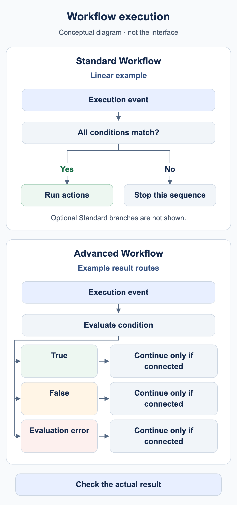

# When does my workflow run?

A workflow needs an execution event and matching conditions. **Document type is Invoice** selects documents; it does not mean every change to an invoice automatically starts another run.

<figure><figcaption>
Conceptual examples: a linear Standard sequence runs actions only when its conditions match; otherwise that sequence stops. An Advanced condition node can use separate configured result routes. A route continues only when connected. Optional Standard branches are omitted; this is not a DocBits interface screenshot.
</figcaption></figure>

## From event to action



**Video:** When a workflow starts · 0:42 · [Captions (WebVTT)](https://docbits-videos.fra1.cdn.digitaloceanspaces.com/settings-assistant/workflow-start/v1/en.vtt)

Transcript

**A status change starts the workflows** · [0:00](https://docbits-videos.fra1.cdn.digitaloceanspaces.com/settings-assistant/workflow-start/v1/en.mp4#t=0.25)

Workflows start when the status of a document changes. The first time is when a new document becomes ready for validation. The workflows run in the background, and while they run, the document is locked.

**Workflow In Progress: the document is locked** · [0:15](https://docbits-videos.fra1.cdn.digitaloceanspaces.com/settings-assistant/workflow-start/v1/en.mp4#t=15.583)

In the document dashboard, the document shows Workflow In Progress. It cannot be opened, so nobody changes it while a workflow is working on it.

**Done: the status is back** · [0:26](https://docbits-videos.fra1.cdn.digitaloceanspaces.com/settings-assistant/workflow-start/v1/en.mp4#t=26.683)

When the workflows are done, the dashboard updates by itself: the document shows its status again and opens as usual. To see what the workflows did, open the menu of the document and choose Workflow logs.

1. Check the organization, permissions and Workflow module, plus the Advanced entitlement where required.
2. Identify the event: document processing, an explicit manual invocation or a supported event trigger. Use only triggers actually available in your version's card catalog.
3. In a Standard Workflow, When and every And condition must match. A false condition stops that linear card sequence.
4. In an Advanced Workflow, the entry and connected result handles determine the route. A false And condition can continue through orange; red handles an evaluation error.
5. Check the result in the appropriate place: test response, persisted execution, document or connected destination.

**Start** is a manual entry. The training kit uses a When entry for Invoice and an exact training invoice number, meeting the current interface's requirements. Import it disabled and test manually. A successful manual test does not establish automatic document-event triggering.

## Save, test and activate

| State         | Meaning                                                                                              |
| ------------- | ---------------------------------------------------------------------------------------------------- |
| Local draft   | A browser copy does not replace saving to the server.                                                |
| Saved         | The configuration exists. Check activation separately; saving a new rule can already enable it.      |
| Advanced test | Evaluates the current graph, including unsaved changes. Document actions are simulated in test mode. |
| Enabled       | The rule can be considered for its matching execution event. Test that event separately.             |

Test Manager and the Advanced test dialog are different execution surfaces. A status comparison alone does not confirm assignment, a notification or export delivery. Check the side effects of the selected test surface before running against real documents.

## Multiple workflows and repeated execution



**Video:** Workflow execution order · 1:14 · [Captions (WebVTT)](https://docbits-videos.fra1.cdn.digitaloceanspaces.com/settings-assistant/workflow-order/v1/en.vtt)

Transcript

**Lower numbers run first** · [0:00](https://docbits-videos.fra1.cdn.digitaloceanspaces.com/settings-assistant/workflow-order/v1/en.mp4#t=0.25)

When a document reaches a status, every enabled workflow that matches it runs, one after another. The Workflow Execution Order column sets the sequence: lower numbers run first.

**Edit execution order** · [0:16](https://docbits-videos.fra1.cdn.digitaloceanspaces.com/settings-assistant/workflow-order/v1/en.mp4#t=16.016)

To change it, open the actions of a workflow and choose Edit execution order. Enter a number from zero to one thousand. New workflows start at five hundred, and workflows with the same number run in alphabetical order.

**Each workflow sees what the previous ones did** · [0:31](https://docbits-videos.fra1.cdn.digitaloceanspaces.com/settings-assistant/workflow-order/v1/en.mp4#t=31.916)

The order matters because each workflow works with what the previous ones left. A later workflow sees the fields an earlier one has set. Cards act right away, also when they assign or export the document. Only the sequential assignment cards, the queued export card and DocOperator prompts wait until the last workflow has run. And when a workflow ends with a failed condition or an error, the next ones still run.

**Prepare first, decide later** · [0:59](https://docbits-videos.fra1.cdn.digitaloceanspaces.com/settings-assistant/workflow-order/v1/en.mp4#t=59.316)

A simple scheme: give workflows that prepare data, such as setting fields, low numbers, and workflows that check, route or approve the document higher ones. Leave gaps, so new workflows fit in between.



**Video:** Workflow execution limits · 0:49 · [Captions (WebVTT)](https://docbits-videos.fra1.cdn.digitaloceanspaces.com/settings-assistant/workflow-limits/v1/en.vtt)

Transcript

**Execution limit reached** · [0:00](https://docbits-videos.fra1.cdn.digitaloceanspaces.com/settings-assistant/workflow-limits/v1/en.mp4#t=0.25)

A workflow can run on the same document only a limited number of times. When a workflow has reached that limit, the workflow logs of the document say so at the top.

**The red icon marks the workflow** · [0:13](https://docbits-videos.fra1.cdn.digitaloceanspaces.com/settings-assistant/workflow-limits/v1/en.mp4#t=13.183)

Every run of a workflow that reached the limit carries this red icon next to its name. Hover over it to see why.

**Per workflow and document** · [0:23](https://docbits-videos.fra1.cdn.digitaloceanspaces.com/settings-assistant/workflow-limits/v1/en.mp4#t=23.283)

The limit counts the runs of one workflow on one document. Once it is reached, that workflow is skipped for this document, while all other workflows still run.

**Find out why it ran so often** · [0:34](https://docbits-videos.fra1.cdn.digitaloceanspaces.com/settings-assistant/workflow-limits/v1/en.mp4#t=34.783)

If a workflow reaches the limit, look in its logs why it ran so often. For example, check whether it changes something that starts it again, and narrow its conditions so that it runs only when it should.

Lower **execution order** values run first. For example, workflow 100 prepares a field and workflow 200 checks it. Use distinct values and confirm the data actually read in a new run. An Advanced card's canvas position does not determine execution order.

**Change Status to → Trigger Workflows** can initiate another execution. **Run Workflow** invokes a selected workflow. Both require deliberate conditions; neither guarantees execution only once. Restrict tasks and exports using business processing state, and explicitly test a second run. A completed flag alone is not a general defense against concurrent duplicate processing.

Continue with the [Advanced case study](advanced-workflow-case-study.md), [training kit](workflow-training-kit.md) and [troubleshooting guide](workflow-troubleshooting.md).

## WF-01: Exercise and acceptance

Record execution event, filter, enabled state and card version. Inspect two successive runs and order 100/200 using a downstream field actually read. Separate an expected follow-up request from an observed execution.

[Learning path](./)
