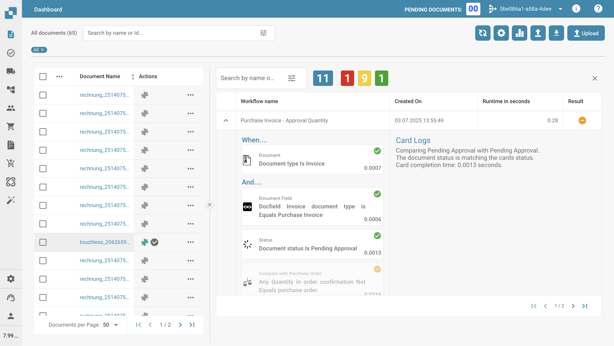

# Registros del Flujo de Trabajo

## Vídeo

El vídeo de búsqueda es una vista previa con pantallas reales de DocBits. El vídeo de diagnóstico conserva los diagramas didácticos identificados como ilustraciones.
### Encontrar la ejecución relevante


Vista previa para pruebas: pantallas reales de DocBits con acciones del documento, flujo del documento, tiempos de los pasos, registros vacíos y filtros de estado y fecha. El documento no tiene una ejecución guardada de Advanced Workflow. Esta vista previa aún no incluye filas de ejecución, paginación ni diagnóstico de nodos.




[Abrir vídeo](https://docbits-videos.fra1.cdn.digitaloceanspaces.com/settings-assistant/advanced_workflow_logs_search/v3/es.mp4) · [Subtítulos (WebVTT)](https://docbits-videos.fra1.cdn.digitaloceanspaces.com/settings-assistant/advanced_workflow_logs_search/v3/es.vtt) · 1:50

Transcripción

**Empezar por el documento**

En el panel de documentos, abra el menú de acciones y elija Flujo del documento. El historial real muestra la importación y el OCR. Abra un paso para revisar los tiempos de espera y procesamiento. Estos pasos son distintos de los nodos de Advanced Workflow.

**Leer los contadores reales**

Aquí se muestran los registros de workflow del mismo documento. Azul indica el total, rojo los errores, amarillo las condiciones fallidas y verde los éxitos. Este documento de demostración no tiene ejecuciones registradas. Por eso, los cuatro contadores muestran cero.

**Revisar las columnas de ejecución**

Las columnas muestran nombre del workflow, fecha de creación, duración y resultado. Distinga ejecuciones repetidas por la marca de tiempo. Este documento no tiene una fila para abrir.

**Abrir los filtros de estado**

El icono de filtros abre el menú real. Ordene por nombre o fecha de creación, en sentido ascendente o descendente. Estado ofrece éxito, condición fallida y error.

**Elegir fechas y borrar filtros**

Elija el periodo con las fechas de inicio y fin o el calendario. El formato es año, mes y día. Aplicar solicita los resultados. Borrar filtros restablece la selección. Borre la búsqueda por separado.

**Vista previa: falta una ejecución guardada**

Esta vista previa permite comprobar el acceso al documento, sus detalles de procesamiento y los controles de registro. Falta una ejecución guardada de Advanced Workflow para mostrar filas reales, paginación, rutas y mensajes de nodos. Esos resultados no se simulan en este vídeo.

### Seguir nodos y diagnosticar



[Subtítulos (WebVTT)](https://docbits-videos.fra1.cdn.digitaloceanspaces.com/settings-assistant/advanced_workflow_logs_diagnosis/v2/es.vtt) · 1:51

Transcripción

**Expanda una ejecución**

Expanda la fila del workflow. Una ejecución avanzada muestra el grafo a la izquierda y mensajes a la derecha; un workflow estándar muestra tarjetas en secuencia. Los datos describen aquella ejecución y pueden diferir del diseñador actual.

**Seleccione un nodo**

Desplace o amplíe el grafo y pulse un nodo. Card Logs muestra sus mensajes. Los controles Wait ALL y Wait ANY también pueden tener mensajes de nodo. Relacione el mensaje con el nodo seleccionado y la fecha de ejecución.

**Distinga los resultados**

Verde indica éxito; naranja, condición falsa; rojo, error; gris, omitido. Un nodo omitido no se ejecutó. Compruebe si se eligió otra rama o falta una entrada de unión antes de modificarlo.

**Siga la primera desviación**

Siga la ruta real desde la entrada. Para una condición de importe falsa, revise naranja; para un error, lea el mensaje y revise rojo. El gestor de errores puede funcionar y la ejecución conservar el error original.

**Revise las uniones**

En Wait ALL, compruebe cada origen y resultado conectado. En ANY u OR, busque un origen coincidente. Dos salidas del mismo nodo no representan aprobaciones independientes. Una condición naranja puede ser intencionada.

**Corrija y verifique**

Anote workflow, referencia del documento, fecha, nodo y mensaje exacto. Corrija datos o configuración y pruebe un escenario repetible. Guarde y compruebe la activación. Compare una ejecución nueva con la antigua; los registros anteriores conservan el comportamiento anterior.

## **Resumen**

Los **Registros del Flujo de Trabajo** permiten a los usuarios analizar qué flujos de trabajo se ejecutaron para un documento, comprender los resultados de la ejecución y profundizar en los detalles a nivel de condición para depuración o validación.

## **Acceso a los Registros del Flujo de Trabajo**



**Vídeo:** Leer los registros del Workflow · 1:22 · [Subtítulos (WebVTT)](https://docbits-videos.fra1.cdn.digitaloceanspaces.com/settings-assistant/workflow-logs/v1/es.vtt)

Transcripción

**Abrir los registros** · [0:00](https://docbits-videos.fra1.cdn.digitaloceanspaces.com/settings-assistant/workflow-logs/v1/es.mp4#t=0.25)

Cada documento guarda los registros de los flujos que se ejecutaron sobre él. En el panel de documentos, abra las acciones de un documento y elija Registros de flujo de trabajo.

**Ejecuciones y resultados** · [0:10](https://docbits-videos.fra1.cdn.digitaloceanspaces.com/settings-assistant/workflow-logs/v1/es.mp4#t=10.383)

Arriba ve cuántas ejecuciones hubo y cuántas terminaron con un error, una condición fallida o éxito. Debajo aparece cada ejecución con su flujo, hora, duración y resultado.

**El camino de una ejecución** · [0:21](https://docbits-videos.fra1.cdn.digitaloceanspaces.com/settings-assistant/workflow-logs/v1/es.mp4#t=21.783)

Arrastre el divisor a la izquierda para dar más espacio a los registros. Luego haga clic en una ejecución para ver su camino. Cada tarjeta muestra su resultado: verde para éxito, naranja para una condición fallida, rojo para un error. Aquí la tarjeta Y terminó con una condición fallida, así que la tarjeta Entonces siguiente no se ejecutó.

**Por qué una tarjeta terminó así** · [0:41](https://docbits-videos.fra1.cdn.digitaloceanspaces.com/settings-assistant/workflow-logs/v1/es.mp4#t=41.416)

Seleccione una tarjeta para leer su registro. Dice qué comparó la tarjeta y por qué terminó así. Aquí el documento está listo para la validación, pero la tarjeta espera la segunda aprobación.

**Un error y su motivo** · [0:53](https://docbits-videos.fra1.cdn.digitaloceanspaces.com/settings-assistant/workflow-logs/v1/es.mp4#t=53.15)

Una ejecución que termina con un error muestra en rojo la tarjeta que falló. Aquí la tarjeta Y no pudo leer la dirección de entrega del documento. Los datos que faltan son siempre un error, así que la tarjeta siguiente no se ejecutó.

**Buscar ejecuciones** · [1:06](https://docbits-videos.fra1.cdn.digitaloceanspaces.com/settings-assistant/workflow-logs/v1/es.mp4#t=66.383)

Con muchas ejecuciones, use la búsqueda para encontrar un flujo por su nombre y el botón de filtro para acotar la lista por estado o fecha.

**Nota del límite de ejecución** · [1:14](https://docbits-videos.fra1.cdn.digitaloceanspaces.com/settings-assistant/workflow-logs/v1/es.mp4#t=74.116)

Arriba aparece una nota cuando un flujo ha alcanzado su límite de ejecuciones en este documento. El vídeo sobre los límites de ejecución la explica.

Para acceder a los registros del flujo de trabajo:

1. Navega hasta el **Tablero**.
2. Haz clic en el **menú de Acciones** (ícono de tres puntos) junto al documento deseado.
3. Selecciona **Registros del Flujo de Trabajo** en el menú.
   * <mark style="color:red;">**Nota**</mark>**:** La función de flujo de trabajo debe estar habilitada para acceder a esta opción.
4.  Se abre un **panel lateral** que muestra un resumen de los flujos de trabajo ejecutados.

    

## **Componentes del Panel de Registros del Flujo de Trabajo**

#### **1. Contadores de Resumen del Flujo de Trabajo**

Ubicados en la parte superior del panel de registros:

* **Azul**: Número total de flujos de trabajo ejecutados.
* **Rojo**: Flujos de trabajo que terminaron con **errores**.
* **Amarillo**: Flujos de trabajo que **no se completaron** debido a discrepancias en las condiciones.
* **Verde**: Flujos de trabajo ejecutados con éxito.

#### **2. Tabla de Ejecución del Flujo de Trabajo**

Cada fila en la tabla representa una ejecución de flujo de trabajo e incluye:

* **Nombre del Flujo de Trabajo**
* **Marca de Tiempo** (Creado en)
* **Tiempo de Ejecución** (en segundos)
* **Ícono de Resultado**:
  * Marca de verificación verde: El flujo de trabajo se ejecutó con éxito.
  * Cruz roja: El flujo de trabajo se ejecutó con un error.
  * Guión naranja: La ejecución se detuvo debido a que no se cumplió una condición

Al hacer clic en la **flecha** a la izquierda de cada fila se expande la **vista detallada del flujo de trabajo**.

<figure><figcaption></figcaption></figure>

### **Vista Detallada del Flujo de Trabajo**

Al hacer clic en una fila de flujo de trabajo específica se abre su **registro detallado de ejecución**, que muestra:

#### **Evaluación de Condiciones**

* Bloque **Cuando...**: Condición inicial.
* Bloque(s) **Y...**: Condiciones adicionales.
* Bloque(s) **Entonces...**: Acciones realizadas cuando se cumplen todas las condiciones.

Cada línea de condición muestra:

* Marca de verificación verde: La condición se cumplió.
* Guión naranja: La condición no se cumplió.
* Cruz roja: La condición falló **debido a un error**

### **Nota de Comportamiento Importante**

Si una condición en un flujo de trabajo **no se cumple**, el sistema **deja de evaluar cualquier otra tarjeta de flujo de trabajo** dentro de ese flujo de trabajo. Este comportamiento evita un procesamiento innecesario. Como indicador visual, la tarjeta que **no cumplió su condición** se muestra en **gris**, y todas las **tarjetas subsiguientes** en el mismo flujo de trabajo también aparecerán **grises**, indicando que no se ejecutaron.
