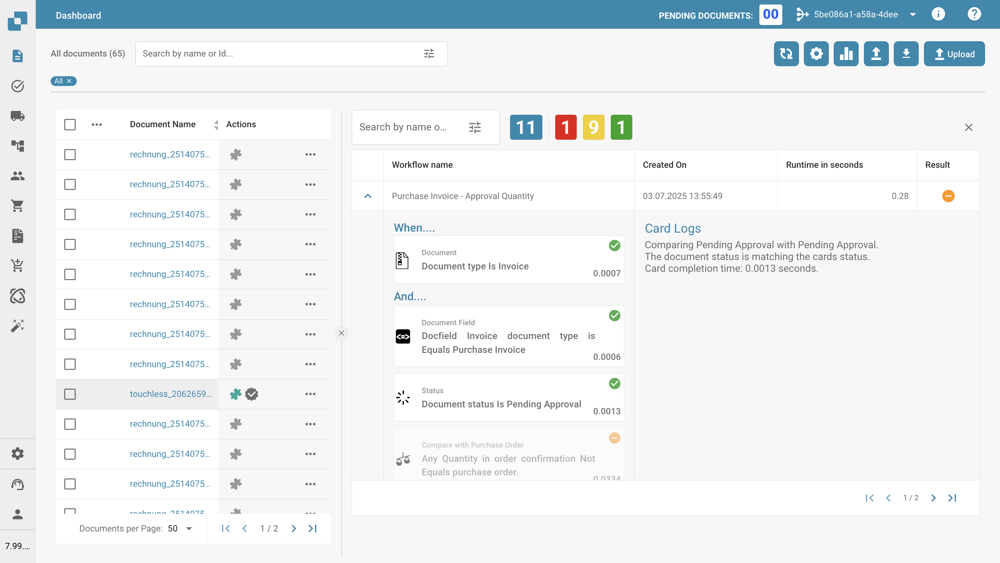

# Registri dei flussi di lavoro

Per spiegazioni narrate della vista avanzata dei registri, guarda [Trovare l'esecuzione pertinente](advanced-workflow-builder/videos.md#find-the-relevant-execution) e [Seguire i nodi e diagnosticare](advanced-workflow-builder/videos.md#trace-nodes-and-diagnose). Entrambi i capitoli sono disponibili in inglese e tedesco, con file di sottotitoli e trascrizioni.

## **Panoramica**

I **Registri dei flussi di lavoro** consentono agli utenti di analizzare quali Workflow sono stati eseguiti per un documento, comprendere i risultati dell'esecuzione e approfondire i dettagli a livello di condizione per il debug o la convalida.

## **Accesso ai registri dei flussi di lavoro**



**Video:** Lettura dei registri dei flussi di lavoro · 1:34 · [Captions (WebVTT)](https://docbits-videos.fra1.cdn.digitaloceanspaces.com/settings-assistant/workflow-logs/v1/en.vtt)

Trascrizione

**Open the workflow logs** · [0:00](https://docbits-videos.fra1.cdn.digitaloceanspaces.com/settings-assistant/workflow-logs/v1/en.mp4#t=0.25)

Ogni documento conserva i registri dei Workflow eseguiti su di esso. Nel Dashboard del documento, apri il menu Actions di un documento e scegli Workflow Logs.

**Runs and their results** · [0:12](https://docbits-videos.fra1.cdn.digitaloceanspaces.com/settings-assistant/workflow-logs/v1/en.mp4#t=12.15)

In alto vedi quante esecuzioni ci sono state e quante sono terminate con un errore, una condizione non soddisfatta o un successo. Sotto, ogni esecuzione è elencata con il suo Workflow, l'ora, la durata e il risultato.

**The path of one run** · [0:25](https://docbits-videos.fra1.cdn.digitaloceanspaces.com/settings-assistant/workflow-logs/v1/en.mp4#t=25.716)

Trascina il divisore verso sinistra per dare più spazio ai registri. Poi fai clic su un'esecuzione per vedere il percorso seguito. Ogni scheda mostra il suo risultato: verde per il successo, arancione per una condizione non soddisfatta, rosso per un errore. Qui la scheda And è terminata con una condizione non soddisfatta, quindi la scheda Then successiva non è stata eseguita.

**Why a card ended this way** · [0:45](https://docbits-videos.fra1.cdn.digitaloceanspaces.com/settings-assistant/workflow-logs/v1/en.mp4#t=45.35)

Seleziona una scheda per leggerne il registro. Indica cosa ha confrontato la scheda e perché è terminata in questo modo. Qui il documento è pronto per la validazione, ma la scheda si aspetta una seconda approvazione in sospeso.

**An error and its reason** · [0:58](https://docbits-videos.fra1.cdn.digitaloceanspaces.com/settings-assistant/workflow-logs/v1/en.mp4#t=58.283)

Un'esecuzione che termina con un errore mostra in rosso la scheda non riuscita. Qui la scheda And non ha potuto leggere l'indirizzo di consegna dal documento. I dati mancanti sono sempre un errore, quindi la scheda Then successiva non è stata eseguita.

**Find runs** · [1:13](https://docbits-videos.fra1.cdn.digitaloceanspaces.com/settings-assistant/workflow-logs/v1/en.mp4#t=73.216)

Con molte esecuzioni, usa la ricerca per trovare un Workflow per nome e il pulsante del filtro per restringere l'elenco per stato o data.

**Execution limit note** · [1:23](https://docbits-videos.fra1.cdn.digitaloceanspaces.com/settings-assistant/workflow-logs/v1/en.mp4#t=83.116)

In alto compare una nota quando un Workflow ha raggiunto il suo limite di esecuzioni su questo documento. Il video sui limiti di esecuzione la spiega.

Per accedere ai Workflow Logs:

1. Vai al **Dashboard**.
2. Fai clic sull'**Actions menu** (icona con tre punti) accanto al documento desiderato.
3. Seleziona **Workflow Logs** dal menu.
   * <mark style="color:red;">**Note**</mark>: La funzione Workflow deve essere abilitata per accedere a questa opzione.
4.  Si apre un **side panel** che mostra un riepilogo dei Workflow eseguiti.\\

    
<figure><figcaption></figcaption></figure>

## **Aprire un registro come pagina dedicata**

Il side panel copre l'elenco dei documenti. Per un documento di cui ispezioni il Workflow per un po', apri lo stesso registro come pagina intera: seleziona l'icona della nuova finestra nell'intestazione del pannello. La pagina ha l'indirizzo `/workflows/logs/<document id>`, quindi puoi tenerla aperta in una seconda finestra del browser o inviare l'indirizzo a un collega che ha accesso al documento.

La pagina mostra gli stessi contatori riepilogativi, la stessa tabella dei Workflow eseguiti e la stessa vista di dettaglio del pannello.

## **Passare a un altro documento**

Nella pagina intera, un campo di ricerca sopra l'elenco trova un documento per nome o per ID. I risultati mostrano la data di caricamento, l'assegnatario e lo stato di ogni documento, così puoi distinguere documenti con nomi simili. Selezionando un risultato si carica il suo registro dei Workflow e il documento viene inserito nell'indirizzo. La ricerca copre i documenti della tua organizzazione che i tuoi permessi ti consentono di vedere; quando non c'è alcuna corrispondenza, DocBits lo indica sotto il campo invece di mostrare un elenco vuoto.

## **Componenti del pannello dei registri dei flussi di lavoro**

#### **1. Contatori riepilogativi dei Workflow**

Posizionati nella parte superiore del pannello dei registri:

* **Blu**: numero totale di Workflow eseguiti.
* **Rosso**: Workflow terminati con **errori**.
* **Giallo**: Workflow **non completati** a causa di condizioni non soddisfatte.
* **Verde**: Workflow **eseguiti** con successo.

#### **2. Tabella delle esecuzioni dei Workflow**

Ogni riga della tabella rappresenta un'esecuzione di un Workflow e include:

* **Workflow Name**
* **Timestamp** (Created On)
* **Runtime** (in secondi)
* **Result Icon**:
  * Segno di spunta verde: Workflow eseguito con successo.
  * Croce rossa: Workflow eseguito con un errore.
  * Trattino arancione: esecuzione interrotta perché una condizione non era soddisfatta

Facendo clic sulla **freccia** a sinistra di ogni riga si espande la **vista di dettaglio del Workflow**.

<figure><figcaption></figcaption></figure>

### **Vista di dettaglio del Workflow**

Facendo clic su una riga specifica del Workflow si apre il suo **registro dettagliato dell'esecuzione**, che mostra:

#### **Valutazione delle condizioni**

* Blocco **When...**: condizione iniziale.
* Blocco/i **And...**: condizioni aggiuntive.
* Blocco/i **Then...**: azioni eseguite quando tutte le condizioni sono soddisfatte.

Ogni riga di condizione mostra:

* **Segno di spunta verde**: condizione soddisfatta.
* **Trattino arancione**: condizione non soddisfatta.
* **Croce rossa**: condizione fallita **a causa di un errore**

### **Nota importante sul comportamento**

Se una condizione in un Workflow **non è soddisfatta**, il sistema **smette di valutare le schede successive di quel Workflow**. Questo comportamento evita elaborazioni non necessarie\
Come indicatore visivo, la scheda che **non ha soddisfatto la sua condizione** viene mostrata in **grigio**, e tutte le **schede successive** dello stesso Workflow appariranno anch'esse **grigie**, indicando che **non sono state eseguite**.
