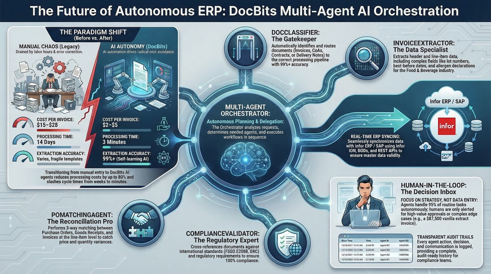
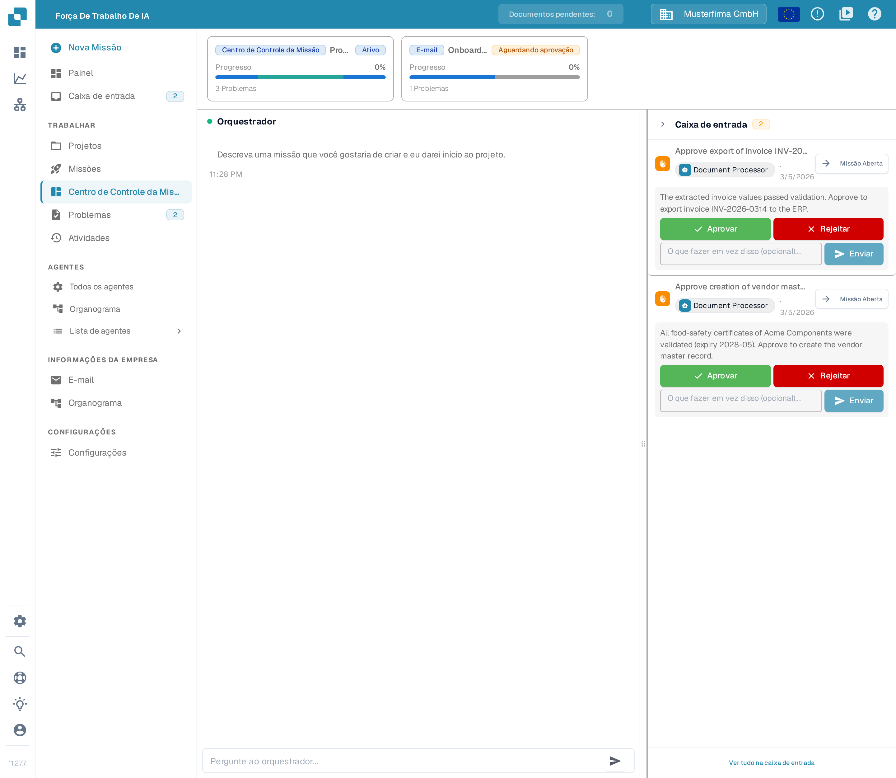
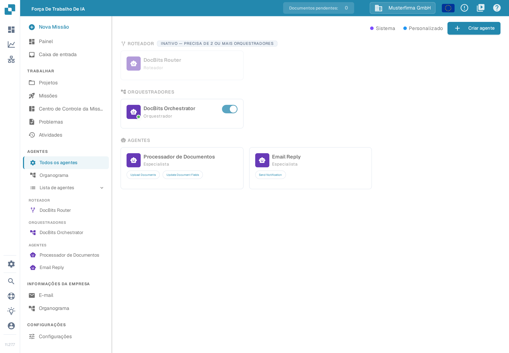
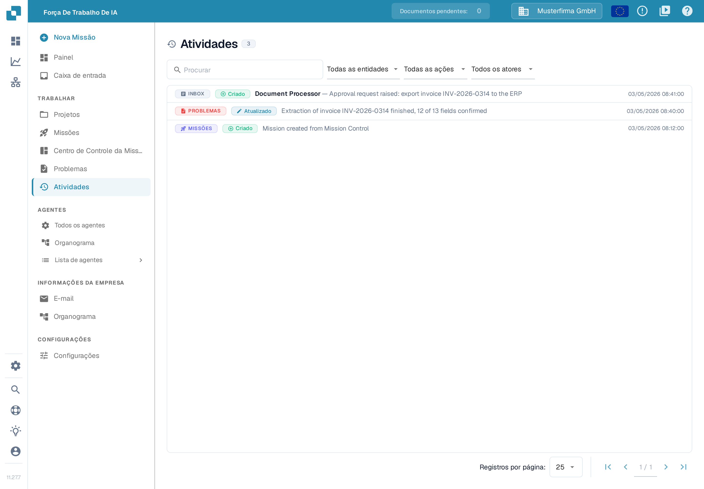

# AI Workforce

<figure><figcaption>
Sistema multiagente da DocBits para o processamento autônomo de documentos
</figcaption></figure>

## Visão geral

O **AI Workforce** é a camada de orquestração dentro da DocBits que transforma o trabalho recebido em agentes de IA coordenados. Em vez de uma pessoa conduzir manualmente cada etapa, ele pega uma unidade de trabalho recebida — um e-mail, uma mensagem de chat no Microsoft Teams ou no Discord, uma ação manual na interface ou uma chamada de API — e a leva até a conclusão: classificando o documento, extraindo e validando campos, comparando com ordens de compra e dados mestre e exportando para o ERP, com humanos participando onde isso importa.

Pense nele como uma equipe que você gerencia, e não como uma ferramenta que você opera. Cada parte do trabalho flui pela mesma estrutura fixa:

* Um **Orquestrador** recebe uma **Missão** (uma unidade de trabalho), a planeja e a delega.
* O plano é dividido em **Problemas** (tarefas individuais), cada um tratado por um **agente Especialista** ou por um **humano**.
* Os Especialistas relatam seus resultados de volta e o Orquestrador sintetiza o resultado.

Os _agentes_ que preenchem esses papéis não são fixos: a DocBits já vem com um **DocBits Orchestrator** pronto para uso e dois especialistas padrão, e você pode criar os seus próprios (consulte [Agentes](./#agentes)).

Uma execução típica, de ponta a ponta: uma fatura chega por e-mail → uma Missão é criada → o Orquestrador a planeja e distribui Problemas aos especialistas (classificar, extrair, validar, comparar com a ordem de compra) → uma etapa sensível é pausada na **Caixa de entrada** para que um humano aprove → após a aprovação, o documento é exportado e a Missão é concluída. Você acompanha todo o processo pelo **Painel**, mantém execuções relacionadas juntas em **Projetos** e intervém pela **Caixa de entrada** e pelos **Problemas** sempre que for necessária uma decisão humana.

## Como ativar

O AI Workforce é habilitado por organização a partir das configurações principais.

1. Acesse **Configurações → Módulos**.
2. Ative o módulo **AI Workforce**.
3. Confirme a assinatura na caixa de diálogo que aparece.

Depois de habilitado, o **AI Workforce** aparece na barra lateral de navegação principal e o espaço de trabalho fica disponível para a sua organização.

## Centro de Controle da Missão

O **Centro de Controle da Missão** é a central de comando onde você **inicia missões e as acompanha ao vivo**. Abra-o pela barra lateral do AI Workforce. A página tem três partes:

<figure><figcaption>
Centro de Controle da Missão: cartões de missão no topo, o chat do Orquestrador no meio e o painel da Caixa de entrada à direita
</figcaption></figure>

* **Cartões de missão** — a faixa no topo mostra as missões ativas no momento, com status, progresso e número de Problemas. Clique em um cartão para abrir a missão.
* **Chat do Orquestrador** — o centro da página. No campo **Pergunte ao orquestrador…** descreva em linguagem simples o que você quer que seja feito, por exemplo _“Processe todas as faturas de fornecedores que chegaram esta semana e compare-as com as suas ordens de compra”_, e envie com a seta à direita do campo. O Orquestrador planeja o trabalho e inicia a missão; você acompanha as respostas no mesmo chat.
* **Painel da Caixa de entrada** — o painel recolhível à direita mostra as solicitações de aprovação pendentes (consulte [Caixa de entrada](./#caixa-de-entrada)). Clique em uma solicitação para lê-la e use **Aprovar**, **Rejeitar** ou escreva no campo de texto e envie ao agente com **Enviar**; **Missão Aberta** abre a missão à qual a solicitação pertence, e uma solicitação que não precisa de decisão pode ser deixada de lado. O número no painel mostra quantas solicitações estão à espera. Com **Ver tudo na caixa de entrada** você abre a lista completa. As mesmas solicitações também aparecem em **Caixa de entrada** na barra lateral.

Para criar uma missão, você também pode pressionar **Nova Missão** na barra lateral do AI Workforce — o item leva ao mesmo chat.

## Lista de agentes

A **Lista de agentes** mostra todos os agentes da sua organização em um relance — o **Roteador**, os seus **Orquestradores** e todos os **Especialistas** — agrupados nessa ordem.

<figure><figcaption>
Lista de agentes: o Roteador no topo, depois os Orquestradores e os Especialistas; a legenda distingue agentes do sistema e personalizados
</figcaption></figure>

Cada cartão mostra o **nome** do agente, o seu **papel**, as **habilidades** que ele pode usar e o seu status atual. A partir do cartão, você pode:

* **Abrir o agente** — clique no cartão para abrir o perfil completo, com todas as [Configurações do agente](./#configuracoes-do-agente).
* **Ativar ou desativar** — use o interruptor nos cartões dos Orquestradores. O sistema só permite desativar um Orquestrador enquanto ao menos um outro Orquestrador continuar ativo, e com dois ou mais Orquestradores ativos o **Roteador** assume o despacho (consulte [Regras de hierarquia e ativação](./#regras-de-hierarquia-e-ativacao)).
* **Editar ou excluir** — agentes personalizados (marcados na legenda como **Personalizado**) têm um menu com essas duas ações; agentes do sistema podem ser configurados, mas não excluídos.
* **Criar agente** — o botão no canto superior direito inicia o assistente de um novo agente (consulte [Criando agentes personalizados](./#criando-agentes-personalizados)).

Enquanto houver menos de dois Orquestradores ativos, o cartão do Roteador fica esmaecido e mostra **INATIVO — PRECISA DE 2 OU MAIS ORQUESTRADORES**; a partir do segundo Orquestrador ativo ele entra em operação.

A legenda no topo mostra a diferença entre agentes **Sistema** e **Personalizado**, para que você sempre saiba o que veio com a DocBits e o que você mesmo criou.

## Atividades

**Atividades** é o registro do que já aconteceu no seu AI Workforce. Toda alteração — uma missão criada, um Problema atualizado, uma solicitação de aprovação aberta — aparece aqui como uma linha com três informações:

<figure><figcaption>
Atividades: cada linha mostra a área afetada, o que aconteceu, quem fez e quando
</figcaption></figure>

* a **área** à qual a alteração pertence — Caixa de entrada, Problemas, Missões, Projetos, Agentes ou execuções de agentes — mostrada como um selo colorido à esquerda; o selo da Caixa de entrada aparece como **INBOX**;
* a **ação** executada — por exemplo **Criado** ou **Atualizado** — como um segundo selo;
* o **ator** que provocou a alteração (um agente ou uma pessoa), em destaque, seguido do **resumo** do que aconteceu e da **hora**, à direita.

Use o **campo de busca** (**Procurar**) para encontrar uma entrada específica e os três menus acima da lista — **Todas as entidades**, **Todas as ações** e **Todos os atores** — para filtrar por **área** (entidade), **ação** e **ator**. Clique em uma linha para ir ao item relacionado — por exemplo a missão ou o Problema a que a entrada se refere. Com **Registros por página** você escolhe quantas entradas são exibidas de uma vez, e as setas no canto inferior direito percorrem históricos mais longos.

O registro de Atividades responde à pergunta _“o que o AI Workforce acabou de fazer e quem fez?”_ — útil depois de uma aprovação, ao verificar por que um documento foi classificado de determinada forma ou ao revisar o que os seus agentes personalizados têm feito.

## Painel

O **Painel** é a sua visão geral do AI Workforce — KPIs, gráficos e listas de atividades em um relance. Você escolhe quais métricas são exibidas.

Para configurar as métricas ativas, abra as **Configurações** (ícone de engrenagem) e use o painel **Widgets do Painel**. Ative ou desative cada widget e clique em **Salvar**; sua seleção é armazenada como uma preferência pessoal, de modo que cada usuário pode adaptar a sua própria visualização.

Os widgets disponíveis incluem:

* **Monitoramento da frota** — status ao vivo de todos os seus agentes.
* **Cartões de KPI** — Problemas Abertos, Missões Ativas, Agentes Habilitados, Execuções Hoje, Uso de Tokens e Aprovações Pendentes.
* **Gráficos** — tendência de problemas ao longo do tempo, missões por status, recebimento de e-mails, problemas por prioridade, execuções por dia e uso de tokens por agente.
* **Listas** — missões ativas, atividade recente, aprovações pendentes, seus problemas abertos, agentes em trabalho e itens bloqueados.

## Caixa de entrada

A **Caixa de entrada** é onde o trabalho aguarda **atenção humana**. Quando um agente está prestes a executar uma ferramenta que precisa de autorização, ele pausa a tarefa e levanta uma **solicitação de aprovação** aqui. Isso é Human-in-the-Loop (HITL): a ação não é executada até que uma pessoa decida. Se uma determinada ferramenta precisa de autorização é definido pelo **modo de aprovação** do agente e pelos marcadores de **crítico** de suas ferramentas (consulte [Configurações do agente](./#configuracoes-do-agente)).

Cada item da Caixa de entrada mostra o título da solicitação, o agente que a levantou e uma breve descrição do que precisa de uma decisão. A partir do item, você pode:

* **Aprovar** — permitir que o agente prossiga com a ação.
* **Rejeitar** — interromper a ação.
* **Comentar / enviar uma mensagem** — dar ao agente instruções alternativas antes de ele continuar.
* **Abrir Missão** — ir até a missão à qual este item pertence para obter o contexto completo.

Os itens ficam **Pendentes** até que alguém aja sobre eles e então se tornam **Resolvidos** (ou **Descartados** se o item for deixado de lado sem uma decisão — por exemplo, quando sua missão é cancelada). O item de navegação da Caixa de entrada exibe um emblema com o número de aprovações pendentes, para que nada crítico seja perdido.

## Missões

Uma **Missão** é a unidade de trabalho de nível superior e a execução do agente que persegue um único objetivo. Cada missão pode envolver várias tarefas e é coordenada por um **agente Orquestrador**, que planeja o trabalho, o delega como Problemas aos especialistas, acompanha os resultados e sintetiza o resultado.

Uma missão é criada a partir de sua **origem** — E-mail, Chat (Microsoft Teams ou Discord), Mission Control (manual) ou a API — e carrega esse contexto ao longo de toda a sua vida. Você mesmo pode iniciar uma a partir do **Mission Control**, descrevendo em linguagem simples o que deseja que seja feito; o Orquestrador assume a partir daí.

As missões passam pelos seguintes status:

| Status                      | Significado                                                                 |
| --------------------------- | -------------------------------------------------------------------------- |
| **Planejamento**            | O Orquestrador está analisando a solicitação e construindo um plano.       |
| **Em Processo** _(Ativa)_   | Os agentes especialistas estão executando os problemas planejados.         |
| **Aguardando Aprovação**    | A missão está pausada, aguardando uma decisão humana na Caixa de entrada.  |
| **Concluída**               | Todos os problemas foram concluídos e o objetivo da missão foi alcançado.  |

As missões também podem estar **Em pausa** ou **Canceladas**. Na visualização de detalhes de uma missão, você pode acompanhar seu **progresso**, revisar os **problemas** vinculados, ver o uso de tempo e de tokens, abrir a **linha do tempo** de eventos e **reiniciar**, **editar** ou **excluir** a missão.

## Problemas

Um **Problema** é uma tarefa individual criada para alcançar parte do objetivo de uma missão — por exemplo, _importar um documento_, _enviar uma resposta ao remetente_ ou _aprovar manualmente uma etapa_. Os problemas são tratados por **agentes especialistas** e **humanos**, trabalhando juntos na mesma tarefa.

Cada problema carrega o contexto de que seu responsável precisa e passa por seu próprio ciclo de vida (A Fazer / Em Andamento → Em Revisão → Concluído, ou Erro / Cancelado). Os problemas podem ser atribuídos a um agente ou a uma pessoa, receber uma prioridade (Crítico, Alto, Médio, Baixo), ser vinculados a uma missão e discutidos por meio de comentários.

Você pode visualizar todos os problemas, filtrá-los por status, prioridade, responsável ou missão, agrupá-los por status, prioridade ou responsável e ver **Meus Problemas** — as tarefas atribuídas a você. Criar um problema manualmente permite adicionar trabalho para um agente ou um colega diretamente em uma missão.

## Projetos

Os **Projetos** são pastas que agrupam **Missões** relacionadas — por exemplo, _todas as faturas de um fornecedor específico no 1º trimestre_, depois outro projeto para o _2º trimestre_ e assim por diante. Eles mantêm um grande volume de execuções de agentes organizado e fácil de encontrar.

Ao criar um projeto, você lhe atribui:

* um **Nome** — por exemplo, _"Faturas Acme 1º Trimestre"_;
* uma **Descrição** opcional — sobre o que é o projeto e qual resultado você espera;
* uma **Data de vencimento** opcional — a data até a qual o projeto deve permanecer ativo.

Um projeto está **Ativo** ou **Concluído**. Um projeto com uma data de vencimento **permanece ativo até que essa data seja alcançada** e então é concluído automaticamente — assim, uma coleção trimestral se encerra sozinha no fim do trimestre (a verificação é executada uma vez por dia). Um projeto sem data de vencimento permanece ativo até que você mesmo o conclua. Você também pode concluir ou reabrir um projeto manualmente a qualquer momento. A partir de um projeto, você pode ver quantas missões ele contém e vincular outras missões a ele.

## Agentes

Os agentes são os trabalhadores. Cada agente tem um **papel** que determina o que ele faz no fluxo Orquestrador → Missões → Problemas:

* **Orquestrador** — coordena o trabalho entre vários agentes. Ele recebe uma missão, a planeja, delega as etapas como problemas e sintetiza os resultados. Um orquestrador é necessário para que as missões sejam executadas.
* **Especialista** — executa uma tarefa específica, como importar um documento ou enviar uma resposta de e-mail, e relata de volta ao seu orquestrador.

A DocBits entrega o AI Workforce pronto para uso, com estes agentes padrão:

* **DocBits Orchestrator** — o orquestrador padrão.
* **Document Processor** — importa e processa documentos enviados.
* **Email Reply** — compõe e envia respostas ao remetente.

Estes são **agentes de sistema**: você pode configurar partes deles, mas não pode excluí-los. Você também pode criar seus próprios orquestradores e especialistas ao lado deles.

### Regras de hierarquia e ativação

Como um orquestrador é necessário para executar qualquer missão, a ativação segue algumas regras:

* Os **Orquestradores** têm um botão de **habilitar/desabilitar**, mas um orquestrador só pode ser **desativado se existirem pelo menos dois orquestradores** — o sistema nunca permite que você desligue o último, pois não restaria nada para coordenar as missões.
* Quando **mais de um orquestrador está ativo**, o **System Router** torna-se automaticamente ativo. Sua função é analisar cada missão recebida e delegá-la ao orquestrador certo. Com um único orquestrador, o roteador não é necessário e fica fora do caminho.
* **Os especialistas não têm um botão de habilitar/desabilitar.** Em vez disso, você controla onde eles podem trabalhar **atribuindo-os a orquestradores** (consulte _Agent Pool_ abaixo). Um especialista que não está atribuído a nenhum orquestrador não fica disponível de forma alguma — ele permanece no diretório, mas nenhum orquestrador pode delegar trabalho a ele, portanto, todo especialista deve ser atribuído a pelo menos um orquestrador para ser usado.

Você pode visualizar e reorganizar essas relações no **Org Chart**, que mostra Router → Orquestradores → Especialistas.

### Configurações do agente

Cada agente — de sistema ou personalizado — tem um menu de configurações com as seguintes seções:

* **Prompt** — o prompt de sistema base do agente. _Somente leitura em agentes de sistema._
* **Configurações** — o **modelo** do agente e seu **esforço de raciocínio**. O AI Workforce é executado em um único modelo com capacidade de raciocínio (**DocBits Pro**), portanto, em vez de controles de baixo nível, há um único ajuste — **Esforço de Raciocínio** — que controla o quanto o agente pensa (e, portanto, quanto isso custa):
  * **Nenhum** — o mais rápido e mais barato; sem raciocínio.
  * **Baixo** — tarefas rápidas, raciocínio leve.
  * **Médio** _(padrão)_ — equilíbrio entre qualidade e custo.
  * **Alto** — raciocínio profundo para tarefas mais difíceis; custo mais elevado.
  * **X-Alto** — raciocínio máximo; custo mais alto.
* **Modo de aprovação** — quanto do trabalho do agente precisa de autorização humana na [Caixa de entrada](./#caixa-de-entrada):
  * **Nenhum** — o agente executa todas as ferramentas automaticamente; nada é enviado para aprovação.
  * **Crítico** _(padrão)_ — apenas as ferramentas marcadas como **críticas** exigem aprovação; todo o resto é executado automaticamente. As ferramentas críticas são as ações sensíveis, de escrita/externas (por exemplo, _enviar/importar documento_, _atualizar campos do documento_, _responder a e-mail_, _enviar notificação_). Nesse modo, uma ferramenta crítica **sempre** levanta uma solicitação de aprovação na Caixa de entrada. Você pode ajustar ferramentas individuais (marcar uma ferramenta normalmente segura como necessitando de aprovação ou desmarcar uma crítica) — essas substituições por ferramenta se aplicam apenas no modo Crítico.
  * **Todos** — cada ferramenta que o agente executa exige aprovação.
*   **Instruções personalizadas** — texto livre onde você descreve os hábitos de trabalho do agente (isto é editável mesmo em agentes de sistema). O modelo padrão tem esta aparência:

    > **Classificação:** use o classificador da DocBits no documento enviado. Baseie-se no assunto/corpo do e-mail somente quando nenhum documento tiver sido anexado.
    >
    > **Substituições de campo:** nenhuma — aceite os valores de extração como estão.
    >
    > **Aprovação:** não configurada. (Para exigir aprovação humana para ações específicas, nomeie a ação e o limite.)
    >
    > **Atribuição de projeto:** compare com as descrições dos projetos; prefira deixar a missão não atribuída a forçar uma correspondência ruim. (Para substituir, liste palavras-chave ou padrões de remetente: por exemplo, `supplier@acme.com → Acme Onboarding`.)
* **Habilidades** — as ferramentas que o agente tem permissão de usar (por exemplo, _enviar documentos_ ou _listar usuários_). Cada ferramenta é **crítica** (ações sensíveis de escrita/externas) ou não crítica, o que determina o comportamento de aprovação descrito acima. _Não editável em agentes de sistema._
* **Agent Pool** — _somente orquestradores._ Uma lista dos agentes disponíveis, onde você seleciona a quais especialistas este orquestrador pode delegar trabalho. Um especialista deve ser atribuído a um orquestrador aqui (ou a outro orquestrador) para realizar qualquer trabalho; um que fique sem atribuição em todos os lugares não fica disponível de forma alguma.

### Criando agentes personalizados

Além dos padrões, você pode criar seus próprios **orquestradores** e **especialistas** para se adequar aos seus processos. Abra **Agentes → Criar agente** para iniciar o assistente, que percorre a mesma configuração descrita acima: escolha o **papel** (Orquestrador ou Especialista), dê ao agente um **nome** e uma **descrição** clara (um orquestrador é escolhido a partir desse texto, e um orquestrador escolhe seus especialistas a partir dos deles), escreva seu prompt, escolha suas habilidades, defina seu esforço de raciocínio e — para orquestradores — escolha os especialistas em seu agent pool. Os agentes personalizados podem ser totalmente editados ou excluídos a qualquer momento.

Guias detalhados: [Ligar Teams e Discord](../ai-workforce-chat-connections.md) · [Verificar a memória do agente](../ai-workforce-agent-memory.md).
