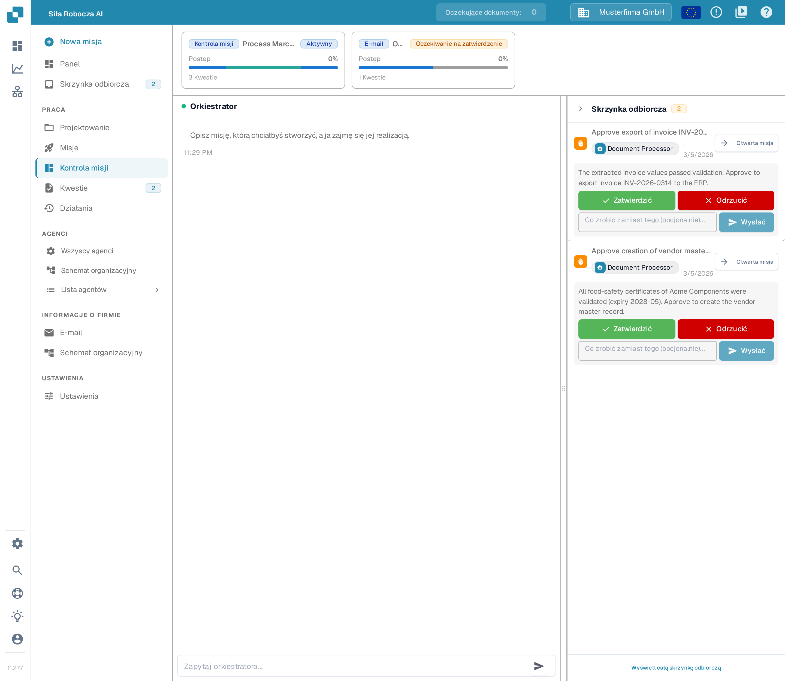
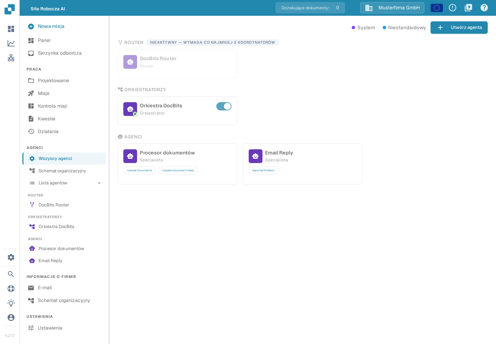
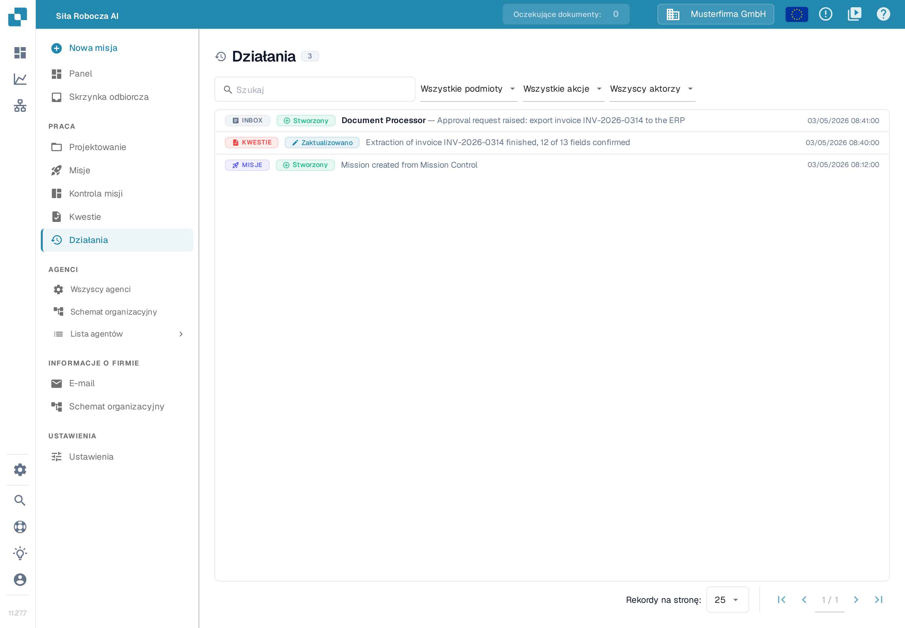

# AI Workforce

<figure><figcaption>
Wieloagentowy system DocBits do autonomicznego przetwarzania dokumentów
</figcaption></figure>

## Przegląd

**AI Workforce** to warstwa orkiestracji w DocBits, która zamienia przychodzącą pracę w skoordynowane działanie agentów AI. Zamiast prowadzić każdy krok ręcznie przez pracownika, warstwa ta pobiera jednostkę przychodzącej pracy — wiadomość e-mail, wiadomość na czacie w Microsoft Teams lub Discord, ręczne działanie w interfejsie lub wywołanie API — i doprowadza ją do końca: klasyfikuje dokument, ekstrahuje i weryfikuje pola, dopasowuje je do zamówień zakupu i danych podstawowych oraz eksportuje do systemu ERP, angażując ludzi tam, gdzie to istotne.

Traktuj to jako zespół, którym zarządzasz, a nie narzędzie, które obsługujesz. Każdy element pracy przepływa przez tę samą, stałą strukturę:

* **Orkiestrator** otrzymuje **Misję** (jedną jednostkę pracy), planuje ją i deleguje.
* Plan jest dzielony na **Kwestie** (pojedyncze zadania), z których każdą zajmuje się **agent Specjalista** lub **człowiek**.
* Specjaliści raportują swoje wyniki, a Orkiestrator scala rezultat.

_Agenci_, którzy wypełniają te role, nie są niezmienni: DocBits dostarcza gotowego do użycia **DocBits Orchestrator** oraz dwóch domyślnych specjalistów, a Ty możesz tworzyć własnych (zobacz [Agenci](./#agenci)).

Typowy przebieg od początku do końca: faktura przychodzi pocztą e-mail → tworzona jest Misja → Orkiestrator planuje ją i rozsyła Kwestie do specjalistów (klasyfikacja, ekstrakcja, weryfikacja, dopasowanie do zamówienia zakupu) → wrażliwy krok wstrzymuje się w **Skrzynce odbiorczej**, oczekując na zatwierdzenie przez człowieka → po zatwierdzeniu dokument zostaje wyeksportowany, a Misja się kończy. Obserwujesz cały ten proces z poziomu **Panelu**, utrzymujesz powiązane przebiegi razem w **Projektach** i wkraczasz do akcji przez **Skrzynkę odbiorczą** oraz **Kwestie**, ilekroć potrzebna jest decyzja człowieka.

## Jak aktywować

AI Workforce jest włączany dla każdej organizacji z poziomu ustawień głównych.

1. Przejdź do **Ustawienia → Moduły**.
2. Włącz moduł **AI Workforce**.
3. Potwierdź subskrypcję w wyświetlonym oknie dialogowym.

Po włączeniu **AI Workforce** pojawia się w głównym pasku nawigacyjnym, a obszar roboczy staje się dostępny dla Twojej organizacji.

## Kontrola misji

**Kontrola misji** to centrum dowodzenia, w którym **rozpoczynasz misje i obserwujesz je na żywo**. Otwórz ją z paska bocznego AI Workforce. Strona składa się z trzech części:

<figure><figcaption>
Kontrola misji: karty misji u góry, czat Orkiestratora pośrodku, panel Skrzynki odbiorczej po prawej
</figcaption></figure>

* **Karty misji** — pasek u góry pokazuje aktualnie aktywne misje wraz z ich statusem, postępem i liczbą kwestii. Kliknij kartę, aby otworzyć misję.
* **Czat Orkiestratora** — środek strony. Opisz zwykłym językiem, co ma zostać wykonane, na przykład _„Przetwórz wszystkie faktury dostawców, które przyszły w tym tygodniu, i dopasuj je do odpowiednich zamówień zakupu”_, a następnie wybierz **Wysłać**. Orkiestrator planuje pracę i rozpoczyna misję; jego odpowiedzi widzisz w tym samym czacie.
* **Panel Skrzynki odbiorczej** — zwijany panel po prawej stronie pokazuje oczekujące prośby o zatwierdzenie (zobacz [Skrzynka odbiorcza](./#skrzynka-odbiorcza)). Kliknij prośbę, aby ją przeczytać, i wybierz **Zatwierdzić**, **Odrzucić** lub odpowiedz agentowi; prośbę, która nie wymaga decyzji, możesz odłożyć na bok. Plakietka **Otwarta misja** prowadzi do misji, do której należy prośba (zobacz [Misje](./#misje)), a link **Wyświetl całą skrzynkę odbiorczą** otwiera pełną listę. Liczba na panelu pokazuje, ile próśb oczekuje; te same prośby pojawiają się także w sekcji **Skrzynka odbiorcza** na pasku bocznym.

Aby utworzyć misję, możesz też wybrać **Nowa misja** na pasku bocznym AI Workforce — prowadzi on do tego samego czatu.

## Lista agentów

**Lista agentów** pokazuje wszystkich agentów w Twojej organizacji w jednym miejscu — **Router**, Twoich **Orkiestratorów** oraz wszystkich **Specjalistów** — pogrupowanych w tej kolejności (sekcje **ROUTER**, **ORKIESTRATORZY** i **AGENCI**).

<figure><figcaption>
Lista agentów: u góry Router, następnie Orkiestratorzy, a potem Specjaliści; legenda oznacza agentów systemowych i niestandardowych
</figcaption></figure>

Każda karta pokazuje **nazwę** agenta, jego **rolę**, **umiejętności**, z których może korzystać, oraz bieżący status. Z poziomu karty możesz:

* **Otworzyć agenta** — kliknij kartę, aby otworzyć pełny profil agenta ze wszystkimi [ustawieniami agenta](./#ustawienia-agenta).
* **Włączyć lub wyłączyć** — użyj przełącznika na kartach orkiestratorów. System pozwala wyłączyć orkiestratora tylko wtedy, gdy co najmniej jeden inny orkiestrator pozostaje włączony, a przy dwóch lub więcej aktywnych orkiestratorach przekazywaniem misji zajmuje się **Router** (zobacz [Hierarchia i reguły aktywacji](./#hierarchia-i-reguly-aktywacji)).
* **Edytować lub usunąć** — agenci niestandardowi (oznaczeni w legendzie jako **Niestandardowy**) mają menu z tymi dwiema opcjami; agentów systemowych można konfigurować, ale nie można ich usunąć.
* **Utworzyć agenta** — przycisk **Utwórz agenta** w prawym górnym rogu uruchamia kreatora nowego agenta (zobacz [Tworzenie niestandardowych agentów](./#tworzenie-niestandardowych-agentow)).

Legenda u góry pokazuje różnicę między agentami **System** i **Niestandardowy**, dzięki czemu zawsze wiesz, co dostarczył DocBits, a co zbudowałeś sam.

## Działania

**Działania** to dziennik tego, co wydarzyło się w Twojej AI Workforce. Każda zmiana — utworzenie misji, aktualizacja kwestii, zgłoszenie prośby o zatwierdzenie — pojawia się tutaj jako wiersz z trzema informacjami:

<figure><figcaption>
Działania: każdy wiersz pokazuje obszar, którego dotyczy zmiana, co się stało, kto to zrobił i kiedy
</figcaption></figure>

* **Obszar**, do którego należy zmiana — Skrzynka odbiorcza, Kwestie, Misje, Projekty, Agenci lub przebiegi agentów — wyświetlany jako kolorowa plakietka po lewej;
* **Akcję**, która została wykonana — na przykład utworzenie, aktualizacja, zatwierdzenie lub odrzucenie — jako druga plakietka;
* **Podsumowanie** zmiany, **aktora**, który ją spowodował (agenta lub osobę), oraz **czas**.

Użyj **pola wyszukiwania**, aby znaleźć konkretny wpis, oraz trzech list rozwijanych nad listą — **Wszystkie podmioty**, **Wszystkie akcje** i **Wszyscy aktorzy** — aby filtrować dziennik według obszaru, akcji i aktora. Kliknij wiersz, aby przejść do powiązanego elementu — na przykład misji lub kwestii, której dotyczy wpis. W polu **Rekordy na stronę** wybierasz, ile wpisów jest wyświetlanych naraz, a strzałki w prawym dolnym rogu pozwalają przeglądać dłuższą historię.

Dziennik działań odpowiada na pytanie _„co AI Workforce właśnie zrobiła i kto to zrobił?”_ — przydaje się po zatwierdzeniu, przy sprawdzaniu, dlaczego dokument został sklasyfikowany w określony sposób, oraz przy przeglądaniu, co robili Twoi niestandardowi agenci.

## Panel

**Panel** to Twój przegląd AI Workforce — wskaźniki KPI, wykresy i listy aktywności w jednym miejscu. Sam wybierasz, które metryki są wyświetlane.

Aby skonfigurować aktywne metryki, otwórz **Ustawienia** (ikona koła zębatego) i skorzystaj z panelu **Widżety panelu**. Włączaj lub wyłączaj poszczególne widżety i **Zapisz**; Twój wybór jest przechowywany jako preferencja osobista, dzięki czemu każdy użytkownik może dostosować własny widok.

Dostępne widżety obejmują:

* **Monitorowanie floty** — status wszystkich Twoich agentów na żywo.
* **Karty KPI** — Otwarte kwestie, Aktywne misje, Włączeni agenci, Dzisiejsze przebiegi, Zużycie tokenów oraz Oczekujące zatwierdzenia.
* **Wykresy** — trend kwestii w czasie, misje według statusu, napływ wiadomości e-mail, kwestie według priorytetu, przebiegi dziennie oraz zużycie tokenów według agenta.
* **Listy** — aktywne misje, ostatnia aktywność, oczekujące zatwierdzenia, Twoje otwarte kwestie, agenci przy pracy oraz zablokowane elementy.

## Skrzynka odbiorcza

**Skrzynka odbiorcza** to miejsce, w którym praca oczekuje na **uwagę człowieka**. Gdy agent ma uruchomić narzędzie wymagające akceptacji, wstrzymuje zadanie i zgłasza tutaj **prośbę o zatwierdzenie**. To Human-in-the-Loop (HITL): działanie nie zostanie uruchomione, dopóki człowiek nie podejmie decyzji. To, czy dane narzędzie wymaga akceptacji, jest określane przez **tryb zatwierdzania** agenta oraz oznaczenia **krytyczne** jego narzędzi (zobacz [Ustawienia agenta](./#ustawienia-agenta)).

Każdy element Skrzynki odbiorczej pokazuje tytuł prośby, agenta, który ją zgłosił, oraz krótki opis tego, co wymaga decyzji. Z poziomu elementu możesz:

* **Zatwierdź** — pozwól agentowi kontynuować działanie.
* **Odrzuć** — zatrzymaj działanie.
* **Skomentuj / wyślij wiadomość** — przekaż agentowi alternatywne instrukcje, zanim będzie kontynuował.
* **Otwórz misję** — przejdź do misji, do której należy ten element, aby uzyskać pełny kontekst.

Elementy pozostają w stanie **Oczekujące**, dopóki ktoś nie podejmie działania, po czym zmieniają się na **Rozwiązane** (lub **Odrzucone**, jeśli element zostanie odłożony bez decyzji — na przykład gdy jego misja zostanie anulowana). Element nawigacji Skrzynka odbiorcza pokazuje odznakę z liczbą oczekujących zatwierdzeń, aby nic krytycznego nie zostało pominięte.

## Misje

**Misja** to nadrzędna jednostka pracy oraz przebieg agenta dążący do osiągnięcia jednego celu. Każda misja może obejmować wiele zadań i jest koordynowana przez **agenta Orkiestratora**, który planuje pracę, deleguje ją jako Kwestie do specjalistów, obserwuje wyniki i scala rezultat.

Misja jest tworzona z jej **źródła** — E-mail, Czat (Microsoft Teams lub Discord), Kontrola misji (ręcznie) lub API — i niesie ten kontekst przez całe swoje życie. Możesz sam ją rozpocząć z poziomu **Kontroli misji**, opisując zwykłym językiem, co ma zostać wykonane; dalej sprawą zajmuje się Orkiestrator.

Misje przechodzą przez następujące statusy:

| Status                       | Znaczenie                                                                     |
| ---------------------------- | ---------------------------------------------------------------------------- |
| **Planowanie**               | Orkiestrator analizuje żądanie i buduje plan.                                 |
| **W toku** _(Aktywna)_       | Agenci Specjaliści realizują zaplanowane kwestie.                             |
| **Oczekuje zatwierdzenia**   | Misja jest wstrzymana, oczekując na decyzję człowieka w Skrzynce odbiorczej. |
| **Zakończona**               | Wszystkie kwestie są ukończone, a cel misji został osiągnięty.               |

Misje mogą również być **Wstrzymane** lub **Anulowane**. Z poziomu widoku szczegółów misji możesz śledzić jej **postęp**, przeglądać powiązane **kwestie**, sprawdzać zużycie czasu i tokenów, otwierać **oś czasu** zdarzeń oraz **uruchamiać ponownie**, **edytować** lub **usuwać** misję.

## Kwestie

**Kwestia** to pojedyncze zadanie utworzone w celu osiągnięcia części celu misji — na przykład _zaimportowanie dokumentu_, _wysłanie odpowiedzi do nadawcy_ lub _ręczne zatwierdzenie kroku_. Kwestiami zajmują się **agenci Specjaliści** oraz **ludzie**, pracując razem nad tym samym zadaniem.

Każda kwestia niesie kontekst potrzebny osobie do niej przypisanej i przechodzi przez własny cykl życia (Do zrobienia / W trakcie → W przeglądzie → Gotowe lub Błąd / Anulowana). Kwestie można przypisać agentowi lub osobie, nadać im priorytet (Krytyczny, Wysoki, Średni, Niski), powiązać z misją oraz omawiać za pomocą komentarzy.

Możesz wyświetlać wszystkie kwestie, filtrować je według statusu, priorytetu, osoby przypisanej lub misji, grupować je według statusu, priorytetu lub osoby przypisanej oraz przeglądać **Moje kwestie** — zadania przypisane do Ciebie. Ręczne utworzenie kwestii pozwala dodać pracę dla agenta lub współpracownika bezpośrednio do misji.

## Projekty

**Projekty** to foldery, które grupują powiązane **Misje** — na przykład _wszystkie faktury od konkretnego dostawcy w I kwartale_, następnie kolejny projekt dla _II kwartału_ i tak dalej. Utrzymują one dużą liczbę wykonań agentów w porządku i ułatwiają ich odnajdywanie.

Tworząc projekt, nadajesz mu:

* **Nazwę** — np. _„Faktury Acme I kw."_;
* opcjonalny **Opis** — czego dotyczy projekt i jakiego wyniku oczekujesz;
* opcjonalny **Termin** — datę, do której projekt powinien pozostać aktywny.

Projekt jest **Aktywny** lub **Zakończony**. Projekt z terminem **pozostaje aktywny, dopóki nie zostanie osiągnięta ta data**, po czym kończy się automatycznie — dzięki temu kwartalny zbiór zamyka się sam z końcem kwartału (sprawdzenie odbywa się raz dziennie). Projekt bez terminu pozostaje aktywny, dopóki sam go nie zakończysz. Możesz również w dowolnym momencie ręcznie zakończyć lub ponownie otworzyć projekt. Z poziomu projektu widzisz, ile misji zawiera, i możesz powiązać z nim kolejne misje.

## Agenci

Agenci to pracownicy. Każdy agent ma **rolę**, która określa, co robi w przepływie Orkiestrator → Misje → Kwestie:

* **Orkiestrator** — koordynuje pracę wielu agentów. Otrzymuje misję, planuje ją, deleguje kroki jako kwestie i scala wyniki. Orkiestrator jest niezbędny, aby misje mogły działać.
* **Specjalista** — realizuje określone zadanie, takie jak zaimportowanie dokumentu lub wysłanie odpowiedzi e-mail, i raportuje do swojego orkiestratora.

DocBits dostarcza AI Workforce gotowe do użycia, z następującymi domyślnymi agentami:

* **DocBits Orchestrator** — domyślny orkiestrator.
* **Document Processor** — importuje i przetwarza przesłane dokumenty.
* **Email Reply** — komponuje i wysyła odpowiedzi do nadawcy.

Są to **agenci systemowi**: możesz konfigurować ich części, ale nie możesz ich usunąć. Możesz również tworzyć obok nich własnych orkiestratorów i specjalistów.

### Hierarchia i reguły aktywacji

Ponieważ do uruchomienia dowolnej misji wymagany jest orkiestrator, aktywacja podlega kilku regułom:

* **Orkiestratorzy** mają przełącznik **włącz/wyłącz**, ale orkiestrator można **dezaktywować tylko wtedy, gdy istnieją co najmniej dwaj orkiestratorzy** — system nigdy nie pozwoli wyłączyć ostatniego, ponieważ nie pozostałby nikt, kto koordynowałby misje.
* Gdy **aktywny jest więcej niż jeden orkiestrator**, automatycznie uaktywnia się **System Router**. Jego zadaniem jest przyjrzenie się każdej przychodzącej misji i przekazanie jej właściwemu orkiestratorowi. Przy pojedynczym orkiestratorze router nie jest potrzebny i pozostaje w tle.
* **Specjaliści nie mają przełącznika włącz/wyłącz.** Zamiast tego kontrolujesz, gdzie mogą pracować, **przypisując ich do orkiestratorów** (zobacz _Agent Pool_ poniżej). Specjalista, który nie jest przypisany do żadnego orkiestratora, nie jest w ogóle dostępny — pozostaje w katalogu, ale żaden orkiestrator nie może delegować mu pracy, więc każdy specjalista musi być przypisany do co najmniej jednego orkiestratora, aby mógł być używany.

Możesz przeglądać i przestawiać te relacje w **Org Chart**, który pokazuje Router → Orkiestratorzy → Specjaliści.

### Ustawienia agenta

Każdy agent — systemowy lub niestandardowy — ma menu ustawień z następującymi sekcjami:

* **Prompt** — bazowy prompt systemowy agenta. _Tylko do odczytu u agentów systemowych._
* **Ustawienia** — **model** agenta oraz jego **poziom rozumowania**. AI Workforce działa na jednym modelu zdolnym do rozumowania (**DocBits Pro**), więc zamiast niskopoziomowych ustawień jest jedno pokrętło — **Poziom rozumowania** — które kontroluje, jak intensywnie agent myśli (a tym samym, ile to kosztuje):
  * **Brak** — najszybszy i najtańszy; bez rozumowania.
  * **Niski** — szybkie zadania, lekkie rozumowanie.
  * **Średni** _(domyślny)_ — zrównoważona jakość i koszt.
  * **Wysoki** — pogłębione rozumowanie do trudniejszych zadań; wyższy koszt.
  * **Bardzo wysoki** — maksymalne rozumowanie; najwyższy koszt.
* **Tryb zatwierdzania** — jaka część pracy agenta wymaga akceptacji człowieka w [Skrzynce odbiorczej](./#skrzynka-odbiorcza):
  * **Brak** — agent uruchamia każde narzędzie automatycznie; nic nie jest wysyłane do zatwierdzenia.
  * **Krytyczne** _(domyślne)_ — akceptacji wymagają tylko narzędzia oznaczone jako **krytyczne**; wszystko inne uruchamia się automatycznie. Narzędzia krytyczne to wrażliwe działania zapisujące/zewnętrzne (na przykład _przesłanie/import dokumentu_, _aktualizacja pól dokumentu_, _odpowiedź na e-mail_, _wysłanie powiadomienia_). W tym trybie narzędzie krytyczne **zawsze** zgłasza prośbę o zatwierdzenie w Skrzynce odbiorczej. Możesz precyzyjnie dostosować poszczególne narzędzia (oznaczyć zwykle bezpieczne narzędzie jako wymagające zatwierdzenia lub zdjąć to oznaczenie z krytycznego) — te nadpisania na poziomie narzędzia obowiązują tylko w trybie Krytyczne.
  * **Wszystkie** — każde narzędzie uruchamiane przez agenta wymaga zatwierdzenia.
*   **Instrukcje niestandardowe** — pole tekstowe, w którym opisujesz nawyki pracy agenta (jest ono edytowalne nawet u agentów systemowych). Domyślny szablon wygląda następująco:

    > **Klasyfikacja:** użyj klasyfikatora DocBits na przesłanym dokumencie. Polegaj na temacie/treści wiadomości e-mail tylko wtedy, gdy nie załączono żadnego dokumentu.
    >
    > **Nadpisania pól:** brak — akceptuj wartości ekstrakcji bez zmian.
    >
    > **Zatwierdzanie:** nieskonfigurowane. (Aby wymagać zatwierdzenia przez człowieka dla określonych działań, nazwij działanie i próg.)
    >
    > **Przypisanie do projektu:** dopasuj do opisów projektów; wolej pozostawić misję nieprzypisaną, niż wymuszać słabe dopasowanie. (Aby nadpisać, wypisz słowa kluczowe lub wzorce nadawców: np. `supplier@acme.com → Acme Onboarding`.)
* **Umiejętności** — narzędzia, których agent może używać (na przykład _przesyłanie dokumentów_ lub _wyświetlanie listy użytkowników_). Każde narzędzie jest albo **krytyczne** (wrażliwe działania zapisujące/zewnętrzne), albo niekrytyczne, co steruje opisanym powyżej zachowaniem zatwierdzania. _Nieedytowalne u agentów systemowych._
* **Agent Pool** — _tylko orkiestratorzy._ Lista dostępnych agentów, na której wybierasz, którym specjalistom ten orkiestrator może delegować pracę. Specjalista musi być tutaj przypisany do orkiestratora (lub do innego orkiestratora), aby wykonywać jakąkolwiek pracę; ten, który wszędzie pozostaje nieprzypisany, nie jest w ogóle dostępny.

### Tworzenie niestandardowych agentów

Poza domyślnymi możesz tworzyć własnych **orkiestratorów** i **specjalistów**, dopasowanych do Twoich procesów. Otwórz **Agenci → Utwórz agenta**, aby uruchomić kreatora, który przeprowadzi przez tę samą konfigurację opisaną powyżej: wybierz **rolę** (Orkiestrator lub Specjalista), nadaj agentowi **nazwę** i jasny **opis** (orkiestrator jest wybierany na podstawie tego tekstu, a orkiestrator wybiera swoich specjalistów na podstawie ich opisów), napisz jego prompt, wybierz jego umiejętności, ustaw jego poziom rozumowania oraz — w przypadku orkiestratorów — wybierz specjalistów w jego puli agentów. Niestandardowych agentów można w dowolnym momencie w pełni edytować lub usunąć.

Szczegółowe instrukcje: [Łączenie Teams i Discord](../ai-workforce-chat-connections.md) · [Sprawdzanie pamięci agenta](../ai-workforce-agent-memory.md).
