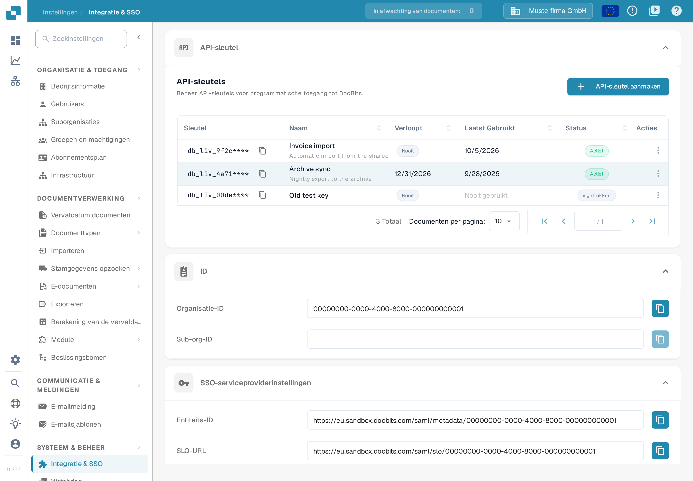

# Leverancier- en Inkoopordergegevens importeren in DocBits vanuit CSV-bestanden

## Overzicht

Deze pagina beschrijft hoe je een CSV-import van leveranciers- of inkoopordergegevens in DocBits voorbereidt.

**Belangrijk:** Controleer het .csv-bestand grondig voordat je gegevens importeert, zodat de gegevens kloppen en de configuratie juist is. Het importeren van onjuiste gegevens kan tot inconsistenties leiden. Raadpleeg de secties [**CSV-specificaties voor Inkooporder**](importing-supplier-and-purchase-order-data-into-docbits-from-csv-files.md#csv-specificaties-voor-inkooporder) en [**CSV-specificaties voor Leverancier**](importing-supplier-and-purchase-order-data-into-docbits-from-csv-files.md#csv-specificaties-voor-leverancier) voor de vereiste en optionele velden en controleer de geaccepteerde kolommen en validatieregels van jouw API-versie voordat je een productiedataset gebruikt.

**Validatie:** Gebruik de onderstaande lijsten als checklist bij de voorbereiding. Controleer de vereiste velden, de extra velden en representatieve rijen voor jouw omgeving; deze lijsten garanderen niet dat elke ongeldige rij het hele bestand afkeurt. Controleer het antwoord en verifieer de bedoelde records zelf.

## Algemene Vereisten:

**Datumformaat:**

Alle datums in het .csv-blad **moeten** de volgende notatie hebben:

YYYY-MM-DD HH:MM:SS

**Vereiste Velden:**

Bereid de hieronder genoemde basisidentificaties voor en valideer ze. Vertrouw er niet op dat een importverzoek de volledigheid of de zakelijke juistheid van je CSV voor jou controleert.

### CSV-specificaties voor Inkooporder

**Basisvelden om voor te bereiden en te valideren**

* `purchase_order_number`

**Velden die kunnen worden opgenomen**

* `warehouse_id`
* `location_id`
* `supplier_id`
* `supplier_name`
* `header_total_amount`
* `order_date`
* `requested_shipment_date`
* `promised_delivery_date`
* `payment_terms_code`
* `total_amount`
* `buyer_contact_id`
* `buyer_contact_name`
* `order_last_modified_by`
* `order_last_modified_on`
* `ship_to_party_id`
* `ship_to_party_name`
* `ship_to_address_id`
* `disponent_id`
* `disponent_name`
* `extended_amount`
* `extended_base_amount`
* `extended_report_amount`
* `canceled_amount`
* `canceled_base_amount`
* `canceled_reporting_amount`
* `geo_code`
* `preview_path`
* `type_code`
* `type_description`
* `custom_field_1`
* `custom_field_2`
* `custom_field_3`
* `custom_field_4`
* `custom_field_5`
* `status`
* `line_number`
* `sub_line_number`
* `item_id`
* `supplier_item_id`
* `description`
* `note`
* `quantity`
* `open_quantity`
* `confirmed_quantity`
* `received_quantity`
* `received_base_mou_quantity`
* `promised_delivery_date`
* `requested_ship_date`
* `unit_of_measure`
* `unit_code_price`
* `unit_price`
* `unit_price_per`
* `extended_amount`
* `total_amount`
* `currency`
* `status`
* `buyer_id`
* `buyer_name`
* `geo_code`
* `delivery_method`

### CSV-specificaties voor Leverancier

**Basisvelden om voor te bereiden en te valideren**

* `customer_number`
* `supplier_number`
* `supplier_name`
* `country_code`

**Velden die kunnen worden opgenomen**

* `address_id`
* `address_1`
* `address_2`
* `address_3`
* `address_4`
* `country_main_division`
* `town_city`
* `zip_code`
* `supplier_phone`
* `supplier_vat`
* `payment_term_id`
* `payment_method_code`
* `buyer_person_reference_id`
* `buyer_person_reference`
* `supplier_category`
* `supplier_group`
* `discount_term`
* `discount_term_description`
* `bank_id`
* `custom_field_1`
* `custom_field_2`
* `custom_field_3`
* `custom_field_4`
* `custom_field_5`
* `custom_field_6`
* `custom_field_7`
* `custom_field_8`
* `custom_field_9`
* `custom_field_10`
* `status`
* `account_id`
* `financial_partner_id`
* `financial_partner_name`
* `iban`
* `currency`

## Toegangseindpunt

### De omgeving en de organisatie kiezen

1. Open de API-referentie van de omgeving die je wilt gebruiken. De productiereferentie is [https://api.docbits.com/](https://api.docbits.com/); gebruik voor testgegevens de testomgeving die je organisatie heeft goedgekeurd. Controleer de API-versie en de waarde bij **Servers** voordat je een aanvraag voorbereidt.
2. Klik voor een geautoriseerde import op **Authorize** en gebruik de API-sleutel die voor de bedoelde organisatie en gebruiker is verstrekt. Kopieer een sleutel nooit naar een schermafbeelding, een CSV-bestand of een gedeeld voorbeeld. Zie [Integratie & SSO](../administration-and-setup/settings/global-settings/integration/README.md) voor het aanmaken en beheren van de inloggegevens.

De interface van de API-referentie is alleen in het Engels beschikbaar. Daarom staan de namen van de bedieningselementen op deze pagina in het Engels en bevat deze pagina geen schermafbeeldingen van de referentie. De onderstaande afbeelding toont in het Nederlands waar je de API-sleutel vindt en waar de identificaties van je organisatie staan.

<figure><figcaption>
In Instellingen → Integratie &amp; SSO maak je de API-sleutel aan: de sectie API-sleutels toont de bestaande sleutels en de knop API-sleutel aanmaken. Op dezelfde pagina staan de waarden Organisatie-ID en Sub-org-ID van je organisatie. De getoonde sleutels, namen en identificaties zijn verzonnen voorbeelden.
</figcaption></figure>

### De importbewerking openen

1. Zoek **POST /master_data_lookup/import_data** en klap de bewerking open.
2. Klik op **Try it out** om het aanvraagformulier van de referentie te activeren. Deze stap voert nog geen import uit. Gebruik **Cancel** om de bewerkingsmodus te verlaten zonder de aanvraag te versturen.

### De aanvraagbody voorbereiden

* **sub_org_id:** Voer de bedoelde, geautoriseerde suborganisatie-ID in wanneer de import bij een suborganisatie hoort. Verwijder anders het gegenereerde voorbeeld `string` en laat het veld bewust leeg met de knop **Send empty value** van het formulier, indien van toepassing. Een leeg veld wijst geen testorganisatie aan en beperkt een vervanging niet tot één suborganisatie: het bereik blijft dan de hele organisatie.
* **data_type:** Voer `supplier` of `purchase_order` in voor de werkstromen die op deze pagina worden beschreven. Vervang het gegenereerde voorbeeld `string`; het veld is verplicht.
* **file / csv_data:** Deze handleiding gebruikt een CSV-bestand. Wis het gegenereerde voorbeeld in **csv_data** voordat je het bestand kiest: niet-lege `csv_data` wordt in de gecontroleerde importer vóór het bestand verwerkt. Kies je gecontroleerde CSV bij **file** en controleer dat de bestandsnaam wordt weergegeven. Laat de voorbeeldwaarden van het formulier niet als inhoud van je aanvraag staan.
* **delimiter:** Kies de werkelijke delimiter van je CSV expliciet: komma (`,`) of puntkomma (`;`). Bekijk de eerste rijen in een teksteditor zonder opmaak. Ga er niet van uit dat de beginselectie met puntkomma in het formulier overeenkomt met het bestand of met de standaardwaarde van de server.

### Vervangings- en conflictopties controleren

Deze beschrijvingen van de opties volgen de gecontroleerde importfunctie. Controleer het bereik van de vervanging en het gedrag bij conflicten voor de API-versie die je gebruikt; de weergaven van de referentie bewijzen die effecten niet.

* **replace_all:** De opgegeven standaardwaarde is `false`. Met `true` worden de bestaande records van het gekozen gegevenstype verwijderd voordat de CSV wordt geladen. Het bereik van de vervanging is de organisatie, met een suborganisatiefilter wanneer je er een opgeeft. Controleer dat bereik expliciet voordat je vervanging gebruikt; een lege `sub_org_id` kan het gekozen gegevenstype in de hele organisatie omvatten. Met `false` worden bestaande records behandeld volgens **on_conflict**.
* **on_conflict:** Kies `IGNORE` om overeenkomende bestaande leveranciers- of inkooporderrecords ongewijzigd te laten, of `REPLACE` om ze uit de CSV bij te werken. De opgegeven standaardwaarde is `REPLACE`. Deze optie beschermt records niet tegen de eerdere verwijderingsstap van **replace_all**.
* **auto_generate_id:** Laat deze op `false` en geef de verplichte zakelijke identificaties in je CSV op. De optionele vlag voor automatische generatie wordt door de gecontroleerde importers voor leveranciers en inkooporders niet gebruikt; reken er niet op dat ontbrekende leveranciers- of inkoopordernummers worden aangemaakt.

Klik pas op **Execute** nadat je de doelomgeving, de organisatie, het suborganisatiebereik, de CSV en de opties hebt gecontroleerd en de import is geautoriseerd. Controleer het antwoord en verifieer de bedoelde records voordat je verdergaat met andere imports. Voor inkooporders zie het [Inkooporderdashboard](../end-user-and-partner-section/end-user-section/purchase-order-dashboard.md). De getoonde afbeelding toont waar je de inloggegevens vindt; de afbeelding bewijst geen uitgevoerde import en geen volledige validatie van de CSV-gegevens.
